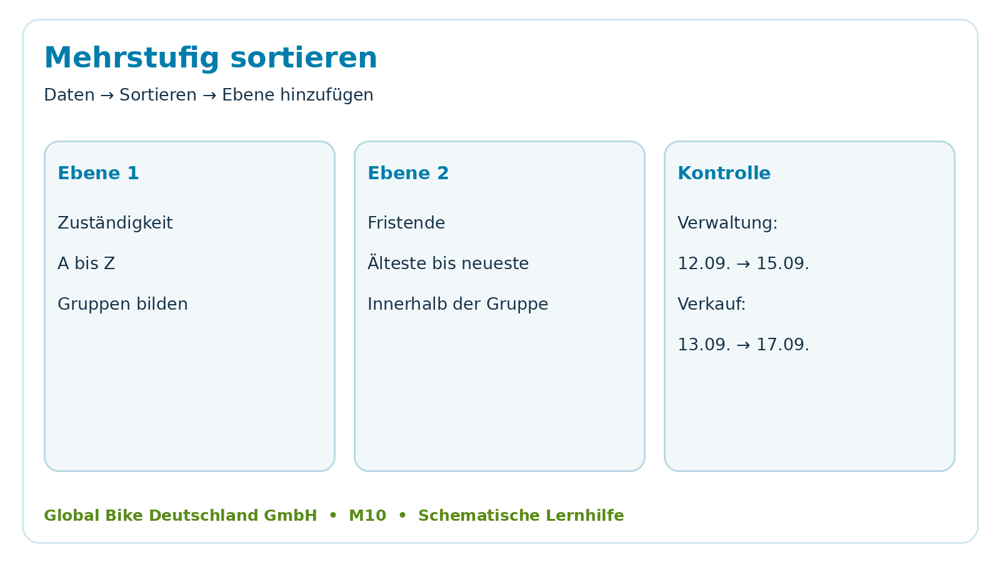

# Ü9 – Betriebliche Listen sortieren und filtern

Global Bike Deutschland GmbH · Verwaltung · Löppt · freiwillig · unbenotet · keine KI

## Ausgangssituation

Emma Fuchs benötigt eine geordnete Übersicht über sechs Kostenbelege und offene Vorgänge. Alle Daten sind simulierte Schulungsdaten, keine SAP-Daten oder Hauptfalllösung. Ü12–Ü14 nutzen bewusst dieselbe Kostenbasis für aufeinander aufbauende Qualitätsaufgaben.

## Das trainieren Sie

F9; Materialien M6, M9, M10.

## Arbeitsdatei

UE9_Arbeitsdatei.xlsx öffnen und Arbeitskopie speichern. Blaue Felder sind Eingaben, grüne Felder vorhandene Formeln. Fehlende Ergebnisse selbst ergänzen.

## Arbeitsaufträge

1.  Sortieren Sie das Blatt Liste nach Kosten absteigend, bei Gleichstand nach ID aufsteigend; bei weiterem Gleichstand nach Datum aufsteigend. Prüfen Sie die Zuordnung aller Zeilen.
2.  Sortieren Sie das Blatt Sortierung nach Bereich A–Z, dann Datum älteste zuerst, dann ID. Daten → Sortieren → Ebene hinzufügen; Überschriften aktivieren.
3.  Filtern Sie das Blatt Filter nach Verkauf UND Offen. Daten → Filter → Textauswahl. Testen Sie zusätzlich Kosten größer 90 und Datum ab 05.11.; löschen Sie anschließend die Zusatzfilter.
4.  Berechnen Sie Rang in F2:F7 mit RANG.GLEICH oder RANG (absteigend, absoluter Vergleichsbereich). Berechnen Sie im Blatt Filter die Gesamtsumme und freiwillig die sichtbare Summe mit TEILERGEBNIS(109;E2:E7).
5.  Erklären Sie gleiche Rangplätze, ausgeblendete Zeilen und die Grenzen einer Kostenpriorisierung. Löschen Sie Filter testweise und stellen Sie den kombinierten Filter wieder her.

## Hilfen bei Bedarf

## Selbstkontrolle

- [ ] Alle Arbeitsaufträge bearbeitet.
- [ ] Daten und Bezugsgrößen geprüft.
- [ ] Ergebnisse und Änderungstests nachvollziehbar.
- [ ] Ausgangswerte wiederhergestellt und Datei gespeichert.

## Freiwillige Vertiefung

Eine zusätzliche plausible Eingabe in einer Testkopie verändern, Ergebnis vorhersagen und prüfen. Keine Pflichtabgabe.

[Excel-Arbeitsdatei herunterladen](UE9_Arbeitsdatei.xlsx)
