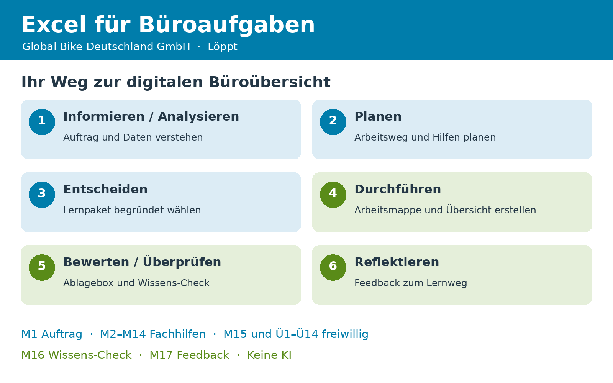

# Orientierung · Excel für Büroaufgaben

Für die Durchführung gelten die Aufträge dieser Lernsituation. Bewerten erfolgt am Produkt per Peer-Check, Reflektieren über das qualitative Feedback zum Unterricht.