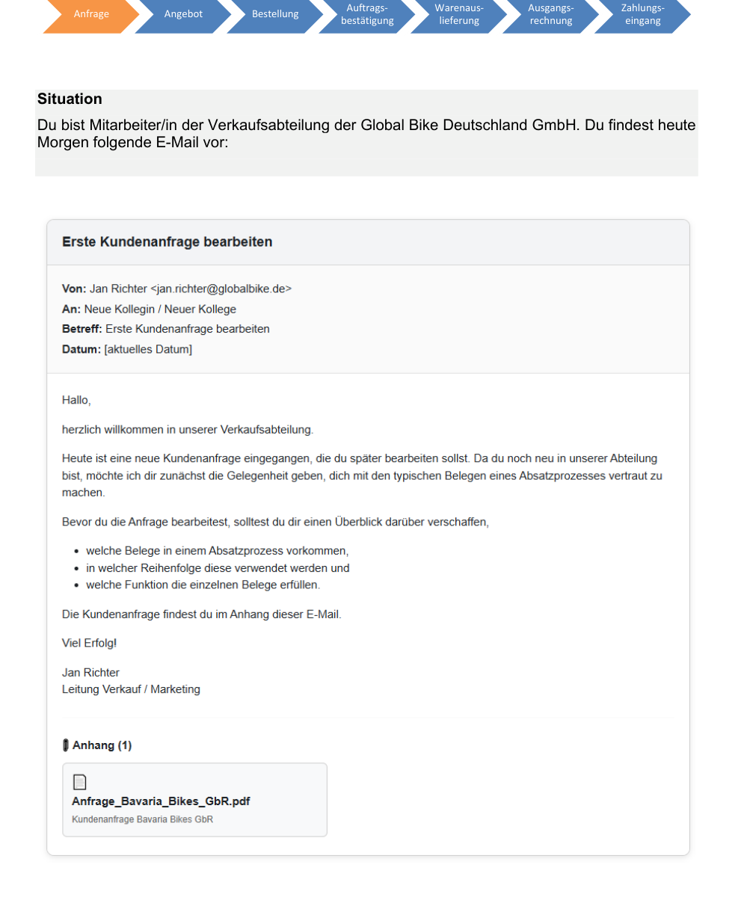

# BFS dual · Lernfeld 2 · LS 2.6b · Absatzvorgänge mit SAP durchführen

**Bildungsgang** · BFS dual, Profil Wirtschaft  
**Lernsituation** · 2.6b · Absatzvorgänge mit SAP durchführen (Paketkennung `BFSDUAL-LF02-LS06B`)  
**Unterrichtlicher Bezug** · Handlungsorientierte Fallbearbeitung bei der Global Bike Deutschland GmbH  
**Zeitrahmen** · 16 Unterrichtsstunden à 45 Minuten, insgesamt 720 Minuten für einen gewählten Lernweg  
**Digitale Fassung** · [Orientierung öffnen](index.html) · [Unterlagen und Downloads](materialien.html)  
**Formgrundlage** · [BFSdual-Vorlage, Arbeitsstand vom 26. November 2026](https://github.com/macmaris83/Lernsituationen/blob/a1dd9b693df1a234bf3c7387198fcf5b5aab6afc/Fachbereiche/BFSdual/Vorlage_Lernsituation.md)

## Aufgabenzeiten

Für jeden der drei Wege gilt derselbe Zeitrahmen. Bei Durchführen zählt der Auftrag zum gewählten Lernpaket einmal.

| Station | Minuten je Lernweg |
| --- | ---: |
| Orientierung | 15 |
| Handlungssituation | 35 |
| Informieren | 75 |
| Fachbegriffscheck | 20 |
| Planen | 50 |
| Entscheiden | 35 |
| Durchführen | 400 |
| Bewerten | 70 |
| Reflektieren | 20 |
| **Gesamt** | **720** |

## Orientierung

[Digitale Fassung öffnen](index.html)

BFS dual · Lernfeld 2 · Lernsituation 2.6b · 16 Unterrichtsstunden

#### Den Auftrag überblicken

Ob ein Auftrag abgeschlossen ist, erkennst du am Zusammenspiel von Vertrieb, Versand und Buchhaltung. Eine Rechnung kann bereits gedruckt sein, während die Forderung noch offen ist. Bei Global Bike verfolgst du drei Kundenaufträge im SAP-Schulungssystem bis zum Zahlungsausgleich.

Drei ausgefüllte Verkaufslaufzettel, je einer für Bavaria Bikes, Drahtesel und Alster Cycling. Jeder Laufzettel enthält die fallbezogenen Organisations- und Artikeldaten sowie die tatsächlich erzeugten Belegnummern. Die Bearbeitung umfasst in jedem Fall den kompletten Vorgang bis zum abgeglichenen Zahlungseingang.

Du entscheidest, welche Aufgaben du selbstständig oder mit anderen bearbeitest. Für die Rückmeldung erhält jede Person ein fremdes Produkt.

15 Minuten

*Fachbuchverweis · Für diesen Auftrag ist keine Buchseite hinterlegt.*

Kompetenzprofil der Lernsituation

Die Gewichtung zeigt, wie häufig und wofür die Kompetenz in den Aufgaben gebraucht wird. 1 bedeutet „kurz in einer Aufgabe“, 6 „von der Vorbereitung bis zur Auswertung“.

| Kompetenz | Gewicht (1–6) | Was übe ich? |
| --- | --- | --- |
| F · Fachkompetenz | 6 / 6 | Ich führe drei vollständige Absatzvorgänge in SAP S/4HANA bis zum Ausgleich der Forderung durch. |
| P · Personalkompetenz | 5 / 6 | Ich prüfe Stammdaten, Mengen, Preis und offenen Posten, bevor ich den nächsten Schritt buche. |
| S · Sozialkompetenz | 4 / 6 | Ich dokumentiere die Übergaben zwischen Verkauf, Versand und Buchhaltung so, dass eine andere Person den Vorgang prüfen kann. |
| M · Methodenkompetenz | 6 / 6 | Ich verknüpfe Folgebelege mit ihren Vorgängern und gleiche Laufzettel und Belegfluss ab. |
| D · Medienkompetenz | 6 / 6 | Ich nutze das SAP-Schulungssystem, die passenden Prozessanleitungen und die Beleganzeige zur Kontrolle. |

## Handlungssituation

[Digitale Fassung öffnen](handlungssituation.html)

 

Interne E-Mail von Jan Richter zur Bearbeitung der Kundenanfrage.

Jan Richter, Leiter Verkauf und Marketing der Global Bike Deutschland GmbH, begrüßt dich in der Verkaufsabteilung. In seinem E-Mail-Anhang liegt die Anfrage der Bavaria Bikes GbR über 100 Wasserflaschen. Zuerst sollst du die Belege in die richtige Reihenfolge bringen und ihre Aufgaben erklären. Anschließend bearbeitest du den Vorgang im SAP-Schulungssystem.

Für Bavaria Bikes gelten im Originalfall die Verkaufsorganisation DS01, der Vertriebsweg EH, die Sparte ZU und das Werk Heidelberg HD01. Später kommen zwei eigenständige Fälle hinzu. Drahtesel e.K. benötigt zehn Verbandskästen, Alster Cycling e.K. zwanzig Fahrradcomputer Basic. Für beide Übungsfälle gelten DN01, GH, ZU und das Werk Hamburg HH01.

Dein Auftrag ist die vollständige Bearbeitung aller drei Absatzvorgänge. Führe je Vorgang einen Laufzettel mit den tatsächlich erzeugten Belegnummern. Prüfe abschließend im SAP-Belegfluss die vollständige Lieferung, die dazugehörige Rechnung und den Ausgleich der Forderung.

14 Minuten

*Fachbuchverweis · Für diesen Auftrag ist keine Buchseite hinterlegt.*

#### Was erwartet Jan Richter vor dem Anlegen des ersten SAP-Belegs?

Lesehilfe

Lies die E-Mail in M1. Sie nennt Reihenfolge und Funktion der Belege.

- ☐ Du ordnest die Belege, erklärst ihre Aufgaben und verschaffst dir einen Überblick über den Ablauf.
- ☐ Du buchst zunächst den voraussichtlichen Erlös für alle drei Fälle.
- ☐ Du legst für jeden Kunden neue Stammdaten an.

7 Minuten

*Fachbuchverweis · Für diesen Auftrag ist keine Buchseite hinterlegt.*

#### Woran erkennst du, dass für die Wasserflaschen andere Organisationsdaten gelten als für die Übungen?

Lesehilfe

Vergleiche in der Handlungssituation Verkaufsorganisation, Vertriebsweg und Werk.

- ☐ Alle drei Vorgänge verwenden DS01, EH und das Heidelberger Werk HD01.
- ☐ Für Bavaria Bikes gelten DS01, EH und HD01. Bei beiden Übungen arbeitest du mit DN01, GH und HH01.
- ☐ Nur der Vertriebsweg wechselt, Verkaufsorganisation und Werk bleiben für alle drei identisch.

7 Minuten

*Fachbuchverweis · Für diesen Auftrag ist keine Buchseite hinterlegt.*

#### Welche drei Nachweise sollen am Ende vorliegen?

Lesehilfe

Jeder Kundenfall erhält ein eigenes Dokument mit seinen tatsächlichen Belegnummern.

- ☐ Drei Angebote mit geschätzten Systemnummern genügen.
- ☐ Ein gemeinsamer Laufzettel ohne Trennung nach Kunde und Wert.
- ☐ Drei getrennte Laufzettel mit den tatsächlich erzeugten Belegnummern und geprüftem Zahlungsstatus.

7 Minuten

*Fachbuchverweis · Für diesen Auftrag ist keine Buchseite hinterlegt.*

## Informieren

[Digitale Fassung öffnen](informieren.html)

Erschließe die Angaben und Unterlagen für deinen Auftrag.

38 Minuten

#### Kundenfall und Organisationsdaten erschließen

Lies die interne E-Mail und die Originalanfrage in [M1](#m1). Erstelle drei getrennte Fallköpfe und kläre die Bedeutung von DS01/EH/ZU und DN01/GH/ZU.

*Fachbuchverweis · Für diesen Auftrag ist keine Buchseite hinterlegt.*

37 Minuten

#### Die Belegfolge rekonstruieren

Ordne in [M2](#m2) die sieben Arbeitsbereiche. Erkläre an zwei Übergängen, welcher Vorgänger für den Folgebeleg gebraucht wird.

*Fachbuchverweis · Für diesen Auftrag ist keine Buchseite hinterlegt.*

[Begriffsblatt zum Nachschlagen](#glossar) · [Begriffe prüfen](#begriffstraining)

## Fachbegriffscheck

[Digitale Fassung öffnen](begriffstraining.html)

Wähle zu jedem Begriff die passende Erklärung. Du kannst den Check wiederholen.

20 Minuten

[Begriffsblatt öffnen](#glossar)

Karte `BFSDUAL-LF02-LS06B-B01`

**1. Kundenanfrage**

- Verbindliche Buchung eines Zahlungseingangs.
- Bitte eines Kunden um Informationen oder ein Angebot.
- Nachweis über den gebuchten Warenausgang.

Karte `BFSDUAL-LF02-LS06B-B02`

**2. Verkaufsorganisation**

- Physischer Lagerplatz eines einzelnen Artikels.
- Organisationseinheit, die für den Verkauf in einem Bereich zuständig ist.
- Nummer der Zahlung eines Kunden.

Karte `BFSDUAL-LF02-LS06B-B03`

**3. Vertriebsweg**

- Verknüpfung zwischen zwei Belegnummern.
- Kanal, über den das Unternehmen Waren verkauft.
- Transportstrecke eines Lieferfahrzeugs.

Karte `BFSDUAL-LF02-LS06B-B04`

**4. Sparte**

- Gliederung des Vertriebs nach Produktbereichen.
- Physischer Platz im Hochregal.
- Geschäftspartner, der die Rechnung bezahlt.

Karte `BFSDUAL-LF02-LS06B-B05`

**5. Angebot**

- Bestätigung, dass eine Rechnung bezahlt ist.
- Vertriebsbeleg mit vorgeschlagener Ware, Menge, Preis und Konditionen für den Kunden.
- Meldung des Lagers über entnommene Ware.

Karte `BFSDUAL-LF02-LS06B-B06`

**6. Kundenreferenz**

- Intern von SAP erzeugte Nummer der Faktura.
- Kennzeichen des Kunden für seine eigene Bestellung.
- Kennung der zuständigen Versandstelle.

Karte `BFSDUAL-LF02-LS06B-B07`

**7. Kundenauftrag**

- Auflistung der offenen Bankumsätze.
- SAP-Vertriebsbeleg über die bestellte Leistung mit den vereinbarten Bedingungen.
- Interne Anmeldung einer neuen Materialnummer.

Karte `BFSDUAL-LF02-LS06B-B08`

**8. Kommissionierung**

- Berechnung der Steuer auf die Rechnung.
- Ausgleich einer offenen Forderung.
- Zusammenstellen der angeforderten Waren für eine Auslieferung.

Karte `BFSDUAL-LF02-LS06B-B09`

**9. Warenausgang**

- Neuanlage des Debitorenstamms.
- Buchung der Warenentnahme für die Lieferung und der entsprechenden Bestandsänderung.
- Eingang einer Anfrage per E-Mail.

Karte `BFSDUAL-LF02-LS06B-B10`

**10. Faktura**

- Abrechnungsbeleg über die erbrachte Lieferung oder Leistung.
- Interner Auftrag zur Lagerentnahme vor dem Versand.
- Bestellung des Händlers bei Global Bike.

Karte `BFSDUAL-LF02-LS06B-B11`

**11. Offener Posten**

- Belegnummer einer bereits stornierten Anfrage.
- Noch nicht zugewiesener Lagerplatz.
- Forderung, die noch nicht ausgeglichen ist.

Karte `BFSDUAL-LF02-LS06B-B12`

**12. Belegfluss**

- Alphabetisches Verzeichnis aller Materialien.
- Verknüpfte Darstellung der Vorgänger- und Folgebelege eines Geschäftsvorgangs.
- Liste der täglichen Marktpreise.

## Planen

[Digitale Fassung öffnen](planen.html)

Entwirf deinen Arbeitsplan.

25 Minuten

#### Arbeitsplatz und Nachweise vorbereiten

Öffne die Laufzettel in [M1](#m1), [M3](#m3) und [M4](#m4). Plane, wann du Stammdaten nachschlägst, Belegnummern sicherst und die Systemwerte vergleichst.

*Fachbuchverweis · Für diesen Auftrag ist keine Buchseite hinterlegt.*

25 Minuten

#### Kontrollpunkte bestimmen

Lege mit [M5](#m5) für jeden Fall Prüfpunkte vor Warenausgang, Faktura und Zahlung fest. Notiere, bei welcher Abweichung du vor der nächsten Buchung Rücksprache hältst.

*Fachbuchverweis · Für diesen Auftrag ist keine Buchseite hinterlegt.*

## Entscheiden

[Digitale Fassung öffnen](entscheiden.html)

Wähle einen von drei gleichwertigen Arbeitswegen. Du kannst deine Wahl begründet ändern.

**Lernpaket wählen**

A · Am Beleg arbeiten · Beginne bei jedem Schritt mit dem Kunden- oder internen Beleg und übertrage die geprüften Werte in SAP. · Dieser Weg passt, wenn du zuerst die Geschäftspost lesen und dann die passenden Felder zuordnen möchtest.

B · Am Prozess arbeiten · Nutze die sieben Prozessstationen als roten Faden und öffne zu jeder Station Beleg und passende Anleitung. · Dieser Weg passt, wenn du Abhängigkeiten von Vertrieb, Versand und Buchhaltung über den Belegfluss verstehen möchtest.

C · Mit Prüfpunkten arbeiten · Gehe vom nächsten benötigten Nachweis aus. Prüfe vor einer Buchung dessen Vorgänger, Mengen und Kontierungsdaten. · Dieser Weg passt, wenn du Arbeitsschritte gern an Kontrollfragen ausrichtest.

Drei ausgefüllte Verkaufslaufzettel, je einer für Bavaria Bikes, Drahtesel und Alster Cycling. Jeder Laufzettel enthält die fallbezogenen Organisations- und Artikeldaten sowie die tatsächlich erzeugten Belegnummern. Die Bearbeitung umfasst in jedem Fall den kompletten Vorgang bis zum abgeglichenen Zahlungseingang.

35 Minuten

#### Arbeitsweg auf alle drei Fälle anwenden

Begründe, ob du vorrangig vom Beleg, von der Prozessstation oder vom nächsten Prüfnachweis ausgehst. Alle drei Zugänge umfassen jeden Kundenfall und dieselben drei Laufzettel.

*Fachbuchverweis · Für diesen Auftrag ist keine Buchseite hinterlegt.*

## Durchführen

[Digitale Fassung öffnen](durchfuehren.html)

Bearbeite den Auftrag im gewählten Format.

[Wähle in Entscheiden dein Lernpaket A, B oder C](#entscheiden), um die Aufträge zu öffnen.

Deine Wahl:  · [Wahl ändern](#entscheiden)

Drei ausgefüllte Verkaufslaufzettel, je einer für Bavaria Bikes, Drahtesel und Alster Cycling. Jeder Laufzettel enthält die fallbezogenen Organisations- und Artikeldaten sowie die tatsächlich erzeugten Belegnummern. Die Bearbeitung umfasst in jedem Fall den kompletten Vorgang bis zum abgeglichenen Zahlungseingang.

80 Minuten

#### Bavaria Bikes vom Bedarf bis zum Zahlungsausgleich bearbeiten

Nutze die sieben Originalbelege und die gleich nummerierten SAP-Anleitungen in [M2](#m2). Prüfe den Vorgänger vor jeder Anlage und trage die vergebenen Nummern unmittelbar in Laufzettel 1 ein.

*Fachbuchverweis · Für diesen Auftrag ist keine Buchseite hinterlegt.*

80 Minuten

#### Drahtesel im Hamburger Vertriebsbereich bearbeiten

Führe mit [M3](#m3) alle sieben Schritte für zehn Verbandskästen durch. Beachte die aktualisierten Termine und die Zahlungsmitteilung. Vergleiche den offenen Posten mit deiner tatsächlichen Rechnung.

*Fachbuchverweis · Für diesen Auftrag ist keine Buchseite hinterlegt.*

160 Minuten

**Lernpaket A**

#### Belege zuordnen und übergeben

Prüfe für jeden Laufzettel, ob du vom eingegangenen Kundenbeleg über die jeweiligen Ausgaben bis zum Ausgleich gelangst. Verwende Belegnummern als Nachweise.

*Fachbuchverweis · Für diesen Auftrag ist keine Buchseite hinterlegt.*

160 Minuten

**Lernpaket B**

#### Prozessübergänge prüfen

Folge für jeden Laufzettel der SAP-Belegkette von Vertrieb über Versand bis Rechnungswesen. Kontrolliere die Vorgänger- und Folgeverknüpfungen.

*Fachbuchverweis · Für diesen Auftrag ist keine Buchseite hinterlegt.*

160 Minuten

**Lernpaket C**

#### Prüfstellen abschließen

Kontrolliere nacheinander Organisationsdaten, Menge, Wert und Zahlungszuordnung der drei Vorgänge. Nutze den Status, um fehlende Buchungen von falsch zugeordneten Belegen zu unterscheiden.

*Fachbuchverweis · Für diesen Auftrag ist keine Buchseite hinterlegt.*

80 Minuten

#### Alster Cycling eigenständig bearbeiten

Bearbeite mit [M4](#m4) den gesamten Vorgang für 20 Fahrradcomputer Basic. Kontrolliere Nettowert, Umsatzsteuer und Zahlungsbetrag. Zeige auf dem dritten Laufzettel den Ausgleich der richtigen Rechnung.

*Fachbuchverweis · Für diesen Auftrag ist keine Buchseite hinterlegt.*

Kriterien für das fertige Produkt

- Jeder Laufzettel gehört eindeutig zu einem Kunden, Artikel, Werk und Vertriebsbereich. Die beiden Übungsfälle bleiben von Bavaria Bikes getrennt.
- Für Anfrage, Angebot, Auftrag, Auslieferung und Faktura sind die tatsächlichen Nummern nachvollziehbar und die Ausgaben dem richtigen Fall zugeordnet.
- Liefermenge, gebuchter Warenausgang, Rechnungswert und tatsächlicher Zahlungseingang passen zusammen. Abweichungen sind vor der Buchung geklärt.
- Die prüfende Person kann aus einem anonymisierten Laufzettel die Belegbezüge und den ausgeglichenen offenen Posten nachvollziehen.

## Bewerten

[Digitale Fassung öffnen](bewerten.html)

Peer-Check am Handlungsprodukt.

18 Minuten

#### Das Produkt für den Peer-Check bereitstellen

**Reiche** deine Arbeit in der Moodle-Aktivität „Peer-Feedback“ ein. Verwende neutrale Titel und Dateinamen. Entferne Namen aus Text und Dateieigenschaften. Bei einem gemeinsamen Produkt reicht jede Person eine Kopie im eigenen Konto ein. Ohne eingerichtete Aktivität verteilt die Lehrkraft codierte Arbeiten.

*Fachbuchverweis · Für diesen Auftrag ist keine Buchseite hinterlegt.*

34 Minuten

#### Ein fremdes Produkt prüfen

**Prüfe** die dir zugeteilte Arbeit mit den Kriterien unten. Benenne eine konkrete Fundstelle, eine fachlich gelungene Stelle und einen begründeten Verbesserungsvorschlag. Gib die Rückmeldung in Moodle oder mit dem [ausfüllbaren Peer-Bogen](#peer-check) ab. Dein Name ist für die empfangende Person sichtbar.

*Fachbuchverweis · Für diesen Auftrag ist keine Buchseite hinterlegt.*

18 Minuten

#### Die empfangene Rückmeldung nutzen

**Lies** das Feedback zu deinem Produkt. Verbessere die genannte Stelle oder begründe am Material, weshalb du deine Fassung beibehältst. Ergebnis ist die für die weitere Verwendung geprüfte Fassung.

*Fachbuchverweis · Für diesen Auftrag ist keine Buchseite hinterlegt.*

### Fachliche Prüfkriterien

- Jeder Laufzettel gehört eindeutig zu einem Kunden, Artikel, Werk und Vertriebsbereich. Die beiden Übungsfälle bleiben von Bavaria Bikes getrennt.
- Für Anfrage, Angebot, Auftrag, Auslieferung und Faktura sind die tatsächlichen Nummern nachvollziehbar und die Ausgaben dem richtigen Fall zugeordnet.
- Liefermenge, gebuchter Warenausgang, Rechnungswert und tatsächlicher Zahlungseingang passen zusammen. Abweichungen sind vor der Buchung geklärt.
- Die prüfende Person kann aus einem anonymisierten Laufzettel die Belegbezüge und den ausgeglichenen offenen Posten nachvollziehen.

[Peer-Check öffnen oder drucken](#peer-check)

## Reflektieren

[Digitale Fassung öffnen](reflektieren.html)

Dein Feedback zum Unterricht.

20 Minuten

#### Feedback zur Lernsituation abgeben

**Fülle** die separate Aktivität „Feedback“ in deinem Moodle-Kurs aus und sende deine Rückmeldung dort ab. Falls hier kein Direktlink angezeigt wird, öffne „Feedback“ in der Kursübersicht.

*Fachbuchverweis · Für diesen Auftrag ist keine Buchseite hinterlegt.*

## Materialien
| Kennung | Unterlage |
| --- | --- |
| HANDBUCH | [SAP-Arbeitshandbuch · alle drei Fälle](#handbuch) |
| M1 | [M1 · Arbeitsauftrag und Laufzettel](#m1) |
| M2 | [M2 · Bavaria Bikes · sieben Arbeitsbereiche](#m2) |
| M3 | [M3 · Drahtesel · zehn Verbandskästen](#m3) |
| M4 | [M4 · Alster Cycling · zwanzig Fahrradcomputer](#m4) |
| M5 | [M5 · Laufzettel und Belegfluss prüfen](#m5) |
| MATERIALIEN | [Materialübersicht und Quellen](#materialien) |
| PEER-CHECK | [Peer-Check · LS 2.6b](#peer-check) |

## SAP-Arbeitshandbuch · alle drei Fälle

[Digitale Fassung öffnen](material/handbuch.html)

**Global Bike Deutschland GmbH | BFS dual | Löppt | SAP S/4HANA**

Ein Lernpaket – drei vollständige Absatzvorgänge. Bearbeiten Sie zuerst den angeleiteten Geschäftsfall. Anschließend festigen Sie Ihre Kenntnisse mit zwei Übungsaufgaben. Nutzen Sie die Anleitungen und führen Sie für jeden Vorgang einen eigenen Laufzettel.

**Hinweis zur Nutzung:** Die SAP-Anleitungen stehen Ihnen auch in analoger Form (Papierform) zur Verfügung.

### Übersicht

1. [Handlungssituation](#handbuch-handlungssituation)
2. [So bearbeiten Sie die Lernsituation](#handbuch-bearbeitung)
3. [Arbeitsaufträge – erster Absatzvorgang](#handbuch-erarbeitung)
4. [SAP-Anleitungen](#handbuch-anleitungen)
5. [Übungsaufgabe 1 – Verbandskästen](#handbuch-uebung1)
6. [Übungsaufgabe 2 – Fahrradcomputer](#handbuch-uebung2)

[Interaktive Gesamt-PDF mit allen Originalbelegen öffnen](material/materialien/Lernsituation_Absatzvorgaenge_SAP_Gesamtpaket.pdf)

### 1. Handlungssituation

Sie sind in der Verkaufsabteilung der Global Bike Deutschland GmbH tätig. Heute Morgen finden Sie folgende E-Mail vor.

#### Erste Kundenanfrage bearbeiten

**Von:** Jan Richter – Leitung Verkauf / Marketing  
 **An:** Neue Kollegin / Neuer Kollege  
 **Betreff:** Erste Kundenanfrage bearbeiten  
 **Datum:** [aktuelles Datum]

Hallo,

herzlich willkommen in unserer Verkaufsabteilung!

Heute ist eine neue Kundenanfrage eingegangen, die du später bearbeiten sollst. Da du noch neu in unserer Abteilung bist, möchte ich dir zunächst die Gelegenheit geben, dich mit den typischen Belegen eines Absatzprozesses vertraut zu machen.

Bevor du die Anfrage bearbeitest, solltest du dir einen Überblick darüber verschaffen,

- welche Belege in einem Absatzprozess vorkommen,
- in welcher Reihenfolge diese verwendet werden und
- welche Funktion die einzelnen Belege erfüllen.

Die Kundenanfrage findest du im Anhang dieser E-Mail.

Viel Erfolg!

Jan Richter  
 Leitung Verkauf / Marketing

[Original-Handlungssituation öffnen](material/materialien/00_Einstieg.pdf) · [Kundenanfrage im Original öffnen](material/materialien/01_Kundenanfrage.pdf)

[Zur Übersicht](#handbuch-uebersicht)

### 2. So bearbeiten Sie die Lernsituation

1. **Arbeitsauftrag aufrufen.** Öffnen Sie den ersten Arbeitsbereich. Lesen Sie die Handlungssituation, die betrieblichen Belege und die dazugehörigen Aufgaben. Bearbeiten Sie die Bereiche in der vorgegebenen Reihenfolge.
2. **SAP-Anleitung nutzen.** Öffnen Sie die Anleitung mit derselben Nummer und führen Sie die Arbeitsschritte im SAP-Schulungssystem durch. Die Anleitungen stehen auch in analoger Form (Papierform) zur Verfügung.
3. **Laufzettel parallel ausfüllen.** Ermitteln Sie die erforderlichen Stammdaten und ergänzen Sie nach jedem Arbeitsschritt die tatsächlich vergebenen Belegnummern. Überprüfen Sie Ihre Eingaben und haken Sie den Arbeitsbereich ab.
4. **Absatzvorgang abschließen.** Kontrollieren Sie den Belegfluss und den Ausgleich der offenen Forderung. Buchen Sie den Zahlungseingang nach Prüfung der offenen Posten und ergänzen Sie den Laufzettel.
5. **Übungsaufgaben durchführen.** Bearbeiten Sie die beiden weiteren Geschäftsfälle möglichst selbstständig. Nutzen Sie bei Bedarf die Anleitungen und führen Sie jeweils einen neuen Laufzettel. Laden Sie die ausgefüllten Laufzettel in die vorgesehene Moodle-Ablagebox hoch.

**Organisatorische Zuordnung:** Bavaria Bikes GbR: DS01 / EH / ZU, Werk HD01 (Originalfall). Beide Übungsfälle: DN01 / GH / ZU, Werk HH01. Verwenden Sie die jeweils im SAP-System hinterlegten Daten. Stammdaten bleiben unverändert.

[Arbeitsaufträge öffnen](#handbuch-erarbeitung) · [Zur Übersicht](#handbuch-uebersicht)

### 3. Arbeitsaufträge – erster Absatzvorgang

**Bavaria Bikes GbR – 100 Wasserflaschen (BOTL1###)**

Bearbeiten Sie alle sieben Bereiche mit den passenden SAP-Anleitungen. Führen Sie für diesen Geschäftsfall einen eigenen [Laufzettel – Verkauf](material/materialien/00_Laufzettel.pdf).

#### Arbeitsfortschritt

- **1. Kundenanfrage bearbeiten** – [Arbeitsauftrag öffnen](material/materialien/01_Kundenanfrage.pdf) · [Anleitung 1 öffnen](material/materialien/Anleitung_01_Kundenanfrage.pdf) · [Kurzauftrag](#handbuch-e1)
- **2. Angebot erstellen** – [Arbeitsauftrag öffnen](material/materialien/02_Angebot.pdf) · [Anleitung 2 öffnen](material/materialien/Anleitung_02_Angebot.pdf) · [Kurzauftrag](#handbuch-e2)
- **3. Bestellung und Auftragsbestätigung bearbeiten** – [Arbeitsauftrag öffnen](material/materialien/03_Bestellung_Auftragsbestaetigung.pdf) · [Anleitung 3 öffnen](material/materialien/Anleitung_03_Bestellung_Auftragsbestaetigung.pdf) · [Kurzauftrag](#handbuch-e3)
- **4. Warenauslieferung durchführen** – [Arbeitsauftrag öffnen](material/materialien/04_Warenauslieferung.pdf) · [Anleitung 4 öffnen](material/materialien/Anleitung_04_Warenauslieferung.pdf) · [Kurzauftrag](#handbuch-e4)
- **5. Ausgangsrechnung erstellen** – [Arbeitsauftrag öffnen](material/materialien/05_Ausgangsrechnung.pdf) · [Anleitung 5 öffnen](material/materialien/Anleitung_05_Ausgangsrechnung.pdf) · [Kurzauftrag](#handbuch-e5)
- **6. Zahlungseingang überwachen und buchen** – [Arbeitsauftrag öffnen](material/materialien/06_Zahlungseingang.pdf) · [Anleitung 6 öffnen](material/materialien/Anleitung_06_Zahlungseingang.pdf) · [Kurzauftrag](#handbuch-e6)
- **7. Vertriebsprozess überprüfen** – [Arbeitsauftrag öffnen](material/materialien/07_Vertriebsprozess.pdf) · [Anleitung 7 öffnen](material/materialien/Anleitung_07_Vertriebsprozess.pdf) · [Kurzauftrag](#handbuch-e7)

#### Einzelne Arbeitsaufträge

##### 3.1 Kundenanfrage bearbeiten

Lesen Sie die Kundenanfrage über 100 Wasserflaschen (BOTL1###). Erläutern Sie Vor- und Nachteile eines Laufzettels. Füllen Sie dessen Kopf anhand der SAP-Stammdaten aus und ermitteln Sie die Lieferungs- und Zahlungsbedingungen. Legen Sie die Anfrage an und ergänzen Sie den Laufzettel.

[Original-Arbeitsauftrag mit Belegen öffnen](material/materialien/01_Kundenanfrage.pdf) · [Anleitung 1 öffnen](material/materialien/Anleitung_01_Kundenanfrage.pdf)

[Zur Arbeitsübersicht](#handbuch-erarbeitung)

##### 3.2 Angebot erstellen

Erstellen Sie ein Angebot mit Bezug zur Anfrage (25,00 € netto je Stück, Gültigkeit ein Monat). Erläutern Sie die rechtliche Bedeutung des Angebots und prüfen Sie die Warenverfügbarkeit. Geben Sie das Angebot aus und ergänzen Sie den Laufzettel.

[Original-Arbeitsauftrag mit Belegen öffnen](material/materialien/02_Angebot.pdf) · [Anleitung 2 öffnen](material/materialien/Anleitung_02_Angebot.pdf)

[Zur Arbeitsübersicht](#handbuch-erarbeitung)

##### 3.3 Bestellung und Auftragsbestätigung bearbeiten

Prüfen Sie die Bestellung B-21### über 100 Wasserflaschen (2.500,00 € netto). Erfassen Sie die Kundenreferenz und legen Sie den Terminauftrag mit Bezug zum Angebot gemäß Anleitung an. Geben Sie die Auftragsbestätigung aus und ergänzen Sie den Laufzettel.

[Original-Arbeitsauftrag mit Belegen öffnen](material/materialien/03_Bestellung_Auftragsbestaetigung.pdf) · [Anleitung 3 öffnen](material/materialien/Anleitung_03_Bestellung_Auftragsbestaetigung.pdf)

[Zur Arbeitsübersicht](#handbuch-erarbeitung)

##### 3.4 Warenauslieferung durchführen

Beschreiben Sie die Schritte der Warenauslieferung und die Bedeutung der Versandstelle. Legen Sie die Auslieferung an, kommissionieren Sie die Ware, buchen Sie den Warenausgang und geben Sie den Lieferschein aus. Prüfen Sie den verbleibenden Bestand im Heidelberger Lager (MD04) und ergänzen Sie den Laufzettel. Die Lösungshinweise stehen im Originalabschnitt.

[Original-Arbeitsauftrag mit Belegen öffnen](material/materialien/04_Warenauslieferung.pdf) · [Anleitung 4 öffnen](material/materialien/Anleitung_04_Warenauslieferung.pdf)

[Zur Arbeitsübersicht](#handbuch-erarbeitung)

##### 3.5 Ausgangsrechnung erstellen

Erstellen und prüfen Sie die Ausgangsrechnung, geben Sie diese aus und ergänzen Sie die Rechnungsnummer im Laufzettel.

[Original-Arbeitsauftrag mit Belegen öffnen](material/materialien/05_Ausgangsrechnung.pdf) · [Anleitung 5 öffnen](material/materialien/Anleitung_05_Ausgangsrechnung.pdf)

[Zur Arbeitsübersicht](#handbuch-erarbeitung)

##### 3.6 Zahlungseingang überwachen und buchen

Beschreiben Sie den Geschäftsfall aus dem Originalbeleg und prüfen Sie die offenen Posten. Ergänzend zum Originalauftrag: Buchen Sie den Zahlungseingang gemäß Anleitung, kontrollieren Sie den Ausgleich und ergänzen Sie den Laufzettel.

[Original-Arbeitsauftrag mit Belegen öffnen](material/materialien/06_Zahlungseingang.pdf) · [Anleitung 6 öffnen](material/materialien/Anleitung_06_Zahlungseingang.pdf)

[Zur Arbeitsübersicht](#handbuch-erarbeitung)

##### 3.7 Vertriebsprozess überprüfen

Rufen Sie den Belegfluss in SAP auf und vergleichen Sie die Belegnummern mit dem Laufzettel. Prüfen Sie den Abschluss des Vorgangs und erläutern Sie, warum der Vertriebsprozess überwacht werden muss.

[Original-Arbeitsauftrag mit Belegen öffnen](material/materialien/07_Vertriebsprozess.pdf) · [Anleitung 7 öffnen](material/materialien/Anleitung_07_Vertriebsprozess.pdf)

[Zur Arbeitsübersicht](#handbuch-erarbeitung)

### 4. SAP-Anleitungen

**Hinweis:** Die SAP-Anleitungen stehen Ihnen auch in analoger Form (Papierform) zur Verfügung.

Öffnen Sie den Anleitungsbereich mit derselben Nummer wie Ihr Arbeitsauftrag.

[Interaktive SAP-Anleitungen als Gesamt-PDF öffnen](material/materialien/SAP_Anleitungen_Arbeitsbereiche.pdf)

1. **Kundenanfrage bearbeiten** – [Anleitung 1 öffnen](material/materialien/Anleitung_01_Kundenanfrage.pdf)
2. **Angebot erstellen** – [Anleitung 2 öffnen](material/materialien/Anleitung_02_Angebot.pdf)
3. **Bestellung und Auftragsbestätigung bearbeiten** – [Anleitung 3 öffnen](material/materialien/Anleitung_03_Bestellung_Auftragsbestaetigung.pdf)
4. **Warenauslieferung durchführen** – [Anleitung 4 öffnen](material/materialien/Anleitung_04_Warenauslieferung.pdf)
5. **Ausgangsrechnung erstellen** – [Anleitung 5 öffnen](material/materialien/Anleitung_05_Ausgangsrechnung.pdf)
6. **Zahlungseingang überwachen und buchen** – [Anleitung 6 öffnen](material/materialien/Anleitung_06_Zahlungseingang.pdf)
7. **Vertriebsprozess überprüfen** – [Anleitung 7 öffnen](material/materialien/Anleitung_07_Vertriebsprozess.pdf)

[Zur Übersicht](#handbuch-uebersicht)

### 5. Übungsaufgabe 1 – Verbandskästen

#### Handlungssituation

Lisa ist seit einigen Wochen in der Verkaufsabteilung der Global Bike Deutschland GmbH tätig. Die Verkaufsleitung überträgt ihr die eigenverantwortliche Bearbeitung einer Kundenanfrage von Drahtesel e.K. über zehn Verbandskästen. Verschaffen Sie sich zunächst einen Überblick über den Ablauf und bearbeiten Sie den gesamten Absatzvorgang in SAP.

[Original-Handlungssituation öffnen](material/materialien/Uebung1_Handlungssituation.pdf) · [Vollständige Original-Übungsaufgabe öffnen](material/materialien/Uebung1_Verbandskaesten_Original.pdf)

#### Verbindliche Hinweise zur Originalaufgabe

- Jan Richter ist die zuständige Verkaufsleitung; eine zusätzliche Lieferantenanfrage ist nicht Teil dieses Übungsfalls.
- Kunde: Drahtesel e.K., Debitor 15###; Verkaufsorganisation DN01, Vertriebsweg GH, Sparte ZU, Werk HH01. Lagerort und Versandstelle im Schulungssystem prüfen.
- 10 Verbandskästen, Materialgrundnummer FAID1000 (individuelle Nummer im SAP-System ermitteln), 12,50 € netto je Stück. Anfragen und Angebote gelten einen Monat.
- Alte Datumsangaben durch aktuelle Bearbeitungsdaten ersetzen. Gewünschte Lieferung spätestens zehn Tage nach Bestellung; Verfügbarkeit prüfen.
- Die alten Kontostände auf dem Zahlungsbeleg sind nicht gültig. Für die Übung wird eine vollständige Zahlung ohne Skonto simuliert. Bei 19 % Umsatzsteuer beträgt sie 148,75 €. Maßgeblich ist die tatsächliche SAP-Rechnung; Abweichungen vor der Buchung klären.

Führen Sie einen eigenen [Laufzettel – Verkauf](material/materialien/Uebung1_Laufzettel.pdf) parallel zur Bearbeitung.

#### Arbeitsfortschritt

- **1. Kundenanfrage bearbeiten** – [Arbeitsauftrag öffnen](#handbuch-v1) · [Anleitung 1 öffnen](material/materialien/Anleitung_01_Kundenanfrage.pdf)
- **2. Angebot erstellen** – [Arbeitsauftrag öffnen](#handbuch-v2) · [Anleitung 2 öffnen](material/materialien/Anleitung_02_Angebot.pdf)
- **3. Bestellung und Auftragsbestätigung bearbeiten** – [Arbeitsauftrag öffnen](#handbuch-v3) · [Anleitung 3 öffnen](material/materialien/Anleitung_03_Bestellung_Auftragsbestaetigung.pdf)
- **4. Warenauslieferung durchführen** – [Arbeitsauftrag öffnen](#handbuch-v4) · [Anleitung 4 öffnen](material/materialien/Anleitung_04_Warenauslieferung.pdf)
- **5. Ausgangsrechnung erstellen** – [Arbeitsauftrag öffnen](#handbuch-v5) · [Anleitung 5 öffnen](material/materialien/Anleitung_05_Ausgangsrechnung.pdf)
- **6. Zahlungseingang überwachen und buchen** – [Arbeitsauftrag öffnen](#handbuch-v6) · [Anleitung 6 öffnen](material/materialien/Anleitung_06_Zahlungseingang.pdf)
- **7. Vertriebsprozess überprüfen** – [Arbeitsauftrag öffnen](#handbuch-v7) · [Anleitung 7 öffnen](material/materialien/Anleitung_07_Vertriebsprozess.pdf)

##### 5.1 Kundenanfrage bearbeiten

Lesen Sie die Anfrage von Drahtesel e.K. über zehn Verbandskästen. Ermitteln Sie die Stammdaten, ergänzen Sie den Kopf des Laufzettels und legen Sie die Anfrage in SAP an (Gültigkeit ein Monat). Notieren Sie die Belegnummer.

[Original-Arbeitsauftrag öffnen](material/materialien/Uebung1_01.pdf) · [Anleitung 1 öffnen](material/materialien/Anleitung_01_Kundenanfrage.pdf)

[Zur Arbeitsübersicht](#handbuch-uebung1)

##### 5.2 Angebot erstellen

Erstellen Sie mit Bezug zur Anfrage ein Angebot über zehn Verbandskästen zu 12,50 € netto je Stück. Prüfen Sie die Verfügbarkeit, geben Sie das Angebot aus und ergänzen Sie den Laufzettel.

[Original-Arbeitsauftrag öffnen](material/materialien/Uebung1_02.pdf) · [Anleitung 2 öffnen](material/materialien/Anleitung_02_Angebot.pdf)

[Zur Arbeitsübersicht](#handbuch-uebung1)

##### 5.3 Bestellung und Auftragsbestätigung bearbeiten

Prüfen Sie die Bestellung B-03### und erfassen Sie den Kundenauftrag mit Bezug zum Angebot. Erfassen Sie die Kundenreferenz, geben Sie die Auftragsbestätigung aus und notieren Sie die Auftragsnummer.

[Original-Arbeitsauftrag öffnen](material/materialien/Uebung1_03.pdf) · [Anleitung 3 öffnen](material/materialien/Anleitung_03_Bestellung_Auftragsbestaetigung.pdf)

[Zur Arbeitsübersicht](#handbuch-uebung1)

##### 5.4 Warenauslieferung durchführen

Legen Sie die Auslieferung an, kommissionieren Sie die Ware, buchen Sie den Warenausgang und geben Sie den Lieferschein aus. Ergänzen Sie den Laufzettel.

[Original-Arbeitsauftrag öffnen](material/materialien/Uebung1_04.pdf) · [Anleitung 4 öffnen](material/materialien/Anleitung_04_Warenauslieferung.pdf)

[Zur Arbeitsübersicht](#handbuch-uebung1)

##### 5.5 Ausgangsrechnung erstellen

Ergänzen Sie die Rechnungsvorlage unter Beachtung der aktualisierten Hinweise. Erstellen Sie die Rechnung in SAP, geben Sie sie aus und ergänzen Sie den Laufzettel.

[Original-Arbeitsauftrag öffnen](material/materialien/Uebung1_05.pdf) · [Anleitung 5 öffnen](material/materialien/Anleitung_05_Ausgangsrechnung.pdf)

[Zur Arbeitsübersicht](#handbuch-uebung1)

##### 5.6 Zahlungseingang überwachen und buchen

Ergänzen Sie den Zahlungsbeleg mit den zutreffenden Daten. Verwenden Sie nicht die alten Kontostände. Prüfen Sie die offene Forderung, buchen Sie den vollständigen Zahlungseingang ohne Skonto und ergänzen Sie den Laufzettel.

[Original-Arbeitsauftrag öffnen](material/materialien/Uebung1_06.pdf) · [Anleitung 6 öffnen](material/materialien/Anleitung_06_Zahlungseingang.pdf)

[Zur Arbeitsübersicht](#handbuch-uebung1)

##### 5.7 Vertriebsprozess überprüfen

Rufen Sie den Belegfluss zum Kundenauftrag auf. Prüfen Sie, ob alle erforderlichen Belege vorhanden sind, der Warenausgang gebucht und die Forderung vollständig ausgeglichen ist. Ergänzen Sie den Laufzettel und gleichen Sie die Belegnummern ab.

[Anleitung 7 öffnen](material/materialien/Anleitung_07_Vertriebsprozess.pdf)

[Zur Arbeitsübersicht](#handbuch-uebung1)

[Weiter zu Übungsaufgabe 2](#handbuch-uebung2) · [Zur Übersicht](#handbuch-uebersicht)

### 6. Übungsaufgabe 2 – Fahrradcomputer

#### Handlungssituation

**Weitere Kundenanfrage selbstständig bearbeiten**

**Von:** Jan Richter – Leitung Verkauf / Marketing  
 **An:** Mitarbeitende der Verkaufsabteilung

Hallo,

Ihren ersten Absatzvorgang haben Sie bereits erfolgreich bearbeitet. Unser Kunde Alster Cycling e.K. möchte sein Sortiment erweitern und interessiert sich für unsere Fahrradcomputer.

Bitte bearbeiten Sie den gesamten Absatzvorgang möglichst selbstständig. Die SAP-Anleitungen stehen Ihnen bei Bedarf zur Verfügung. Führen Sie den Laufzettel parallel und prüfen Sie am Ende den Belegfluss.

Viel Erfolg! Jan Richter

Arbeiten Sie mit den vorhandenen SAP-Stammdaten; nehmen Sie keine Stammdatenänderungen vor.

Führen Sie einen eigenen [Laufzettel – Verkauf](material/materialien/Uebung2_Laufzettel.pdf).

#### Arbeitsfortschritt

- **1. Kundenanfrage bearbeiten** – [Arbeitsauftrag öffnen](#handbuch-f1) · [Anleitung 1 öffnen](material/materialien/Anleitung_01_Kundenanfrage.pdf)
- **2. Angebot erstellen** – [Arbeitsauftrag öffnen](#handbuch-f2) · [Anleitung 2 öffnen](material/materialien/Anleitung_02_Angebot.pdf)
- **3. Bestellung und Auftragsbestätigung bearbeiten** – [Arbeitsauftrag öffnen](#handbuch-f3) · [Anleitung 3 öffnen](material/materialien/Anleitung_03_Bestellung_Auftragsbestaetigung.pdf)
- **4. Warenauslieferung durchführen** – [Arbeitsauftrag öffnen](#handbuch-f4) · [Anleitung 4 öffnen](material/materialien/Anleitung_04_Warenauslieferung.pdf)
- **5. Ausgangsrechnung erstellen** – [Arbeitsauftrag öffnen](#handbuch-f5) · [Anleitung 5 öffnen](material/materialien/Anleitung_05_Ausgangsrechnung.pdf)
- **6. Zahlungseingang überwachen und buchen** – [Arbeitsauftrag öffnen](#handbuch-f6) · [Anleitung 6 öffnen](material/materialien/Anleitung_06_Zahlungseingang.pdf)
- **7. Vertriebsprozess überprüfen** – [Arbeitsauftrag öffnen](#handbuch-f7) · [Anleitung 7 öffnen](material/materialien/Anleitung_07_Vertriebsprozess.pdf)

##### 6.1 Kundenanfrage bearbeiten

**Alster Cycling e.K. – Kundenanfrage**

An: Global Bike Deutschland GmbH – Verkaufsabteilung  
 Betreff: Anfrage – Fahrradcomputer Basic

Sehr geehrte Damen und Herren,

zur Erweiterung unseres Sortiments interessieren wir uns für 20 Fahrradcomputer Basic. Bitte unterbreiten Sie uns ein Angebot und teilen Sie uns die Lieferungs- und Zahlungsbedingungen sowie den möglichen Liefertermin mit.

Mit freundlichen Grüßen  
 Alster Cycling e.K. – Einkaufsabteilung

**Stammdaten:** Debitor 11###, DN01, GH, ZU, Werk HH01. Materialgrundnummer FCPT1000; individuelle Materialnummer im Schulungssystem ermitteln.

**Arbeitsauftrag:** Ermitteln Sie die erforderlichen Stammdaten und ergänzen Sie den Kopf des Laufzettels. Legen Sie die Anfrage in SAP an (Gültigkeit: ein Monat). Notieren Sie die Belegnummer.

[Anleitung 1 öffnen](material/materialien/Anleitung_01_Kundenanfrage.pdf) · [Zur Arbeitsübersicht](#handbuch-uebung2)

##### 6.2 Angebot erstellen

**Interne Vorgabe der Verkaufsabteilung:** 20 Fahrradcomputer Basic zu 75,00 € netto je Stück. Nettowarenwert: 1.500,00 €. Angebotsgültigkeit: ein Monat. Lieferungs- und Zahlungsbedingungen gemäß SAP-Stammdaten; Lieferung schnellstmöglich nach Verfügbarkeit.

**Arbeitsauftrag:** Prüfen Sie die Warenverfügbarkeit. Legen Sie das Angebot mit Bezug zur Anfrage in SAP an. Kontrollieren Sie Menge, Preis und Konditionen. Geben Sie das Angebot aus und ergänzen Sie den Laufzettel.

[Anleitung 2 öffnen](material/materialien/Anleitung_02_Angebot.pdf) · [Zur Arbeitsübersicht](#handbuch-uebung2)

##### 6.3 Bestellung und Auftragsbestätigung bearbeiten

**Alster Cycling e.K. – Bestellung B-31###**

An: Global Bike Deutschland GmbH – Verkaufsabteilung

Sehr geehrte Damen und Herren,

vielen Dank für Ihr Angebot. Hiermit bestellen wir 20 Fahrradcomputer Basic zum angebotenen Nettopreis von 75,00 € je Stück (Gesamtwert netto: 1.500,00 €). Bitte liefern Sie schnellstmöglich zu den vereinbarten Bedingungen und senden Sie uns eine Auftragsbestätigung.

Mit freundlichen Grüßen  
 Alster Cycling e.K. – Einkaufsabteilung

**Arbeitsauftrag:** Vergleichen Sie die Bestellung mit dem Angebot. Erfassen Sie die Bestellnummer als Kundenreferenz. Legen Sie den Terminauftrag mit Bezug zum Angebot an. Geben Sie die Auftragsbestätigung aus und ergänzen Sie den Laufzettel.

[Anleitung 3 öffnen](material/materialien/Anleitung_03_Bestellung_Auftragsbestaetigung.pdf) · [Zur Arbeitsübersicht](#handbuch-uebung2)

##### 6.4 Warenauslieferung durchführen

**Interner Auftrag – Versand:** Der Kundenauftrag ist bestätigt. Die Ware soll nun vollständig ausgeliefert werden. Verwenden Sie das Werk Hamburg (HH01) und prüfen Sie die zutreffende Versandstelle sowie den Lagerort.

**Arbeitsauftrag:** Legen Sie die Auslieferung mit Bezug zum Kundenauftrag an. Kommissionieren Sie die Ware, buchen Sie den Warenausgang und geben Sie den Lieferschein aus. Prüfen Sie die ausgelieferte Menge und ergänzen Sie den Laufzettel.

[Anleitung 4 öffnen](material/materialien/Anleitung_04_Warenauslieferung.pdf) · [Zur Arbeitsübersicht](#handbuch-uebung2)

##### 6.5 Ausgangsrechnung erstellen

**Interner Auftrag – Rechnungswesen:** Die Ware wurde ausgeliefert. Erstellen Sie die Ausgangsrechnung für Alster Cycling e.K. auf Grundlage der tatsächlich gebuchten Lieferung.

**Arbeitsauftrag:** Erstellen und kontrollieren Sie die Faktura in SAP. Prüfen Sie Nettowert, Umsatzsteuer, Rechnungsbetrag und Zahlungsbedingungen. Geben Sie die Rechnung aus und ergänzen Sie die Belegnummer im Laufzettel.

[Anleitung 5 öffnen](material/materialien/Anleitung_05_Ausgangsrechnung.pdf) · [Zur Arbeitsübersicht](#handbuch-uebung2)

##### 6.6 Zahlungseingang überwachen und buchen

**Zahlungsmitteilung – Schulungsfall**

| Feld | Angabe |
| --- | --- |
| Auftraggeber | Alster Cycling e.K. |
| Empfänger | Global Bike Deutschland GmbH |
| Verwendungszweck | Rechnung zur Bestellung B-31### |
| Betrag | 1.785,00 € bei 19 % Umsatzsteuer, ohne Skonto |
| Buchungsdatum | Aktuelles Bearbeitungsdatum |

**Arbeitsauftrag:** Prüfen Sie die offene Forderung anhand der tatsächlichen SAP-Rechnung. Stimmen die Werte nicht überein, klären Sie die Ursache vor der Buchung. Buchen Sie den vollständigen Zahlungseingang, kontrollieren Sie den Ausgleich und ergänzen Sie den Laufzettel.

[Anleitung 6 öffnen](material/materialien/Anleitung_06_Zahlungseingang.pdf) · [Zur Arbeitsübersicht](#handbuch-uebung2)

##### 6.7 Vertriebsprozess überprüfen

**Arbeitsauftrag:** Rufen Sie den Belegfluss zum Kundenauftrag auf. Prüfen Sie die Zusammenhänge der Belege, die vollständige Auslieferung und den Ausgleich der offenen Forderung. Gleichen Sie alle Belegnummern mit Ihrem Laufzettel ab.

**Abgabe:** Kontrollieren Sie den Laufzettel auf Vollständigkeit. Laden Sie ihn in die vorgesehene Moodle-Ablagebox hoch.

[Anleitung 7 öffnen](material/materialien/Anleitung_07_Vertriebsprozess.pdf) · [Zur Arbeitsübersicht](#handbuch-uebung2)

### Abschluss und Abgabe

Kontrollieren Sie die drei Absatzvorgänge in SAP anhand der jeweiligen Belegflüsse. Geben Sie die drei vollständig ausgefüllten Laufzettel in der vorgesehenen Moodle-Ablagebox ab.

[Zur Übersicht](#handbuch-uebersicht)

## M1 · Arbeitsauftrag und Laufzettel

[Digitale Fassung öffnen](material/m1.html)

Sie sind in der Verkaufsabteilung der Global Bike Deutschland GmbH tätig. Heute Morgen finden Sie folgende E-Mail vor.

#### Erste Kundenanfrage bearbeiten

**Von:** Jan Richter – Leitung Verkauf / Marketing  
 **An:** Neue Kollegin / Neuer Kollege  
 **Betreff:** Erste Kundenanfrage bearbeiten  
 **Datum:** [aktuelles Datum]

Hallo,

herzlich willkommen in unserer Verkaufsabteilung!

Heute ist eine neue Kundenanfrage eingegangen, die du später bearbeiten sollst. Da du noch neu in unserer Abteilung bist, möchte ich dir zunächst die Gelegenheit geben, dich mit den typischen Belegen eines Absatzprozesses vertraut zu machen.

Bevor du die Anfrage bearbeitest, solltest du dir einen Überblick darüber verschaffen,

- welche Belege in einem Absatzprozess vorkommen,
- in welcher Reihenfolge diese verwendet werden und
- welche Funktion die einzelnen Belege erfüllen.

Die Kundenanfrage findest du im Anhang dieser E-Mail.

Viel Erfolg!

Jan Richter  
 Leitung Verkauf / Marketing

[Original-Handlungssituation öffnen](material/materialien/00_Einstieg.pdf) · [Kundenanfrage im Original öffnen](material/materialien/01_Kundenanfrage.pdf)

### Drei getrennte Fallköpfe

Die Zeichen ### stehen für die persönliche Schulungsnummer. Ermittle fehlende Material- und Kundennummern aus den vorhandenen Stammdaten.

- Bavaria Bikes GbR · 100 Wasserflaschen · BOTL1### · DS01/EH/ZU · Werk HD01. [Laufzettel 1 öffnen](material/materialien/00_Laufzettel.pdf)
- Drahtesel e.K. · 10 Verbandskästen · FAID1000 als Materialgrundnummer · DN01/GH/ZU · Werk HH01. [Laufzettel 2 öffnen](material/materialien/Uebung1_Laufzettel.pdf)
- Alster Cycling e.K. · 20 Fahrradcomputer Basic · FCPT1000 als Materialgrundnummer · DN01/GH/ZU · Werk HH01. [Laufzettel 3 öffnen](material/materialien/Uebung2_Laufzettel.pdf)

## M2 · Bavaria Bikes · sieben Arbeitsbereiche

[Digitale Fassung öffnen](material/m2.html)

Verwende zu jedem Arbeitsbereich den Beleg und die gleich nummerierte SAP-Anleitung. Die Anleitungen können auch ausgedruckt genutzt werden.

**Bavaria Bikes GbR – 100 Wasserflaschen (BOTL1###)**

Bearbeiten Sie alle sieben Bereiche mit den passenden SAP-Anleitungen. Führen Sie für diesen Geschäftsfall einen eigenen [Laufzettel – Verkauf](material/materialien/00_Laufzettel.pdf).

#### Arbeitsfortschritt

- **1. Kundenanfrage bearbeiten** – [Arbeitsauftrag öffnen](material/materialien/01_Kundenanfrage.pdf) · [Anleitung 1 öffnen](material/materialien/Anleitung_01_Kundenanfrage.pdf) · [Kurzauftrag](#m2-e1)
- **2. Angebot erstellen** – [Arbeitsauftrag öffnen](material/materialien/02_Angebot.pdf) · [Anleitung 2 öffnen](material/materialien/Anleitung_02_Angebot.pdf) · [Kurzauftrag](#m2-e2)
- **3. Bestellung und Auftragsbestätigung bearbeiten** – [Arbeitsauftrag öffnen](material/materialien/03_Bestellung_Auftragsbestaetigung.pdf) · [Anleitung 3 öffnen](material/materialien/Anleitung_03_Bestellung_Auftragsbestaetigung.pdf) · [Kurzauftrag](#m2-e3)
- **4. Warenauslieferung durchführen** – [Arbeitsauftrag öffnen](material/materialien/04_Warenauslieferung.pdf) · [Anleitung 4 öffnen](material/materialien/Anleitung_04_Warenauslieferung.pdf) · [Kurzauftrag](#m2-e4)
- **5. Ausgangsrechnung erstellen** – [Arbeitsauftrag öffnen](material/materialien/05_Ausgangsrechnung.pdf) · [Anleitung 5 öffnen](material/materialien/Anleitung_05_Ausgangsrechnung.pdf) · [Kurzauftrag](#m2-e5)
- **6. Zahlungseingang überwachen und buchen** – [Arbeitsauftrag öffnen](material/materialien/06_Zahlungseingang.pdf) · [Anleitung 6 öffnen](material/materialien/Anleitung_06_Zahlungseingang.pdf) · [Kurzauftrag](#m2-e6)
- **7. Vertriebsprozess überprüfen** – [Arbeitsauftrag öffnen](material/materialien/07_Vertriebsprozess.pdf) · [Anleitung 7 öffnen](material/materialien/Anleitung_07_Vertriebsprozess.pdf) · [Kurzauftrag](#m2-e7)

#### Einzelne Arbeitsaufträge

##### 3.1 Kundenanfrage bearbeiten

Lesen Sie die Kundenanfrage über 100 Wasserflaschen (BOTL1###). Erläutern Sie Vor- und Nachteile eines Laufzettels. Füllen Sie dessen Kopf anhand der SAP-Stammdaten aus und ermitteln Sie die Lieferungs- und Zahlungsbedingungen. Legen Sie die Anfrage an und ergänzen Sie den Laufzettel.

[Original-Arbeitsauftrag mit Belegen öffnen](material/materialien/01_Kundenanfrage.pdf) · [Anleitung 1 öffnen](material/materialien/Anleitung_01_Kundenanfrage.pdf)

[Zur Arbeitsübersicht](#m2-erarbeitung)

##### 3.2 Angebot erstellen

Erstellen Sie ein Angebot mit Bezug zur Anfrage (25,00 € netto je Stück, Gültigkeit ein Monat). Erläutern Sie die rechtliche Bedeutung des Angebots und prüfen Sie die Warenverfügbarkeit. Geben Sie das Angebot aus und ergänzen Sie den Laufzettel.

[Original-Arbeitsauftrag mit Belegen öffnen](material/materialien/02_Angebot.pdf) · [Anleitung 2 öffnen](material/materialien/Anleitung_02_Angebot.pdf)

[Zur Arbeitsübersicht](#m2-erarbeitung)

##### 3.3 Bestellung und Auftragsbestätigung bearbeiten

Prüfen Sie die Bestellung B-21### über 100 Wasserflaschen (2.500,00 € netto). Erfassen Sie die Kundenreferenz und legen Sie den Terminauftrag mit Bezug zum Angebot gemäß Anleitung an. Geben Sie die Auftragsbestätigung aus und ergänzen Sie den Laufzettel.

[Original-Arbeitsauftrag mit Belegen öffnen](material/materialien/03_Bestellung_Auftragsbestaetigung.pdf) · [Anleitung 3 öffnen](material/materialien/Anleitung_03_Bestellung_Auftragsbestaetigung.pdf)

[Zur Arbeitsübersicht](#m2-erarbeitung)

##### 3.4 Warenauslieferung durchführen

Beschreiben Sie die Schritte der Warenauslieferung und die Bedeutung der Versandstelle. Legen Sie die Auslieferung an, kommissionieren Sie die Ware, buchen Sie den Warenausgang und geben Sie den Lieferschein aus. Prüfen Sie den verbleibenden Bestand im Heidelberger Lager (MD04) und ergänzen Sie den Laufzettel. Die Lösungshinweise stehen im Originalabschnitt.

[Original-Arbeitsauftrag mit Belegen öffnen](material/materialien/04_Warenauslieferung.pdf) · [Anleitung 4 öffnen](material/materialien/Anleitung_04_Warenauslieferung.pdf)

[Zur Arbeitsübersicht](#m2-erarbeitung)

##### 3.5 Ausgangsrechnung erstellen

Erstellen und prüfen Sie die Ausgangsrechnung, geben Sie diese aus und ergänzen Sie die Rechnungsnummer im Laufzettel.

[Original-Arbeitsauftrag mit Belegen öffnen](material/materialien/05_Ausgangsrechnung.pdf) · [Anleitung 5 öffnen](material/materialien/Anleitung_05_Ausgangsrechnung.pdf)

[Zur Arbeitsübersicht](#m2-erarbeitung)

##### 3.6 Zahlungseingang überwachen und buchen

Beschreiben Sie den Geschäftsfall aus dem Originalbeleg und prüfen Sie die offenen Posten. Ergänzend zum Originalauftrag: Buchen Sie den Zahlungseingang gemäß Anleitung, kontrollieren Sie den Ausgleich und ergänzen Sie den Laufzettel.

[Original-Arbeitsauftrag mit Belegen öffnen](material/materialien/06_Zahlungseingang.pdf) · [Anleitung 6 öffnen](material/materialien/Anleitung_06_Zahlungseingang.pdf)

[Zur Arbeitsübersicht](#m2-erarbeitung)

##### 3.7 Vertriebsprozess überprüfen

Rufen Sie den Belegfluss in SAP auf und vergleichen Sie die Belegnummern mit dem Laufzettel. Prüfen Sie den Abschluss des Vorgangs und erläutern Sie, warum der Vertriebsprozess überwacht werden muss.

[Original-Arbeitsauftrag mit Belegen öffnen](material/materialien/07_Vertriebsprozess.pdf) · [Anleitung 7 öffnen](material/materialien/Anleitung_07_Vertriebsprozess.pdf)

[Zur Arbeitsübersicht](#m2-erarbeitung)

[Alle sieben Anleitungen zusammen öffnen](material/materialien/SAP_Anleitungen_Arbeitsbereiche.pdf)

### Begriffe für die Belegkontrolle

[Kundenanfrage](#kundenanfrage) · [Verkaufsorganisation](#verkaufsorganisation) · [Vertriebsweg](#vertriebsweg) · [Sparte](#sparte) · [Angebot](#angebot) · [Kundenreferenz](#kundenreferenz) · [Kundenauftrag](#kundenauftrag) · [Kommissionierung](#kommissionierung) · [Warenausgang](#warenausgang) · [Faktura](#faktura) · [Offener Posten](#offener-posten) · [Belegfluss](#belegfluss)

## M3 · Drahtesel · zehn Verbandskästen

[Digitale Fassung öffnen](material/m3.html)

### 5. Übungsaufgabe 1 – Verbandskästen

#### Handlungssituation

Lisa ist seit einigen Wochen in der Verkaufsabteilung der Global Bike Deutschland GmbH tätig. Die Verkaufsleitung überträgt ihr die eigenverantwortliche Bearbeitung einer Kundenanfrage von Drahtesel e.K. über zehn Verbandskästen. Verschaffen Sie sich zunächst einen Überblick über den Ablauf und bearbeiten Sie den gesamten Absatzvorgang in SAP.

[Original-Handlungssituation öffnen](material/materialien/Uebung1_Handlungssituation.pdf) · [Vollständige Original-Übungsaufgabe öffnen](material/materialien/Uebung1_Verbandskaesten_Original.pdf)

#### Verbindliche Hinweise zur Originalaufgabe

- Jan Richter ist die zuständige Verkaufsleitung; eine zusätzliche Lieferantenanfrage ist nicht Teil dieses Übungsfalls.
- Kunde: Drahtesel e.K., Debitor 15###; Verkaufsorganisation DN01, Vertriebsweg GH, Sparte ZU, Werk HH01. Lagerort und Versandstelle im Schulungssystem prüfen.
- 10 Verbandskästen, Materialgrundnummer FAID1000 (individuelle Nummer im SAP-System ermitteln), 12,50 € netto je Stück. Anfragen und Angebote gelten einen Monat.
- Alte Datumsangaben durch aktuelle Bearbeitungsdaten ersetzen. Gewünschte Lieferung spätestens zehn Tage nach Bestellung; Verfügbarkeit prüfen.
- Die alten Kontostände auf dem Zahlungsbeleg sind nicht gültig. Für die Übung wird eine vollständige Zahlung ohne Skonto simuliert. Bei 19 % Umsatzsteuer beträgt sie 148,75 €. Maßgeblich ist die tatsächliche SAP-Rechnung; Abweichungen vor der Buchung klären.

Führen Sie einen eigenen [Laufzettel – Verkauf](material/materialien/Uebung1_Laufzettel.pdf) parallel zur Bearbeitung.

#### Arbeitsfortschritt

- **1. Kundenanfrage bearbeiten** – [Arbeitsauftrag öffnen](#m3-v1) · [Anleitung 1 öffnen](material/materialien/Anleitung_01_Kundenanfrage.pdf)
- **2. Angebot erstellen** – [Arbeitsauftrag öffnen](#m3-v2) · [Anleitung 2 öffnen](material/materialien/Anleitung_02_Angebot.pdf)
- **3. Bestellung und Auftragsbestätigung bearbeiten** – [Arbeitsauftrag öffnen](#m3-v3) · [Anleitung 3 öffnen](material/materialien/Anleitung_03_Bestellung_Auftragsbestaetigung.pdf)
- **4. Warenauslieferung durchführen** – [Arbeitsauftrag öffnen](#m3-v4) · [Anleitung 4 öffnen](material/materialien/Anleitung_04_Warenauslieferung.pdf)
- **5. Ausgangsrechnung erstellen** – [Arbeitsauftrag öffnen](#m3-v5) · [Anleitung 5 öffnen](material/materialien/Anleitung_05_Ausgangsrechnung.pdf)
- **6. Zahlungseingang überwachen und buchen** – [Arbeitsauftrag öffnen](#m3-v6) · [Anleitung 6 öffnen](material/materialien/Anleitung_06_Zahlungseingang.pdf)
- **7. Vertriebsprozess überprüfen** – [Arbeitsauftrag öffnen](#m3-v7) · [Anleitung 7 öffnen](material/materialien/Anleitung_07_Vertriebsprozess.pdf)

##### 5.1 Kundenanfrage bearbeiten

Lesen Sie die Anfrage von Drahtesel e.K. über zehn Verbandskästen. Ermitteln Sie die Stammdaten, ergänzen Sie den Kopf des Laufzettels und legen Sie die Anfrage in SAP an (Gültigkeit ein Monat). Notieren Sie die Belegnummer.

[Original-Arbeitsauftrag öffnen](material/materialien/Uebung1_01.pdf) · [Anleitung 1 öffnen](material/materialien/Anleitung_01_Kundenanfrage.pdf)

[Zur Arbeitsübersicht](#m3-uebung1)

##### 5.2 Angebot erstellen

Erstellen Sie mit Bezug zur Anfrage ein Angebot über zehn Verbandskästen zu 12,50 € netto je Stück. Prüfen Sie die Verfügbarkeit, geben Sie das Angebot aus und ergänzen Sie den Laufzettel.

[Original-Arbeitsauftrag öffnen](material/materialien/Uebung1_02.pdf) · [Anleitung 2 öffnen](material/materialien/Anleitung_02_Angebot.pdf)

[Zur Arbeitsübersicht](#m3-uebung1)

##### 5.3 Bestellung und Auftragsbestätigung bearbeiten

Prüfen Sie die Bestellung B-03### und erfassen Sie den Kundenauftrag mit Bezug zum Angebot. Erfassen Sie die Kundenreferenz, geben Sie die Auftragsbestätigung aus und notieren Sie die Auftragsnummer.

[Original-Arbeitsauftrag öffnen](material/materialien/Uebung1_03.pdf) · [Anleitung 3 öffnen](material/materialien/Anleitung_03_Bestellung_Auftragsbestaetigung.pdf)

[Zur Arbeitsübersicht](#m3-uebung1)

##### 5.4 Warenauslieferung durchführen

Legen Sie die Auslieferung an, kommissionieren Sie die Ware, buchen Sie den Warenausgang und geben Sie den Lieferschein aus. Ergänzen Sie den Laufzettel.

[Original-Arbeitsauftrag öffnen](material/materialien/Uebung1_04.pdf) · [Anleitung 4 öffnen](material/materialien/Anleitung_04_Warenauslieferung.pdf)

[Zur Arbeitsübersicht](#m3-uebung1)

##### 5.5 Ausgangsrechnung erstellen

Ergänzen Sie die Rechnungsvorlage unter Beachtung der aktualisierten Hinweise. Erstellen Sie die Rechnung in SAP, geben Sie sie aus und ergänzen Sie den Laufzettel.

[Original-Arbeitsauftrag öffnen](material/materialien/Uebung1_05.pdf) · [Anleitung 5 öffnen](material/materialien/Anleitung_05_Ausgangsrechnung.pdf)

[Zur Arbeitsübersicht](#m3-uebung1)

##### 5.6 Zahlungseingang überwachen und buchen

Ergänzen Sie den Zahlungsbeleg mit den zutreffenden Daten. Verwenden Sie nicht die alten Kontostände. Prüfen Sie die offene Forderung, buchen Sie den vollständigen Zahlungseingang ohne Skonto und ergänzen Sie den Laufzettel.

[Original-Arbeitsauftrag öffnen](material/materialien/Uebung1_06.pdf) · [Anleitung 6 öffnen](material/materialien/Anleitung_06_Zahlungseingang.pdf)

[Zur Arbeitsübersicht](#m3-uebung1)

##### 5.7 Vertriebsprozess überprüfen

Rufen Sie den Belegfluss zum Kundenauftrag auf. Prüfen Sie, ob alle erforderlichen Belege vorhanden sind, der Warenausgang gebucht und die Forderung vollständig ausgeglichen ist. Ergänzen Sie den Laufzettel und gleichen Sie die Belegnummern ab.

[Anleitung 7 öffnen](material/materialien/Anleitung_07_Vertriebsprozess.pdf)

[Zur Arbeitsübersicht](#m3-uebung1)

[Weiter zu Übungsaufgabe 2](#m4-uebung2) · [Zur Übersicht](#handbuch-uebersicht)

## M4 · Alster Cycling · zwanzig Fahrradcomputer

[Digitale Fassung öffnen](material/m4.html)

### 6. Übungsaufgabe 2 – Fahrradcomputer

#### Handlungssituation

**Weitere Kundenanfrage selbstständig bearbeiten**

**Von:** Jan Richter – Leitung Verkauf / Marketing  
 **An:** Mitarbeitende der Verkaufsabteilung

Hallo,

Ihren ersten Absatzvorgang haben Sie bereits erfolgreich bearbeitet. Unser Kunde Alster Cycling e.K. möchte sein Sortiment erweitern und interessiert sich für unsere Fahrradcomputer.

Bitte bearbeiten Sie den gesamten Absatzvorgang möglichst selbstständig. Die SAP-Anleitungen stehen Ihnen bei Bedarf zur Verfügung. Führen Sie den Laufzettel parallel und prüfen Sie am Ende den Belegfluss.

Viel Erfolg! Jan Richter

Arbeiten Sie mit den vorhandenen SAP-Stammdaten; nehmen Sie keine Stammdatenänderungen vor.

Führen Sie einen eigenen [Laufzettel – Verkauf](material/materialien/Uebung2_Laufzettel.pdf).

#### Arbeitsfortschritt

- **1. Kundenanfrage bearbeiten** – [Arbeitsauftrag öffnen](#m4-f1) · [Anleitung 1 öffnen](material/materialien/Anleitung_01_Kundenanfrage.pdf)
- **2. Angebot erstellen** – [Arbeitsauftrag öffnen](#m4-f2) · [Anleitung 2 öffnen](material/materialien/Anleitung_02_Angebot.pdf)
- **3. Bestellung und Auftragsbestätigung bearbeiten** – [Arbeitsauftrag öffnen](#m4-f3) · [Anleitung 3 öffnen](material/materialien/Anleitung_03_Bestellung_Auftragsbestaetigung.pdf)
- **4. Warenauslieferung durchführen** – [Arbeitsauftrag öffnen](#m4-f4) · [Anleitung 4 öffnen](material/materialien/Anleitung_04_Warenauslieferung.pdf)
- **5. Ausgangsrechnung erstellen** – [Arbeitsauftrag öffnen](#m4-f5) · [Anleitung 5 öffnen](material/materialien/Anleitung_05_Ausgangsrechnung.pdf)
- **6. Zahlungseingang überwachen und buchen** – [Arbeitsauftrag öffnen](#m4-f6) · [Anleitung 6 öffnen](material/materialien/Anleitung_06_Zahlungseingang.pdf)
- **7. Vertriebsprozess überprüfen** – [Arbeitsauftrag öffnen](#m4-f7) · [Anleitung 7 öffnen](material/materialien/Anleitung_07_Vertriebsprozess.pdf)

##### 6.1 Kundenanfrage bearbeiten

**Alster Cycling e.K. – Kundenanfrage**

An: Global Bike Deutschland GmbH – Verkaufsabteilung  
 Betreff: Anfrage – Fahrradcomputer Basic

Sehr geehrte Damen und Herren,

zur Erweiterung unseres Sortiments interessieren wir uns für 20 Fahrradcomputer Basic. Bitte unterbreiten Sie uns ein Angebot und teilen Sie uns die Lieferungs- und Zahlungsbedingungen sowie den möglichen Liefertermin mit.

Mit freundlichen Grüßen  
 Alster Cycling e.K. – Einkaufsabteilung

**Stammdaten:** Debitor 11###, DN01, GH, ZU, Werk HH01. Materialgrundnummer FCPT1000; individuelle Materialnummer im Schulungssystem ermitteln.

**Arbeitsauftrag:** Ermitteln Sie die erforderlichen Stammdaten und ergänzen Sie den Kopf des Laufzettels. Legen Sie die Anfrage in SAP an (Gültigkeit: ein Monat). Notieren Sie die Belegnummer.

[Anleitung 1 öffnen](material/materialien/Anleitung_01_Kundenanfrage.pdf) · [Zur Arbeitsübersicht](#m4-uebung2)

##### 6.2 Angebot erstellen

**Interne Vorgabe der Verkaufsabteilung:** 20 Fahrradcomputer Basic zu 75,00 € netto je Stück. Nettowarenwert: 1.500,00 €. Angebotsgültigkeit: ein Monat. Lieferungs- und Zahlungsbedingungen gemäß SAP-Stammdaten; Lieferung schnellstmöglich nach Verfügbarkeit.

**Arbeitsauftrag:** Prüfen Sie die Warenverfügbarkeit. Legen Sie das Angebot mit Bezug zur Anfrage in SAP an. Kontrollieren Sie Menge, Preis und Konditionen. Geben Sie das Angebot aus und ergänzen Sie den Laufzettel.

[Anleitung 2 öffnen](material/materialien/Anleitung_02_Angebot.pdf) · [Zur Arbeitsübersicht](#m4-uebung2)

##### 6.3 Bestellung und Auftragsbestätigung bearbeiten

**Alster Cycling e.K. – Bestellung B-31###**

An: Global Bike Deutschland GmbH – Verkaufsabteilung

Sehr geehrte Damen und Herren,

vielen Dank für Ihr Angebot. Hiermit bestellen wir 20 Fahrradcomputer Basic zum angebotenen Nettopreis von 75,00 € je Stück (Gesamtwert netto: 1.500,00 €). Bitte liefern Sie schnellstmöglich zu den vereinbarten Bedingungen und senden Sie uns eine Auftragsbestätigung.

Mit freundlichen Grüßen  
 Alster Cycling e.K. – Einkaufsabteilung

**Arbeitsauftrag:** Vergleichen Sie die Bestellung mit dem Angebot. Erfassen Sie die Bestellnummer als Kundenreferenz. Legen Sie den Terminauftrag mit Bezug zum Angebot an. Geben Sie die Auftragsbestätigung aus und ergänzen Sie den Laufzettel.

[Anleitung 3 öffnen](material/materialien/Anleitung_03_Bestellung_Auftragsbestaetigung.pdf) · [Zur Arbeitsübersicht](#m4-uebung2)

##### 6.4 Warenauslieferung durchführen

**Interner Auftrag – Versand:** Der Kundenauftrag ist bestätigt. Die Ware soll nun vollständig ausgeliefert werden. Verwenden Sie das Werk Hamburg (HH01) und prüfen Sie die zutreffende Versandstelle sowie den Lagerort.

**Arbeitsauftrag:** Legen Sie die Auslieferung mit Bezug zum Kundenauftrag an. Kommissionieren Sie die Ware, buchen Sie den Warenausgang und geben Sie den Lieferschein aus. Prüfen Sie die ausgelieferte Menge und ergänzen Sie den Laufzettel.

[Anleitung 4 öffnen](material/materialien/Anleitung_04_Warenauslieferung.pdf) · [Zur Arbeitsübersicht](#m4-uebung2)

##### 6.5 Ausgangsrechnung erstellen

**Interner Auftrag – Rechnungswesen:** Die Ware wurde ausgeliefert. Erstellen Sie die Ausgangsrechnung für Alster Cycling e.K. auf Grundlage der tatsächlich gebuchten Lieferung.

**Arbeitsauftrag:** Erstellen und kontrollieren Sie die Faktura in SAP. Prüfen Sie Nettowert, Umsatzsteuer, Rechnungsbetrag und Zahlungsbedingungen. Geben Sie die Rechnung aus und ergänzen Sie die Belegnummer im Laufzettel.

[Anleitung 5 öffnen](material/materialien/Anleitung_05_Ausgangsrechnung.pdf) · [Zur Arbeitsübersicht](#m4-uebung2)

##### 6.6 Zahlungseingang überwachen und buchen

**Zahlungsmitteilung – Schulungsfall**

| Feld | Angabe |
| --- | --- |
| Auftraggeber | Alster Cycling e.K. |
| Empfänger | Global Bike Deutschland GmbH |
| Verwendungszweck | Rechnung zur Bestellung B-31### |
| Betrag | 1.785,00 € bei 19 % Umsatzsteuer, ohne Skonto |
| Buchungsdatum | Aktuelles Bearbeitungsdatum |

**Arbeitsauftrag:** Prüfen Sie die offene Forderung anhand der tatsächlichen SAP-Rechnung. Stimmen die Werte nicht überein, klären Sie die Ursache vor der Buchung. Buchen Sie den vollständigen Zahlungseingang, kontrollieren Sie den Ausgleich und ergänzen Sie den Laufzettel.

[Anleitung 6 öffnen](material/materialien/Anleitung_06_Zahlungseingang.pdf) · [Zur Arbeitsübersicht](#m4-uebung2)

##### 6.7 Vertriebsprozess überprüfen

**Arbeitsauftrag:** Rufen Sie den Belegfluss zum Kundenauftrag auf. Prüfen Sie die Zusammenhänge der Belege, die vollständige Auslieferung und den Ausgleich der offenen Forderung. Gleichen Sie alle Belegnummern mit Ihrem Laufzettel ab.

**Abgabe:** Kontrollieren Sie den Laufzettel auf Vollständigkeit. Laden Sie ihn in die vorgesehene Moodle-Ablagebox hoch.

[Anleitung 7 öffnen](material/materialien/Anleitung_07_Vertriebsprozess.pdf) · [Zur Arbeitsübersicht](#m4-uebung2)

## M5 · Laufzettel und Belegfluss prüfen

[Digitale Fassung öffnen](material/m5.html)

Rufe bei jedem Kundenauftrag den Belegfluss auf. Vergleiche ihn mit dem zugehörigen Laufzettel und prüfe das Ergebnis anhand der folgenden Fragen.

1. Stimmen Kunde, Vertriebsbereich, Material, Menge und Werk mit dem Fallkopf überein?
2. Sind Angebot, Auftrag und Auslieferung über die passenden Vorgänger verbunden? Ist der Warenausgang über die richtige Menge gebucht?
3. Bezieht sich die Faktura auf diese Lieferung? Stimmen Betrag, offener Posten und Zahlungszuordnung überein?
4. Lässt sich die vollständige Bearbeitung anhand der tatsächlichen SAP-Nummern belegen?

Für den Peer-Check kann die freigegebene, anonymisierte Einreichung geprüft werden. Personenbezogene Kennungen oder Zugangsdaten gehören nicht hinein.

[Belegfluss in SAP anzeigen](material/materialien/Anleitung_07_Vertriebsprozess.pdf) · [Offene Forderung und Ausgleich prüfen](material/materialien/Anleitung_06_Zahlungseingang.pdf)

## Materialübersicht und Quellen

[Digitale Fassung öffnen](materialien.html)

Wähle eine Unterlage für deinen nächsten Arbeitsschritt.

#### [M1 · Arbeitsauftrag und Laufzettel](#m1)

Jan Richters E-Mail, erster Kundenbeleg, Organisationsdaten und drei Laufzettel.

#### [M2 · Bavaria Bikes · sieben Arbeitsbereiche](#m2)

Arbeitsaufträge und sieben passende SAP-Schrittanleitungen zum Originalfall.

#### [M3 · Drahtesel · zehn Verbandskästen](#m3)

Vollständiger Übungsfall mit Originalbelegen, aktualisierten Fristen und korrigierter Zahlungsmitteilung.

#### [M4 · Alster Cycling · zwanzig Fahrradcomputer](#m4)

Kundenanfrage, interne Konditionen, Bestellung und Zahlungsmitteilung zum Fahrradcomputer.

#### [M5 · Laufzettel und Belegfluss prüfen](#m5)

Kontrollfragen und Originalanleitungen für Belegfluss und Forderungsausgleich.

#### [Vollständiges Arbeitshandbuch](#handbuch)

Alle drei Fallstrecken mit internen Sprungmarken, Belegen und Anleitungen.

#### [Interaktive Gesamt-PDF](material/materialien/Lernsituation_Absatzvorgaenge_SAP_Gesamtpaket.pdf)

69 Seiten mit allen Geschäftsunterlagen und den SAP-Arbeitsbereichen; die Lösungsseite zur Warenauslieferung ist durch einen Prüfauftrag ersetzt.

#### [SAP-Anleitungen als PDF](material/materialien/SAP_Anleitungen_Arbeitsbereiche.pdf)

Originale bebilderte Hilfen zum SAP-Schulungssystem.

#### [Arbeitsaufträge als Markdown](material/Lernsituation_Absatzvorgaenge_SAP.md)

Bearbeitbare Textfassung mit den zugehörigen PDF-Belegen.

## Peer-Check · LS 2.6b

[Digitale Fassung öffnen](peer-check.html)

Prüfen Sie das zugeteilte Handlungsprodukt anhand der gemeinsamen fachlichen Kriterien. Eine Fundstelle kann eine Textzeile, ein Bildausschnitt oder eine Zeitmarke in der Übergabe sein.

Was möchten Sie festhalten?

 (Meine Rückmeldung zu einer fremden Arbeit / Meine Entscheidung nach Erhalt der Rückmeldung)

### Peer-Rückmeldung zur zugeteilten Arbeit

Nutzen Sie diese Fragen beim Lesen, Betrachten oder Anhören.

- Jeder Laufzettel gehört eindeutig zu einem Kunden, Artikel, Werk und Vertriebsbereich. Die beiden Übungsfälle bleiben von Bavaria Bikes getrennt.
- Für Anfrage, Angebot, Auftrag, Auslieferung und Faktura sind die tatsächlichen Nummern nachvollziehbar und die Ausgaben dem richtigen Fall zugeordnet.
- Liefermenge, gebuchter Warenausgang, Rechnungswert und tatsächlicher Zahlungseingang passen zusammen. Abweichungen sind vor der Buchung geklärt.
- Die prüfende Person kann aus einem anonymisierten Laufzettel die Belegbezüge und den ausgeglichenen offenen Posten nachvollziehen.

Welches Produkt prüfen Sie und auf welche Fundstelle beziehen Sie sich?

Welche Stelle ist fachlich gelungen und wem hilft sie bei der Weiterarbeit und warum?

Wo bleibt eine Frage offen? Welchen konkreten Änderungsvorschlag machen Sie für diese Stelle?

**Rückmeldung weitergeben.** Übertragen Sie Ihren Text in die zugeteilte Arbeit in der Moodle-Aktivität „Peer-Feedback“ und geben Sie ihn dort ab. Ohne Moodle geben Sie den Bogen mit dem vereinbarten Arbeitscode an die Lehrkraft zur Rückgabe an die einreichende Person. Setzen Sie Ihren Namen als rückmeldende Person auf den Ausdruck oder die Textdatei.

Die Eingaben bleiben im geöffneten Bogen. Laden Sie die gewählte Ansicht vor dem Verlassen als Textdatei herunter, wenn Sie sie behalten möchten.

## Glossar zur Kundenanfrage

[Digitale Fassung öffnen](ls-glossar.html)

Begriffsblatt zum Nachschlagen und zur Vorbereitung auf den Fachbegriffscheck.

[Zurück zum Material](#materialien)

### Kundenanfrage

Bitte eines Kunden um Informationen oder ein Angebot.

Bavaria Bikes fragt nach 100 Wasserflaschen. M2 zeigt die Anfrage als ersten Vertriebsbeleg.

### Verkaufsorganisation

Organisationseinheit, die für den Verkauf in einem Bereich zuständig ist.

M1 unterscheidet DS01 für Bavaria Bikes und DN01 für beide Übungen.

### Vertriebsweg

Kanal, über den das Unternehmen Waren verkauft.

EH gehört zum Originalfall und GH zu den Übungsfällen (M1).

### Sparte

Gliederung des Vertriebs nach Produktbereichen.

Die Sparte ZU gehört in allen drei Fällen zu den Organisationsdaten (M1).

### Angebot

Vertriebsbeleg mit vorgeschlagener Ware, Menge, Preis und Konditionen für den Kunden.

Das Angebot für Bavaria Bikes wird mit Bezug zur Anfrage angelegt (M2).

### Kundenreferenz

Kennzeichen des Kunden für seine eigene Bestellung.

Die Bestellnummer B-31### von Alster Cycling gehört in den Kundenauftrag (M4).

### Kundenauftrag

SAP-Vertriebsbeleg über die bestellte Leistung mit den vereinbarten Bedingungen.

In M2 folgt auf das Angebot ein Terminauftrag mit Bezug zur Bestellung.

### Kommissionierung

Zusammenstellen der angeforderten Waren für eine Auslieferung.

Beim Versand werden Menge und tatsächlich bereitgestellte Ware kontrolliert (M2).

### Warenausgang

Buchung der Warenentnahme für die Lieferung und der entsprechenden Bestandsänderung.

In M3 folgt die Buchung auf die Kommissionierung im Werk HH01.

### Faktura

Abrechnungsbeleg über die erbrachte Lieferung oder Leistung.

Die Rechnung an Alster Cycling bezieht sich auf die gebuchte Lieferung (M4).

### Offener Posten

Forderung, die noch nicht ausgeglichen ist.

Vor dem Buchen der Zahlung vergleichst du Rechnungsbetrag und offenen Posten (M4/M5).

### Belegfluss

Verknüpfte Darstellung der Vorgänger- und Folgebelege eines Geschäftsvorgangs.

Mit M5 weist du für jeden Fall die richtige Kette und den erreichten Status nach.

## Lehrkraftmaterial und Moodle

Die Lehrkraft erhält die Erwartungshinweise und Unterlagen separat. Die Aktivität *Peer-Feedback* und das abschließende *Feedback* werden im jeweiligen Moodle-Kurs eingerichtet. Für das Peer-Feedback gelten die fallbezogenen Kriterien unter „Bewerten“.
