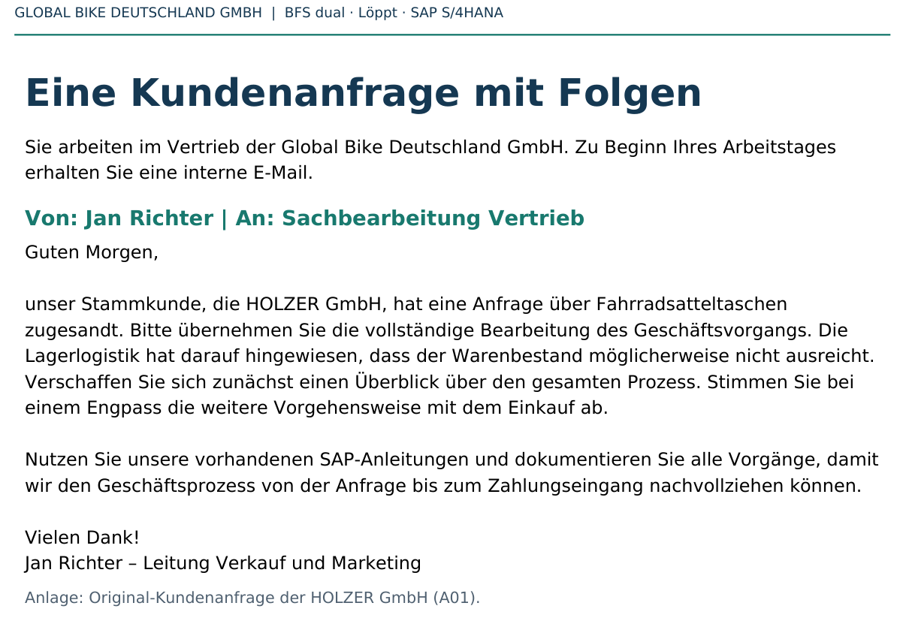

# BFS dual · Lernfeld 2 · LS 2.7 · Einen Kundenauftrag abwickeln mit SAP (Praxis)

**Bildungsgang** · BFS dual, Profil Wirtschaft  
**Lernsituation** · 2.7 · Einen Kundenauftrag abwickeln mit SAP (Praxis) (Paketkennung `BFSDUAL-LF02-LS07`)  
**Unterrichtlicher Bezug** · Handlungsorientierte Fallbearbeitung bei der Global Bike Deutschland GmbH  
**Zeitrahmen** · 20 Unterrichtsstunden à 45 Minuten, insgesamt 900 Minuten für einen gewählten Lernweg  
**Digitale Fassung** · [Orientierung öffnen](index.html) · [Unterlagen und Downloads](materialien.html)  
**Formgrundlage** · [BFSdual-Vorlage, Arbeitsstand vom 26. November 2026](https://github.com/macmaris83/Lernsituationen/blob/a1dd9b693df1a234bf3c7387198fcf5b5aab6afc/Fachbereiche/BFSdual/Vorlage_Lernsituation.md)

## Aufgabenzeiten

Für jeden der drei Wege gilt derselbe Zeitrahmen. Bei Durchführen zählt der Auftrag zum gewählten Lernpaket einmal.

| Station | Minuten je Lernweg |
| --- | ---: |
| Orientierung | 15 |
| Handlungssituation | 40 |
| Informieren | 90 |
| Fachbegriffscheck | 20 |
| Planen | 60 |
| Entscheiden | 35 |
| Durchführen | 545 |
| Bewerten | 75 |
| Reflektieren | 20 |
| **Gesamt** | **900** |

## Orientierung

[Digitale Fassung öffnen](index.html)

BFS dual · Lernfeld 2 · Lernsituation 2.7 · 20 Unterrichtsstunden

#### Den Auftrag überblicken

Eine Terminzusage an den Kunden hängt auch vom Einkauf ab. Bei Global Bike verfolgst du zwei Aufträge, für die Ware beschafft werden soll. Ob die Auslieferung bereits möglich ist, entscheidest du anhand der verfügbaren Menge und des bestätigten Termins im SAP-Schulungssystem.

Gib eine Prozessübersicht und deine gewählte Dokumentation für beide Geschäftsfälle ab. Je Fall gehören ein Laufzettel Vertrieb, ein Laufzettel Beschaffung, die Bestandsprüfung, eigene SAP-Belegnachweise, der Vertriebsbelegfluss und die Bestellentwicklung dazu. Markiere die Schnittstelle über den verfügbaren Bestand. Sichere auch, wie Forderung und Verbindlichkeit ausgeglichen wurden.

Du entscheidest, welche Aufgaben du selbstständig oder mit anderen bearbeitest. Für die Rückmeldung erhält jede Person ein fremdes Produkt.

15 Minuten

*Fachbuchverweis · Für diesen Auftrag ist keine Buchseite hinterlegt.*

Kompetenzprofil der Lernsituation

Die Gewichtung zeigt, wie häufig und wofür die Kompetenz in den Aufgaben gebraucht wird. 1 bedeutet „kurz in einer Aufgabe“, 6 „von der Vorbereitung bis zur Auswertung“.

| Kompetenz | Gewicht (1–6) | Was übe ich? |
| --- | --- | --- |
| F · Fachkompetenz | 6 / 6 | Ich bearbeite zwei Kundenaufträge samt Beschaffung in SAP bis zum Ausgleich von Forderung und Verbindlichkeit. |
| P · Personalkompetenz | 5 / 6 | Ich prüfe Abweichungen bei Werk, Preis, Liefertermin und Zahlungsbedingungen vor der nächsten Buchung. |
| S · Sozialkompetenz | 5 / 6 | Ich erläutere Vertrieb und Einkauf den Fehlbedarf und gebe Kolleginnen oder Kollegen belegbezogene Rückmeldung. |
| M · Methodenkompetenz | 5 / 6 | Ich leite aus einer Bestands- und Bedarfsliste den Fehlbedarf ab und dokumentiere die Abhängigkeiten zwischen den Arbeitsschritten. |
| D · Medienkompetenz | 6 / 6 | Ich sichere Vertriebsbelegfluss und Bestellentwicklung mit meinen tatsächlichen SAP-Belegnummern. |

## Handlungssituation

[Digitale Fassung öffnen](handlungssituation.html)

 

Interne E-Mail von Jan Richter zum Auftrag der HOLZER GmbH.

Jan Richter leitet Verkauf und Marketing der Global Bike Deutschland GmbH. Er übergibt dir die Anfrage des Stammkunden HOLZER GmbH über 200 Fahrradsatteltaschen. Die Lagerlogistik meldet, dass der Bestand knapp sein könnte. Als Sachbearbeitung Vertrieb stimmst du den Liefertermin mit dem Einkauf ab. Vor dem ersten SAP-Beleg erstellst du eine Prozessübersicht und klärst die für deinen Übungsmandanten gültigen Werk- und Termindaten.

Im zweiten Geschäftsfall bestellt die Fahrrad Glocke GmbH direkt 300 LED-Fahrradlichtsets. Du bearbeitest beide Aufträge vom jeweiligen Einstieg bis zum Zahlungseingang. Weise an eigenen SAP-Belegen nach, wie Einkauf, Lager, Vertrieb und Rechnungswesen zusammenarbeiten.

12 Minuten

*Fachbuchverweis · Für diesen Auftrag ist keine Buchseite hinterlegt.*

#### Was klärst du vor der Lieferzusage an die HOLZER GmbH?

Lesehilfe

Lies den Auftrag der Vertriebsleitung in M1 und überlege, wer einen Liefertermin absichern kann.

- ☐ Du prüfst Verfügbarkeit und Termin im vorgesehenen Werk und stimmst einen möglichen Engpass mit dem Einkauf ab.
- ☐ Du bestätigst den gewünschten Termin und prüfst die Menge erst nach dem Zahlungseingang.
- ☐ Du übernimmst die Menge der Einkaufsbestellung als Nachweis des verfügbaren Bestands.

7 Minuten

*Fachbuchverweis · Für diesen Auftrag ist keine Buchseite hinterlegt.*

#### Welche Unterlage entscheidet bei abweichenden Zahlungsbedingungen oder Lieferorten im Originalbeleg?

Lesehilfe

In M2 findest du die für beide Fälle geltende Vereinbarung.

- ☐ Für jede Buchung übernimmst du jeweils den neuesten gedruckten Originalbeleg.
- ☐ Die für deinen Schulungsmandanten bestätigte Fallfreigabe legt die Eingaben fest.
- ☐ Der Kundenlieferschein bestimmt automatisch, welche Zahlungsbedingungen für den Lieferanten gelten.

7 Minuten

*Fachbuchverweis · Für diesen Auftrag ist keine Buchseite hinterlegt.*

#### Wodurch unterscheidet sich der Einstieg bei Fahrrad Glocke vom Einstieg bei HOLZER?

Lesehilfe

Vergleiche die ersten Kundenbelege in M1 und M4.

- ☐ Fahrrad Glocke beginnt mit einer Anfrage. HOLZER sendet direkt einen Lieferantenauftrag.
- ☐ Fahrrad Glocke überspringt wegen der direkten Bestellung die Bestandsprüfung.
- ☐ Fahrrad Glocke sendet bereits eine Bestellung. Der Vertriebsweg beginnt dort beim Kundenauftrag.

7 Minuten

*Fachbuchverweis · Für diesen Auftrag ist keine Buchseite hinterlegt.*

#### Wie weist du die Verbindung von Beschaffung und Vertrieb nach?

Lesehilfe

M3 beschreibt die beiden getrennten Belegketten und wann die Ware verfügbar ist.

- ☐ Du zeigst Vertriebsbelegfluss und Bestellentwicklung getrennt und erklärst die Verbindung über die Warenverfügbarkeit.
- ☐ Du fasst beide Prozesse als automatisch verknüpfte Belegkette unter einer gemeinsamen Systemnummer zusammen.
- ☐ Du leitest die Lieferfähigkeit aus dem Kontoauszug zur Zahlung an den Lieferanten ab.

7 Minuten

*Fachbuchverweis · Für diesen Auftrag ist keine Buchseite hinterlegt.*

## Informieren

[Digitale Fassung öffnen](informieren.html)

Erschließe die Angaben und Unterlagen für deinen Auftrag.

45 Minuten

#### Kundenanliegen und Engpass klären

Lies die interne E-Mail und die Kundenanfrage in [M1](#m1). Halte fest, wer welche Ware benötigt, welche Auskunft noch fehlt und an wen der Vertrieb sich bei knappem Bestand wendet.

*Fachbuchverweis · Für diesen Auftrag ist keine Buchseite hinterlegt.*

45 Minuten

#### Belege und Informationswege ordnen

Öffne die bearbeitbare Prozessvorlage in [M2](#m2). Ordne die Begriffe bei Kunde, Global Bike und Lieferant ein. Kennzeichne Absender, Empfänger und die Schnittstelle zwischen Einkauf und Vertrieb. „Drahtesel“ in der Vorlage steht stellvertretend für den jeweiligen Kunden.

*Fachbuchverweis · Für diesen Auftrag ist keine Buchseite hinterlegt.*

[Begriffsblatt zum Nachschlagen](#glossar) · [Begriffe prüfen](#begriffstraining)

## Fachbegriffscheck

[Digitale Fassung öffnen](begriffstraining.html)

Wähle zu jedem Begriff die passende Erklärung. Du kannst den Check wiederholen.

20 Minuten

[Begriffsblatt öffnen](#glossar)

Karte `BFSDUAL-LF02-LS07-B01`

**1. Kundenanfrage**

- Mitteilung des Lieferanten, dass Ware versandt wurde.
- Bitte des Kunden um ein Angebot zu einem bestimmten Bedarf.
- Verbindliche Anweisung, eine bestimmte Menge sofort auszuliefern.

Karte `BFSDUAL-LF02-LS07-B02`

**2. Angebotsbezug**

- Verweis eines Lieferanten auf seine Bankverbindung.
- Verweis eines Wareneingangs auf den Kundenlieferschein.
- Verweis im Kundenauftrag auf ein zuvor angelegtes Angebot.

Karte `BFSDUAL-LF02-LS07-B03`

**3. Fallfreigabe**

- Bestätigte Übungsvorgabe für offene oder widersprüchliche Stammdaten, Termine und Konditionen.
- Automatische Buchungsbestätigung nach einem Zahlungseingang.
- Zusicherung des Lieferanten, dass alle Positionen vorrätig sind.

Karte `BFSDUAL-LF02-LS07-B04`

**4. Verfügbare Menge**

- Menge, die der Kunde bei seiner letzten Bestellung bezahlt hat.
- Summe aller je bestellten Mengen eines Artikels.
- Menge, die unter Berücksichtigung von Bestand, rechtzeitigen Zugängen und anderen Bedarfen zum Termin eingesetzt werden kann.

Karte `BFSDUAL-LF02-LS07-B05`

**5. Fehlbedarf**

- Gesamtmenge aller Positionen in einer Lieferantenbestellung.
- Menge, die bei der letzten Inventur gezählt wurde.
- Anteil des Bedarfs, der zum benötigten Zeitpunkt noch nicht gedeckt ist.

Karte `BFSDUAL-LF02-LS07-B06`

**6. MD04**

- SAP-Funktion zum Druck eines Kundenkontoauszugs.
- SAP-Beleg zur Genehmigung eines Warenrabatts.
- SAP-Anzeige der aktuellen Bestands- und Bedarfssituation eines Materials im Werk.

Karte `BFSDUAL-LF02-LS07-B07`

**7. Bestellung**

- Mitteilung, dass der Käufer eine Rechnung erhalten hat.
- Auftrag des Käufers an den Lieferanten zur Lieferung der genannten Waren und Konditionen.
- Unverbindliche Frage nach Preisen und Lieferfristen.

Karte `BFSDUAL-LF02-LS07-B08`

**8. Wareneingang**

- Zahlung eines Kunden auf eine Ausgangsrechnung.
- Weiterleitung der Lieferantenrechnung an den Kunden.
- Buchung des Zugangs eingetroffener Ware im Lager.

Karte `BFSDUAL-LF02-LS07-B09`

**9. Bestellentwicklung**

- Verlauf der Verkaufspreise eines Artikels über mehrere Jahre.
- Liste aller Angebote, die ein Kunde in letzter Zeit erhalten hat.
- Übersicht der Folgebelege einer Einkaufsbestellung, etwa Wareneingang und Rechnungseingang.

Karte `BFSDUAL-LF02-LS07-B10`

**10. Vertriebsbelegfluss**

- Liste verfügbarer Lagerorte für einen Artikel im Einkauf.
- Übersicht zusammengehöriger Vertriebsbelege von den Vorgängern bis zu den Folgebelegen.
- Monatliche Zusammenfassung aller Zahlungsausgänge an einen Lieferanten.

Karte `BFSDUAL-LF02-LS07-B11`

**11. Kommissionierung**

- Berechnen der Umsatzsteuer für eine Bestellung.
- Erfassen einer Zahlung auf dem Konto des Lieferanten.
- Zusammenstellen der freigegebenen Artikel und Mengen für eine Auslieferung.

Karte `BFSDUAL-LF02-LS07-B12`

**12. Faktura**

- Abrechnungsbeleg des Vertriebs, aus dem die Kundenrechnung entsteht.
- Quittung über eine gezählte Lagerdifferenz.
- Aufforderung zur Bestätigung eines Lieferantenangebots.

Karte `BFSDUAL-LF02-LS07-B13`

**13. Offener Posten**

- Menge eines noch nicht kommissionierten Artikels.
- Noch nicht ausgeglichene Forderung oder Verbindlichkeit auf einem Konto.
- Unbestätigter Liefertermin in der Produktionsplanung.

Karte `BFSDUAL-LF02-LS07-B14`

**14. Skonto**

- Preisnachlass bei Zahlung innerhalb einer vereinbarten Frist.
- Steueraufschlag bei einer Warenlieferung in ein anderes Werk.
- Vom Lieferanten gezahlter Zuschuss zu den Transportkosten.

Karte `BFSDUAL-LF02-LS07-B15`

**15. Eingangsrechnung**

- Rechnung, die das Unternehmen von seinem Lieferanten erhält.
- Bankbeleg zu einer eingegangenen Zahlung.
- Rechnung, die das Unternehmen nach einer Lieferung an seinen Kunden stellt.

Karte `BFSDUAL-LF02-LS07-B16`

**16. Bevorratung**

- Einkauf zusätzlicher Ware für künftigen Bedarf.
- Buchung eines Zahlungseingangs vor dem Zahlungstermin.
- Vereinbarung einer verkürzten Lieferfrist im Kundenangebot.

## Planen

[Digitale Fassung öffnen](planen.html)

Entwirf deinen Arbeitsplan.

30 Minuten

#### Fallfreigabe vorbereiten

Beschaffe die für den Schulungsmandanten geltenden Angaben mit [M2](#m2). Trage für jeden Fall Werk, Lagerort, Versandstelle und Lieferdatum ein und lasse diese Angaben vor der SAP-Bearbeitung bestätigen.

*Fachbuchverweis · Für diesen Auftrag ist keine Buchseite hinterlegt.*

30 Minuten

#### Vier Laufzettel anlegen

Lege für HOLZER und Fahrrad Glocke je einen Laufzettel Vertrieb und Beschaffung an. Plane mit [M2](#m2), wann du Verfügbarkeit, Warenbewegungen, offene Posten und Systemnummern erfasst.

*Fachbuchverweis · Für diesen Auftrag ist keine Buchseite hinterlegt.*

## Entscheiden

[Digitale Fassung öffnen](entscheiden.html)

Wähle einen von drei gleichwertigen Arbeitswegen. Du kannst deine Wahl begründet ändern.

**Lernpaket wählen**

A · Vorgangsmappe · Ordne je Fall die Belege chronologisch und erläutere die Abhängigkeiten schriftlich. · Wähle diesen Weg, wenn du gern mit Belegregistern arbeitest und eine Akte mit kurzen Übergabenotizen erstellen möchtest.

B · Visuelle Prozessdokumentation · Ergänze die Prozessgrafik für beide Fälle um eigene SAP-Belegnummern und beschrifte die Schnittstellen. · Wähle diesen Weg, wenn du Warenbewegungen, Belege und Zahlungen über Pfeile nachvollziehbar machen möchtest.

C · Digitale Prozesspräsentation · Erkläre beide Belegketten an kommentierten Folien mit eigenen SAP-Nachweisen. · Wähle diesen Weg, wenn du Belege gezielt zeigen und jeden Übergang kurz erläutern möchtest. Eine mündliche Präsentation ist freiwillig.

Gib eine Prozessübersicht und deine gewählte Dokumentation für beide Geschäftsfälle ab. Je Fall gehören ein Laufzettel Vertrieb, ein Laufzettel Beschaffung, die Bestandsprüfung, eigene SAP-Belegnachweise, der Vertriebsbelegfluss und die Bestellentwicklung dazu. Markiere die Schnittstelle über den verfügbaren Bestand. Sichere auch, wie Forderung und Verbindlichkeit ausgeglichen wurden.

35 Minuten

#### Darstellungsform begründen

Prüfe die drei gleichwertigen Wahlwege in [M2](#m2). Entscheide, in welcher Form du die zwei Fälle einem Kollegen übergeben möchtest. Notiere einen Grund für deine Wahl und welche Nachweise du während der Buchung sichern wirst.

*Fachbuchverweis · Für diesen Auftrag ist keine Buchseite hinterlegt.*

## Durchführen

[Digitale Fassung öffnen](durchfuehren.html)

Bearbeite den Auftrag im gewählten Format.

[Wähle in Entscheiden dein Lernpaket A, B oder C](#entscheiden), um die Aufträge zu öffnen.

Deine Wahl:  · [Wahl ändern](#entscheiden)

Gib eine Prozessübersicht und deine gewählte Dokumentation für beide Geschäftsfälle ab. Je Fall gehören ein Laufzettel Vertrieb, ein Laufzettel Beschaffung, die Bestandsprüfung, eigene SAP-Belegnachweise, der Vertriebsbelegfluss und die Bestellentwicklung dazu. Markiere die Schnittstelle über den verfügbaren Bestand. Sichere auch, wie Forderung und Verbindlichkeit ausgeglichen wurden.

91 Minuten

#### HOLZER · vom Kundenbeleg zum Fehlbedarf

Bearbeite A01 bis A04 in [M3](#m3). Buche Anfrage, Angebot und Terminauftrag mit Bezug. Prüfe in MD04 Verfügbarkeit und Liefertermin. Teile dem Einkauf den aus der Übersicht abgeleiteten Fehlbedarf mit.

*Fachbuchverweis · Für diesen Auftrag ist keine Buchseite hinterlegt.*

91 Minuten

#### HOLZER · beschaffen, ausliefern und abrechnen

Führe die Arbeitsaufträge A05 bis A14 in [M3](#m3) aus. Gleiche Lieferantenbelege mit Bestellung und Fallfreigabe ab. Prüfe die Lieferfähigkeit nach dem Wareneingang, liefere den Kundenauftrag aus und gleiche die offenen Posten aus.

*Fachbuchverweis · Für diesen Auftrag ist keine Buchseite hinterlegt.*

91 Minuten

#### Fahrrad Glocke · den zweiten Vorgang eigenständig bearbeiten

Beginne in [M4](#m4) bei der Kundenbestellung. Bearbeite beide Prozessketten und sichere deine Belege. Rechne den Skontoabzug eigenständig nach und gleiche ihn mit Ergänzungsbeleg und SAP-Zahlung ab.

*Fachbuchverweis · Für diesen Auftrag ist keine Buchseite hinterlegt.*

181 Minuten

**Lernpaket A**

#### Vorgangsmappe übergeben

Gliedere die Mappe nach HOLZER und Fahrrad Glocke. Verweise an jeder Übergabe zwischen Einkauf, Lager, Vertrieb und Rechnungswesen auf den passenden Beleg. Erkläre die zusätzliche Bevorratung und die Zahlungsbedingungen.

*Fachbuchverweis · Für diesen Auftrag ist keine Buchseite hinterlegt.*

181 Minuten

**Lernpaket B**

#### Prozessdokumentation vervollständigen

Zeige beide Verläufe in beschrifteten Grafiken mit deinen tatsächlichen Systemnummern. Markiere die Warenbewegung, die den Kundenauftrag lieferbar macht, und kennzeichne, wer an wen mit oder ohne Skonto zahlt.

*Fachbuchverweis · Für diesen Auftrag ist keine Buchseite hinterlegt.*

181 Minuten

**Lernpaket C**

#### Prozesspräsentation fertigstellen

Führe in kommentierten Folien für beide Kunden durch die Belegketten. Zeige den Verfügbarkeitsnachweis vor und nach dem Wareneingang sowie die Zahlungsprüfung. Stelle die Folien so zusammen, dass sie ohne Vortrag verständlich sind.

*Fachbuchverweis · Für diesen Auftrag ist keine Buchseite hinterlegt.*

91 Minuten

#### Beide Geschäftsvorgänge dokumentieren

Vergleiche die eigenen Belegnummern, die Bestellentwicklung und die Vertriebsbelegflüsse. Halte für beide Fälle fest, ab wann der Lagerbestand die Auslieferung erlaubte. Stelle das gemeinsame Nachweispaket mit [M5](#m5) zusammen.

*Fachbuchverweis · Für diesen Auftrag ist keine Buchseite hinterlegt.*

Kriterien für das fertige Produkt

- In der Prozessübersicht stimmen Absender, Empfänger und Richtung der Belege. HOLZER beginnt mit der Anfrage, Fahrrad Glocke mit der Bestellung.
- Je Fall zeigen die Bestandsprüfung und die bestätigte Fallfreigabe, welche Menge im Werk zu welchem Zeitpunkt verfügbar war. Der eigene Auftrag wird einmal berücksichtigt.
- Je Fall stimmen die beiden Laufzettel mit eigenen Belegnummern in Vertriebsbelegfluss und Bestellentwicklung überein. Die Verbindung über den Wareneingang ist erklärt.
- Menge und Preis stimmen mit den Geschäftspapieren überein. Lieferantenzahlungen, Kundenzahlungen und der Skontoabzug bei Fahrrad Glocke sind über die ausgeglichenen Posten nachvollziehbar.

## Bewerten

[Digitale Fassung öffnen](bewerten.html)

Peer-Check am Handlungsprodukt.

19 Minuten

#### Das Produkt für den Peer-Check bereitstellen

**Reiche** deine Arbeit in der Moodle-Aktivität „Peer-Feedback“ ein. Verwende neutrale Titel und Dateinamen. Entferne Namen aus Text und Dateieigenschaften. Bei einem gemeinsamen Produkt reicht jede Person eine Kopie im eigenen Konto ein. Ohne eingerichtete Aktivität verteilt die Lehrkraft codierte Arbeiten.

*Fachbuchverweis · Für diesen Auftrag ist keine Buchseite hinterlegt.*

37 Minuten

#### Ein fremdes Produkt prüfen

**Prüfe** die dir zugeteilte Arbeit mit den Kriterien unten. Benenne eine konkrete Fundstelle, eine fachlich gelungene Stelle und einen begründeten Verbesserungsvorschlag. Gib die Rückmeldung in Moodle oder mit dem [ausfüllbaren Peer-Bogen](#peer-check) ab. Dein Name ist für die empfangende Person sichtbar.

*Fachbuchverweis · Für diesen Auftrag ist keine Buchseite hinterlegt.*

19 Minuten

#### Die empfangene Rückmeldung nutzen

**Lies** das Feedback zu deinem Produkt. Verbessere die genannte Stelle oder begründe am Material, weshalb du deine Fassung beibehältst. Ergebnis ist die für die weitere Verwendung geprüfte Fassung.

*Fachbuchverweis · Für diesen Auftrag ist keine Buchseite hinterlegt.*

### Fachliche Prüfkriterien

- In der Prozessübersicht stimmen Absender, Empfänger und Richtung der Belege. HOLZER beginnt mit der Anfrage, Fahrrad Glocke mit der Bestellung.
- Je Fall zeigen die Bestandsprüfung und die bestätigte Fallfreigabe, welche Menge im Werk zu welchem Zeitpunkt verfügbar war. Der eigene Auftrag wird einmal berücksichtigt.
- Je Fall stimmen die beiden Laufzettel mit eigenen Belegnummern in Vertriebsbelegfluss und Bestellentwicklung überein. Die Verbindung über den Wareneingang ist erklärt.
- Menge und Preis stimmen mit den Geschäftspapieren überein. Lieferantenzahlungen, Kundenzahlungen und der Skontoabzug bei Fahrrad Glocke sind über die ausgeglichenen Posten nachvollziehbar.

[Peer-Check öffnen oder drucken](#peer-check)

## Reflektieren

[Digitale Fassung öffnen](reflektieren.html)

Dein Feedback zum Unterricht.

20 Minuten

#### Feedback zur Lernsituation abgeben

**Fülle** die separate Aktivität „Feedback“ in deinem Moodle-Kurs aus und sende deine Rückmeldung dort ab. Falls hier kein Direktlink angezeigt wird, öffne „Feedback“ in der Kursübersicht.

*Fachbuchverweis · Für diesen Auftrag ist keine Buchseite hinterlegt.*

## Materialien
| Kennung | Unterlage |
| --- | --- |
| HANDBUCH | [SAP-Arbeitshandbuch zur Auftragsabwicklung](#handbuch) |
| M1 | [M1 · Arbeitsauftrag und Originalanfrage der HOLZER GmbH](#m1) |
| M2 | [M2 · Prozessplanung, Fallfreigaben und Laufzettel](#m2) |
| M3 | [M3 · HOLZER GmbH · Anfrage, Beschaffung und Auftragsabschluss](#m3) |
| M4 | [M4 · Fahrrad Glocke GmbH · Transfer mit Skonto](#m4) |
| M5 | [M5 · Arbeitsprodukt für den Peer-Check vorbereiten](#m5) |
| MATERIALIEN | [Materialübersicht und Quellen](#materialien) |
| PEER-CHECK | [Peer-Check · LS 2.7](#peer-check) |

## SAP-Arbeitshandbuch zur Auftragsabwicklung

[Digitale Fassung öffnen](material/handbuch.html)

[Text als bearbeitbare Markdown-Datei herunterladen](material/SAP-Arbeitshandbuch.md)

### Handlungssituation – Eine Kundenanfrage mit Folgen

Sie arbeiten im Vertrieb der Global Bike Deutschland GmbH. Heute erhalten Sie folgende interne E-Mail.

**Von:** Jan Richter – Leitung Verkauf und Marketing  
 **An:** Sachbearbeitung Vertrieb  
 **Betreff:** Kundenanfrage der HOLZER GmbH

Guten Morgen,

unser Stammkunde, die HOLZER GmbH, hat eine Anfrage über Fahrradsatteltaschen zugesandt. Bitte übernehmen Sie die vollständige Bearbeitung des Geschäftsvorgangs. Die Lagerlogistik hat darauf hingewiesen, dass der Warenbestand möglicherweise nicht ausreicht. Verschaffen Sie sich zunächst einen Überblick über den gesamten Prozess. Stimmen Sie bei einem Engpass die weitere Vorgehensweise mit dem Einkauf ab.

Nutzen Sie unsere vorhandenen SAP-Anleitungen und dokumentieren Sie alle Vorgänge, damit wir den Geschäftsprozess von der Anfrage bis zum Zahlungseingang nachvollziehen können.

Vielen Dank! Jan Richter – Leitung Verkauf und Marketing

[Handlungssituation als PDF](material/materialien/00_Einstieg.pdf) · [Original-Kundenanfrage öffnen](material/materialien/A01_Original_Kundenanfrage.pdf)

### Phase 1: Informieren / Analysieren

Lesen Sie die Handlungssituation und die Original-Kundenanfrage. Welche Informationen liegen vor? Welche Abteilungen sind beteiligt? Welches Problem könnte auftreten?

#### 1.2 Den Prozess der Auftragsabwicklung gliedern

Öffnen Sie die vorhandene PowerPoint-Datei. Drahtesel steht dort stellvertretend für den Kunden; im ersten Fall HOLZER, im zweiten Fahrrad Glocke.

1. Ordnen Sie Vertrieb und Beschaffung den richtigen Bereichen zu.
2. Verschieben Sie die vorgegebenen Begriffe und Belege zu den beteiligten Unternehmen.
3. Ordnen Sie die Belege zeitlich sinnvoll an und ergänzen Sie Pfeile für Absender und Empfänger.
4. Markieren Sie die Schnittstelle, an der der fehlende Bestand die Beschaffung erforderlich macht.
5. Prüfen Sie Absender, Empfänger und Pfeilrichtung. Sie können das Ergebnis mit einer anderen Person vergleichen. Speichern Sie Ihre Datei.

[Arbeitsauftrag PDF](material/materialien/01_Prozessdarstellung.pdf) · [PowerPoint-Arbeitsvorlage (editierbar)](material/materialien/Prozess_der_Auftragsabwicklung.pptx)

### Phase 2: Planen

Planen Sie die Arbeitsschritte und Abhängigkeiten anhand Ihrer Prozessübersicht. Prüfen Sie, welche Anleitungen, Belege und Laufzettel Sie benötigen. Führen Sie für jeden Fall einen eigenen Laufzettel Vertrieb und Beschaffung. Holen Sie vor der SAP-Bearbeitung die Fallfreigabe ein.

[Verbindliche Fallfreigabe / Abweichungen der Originalbelege](material/materialien/02_Fallfreigabe.pdf) · [Laufzettel Vertrieb (Original)](material/materialien/Laufzettel_Vertrieb_Original.pdf) · [Laufzettel Beschaffung (aus Original-SAP-Anleitung)](material/materialien/Laufzettel_Beschaffung_mit_Auftragsbestaetigung.pdf)

### Phase 3: Entscheiden

Wählen Sie begründet eines der drei gleichwertigen Lernpakete. Alle bearbeiten beide Fälle vollständig in SAP und geben für beide Fälle Laufzettel, die Prozessübersicht, SAP-Belegnachweise, Bestandsprüfung, Belegfluss und Bestellentwicklung ab. A – Vorgangsmappe: strukturieren Sie die Belege chronologisch und erläutern Sie die Abhängigkeiten schriftlich. B – Visuelle Prozessdokumentation: erweitern Sie die Prozessübersicht um die Belegnummern beider Fälle und erläutern Sie die Abhängigkeiten an den Schnittstellen. C – Digitale Prozesspräsentation: erläutern Sie die beiden Belegketten anhand eigener SAP-Belege und kommentierter Folien; eine mündliche Präsentation ist freiwillig. Begründen Sie die Wahl mit Ihrem geplanten Arbeitsweg. Für alle gelten gleiche fachliche Kriterien: Vollständigkeit, fachliche Richtigkeit, Nachvollziehbarkeit und Sorgfalt. Die Lernpakete unterscheiden sich nur in der Darstellungsform.

[Lernpakete und Arbeitsplanung](material/materialien/03_Lernpakete.pdf)

#### Vorlagen für die Bestandsprüfung und die Dokumentation

[Notierhilfe Bestandsprüfung](material/materialien/Notierhilfe_Bestandspruefung.pdf) · [Laufzettel Beschaffung aus der Fallvorlage](material/materialien/Laufzettel_Beschaffung_Original.pdf)

Der Laufzettel aus der SAP-Anleitung enthält ein eigenes Feld für die Auftragsbestätigung. Falls Sie den Laufzettel aus der Fallvorlage verwenden, notieren Sie die Bestätigungsnummer ergänzend.

### Phase 4: Durchführen – Geschäftsfall 1

**HOLZER GmbH – 200 Fahrradsatteltaschen (FSTA1###)**

Die Originalbelege bleiben unverändert. Maßgeblich für abweichende Angaben ist die ausdrücklich bestätigte Fallfreigabe. Nutzen Sie die Anleitungen mit den angegebenen Seitenzahlen. Keine Stammdatenänderungen, keine Lieferantenanfragen, kein Angebotsvergleich, kein Einkaufsinfosatz, kein Orderbuch. Dokumentieren Sie alle eigenen SAP-Belegnummern. Die nachstehende Reihenfolge dient der Unterrichtsorganisation; die Auslieferung setzt ausreichenden verfügbaren Bestand voraus, nicht die Zahlung an den Lieferanten.

#### Teil A – Vertrieb bis zum Beschaffungsbedarf

#### A01 – Kundenanfrage bearbeiten

Die Originalanfrage der HOLZER GmbH liegt vor.

1. Ermitteln Sie die individuellen Kunden- und Materialnummern sowie den Vertriebsbereich. Füllen Sie den Kopf des Laufzettels aus.
2. Erfassen Sie die Anfrage über 200 Fahrradsatteltaschen in SAP. Prüfen und notieren Sie die Verfügbarkeit; sichern Sie die Anfrage.
3. Ergänzen Sie den Laufzettel.

**Hilfestellung:** Vertrieb, Kap. 1, S. 4–5 · [Anleitung öffnen](material/materialien/SAP_Anleitung_Vertrieb.pdf)

[Arbeitsauftrag als PDF](material/materialien/A01_Arbeitsauftrag.pdf) · [A01 Original Kundenanfrage](material/materialien/A01_Original_Kundenanfrage.pdf) · [Laufzettel Vertrieb Original](material/materialien/Laufzettel_Vertrieb_Original.pdf)

#### A02 – Angebot erstellen

Jan Richter gibt vor: 21,00 EUR netto je Stück, vier Wochen gültig, Lieferung 10 Arbeitstage nach Bestelleingang, DDP Memmingen, sofort ohne Abzug. Lieferfrist vor verbindlicher Zusage mit Einkauf abstimmen.

1. Legen Sie das Angebot mit Bezug zur Anfrage an. Prüfen Sie die Konditionen und die Lieferbarkeit.
2. Speichern Sie das Angebot, geben Sie es als PDF aus und ergänzen Sie den Laufzettel.

**Hilfestellung:** Vertrieb, Kap. 2, S. 6–8 · [Anleitung öffnen](material/materialien/SAP_Anleitung_Vertrieb.pdf)

[Arbeitsauftrag als PDF](material/materialien/A02_Arbeitsauftrag.pdf)

#### A03 – Kundenauftrag bearbeiten

Die HOLZER GmbH hat das Angebot angenommen. Ihre Originalbestellung liegt vor.

1. Vergleichen Sie Bestellung und Angebot. Legen Sie den Terminauftrag mit Angebotsbezug an; erfassen Sie Kundenreferenz und Datum.
2. Speichern Sie den Auftrag, geben Sie die Auftragsbestätigung aus und ergänzen Sie den Laufzettel.
3. Zeigen Sie den bisherigen Belegfluss an.

**Hilfestellung:** Vertrieb, Kap. 3, S. 9–10 · [Anleitung öffnen](material/materialien/SAP_Anleitung_Vertrieb.pdf)

[Arbeitsauftrag als PDF](material/materialien/A03_Arbeitsauftrag.pdf) · [A03 Original Kundenbestellung](material/materialien/A03_Original_Kundenbestellung.pdf)

#### A04 – Beschaffungsbedarf ermitteln

Christian Klein aus der Absatzlogistik benötigt eine Rückmeldung zur Lieferfähigkeit.

1. Prüfen Sie in MD04 die Bestands- und Bedarfssituation im freigegebenen Werk. Notieren Sie Bestand, weitere Bedarfe, rechtzeitige Zugänge, verfügbare Menge und Fehlmenge.
2. Berücksichtigen Sie den bereits angelegten Kundenauftrag nur einmal. Prüfen Sie die zugesagte Lieferfrist.
3. Melden Sie den Engpass und die erforderliche Maßnahme in einer kurzen Mitteilung an Birgit Horst. Bei ausreichendem Bestand oder unklaren Daten Rücksprache mit der Lehrkraft.

**Hilfestellung:** Fallvorlage S. 7; bekannte MD04-Unterlagen · [Anleitung öffnen](material/materialien/SAP_Anleitung_Vertrieb.pdf)

[Arbeitsauftrag als PDF](material/materialien/A04_Arbeitsauftrag.pdf) · [Notierhilfe Bestandspruefung](material/materialien/Notierhilfe_Bestandspruefung.pdf)

#### Teil B – Beschaffung

#### A05 – Bestellung anlegen

Die Einkaufsleitung gibt die Beschaffung verbindlich vor. Die zusätzliche Menge dient der Bevorratung.

1. Lesen Sie den Beschaffungsauftrag. Prüfen Sie, ob 300 Stück ausreichen und die Lieferung fristgerecht erfolgen kann.
2. Legen Sie die Bestellung bei Cologne Bike GmbH an: 300 Stück zu 12,00 EUR netto pro Stück, sofort ohne Abzug. Werk/Lagerort gemäß Freigabe.
3. Verändern Sie keine Stammdaten; deaktivieren Sie ggf. die Infosatzaktualisierung. Sichern Sie die Bestellung und ergänzen Sie den Laufzettel.

**Hilfestellung:** Beschaffung, Kap. 2, S. 4 · [Anleitung öffnen](material/materialien/SAP_Anleitung_Beschaffung.pdf)

[Arbeitsauftrag als PDF](material/materialien/A05_Arbeitsauftrag.pdf) · [A05 Beschaffungsauftrag](material/materialien/A05_Beschaffungsauftrag.pdf) · [Laufzettel Beschaffung mit Auftragsbestaetigung](material/materialien/Laufzettel_Beschaffung_mit_Auftragsbestaetigung.pdf)

#### A06 – Auftragsbestätigung bearbeiten

Die Original-Auftragsbestätigung des Lieferanten liegt vor.

1. Vergleichen Sie Menge, Preis, Lieferdatum, Ort und Zahlungsbedingungen mit Ihrer Bestellung. Beachten Sie die verbindliche Fallfreigabe.
2. Erfassen Sie nach Klärung die Nummer der Bestätigung in der Bestellung. Sichern und dokumentieren Sie den Vorgang.

**Hilfestellung:** Beschaffung, Kap. 3, S. 5 · [Anleitung öffnen](material/materialien/SAP_Anleitung_Beschaffung.pdf)

[Arbeitsauftrag als PDF](material/materialien/A06_Arbeitsauftrag.pdf) · [A06 Original Auftragsbestaetigung](material/materialien/A06_Original_Auftragsbestaetigung.pdf)

#### A07 – Wareneingang buchen

Der Originallieferschein liegt vor. Die Ware wird im freigegebenen Werk angenommen.

1. Vergleichen Sie Lieferschein und Bestellung; prüfen Sie Material, Menge (300 Stück) und Werk.
2. Buchen Sie den Wareneingang mit Bestellbezug erst nach Klärung. Notieren Sie die Materialbelegnummer.
3. Prüfen Sie erneut die Verfügbarkeit für den Kundenauftrag.

**Hilfestellung:** Beschaffung, Kap. 4, S. 6–7 · [Anleitung öffnen](material/materialien/SAP_Anleitung_Beschaffung.pdf)

[Arbeitsauftrag als PDF](material/materialien/A07_Arbeitsauftrag.pdf) · [A07 Original Lieferschein](material/materialien/A07_Original_Lieferschein.pdf)

#### A08 – Eingangsrechnung erfassen

Die Originalrechnung des Lieferanten ist eingegangen.

1. Vergleichen Sie Rechnung, Bestellung und Wareneingang. Prüfen Sie Nettobetrag und Umsatzsteuer. Klären Sie die abweichenden Zahlungsbedingungen gemäß Fallfreigabe.
2. Erfassen und buchen Sie die Eingangsrechnung mit Bestellbezug. Ergänzen Sie den Laufzettel.

**Hilfestellung:** Beschaffung, Kap. 5, S. 8–9 · [Anleitung öffnen](material/materialien/SAP_Anleitung_Beschaffung.pdf)

[Arbeitsauftrag als PDF](material/materialien/A08_Arbeitsauftrag.pdf) · [A08 Original Eingangsrechnung](material/materialien/A08_Original_Eingangsrechnung.pdf)

#### A09 – Zahlungsausgang buchen

Die Rechnung wird ohne Abzug bezahlt. Der Originalkontoauszug liegt vor.

1. Zeigen Sie die offenen Posten des Lieferanten an. Prüfen Sie Referenz und Betrag anhand des SAP-Belegs.
2. Buchen Sie den Zahlungsausgang gemäß Kontoauszug, ordnen Sie ihn dem offenen Posten zu und prüfen Sie dessen Ausgleich.
3. Ergänzen Sie den Laufzettel.

**Hilfestellung:** Beschaffung, Kap. 6–7, S. 10–12 · [Anleitung öffnen](material/materialien/SAP_Anleitung_Beschaffung.pdf)

[Arbeitsauftrag als PDF](material/materialien/A09_Arbeitsauftrag.pdf) · [A09 Original Kontoauszug Ausgang](material/materialien/A09_Original_Kontoauszug_Ausgang.pdf)

#### A10 – Beschaffungsprozess überprüfen

Der Einkauf benötigt eine vollständige Dokumentation.

1. Rufen Sie die Bestellentwicklung und den Status auf. Vergleichen Sie die Belegnummern mit Ihrem Laufzettel.
2. Sichern Sie die Bestellentwicklung. Ergänzen Sie ggf. die Nummer der Auftragsbestätigung separat.

**Hilfestellung:** Beschaffung, Kap. 8, S. 13 · [Anleitung öffnen](material/materialien/SAP_Anleitung_Beschaffung.pdf)

[Arbeitsauftrag als PDF](material/materialien/A10_Arbeitsauftrag.pdf)

#### Teil C – Vertrieb fortsetzen und kontrollieren

#### A11 – Warenauslieferung durchführen

Die Ware ist verfügbar. Christian Klein gibt den Kundenauftrag zur Auslieferung frei. Die Lieferantenzahlung ist keine Voraussetzung.

1. Prüfen Sie die bestätigte Menge und den Termin. Bei Bedarf Verfügbarkeit im Auftrag erneut prüfen und Änderungen mit der Lehrkraft klären.
2. Legen Sie die Auslieferung mit Auftragsbezug an, kommissionieren Sie 200 Stück aus dem freigegebenen Lagerort und buchen Sie den Warenausgang.
3. Geben Sie den Lieferschein aus, prüfen Sie den Bestand und ergänzen Sie den Laufzettel.

**Hilfestellung:** Vertrieb, Kap. 4–5, S. 11–18 · [Anleitung öffnen](material/materialien/SAP_Anleitung_Vertrieb.pdf)

[Arbeitsauftrag als PDF](material/materialien/A11_Arbeitsauftrag.pdf)

#### A12 – Ausgangsrechnung erstellen

Die HOLZER GmbH erhält nach erfolgter Lieferung ihre Rechnung.

1. Legen Sie die Faktura mit Auslieferungsbezug an. Prüfen Sie Preise, Menge, Steuer und Zahlungsbedingungen.
2. Speichern Sie die Rechnung, geben Sie sie aus und ergänzen Sie den Laufzettel.

**Hilfestellung:** Vertrieb, Kap. 6, S. 19–23 · [Anleitung öffnen](material/materialien/SAP_Anleitung_Vertrieb.pdf)

[Arbeitsauftrag als PDF](material/materialien/A12_Arbeitsauftrag.pdf)

#### A13 – Zahlungseingang buchen

Der Originalkontoauszug dokumentiert die Zahlung der HOLZER GmbH.

1. Prüfen Sie die offene Forderung und die tatsächliche SAP-Rechnungsnummer. Buchen Sie die Zahlung ohne Abzug.
2. Ordnen Sie den Betrag der Rechnung zu und kontrollieren Sie den Ausgleich. Ergänzen Sie den Laufzettel.

**Hilfestellung:** Vertrieb, Kap. 7, S. 24–29 · [Anleitung öffnen](material/materialien/SAP_Anleitung_Vertrieb.pdf)

[Arbeitsauftrag als PDF](material/materialien/A13_Arbeitsauftrag.pdf) · [A13 Original Kontoauszug Eingang](material/materialien/A13_Original_Kontoauszug_Eingang.pdf)

#### A14 – Gesamtprozess überprüfen

Der gesamte Geschäftsvorgang soll nachvollziehbar sein.

1. Vergleichen Sie SAP-Vertriebsbelegfluss, Bestellentwicklung, offene Posten und Laufzettel.
2. Ergänzen Sie die Prozessübersicht um die tatsächlich vergebenen Belegnummern und erklären Sie die Schnittstelle über den Warenbestand. Die beiden Belegketten sind bei einer eigenständigen Bestellung nicht automatisch als ein gemeinsamer SAP-Belegfluss verknüpft.

**Hilfestellung:** Vertrieb S. 10, 18; Beschaffung S. 13 · [Anleitung öffnen](material/materialien/SAP_Anleitung_Vertrieb.pdf)

[Arbeitsauftrag als PDF](material/materialien/A14_Arbeitsauftrag.pdf)

### Phase 4: Durchführen – Geschäftsfall 2 (Übung)

**Fahrrad Glocke GmbH – 300 Fahrradlicht Set LED (FLSL1###)**

Guten Morgen,

nachdem Sie den ersten Vorgang bearbeitet haben, liegt eine Bestellung der Fahrrad Glocke GmbH vor. Übernehmen Sie den Auftrag einschließlich der erforderlichen Beschaffung und des Abschlusses im Rechnungswesen. Leiten Sie die notwendigen Arbeitsschritte aus Ihrer Prozessübersicht ab. Nutzen Sie bei Bedarf die bekannten SAP-Anleitungen.

Jan Richter – Leitung Verkauf und Marketing

[Handlungssituation PDF](material/materialien/B00_Einstieg.pdf) · [Original-Kundenbestellung](material/materialien/B01_Original_Kundenbestellung.pdf)

Der Fall beginnt bewusst mit einer Bestellung; Anfrage und Angebot entfallen. Führen Sie neue Laufzettel; wählen Sie die Anleitungen selbstständig aus. Die nicht vorhandenen Lieferantenbelege sind als neu erstellte Übungsbelege gekennzeichnet. Die Fallfreigabe gilt auch hier.

#### B01 – Kundenauftrag und Bestandsprüfung

Die Originalbestellung der Fahrrad Glocke GmbH liegt vor: 300 Fahrradlicht Set LED zu 36,00 EUR netto, CPT Köln, 30 Tage 3 % Skonto / 45 Tage netto.

1. Bearbeiten Sie den Kundenauftrag ohne Anfrage- oder Angebotsbezug. Verwenden Sie nur die gültige Materialposition; ignorieren Sie die #NV- und Nullzeilen der Vorlage.
2. Prüfen Sie den Bestand, ermitteln Sie den Fehlbedarf und dokumentieren Sie Ihre Entscheidung. Führen Sie einen neuen Laufzettel.

**Hilfestellung:** Vertrieb, Kap. 3; MD04 · [Anleitung öffnen](material/materialien/SAP_Anleitung_Vertrieb.pdf)

[Arbeitsauftrag als PDF](material/materialien/B01_Arbeitsauftrag.pdf) · [B01 Original Kundenbestellung](material/materialien/B01_Original_Kundenbestellung.pdf) · [Laufzettel Vertrieb Original](material/materialien/Laufzettel_Vertrieb_Original.pdf) · [Notierhilfe Bestandspruefung](material/materialien/Notierhilfe_Bestandspruefung.pdf)

#### B02 – Beschaffung durchführen

Birgit Horst gibt die Beschaffung von 400 Stück zu 24,00 EUR netto je Stück bei Cologne Bike GmbH vor.

1. Prüfen Sie, ob die Menge ausreicht. Legen Sie die Bestellung an und bearbeiten Sie die Auftragsbestätigung.
2. Buchen Sie Wareneingang und Eingangsrechnung nach Prüfung der Übungsbelege. Prüfen und buchen Sie den Zahlungsausgang ohne Abzug.
3. Kontrollieren Sie Bestellentwicklung, offene Posten und Laufzettel. Nutzen Sie die Beschaffungsanleitung eigenständig.

**Hilfestellung:** Beschaffung, Kap. 2–8 · [Anleitung öffnen](material/materialien/SAP_Anleitung_Beschaffung.pdf)

[Arbeitsauftrag als PDF](material/materialien/B02_Arbeitsauftrag.pdf) · [B02 Beschaffungsauftrag](material/materialien/B02_Beschaffungsauftrag.pdf) · [B03 Uebungsbelege Beschaffung](material/materialien/B03_Uebungsbelege_Beschaffung.pdf) · [Laufzettel Beschaffung mit Auftragsbestaetigung](material/materialien/Laufzettel_Beschaffung_mit_Auftragsbestaetigung.pdf)

#### B04 – Kundenauftrag beliefern und fakturieren

Die Ware ist im freigegebenen Werk verfügbar.

1. Prüfen Sie die Verfügbarkeit und bearbeiten Sie Auslieferung, Kommissionierung und Warenausgang für 300 Stück.
2. Erstellen und prüfen Sie die Ausgangsrechnung. Geben Sie die erforderlichen Belege aus und ergänzen Sie den Laufzettel.

**Hilfestellung:** Vertrieb, Kap. 4–6 · [Anleitung öffnen](material/materialien/SAP_Anleitung_Vertrieb.pdf)

[Arbeitsauftrag als PDF](material/materialien/B04_Arbeitsauftrag.pdf)

#### B06 – Zahlungseingang und Abschluss

Der Kunde zahlt innerhalb der Skontofrist. Der Originalkontoauszug enthält #NV; der Ergänzungsbeleg gibt die Übungszahlung vor.

1. Prüfen Sie die offene Forderung, ermitteln Sie den Skontobetrag und den Zahlbetrag. Buchen Sie den Zahlungseingang mit Skonto gemäß SAP-Anleitung.
2. Kontrollieren Sie den Ausgleich der Forderung und die Vollständigkeit beider Prozessketten. Ergänzen Sie die Laufzettel und Ihr Lernpaket.

**Hilfestellung:** Vertrieb, Kap. 7; Beschaffung, Kap. 8 · [Anleitung öffnen](material/materialien/SAP_Anleitung_Vertrieb.pdf)

[Arbeitsauftrag als PDF](material/materialien/B06_Arbeitsauftrag.pdf) · [B06 Original Kontoauszug Eingang](material/materialien/B06_Original_Kontoauszug_Eingang.pdf) · [B06 Ergaenzung Zahlungseingang](material/materialien/B06_Ergaenzung_Zahlungseingang.pdf)

#### Übungsbelege des Lieferanten einzeln öffnen

- [Auftragsbestätigung](material/materialien/B03a_Uebungs_Auftragsbestaetigung.pdf)
- [Lieferschein](material/materialien/B03b_Uebungs_Lieferschein.pdf)
- [Eingangsrechnung](material/materialien/B03c_Uebungs_Eingangsrechnung.pdf)
- [Kontoauszug zum Zahlungsausgang](material/materialien/B03d_Uebungs_Kontoauszug_Ausgang.pdf)

### SAP-Anleitungen

[Anleitungen Vertriebsprozess SAP S/4HANA (29 Seiten)](material/materialien/SAP_Anleitung_Vertrieb.pdf) · [Beschaffungsvorgänge durchführen (14 Seiten)](material/materialien/SAP_Anleitung_Beschaffung.pdf)

### Übergabe für den Peer-Check

Wählen Sie aus jedem Fall eine belegte Übergabe zwischen Vertrieb und Einkauf. Legen Sie Prozessübersicht, Bestandsprüfung, die beiden Laufzettel und die zugehörigen SAP-Nachweise bereit. Verwenden Sie im Austausch die fallbezogenen Angaben und achten Sie bei Bildschirmfotos auf private Anmeldedaten.

1. Folgen Sie in der Unterlage einer anderen Person einer Kundenposition von der Bestellung bis zur Zahlung. Stimmen Artikel, Menge, Belegnummern und Betrag?
2. Prüfen Sie, wie der verfügbare Bestand im richtigen Werk und die Fehlmenge hergeleitet wurden. Lässt sich der Zeitpunkt der Auslieferung am Beleg nachvollziehen?
3. Vergleichen Sie Bestellentwicklung und Vertriebsbelegfluss. Wo ist die Warenbewegung nachgewiesen, die Einkauf und Vertrieb verbindet?
4. Schauen Sie im Fall Fahrrad Glocke auf den Rechnungsbetrag, die Skontofrist, den tatsächlichen Zahlbetrag und den Ausgleich des offenen Postens.
5. Geben Sie in der Moodle-Aktivität **Peer-Check** eine konkrete Stärke und einen Verbesserungsvorschlag an. Nennen Sie dabei jeweils den Beleg oder die Stelle, auf die sich die Rückmeldung bezieht.

Laden Sie Ihr fertiggestelltes Arbeitsprodukt in der für diese Lernsituation vorgesehenen Moodle-Ablagebox hoch. In der Phase **Reflektieren** füllen Sie das **Feedback zur Lernsituation in Moodle** aus. Der originale Wissens-Check wird von der Lehrkraft separat freigegeben.

[Hinweis zur Feedback-Aktivität in Moodle (PDF)](material/materialien/06_Feedback.pdf)

## M1 · Arbeitsauftrag und Originalanfrage der HOLZER GmbH

[Digitale Fassung öffnen](material/m1.html)

### Handlungssituation – Eine Kundenanfrage mit Folgen

Sie arbeiten im Vertrieb der Global Bike Deutschland GmbH. Heute erhalten Sie folgende interne E-Mail.

**Von:** Jan Richter – Leitung Verkauf und Marketing  
 **An:** Sachbearbeitung Vertrieb  
 **Betreff:** Kundenanfrage der HOLZER GmbH

Guten Morgen,

unser Stammkunde, die HOLZER GmbH, hat eine Anfrage über Fahrradsatteltaschen zugesandt. Bitte übernehmen Sie die vollständige Bearbeitung des Geschäftsvorgangs. Die Lagerlogistik hat darauf hingewiesen, dass der Warenbestand möglicherweise nicht ausreicht. Verschaffen Sie sich zunächst einen Überblick über den gesamten Prozess. Stimmen Sie bei einem Engpass die weitere Vorgehensweise mit dem Einkauf ab.

Nutzen Sie unsere vorhandenen SAP-Anleitungen und dokumentieren Sie alle Vorgänge, damit wir den Geschäftsprozess von der Anfrage bis zum Zahlungseingang nachvollziehen können.

Vielen Dank! Jan Richter – Leitung Verkauf und Marketing

[Handlungssituation als PDF](material/materialien/00_Einstieg.pdf) · [Original-Kundenanfrage öffnen](material/materialien/A01_Original_Kundenanfrage.pdf)

## M2 · Prozessplanung, Fallfreigaben und Laufzettel

[Digitale Fassung öffnen](material/m2.html)

### Phase 1: Informieren / Analysieren

Lesen Sie die Handlungssituation und die Original-Kundenanfrage. Welche Informationen liegen vor? Welche Abteilungen sind beteiligt? Welches Problem könnte auftreten?

#### 1.2 Den Prozess der Auftragsabwicklung gliedern

Öffnen Sie die vorhandene PowerPoint-Datei. Drahtesel steht dort stellvertretend für den Kunden; im ersten Fall HOLZER, im zweiten Fahrrad Glocke.

1. Ordnen Sie Vertrieb und Beschaffung den richtigen Bereichen zu.
2. Verschieben Sie die vorgegebenen Begriffe und Belege zu den beteiligten Unternehmen.
3. Ordnen Sie die Belege zeitlich sinnvoll an und ergänzen Sie Pfeile für Absender und Empfänger.
4. Markieren Sie die Schnittstelle, an der der fehlende Bestand die Beschaffung erforderlich macht.
5. Prüfen Sie Absender, Empfänger und Pfeilrichtung. Sie können das Ergebnis mit einer anderen Person vergleichen. Speichern Sie Ihre Datei.

[Arbeitsauftrag PDF](material/materialien/01_Prozessdarstellung.pdf) · [PowerPoint-Arbeitsvorlage (editierbar)](material/materialien/Prozess_der_Auftragsabwicklung.pptx)

### Phase 2: Planen

Planen Sie die Arbeitsschritte und Abhängigkeiten anhand Ihrer Prozessübersicht. Prüfen Sie, welche Anleitungen, Belege und Laufzettel Sie benötigen. Führen Sie für jeden Fall einen eigenen Laufzettel Vertrieb und Beschaffung. Holen Sie vor der SAP-Bearbeitung die Fallfreigabe ein.

[Verbindliche Fallfreigabe / Abweichungen der Originalbelege](material/materialien/02_Fallfreigabe.pdf) · [Laufzettel Vertrieb (Original)](material/materialien/Laufzettel_Vertrieb_Original.pdf) · [Laufzettel Beschaffung (aus Original-SAP-Anleitung)](material/materialien/Laufzettel_Beschaffung_mit_Auftragsbestaetigung.pdf)

### Phase 3: Entscheiden

Wählen Sie begründet eines der drei gleichwertigen Lernpakete. Alle bearbeiten beide Fälle vollständig in SAP und geben für beide Fälle Laufzettel, die Prozessübersicht, SAP-Belegnachweise, Bestandsprüfung, Belegfluss und Bestellentwicklung ab. A – Vorgangsmappe: strukturieren Sie die Belege chronologisch und erläutern Sie die Abhängigkeiten schriftlich. B – Visuelle Prozessdokumentation: erweitern Sie die Prozessübersicht um die Belegnummern beider Fälle und erläutern Sie die Abhängigkeiten an den Schnittstellen. C – Digitale Prozesspräsentation: erläutern Sie die beiden Belegketten anhand eigener SAP-Belege und kommentierter Folien; eine mündliche Präsentation ist freiwillig. Begründen Sie die Wahl mit Ihrem geplanten Arbeitsweg. Für alle gelten gleiche fachliche Kriterien: Vollständigkeit, fachliche Richtigkeit, Nachvollziehbarkeit und Sorgfalt. Die Lernpakete unterscheiden sich nur in der Darstellungsform.

[Lernpakete und Arbeitsplanung](material/materialien/03_Lernpakete.pdf)

#### Vorlagen für die Bestandsprüfung und die Dokumentation

[Notierhilfe Bestandsprüfung](material/materialien/Notierhilfe_Bestandspruefung.pdf) · [Laufzettel Beschaffung aus der Fallvorlage](material/materialien/Laufzettel_Beschaffung_Original.pdf)

Der Laufzettel aus der SAP-Anleitung enthält ein eigenes Feld für die Auftragsbestätigung. Falls Sie den Laufzettel aus der Fallvorlage verwenden, notieren Sie die Bestätigungsnummer ergänzend.

## M3 · HOLZER GmbH · Anfrage, Beschaffung und Auftragsabschluss

[Digitale Fassung öffnen](material/m3.html)

### Phase 4: Durchführen – Geschäftsfall 1

**HOLZER GmbH – 200 Fahrradsatteltaschen (FSTA1###)**

Die Originalbelege bleiben unverändert. Maßgeblich für abweichende Angaben ist die ausdrücklich bestätigte Fallfreigabe. Nutzen Sie die Anleitungen mit den angegebenen Seitenzahlen. Keine Stammdatenänderungen, keine Lieferantenanfragen, kein Angebotsvergleich, kein Einkaufsinfosatz, kein Orderbuch. Dokumentieren Sie alle eigenen SAP-Belegnummern. Die nachstehende Reihenfolge dient der Unterrichtsorganisation; die Auslieferung setzt ausreichenden verfügbaren Bestand voraus, nicht die Zahlung an den Lieferanten.

#### Teil A – Vertrieb bis zum Beschaffungsbedarf

#### A01 – Kundenanfrage bearbeiten

Die Originalanfrage der HOLZER GmbH liegt vor.

1. Ermitteln Sie die individuellen Kunden- und Materialnummern sowie den Vertriebsbereich. Füllen Sie den Kopf des Laufzettels aus.
2. Erfassen Sie die Anfrage über 200 Fahrradsatteltaschen in SAP. Prüfen und notieren Sie die Verfügbarkeit; sichern Sie die Anfrage.
3. Ergänzen Sie den Laufzettel.

**Hilfestellung:** Vertrieb, Kap. 1, S. 4–5 · [Anleitung öffnen](material/materialien/SAP_Anleitung_Vertrieb.pdf)

[Arbeitsauftrag als PDF](material/materialien/A01_Arbeitsauftrag.pdf) · [A01 Original Kundenanfrage](material/materialien/A01_Original_Kundenanfrage.pdf) · [Laufzettel Vertrieb Original](material/materialien/Laufzettel_Vertrieb_Original.pdf)

#### A02 – Angebot erstellen

Jan Richter gibt vor: 21,00 EUR netto je Stück, vier Wochen gültig, Lieferung 10 Arbeitstage nach Bestelleingang, DDP Memmingen, sofort ohne Abzug. Lieferfrist vor verbindlicher Zusage mit Einkauf abstimmen.

1. Legen Sie das Angebot mit Bezug zur Anfrage an. Prüfen Sie die Konditionen und die Lieferbarkeit.
2. Speichern Sie das Angebot, geben Sie es als PDF aus und ergänzen Sie den Laufzettel.

**Hilfestellung:** Vertrieb, Kap. 2, S. 6–8 · [Anleitung öffnen](material/materialien/SAP_Anleitung_Vertrieb.pdf)

[Arbeitsauftrag als PDF](material/materialien/A02_Arbeitsauftrag.pdf)

#### A03 – Kundenauftrag bearbeiten

Die HOLZER GmbH hat das Angebot angenommen. Ihre Originalbestellung liegt vor.

1. Vergleichen Sie Bestellung und Angebot. Legen Sie den Terminauftrag mit Angebotsbezug an; erfassen Sie Kundenreferenz und Datum.
2. Speichern Sie den Auftrag, geben Sie die Auftragsbestätigung aus und ergänzen Sie den Laufzettel.
3. Zeigen Sie den bisherigen Belegfluss an.

**Hilfestellung:** Vertrieb, Kap. 3, S. 9–10 · [Anleitung öffnen](material/materialien/SAP_Anleitung_Vertrieb.pdf)

[Arbeitsauftrag als PDF](material/materialien/A03_Arbeitsauftrag.pdf) · [A03 Original Kundenbestellung](material/materialien/A03_Original_Kundenbestellung.pdf)

#### A04 – Beschaffungsbedarf ermitteln

Christian Klein aus der Absatzlogistik benötigt eine Rückmeldung zur Lieferfähigkeit.

1. Prüfen Sie in MD04 die Bestands- und Bedarfssituation im freigegebenen Werk. Notieren Sie Bestand, weitere Bedarfe, rechtzeitige Zugänge, verfügbare Menge und Fehlmenge.
2. Berücksichtigen Sie den bereits angelegten Kundenauftrag nur einmal. Prüfen Sie die zugesagte Lieferfrist.
3. Melden Sie den Engpass und die erforderliche Maßnahme in einer kurzen Mitteilung an Birgit Horst. Bei ausreichendem Bestand oder unklaren Daten Rücksprache mit der Lehrkraft.

**Hilfestellung:** Fallvorlage S. 7; bekannte MD04-Unterlagen · [Anleitung öffnen](material/materialien/SAP_Anleitung_Vertrieb.pdf)

[Arbeitsauftrag als PDF](material/materialien/A04_Arbeitsauftrag.pdf) · [Notierhilfe Bestandspruefung](material/materialien/Notierhilfe_Bestandspruefung.pdf)

#### Teil B – Beschaffung

#### A05 – Bestellung anlegen

Die Einkaufsleitung gibt die Beschaffung verbindlich vor. Die zusätzliche Menge dient der Bevorratung.

1. Lesen Sie den Beschaffungsauftrag. Prüfen Sie, ob 300 Stück ausreichen und die Lieferung fristgerecht erfolgen kann.
2. Legen Sie die Bestellung bei Cologne Bike GmbH an: 300 Stück zu 12,00 EUR netto pro Stück, sofort ohne Abzug. Werk/Lagerort gemäß Freigabe.
3. Verändern Sie keine Stammdaten; deaktivieren Sie ggf. die Infosatzaktualisierung. Sichern Sie die Bestellung und ergänzen Sie den Laufzettel.

**Hilfestellung:** Beschaffung, Kap. 2, S. 4 · [Anleitung öffnen](material/materialien/SAP_Anleitung_Beschaffung.pdf)

[Arbeitsauftrag als PDF](material/materialien/A05_Arbeitsauftrag.pdf) · [A05 Beschaffungsauftrag](material/materialien/A05_Beschaffungsauftrag.pdf) · [Laufzettel Beschaffung mit Auftragsbestaetigung](material/materialien/Laufzettel_Beschaffung_mit_Auftragsbestaetigung.pdf)

#### A06 – Auftragsbestätigung bearbeiten

Die Original-Auftragsbestätigung des Lieferanten liegt vor.

1. Vergleichen Sie Menge, Preis, Lieferdatum, Ort und Zahlungsbedingungen mit Ihrer Bestellung. Beachten Sie die verbindliche Fallfreigabe.
2. Erfassen Sie nach Klärung die Nummer der Bestätigung in der Bestellung. Sichern und dokumentieren Sie den Vorgang.

**Hilfestellung:** Beschaffung, Kap. 3, S. 5 · [Anleitung öffnen](material/materialien/SAP_Anleitung_Beschaffung.pdf)

[Arbeitsauftrag als PDF](material/materialien/A06_Arbeitsauftrag.pdf) · [A06 Original Auftragsbestaetigung](material/materialien/A06_Original_Auftragsbestaetigung.pdf)

#### A07 – Wareneingang buchen

Der Originallieferschein liegt vor. Die Ware wird im freigegebenen Werk angenommen.

1. Vergleichen Sie Lieferschein und Bestellung; prüfen Sie Material, Menge (300 Stück) und Werk.
2. Buchen Sie den Wareneingang mit Bestellbezug erst nach Klärung. Notieren Sie die Materialbelegnummer.
3. Prüfen Sie erneut die Verfügbarkeit für den Kundenauftrag.

**Hilfestellung:** Beschaffung, Kap. 4, S. 6–7 · [Anleitung öffnen](material/materialien/SAP_Anleitung_Beschaffung.pdf)

[Arbeitsauftrag als PDF](material/materialien/A07_Arbeitsauftrag.pdf) · [A07 Original Lieferschein](material/materialien/A07_Original_Lieferschein.pdf)

#### A08 – Eingangsrechnung erfassen

Die Originalrechnung des Lieferanten ist eingegangen.

1. Vergleichen Sie Rechnung, Bestellung und Wareneingang. Prüfen Sie Nettobetrag und Umsatzsteuer. Klären Sie die abweichenden Zahlungsbedingungen gemäß Fallfreigabe.
2. Erfassen und buchen Sie die Eingangsrechnung mit Bestellbezug. Ergänzen Sie den Laufzettel.

**Hilfestellung:** Beschaffung, Kap. 5, S. 8–9 · [Anleitung öffnen](material/materialien/SAP_Anleitung_Beschaffung.pdf)

[Arbeitsauftrag als PDF](material/materialien/A08_Arbeitsauftrag.pdf) · [A08 Original Eingangsrechnung](material/materialien/A08_Original_Eingangsrechnung.pdf)

#### A09 – Zahlungsausgang buchen

Die Rechnung wird ohne Abzug bezahlt. Der Originalkontoauszug liegt vor.

1. Zeigen Sie die offenen Posten des Lieferanten an. Prüfen Sie Referenz und Betrag anhand des SAP-Belegs.
2. Buchen Sie den Zahlungsausgang gemäß Kontoauszug, ordnen Sie ihn dem offenen Posten zu und prüfen Sie dessen Ausgleich.
3. Ergänzen Sie den Laufzettel.

**Hilfestellung:** Beschaffung, Kap. 6–7, S. 10–12 · [Anleitung öffnen](material/materialien/SAP_Anleitung_Beschaffung.pdf)

[Arbeitsauftrag als PDF](material/materialien/A09_Arbeitsauftrag.pdf) · [A09 Original Kontoauszug Ausgang](material/materialien/A09_Original_Kontoauszug_Ausgang.pdf)

#### A10 – Beschaffungsprozess überprüfen

Der Einkauf benötigt eine vollständige Dokumentation.

1. Rufen Sie die Bestellentwicklung und den Status auf. Vergleichen Sie die Belegnummern mit Ihrem Laufzettel.
2. Sichern Sie die Bestellentwicklung. Ergänzen Sie ggf. die Nummer der Auftragsbestätigung separat.

**Hilfestellung:** Beschaffung, Kap. 8, S. 13 · [Anleitung öffnen](material/materialien/SAP_Anleitung_Beschaffung.pdf)

[Arbeitsauftrag als PDF](material/materialien/A10_Arbeitsauftrag.pdf)

#### Teil C – Vertrieb fortsetzen und kontrollieren

#### A11 – Warenauslieferung durchführen

Die Ware ist verfügbar. Christian Klein gibt den Kundenauftrag zur Auslieferung frei. Die Lieferantenzahlung ist keine Voraussetzung.

1. Prüfen Sie die bestätigte Menge und den Termin. Bei Bedarf Verfügbarkeit im Auftrag erneut prüfen und Änderungen mit der Lehrkraft klären.
2. Legen Sie die Auslieferung mit Auftragsbezug an, kommissionieren Sie 200 Stück aus dem freigegebenen Lagerort und buchen Sie den Warenausgang.
3. Geben Sie den Lieferschein aus, prüfen Sie den Bestand und ergänzen Sie den Laufzettel.

**Hilfestellung:** Vertrieb, Kap. 4–5, S. 11–18 · [Anleitung öffnen](material/materialien/SAP_Anleitung_Vertrieb.pdf)

[Arbeitsauftrag als PDF](material/materialien/A11_Arbeitsauftrag.pdf)

#### A12 – Ausgangsrechnung erstellen

Die HOLZER GmbH erhält nach erfolgter Lieferung ihre Rechnung.

1. Legen Sie die Faktura mit Auslieferungsbezug an. Prüfen Sie Preise, Menge, Steuer und Zahlungsbedingungen.
2. Speichern Sie die Rechnung, geben Sie sie aus und ergänzen Sie den Laufzettel.

**Hilfestellung:** Vertrieb, Kap. 6, S. 19–23 · [Anleitung öffnen](material/materialien/SAP_Anleitung_Vertrieb.pdf)

[Arbeitsauftrag als PDF](material/materialien/A12_Arbeitsauftrag.pdf)

#### A13 – Zahlungseingang buchen

Der Originalkontoauszug dokumentiert die Zahlung der HOLZER GmbH.

1. Prüfen Sie die offene Forderung und die tatsächliche SAP-Rechnungsnummer. Buchen Sie die Zahlung ohne Abzug.
2. Ordnen Sie den Betrag der Rechnung zu und kontrollieren Sie den Ausgleich. Ergänzen Sie den Laufzettel.

**Hilfestellung:** Vertrieb, Kap. 7, S. 24–29 · [Anleitung öffnen](material/materialien/SAP_Anleitung_Vertrieb.pdf)

[Arbeitsauftrag als PDF](material/materialien/A13_Arbeitsauftrag.pdf) · [A13 Original Kontoauszug Eingang](material/materialien/A13_Original_Kontoauszug_Eingang.pdf)

#### A14 – Gesamtprozess überprüfen

Der gesamte Geschäftsvorgang soll nachvollziehbar sein.

1. Vergleichen Sie SAP-Vertriebsbelegfluss, Bestellentwicklung, offene Posten und Laufzettel.
2. Ergänzen Sie die Prozessübersicht um die tatsächlich vergebenen Belegnummern und erklären Sie die Schnittstelle über den Warenbestand. Die beiden Belegketten sind bei einer eigenständigen Bestellung nicht automatisch als ein gemeinsamer SAP-Belegfluss verknüpft.

**Hilfestellung:** Vertrieb S. 10, 18; Beschaffung S. 13 · [Anleitung öffnen](material/materialien/SAP_Anleitung_Vertrieb.pdf)

[Arbeitsauftrag als PDF](material/materialien/A14_Arbeitsauftrag.pdf)

## M4 · Fahrrad Glocke GmbH · Transfer mit Skonto

[Digitale Fassung öffnen](material/m4.html)

### Phase 4: Durchführen – Geschäftsfall 2 (Übung)

**Fahrrad Glocke GmbH – 300 Fahrradlicht Set LED (FLSL1###)**

Guten Morgen,

nachdem Sie den ersten Vorgang bearbeitet haben, liegt eine Bestellung der Fahrrad Glocke GmbH vor. Übernehmen Sie den Auftrag einschließlich der erforderlichen Beschaffung und des Abschlusses im Rechnungswesen. Leiten Sie die notwendigen Arbeitsschritte aus Ihrer Prozessübersicht ab. Nutzen Sie bei Bedarf die bekannten SAP-Anleitungen.

Jan Richter – Leitung Verkauf und Marketing

[Handlungssituation PDF](material/materialien/B00_Einstieg.pdf) · [Original-Kundenbestellung](material/materialien/B01_Original_Kundenbestellung.pdf)

Der Fall beginnt bewusst mit einer Bestellung; Anfrage und Angebot entfallen. Führen Sie neue Laufzettel; wählen Sie die Anleitungen selbstständig aus. Die nicht vorhandenen Lieferantenbelege sind als neu erstellte Übungsbelege gekennzeichnet. Die Fallfreigabe gilt auch hier.

#### B01 – Kundenauftrag und Bestandsprüfung

Die Originalbestellung der Fahrrad Glocke GmbH liegt vor: 300 Fahrradlicht Set LED zu 36,00 EUR netto, CPT Köln, 30 Tage 3 % Skonto / 45 Tage netto.

1. Bearbeiten Sie den Kundenauftrag ohne Anfrage- oder Angebotsbezug. Verwenden Sie nur die gültige Materialposition; ignorieren Sie die #NV- und Nullzeilen der Vorlage.
2. Prüfen Sie den Bestand, ermitteln Sie den Fehlbedarf und dokumentieren Sie Ihre Entscheidung. Führen Sie einen neuen Laufzettel.

**Hilfestellung:** Vertrieb, Kap. 3; MD04 · [Anleitung öffnen](material/materialien/SAP_Anleitung_Vertrieb.pdf)

[Arbeitsauftrag als PDF](material/materialien/B01_Arbeitsauftrag.pdf) · [B01 Original Kundenbestellung](material/materialien/B01_Original_Kundenbestellung.pdf) · [Laufzettel Vertrieb Original](material/materialien/Laufzettel_Vertrieb_Original.pdf) · [Notierhilfe Bestandspruefung](material/materialien/Notierhilfe_Bestandspruefung.pdf)

#### B02 – Beschaffung durchführen

Birgit Horst gibt die Beschaffung von 400 Stück zu 24,00 EUR netto je Stück bei Cologne Bike GmbH vor.

1. Prüfen Sie, ob die Menge ausreicht. Legen Sie die Bestellung an und bearbeiten Sie die Auftragsbestätigung.
2. Buchen Sie Wareneingang und Eingangsrechnung nach Prüfung der Übungsbelege. Prüfen und buchen Sie den Zahlungsausgang ohne Abzug.
3. Kontrollieren Sie Bestellentwicklung, offene Posten und Laufzettel. Nutzen Sie die Beschaffungsanleitung eigenständig.

**Hilfestellung:** Beschaffung, Kap. 2–8 · [Anleitung öffnen](material/materialien/SAP_Anleitung_Beschaffung.pdf)

[Arbeitsauftrag als PDF](material/materialien/B02_Arbeitsauftrag.pdf) · [B02 Beschaffungsauftrag](material/materialien/B02_Beschaffungsauftrag.pdf) · [B03 Uebungsbelege Beschaffung](material/materialien/B03_Uebungsbelege_Beschaffung.pdf) · [Laufzettel Beschaffung mit Auftragsbestaetigung](material/materialien/Laufzettel_Beschaffung_mit_Auftragsbestaetigung.pdf)

#### B04 – Kundenauftrag beliefern und fakturieren

Die Ware ist im freigegebenen Werk verfügbar.

1. Prüfen Sie die Verfügbarkeit und bearbeiten Sie Auslieferung, Kommissionierung und Warenausgang für 300 Stück.
2. Erstellen und prüfen Sie die Ausgangsrechnung. Geben Sie die erforderlichen Belege aus und ergänzen Sie den Laufzettel.

**Hilfestellung:** Vertrieb, Kap. 4–6 · [Anleitung öffnen](material/materialien/SAP_Anleitung_Vertrieb.pdf)

[Arbeitsauftrag als PDF](material/materialien/B04_Arbeitsauftrag.pdf)

#### B06 – Zahlungseingang und Abschluss

Der Kunde zahlt innerhalb der Skontofrist. Der Originalkontoauszug enthält #NV; der Ergänzungsbeleg gibt die Übungszahlung vor.

1. Prüfen Sie die offene Forderung, ermitteln Sie den Skontobetrag und den Zahlbetrag. Buchen Sie den Zahlungseingang mit Skonto gemäß SAP-Anleitung.
2. Kontrollieren Sie den Ausgleich der Forderung und die Vollständigkeit beider Prozessketten. Ergänzen Sie die Laufzettel und Ihr Lernpaket.

**Hilfestellung:** Vertrieb, Kap. 7; Beschaffung, Kap. 8 · [Anleitung öffnen](material/materialien/SAP_Anleitung_Vertrieb.pdf)

[Arbeitsauftrag als PDF](material/materialien/B06_Arbeitsauftrag.pdf) · [B06 Original Kontoauszug Eingang](material/materialien/B06_Original_Kontoauszug_Eingang.pdf) · [B06 Ergaenzung Zahlungseingang](material/materialien/B06_Ergaenzung_Zahlungseingang.pdf)

#### Übungsbelege des Lieferanten einzeln öffnen

- [Auftragsbestätigung](material/materialien/B03a_Uebungs_Auftragsbestaetigung.pdf)
- [Lieferschein](material/materialien/B03b_Uebungs_Lieferschein.pdf)
- [Eingangsrechnung](material/materialien/B03c_Uebungs_Eingangsrechnung.pdf)
- [Kontoauszug zum Zahlungsausgang](material/materialien/B03d_Uebungs_Kontoauszug_Ausgang.pdf)

## M5 · Arbeitsprodukt für den Peer-Check vorbereiten

[Digitale Fassung öffnen](material/m5.html)

### Übergabe für den Peer-Check

Wählen Sie aus jedem Fall eine belegte Übergabe zwischen Vertrieb und Einkauf. Legen Sie Prozessübersicht, Bestandsprüfung, die beiden Laufzettel und die zugehörigen SAP-Nachweise bereit. Verwenden Sie im Austausch die fallbezogenen Angaben und achten Sie bei Bildschirmfotos auf private Anmeldedaten.

1. Folgen Sie in der Unterlage einer anderen Person einer Kundenposition von der Bestellung bis zur Zahlung. Stimmen Artikel, Menge, Belegnummern und Betrag?
2. Prüfen Sie, wie der verfügbare Bestand im richtigen Werk und die Fehlmenge hergeleitet wurden. Lässt sich der Zeitpunkt der Auslieferung am Beleg nachvollziehen?
3. Vergleichen Sie Bestellentwicklung und Vertriebsbelegfluss. Wo ist die Warenbewegung nachgewiesen, die Einkauf und Vertrieb verbindet?
4. Schauen Sie im Fall Fahrrad Glocke auf den Rechnungsbetrag, die Skontofrist, den tatsächlichen Zahlbetrag und den Ausgleich des offenen Postens.
5. Geben Sie in der Moodle-Aktivität **Peer-Check** eine konkrete Stärke und einen Verbesserungsvorschlag an. Nennen Sie dabei jeweils den Beleg oder die Stelle, auf die sich die Rückmeldung bezieht.

Laden Sie Ihr fertiggestelltes Arbeitsprodukt in der für diese Lernsituation vorgesehenen Moodle-Ablagebox hoch. In der Phase **Reflektieren** füllen Sie das **Feedback zur Lernsituation in Moodle** aus. Der originale Wissens-Check wird von der Lehrkraft separat freigegeben.

[Hinweis zur Feedback-Aktivität in Moodle (PDF)](material/materialien/06_Feedback.pdf)

[Prüfblatt als PDF](material/materialien/04_Selbstkontrolle.pdf)

## Materialübersicht und Quellen

[Digitale Fassung öffnen](materialien.html)

Wähle eine Unterlage für deinen nächsten Arbeitsschritt.

#### [M1 · Arbeitsauftrag und Originalanfrage der HOLZER GmbH](#m1)

Interne E-Mail der Vertriebsleitung und Kundenanfrage über 200 Fahrradsatteltaschen.

#### [M2 · Prozessplanung, Fallfreigaben und Laufzettel](#m2)

Verschiebbare Prozessbausteine, Fallfreigabe, beide Laufzettel und Notierhilfe für MD04.

#### [M3 · HOLZER GmbH · Anfrage, Beschaffung und Auftragsabschluss](#m3)

14 Arbeitsaufträge, Originalbelege und Anleitungen für den angeleiteten Geschäftsvorgang.

#### [M4 · Fahrrad Glocke GmbH · Transfer mit Skonto](#m4)

Kundenbestellung, Beschaffungsauftrag, Übungsbelege und Ergänzung zur Zahlung.

#### [M5 · Arbeitsprodukt für den Peer-Check vorbereiten](#m5)

Gemeinsame Prüfkriterien zu Laufzetteln, Warenbewegungen und Zahlungen.

#### [SAP-Arbeitshandbuch](#handbuch)

Beide vollständigen Schülerfälle mit Aufträgen, Belegen und SAP-Anleitungen.

#### [Navigierbare Arbeitsmappe als PDF](material/materialien/Lernsituation_Auftragsabwicklung_SAP_Gesamtpaket.pdf)

88 Seiten. Übersicht, Belege, SAP-Anleitungen und Kontrolle.

#### [Editierbare Prozessvorlage](material/materialien/Prozess_der_Auftragsabwicklung.pptx)

PowerPoint mit den vorgegebenen Begriffen und Belegen zum Verschieben.

## Peer-Check · LS 2.7

[Digitale Fassung öffnen](peer-check.html)

Prüfen Sie das zugeteilte Handlungsprodukt anhand der gemeinsamen fachlichen Kriterien. Eine Fundstelle kann eine Textzeile, ein Bildausschnitt oder eine Zeitmarke in der Übergabe sein.

Was möchten Sie festhalten?

 (Meine Rückmeldung zu einer fremden Arbeit / Meine Entscheidung nach Erhalt der Rückmeldung)

### Peer-Rückmeldung zur zugeteilten Arbeit

Nutzen Sie diese Fragen beim Lesen, Betrachten oder Anhören.

- In der Prozessübersicht stimmen Absender, Empfänger und Richtung der Belege. HOLZER beginnt mit der Anfrage, Fahrrad Glocke mit der Bestellung.
- Je Fall zeigen die Bestandsprüfung und die bestätigte Fallfreigabe, welche Menge im Werk zu welchem Zeitpunkt verfügbar war. Der eigene Auftrag wird einmal berücksichtigt.
- Je Fall stimmen die beiden Laufzettel mit eigenen Belegnummern in Vertriebsbelegfluss und Bestellentwicklung überein. Die Verbindung über den Wareneingang ist erklärt.
- Menge und Preis stimmen mit den Geschäftspapieren überein. Lieferantenzahlungen, Kundenzahlungen und der Skontoabzug bei Fahrrad Glocke sind über die ausgeglichenen Posten nachvollziehbar.

Welches Produkt prüfen Sie und auf welche Fundstelle beziehen Sie sich?

Welche Stelle ist fachlich gelungen und wem hilft sie bei der Weiterarbeit und warum?

Wo bleibt eine Frage offen? Welchen konkreten Änderungsvorschlag machen Sie für diese Stelle?

**Rückmeldung weitergeben.** Übertragen Sie Ihren Text in die zugeteilte Arbeit in der Moodle-Aktivität „Peer-Feedback“ und geben Sie ihn dort ab. Ohne Moodle geben Sie den Bogen mit dem vereinbarten Arbeitscode an die Lehrkraft zur Rückgabe an die einreichende Person. Setzen Sie Ihren Namen als rückmeldende Person auf den Ausdruck oder die Textdatei.

Die Eingaben bleiben im geöffneten Bogen. Laden Sie die gewählte Ansicht vor dem Verlassen als Textdatei herunter, wenn Sie sie behalten möchten.

## Glossar zur Kundenanfrage

[Digitale Fassung öffnen](ls-glossar.html)

Begriffsblatt zum Nachschlagen und zur Vorbereitung auf den Fachbegriffscheck.

[Zurück zum Material](#materialien)

### Kundenanfrage

Bitte des Kunden um ein Angebot zu einem bestimmten Bedarf.

HOLZER erfragt in M1 die Konditionen für 200 Fahrradsatteltaschen.

### Angebotsbezug

Verweis im Kundenauftrag auf ein zuvor angelegtes Angebot.

Bei HOLZER übernimmst du die geprüften Angebotsdaten in A03 in M3. Fahrrad Glocke bestellt direkt.

### Fallfreigabe

Bestätigte Übungsvorgabe für offene oder widersprüchliche Stammdaten, Termine und Konditionen.

M2 regelt unter anderem das Werk und die Behandlung des abweichenden Skontohinweises in den HOLZER-Lieferantenbelegen.

### Verfügbare Menge

Menge, die unter Berücksichtigung von Bestand, rechtzeitigen Zugängen und anderen Bedarfen zum Termin eingesetzt werden kann.

M3 verlangt bei A04 die Prüfung im freigegebenen Werk zum zugesagten Termin.

### Fehlbedarf

Anteil des Bedarfs, der zum benötigten Zeitpunkt noch nicht gedeckt ist.

In M3 und M4 bestimmst du die Fehlmenge aus den Daten deines Schulungsmandanten.

### MD04

SAP-Anzeige der aktuellen Bestands- und Bedarfssituation eines Materials im Werk.

In A04 in M3 kannst du erkennen, ob dein bereits erfasster Kundenauftrag in der Übersicht enthalten ist.

### Bestellung

Auftrag des Käufers an den Lieferanten zur Lieferung der genannten Waren und Konditionen.

Global Bike bestellt in A05 in M3 bei Cologne Bike 300 Satteltaschen. Ein Teil ist zur Bevorratung vorgesehen.

### Wareneingang

Buchung des Zugangs eingetroffener Ware im Lager.

Prüfe in A07 in M3 Menge und Werk. Prüfe nach der Buchung erneut den verfügbaren Bestand.

### Bestellentwicklung

Übersicht der Folgebelege einer Einkaufsbestellung, etwa Wareneingang und Rechnungseingang.

In A10 in M3 gleichst du diese Übersicht mit dem Beschaffungslaufzettel ab.

### Vertriebsbelegfluss

Übersicht zusammengehöriger Vertriebsbelege von den Vorgängern bis zu den Folgebelegen.

In M3 und M4 zeigst du den Verkaufsprozess getrennt von der Bestellentwicklung.

### Kommissionierung

Zusammenstellen der freigegebenen Artikel und Mengen für eine Auslieferung.

In A11 in M3 stellst du 200 Satteltaschen aus dem freigegebenen Lagerort bereit.

### Faktura

Abrechnungsbeleg des Vertriebs, aus dem die Kundenrechnung entsteht.

In B04 in M4 fakturierst du die ausgelieferten 300 LED-Sets zu den geprüften Konditionen.

### Offener Posten

Noch nicht ausgeglichene Forderung oder Verbindlichkeit auf einem Konto.

In M4 kontrollierst du nach der Buchung, ob die Zahlung dem richtigen Kundenposten zugeordnet ist.

### Skonto

Preisnachlass bei Zahlung innerhalb einer vereinbarten Frist.

Fahrrad Glocke nutzt in M4 die vereinbarten 3 Prozent innerhalb von 30 Tagen. Prüfe den Zahlbetrag mit B06.

### Eingangsrechnung

Rechnung, die das Unternehmen von seinem Lieferanten erhält.

In A08 in M3 vergleichst du die Rechnung von Cologne Bike mit Bestellung und Wareneingang.

### Bevorratung

Einkauf zusätzlicher Ware für künftigen Bedarf.

Die Beschaffungsaufträge in M3 und M4 geben eine höhere Menge vor als die jeweilige Kundenbestellung.

## Lehrkraftmaterial und Moodle

Die Lehrkraft erhält die Erwartungshinweise und Unterlagen separat. Die Aktivität *Peer-Feedback* und das abschließende *Feedback* werden im jeweiligen Moodle-Kurs eingerichtet. Für das Peer-Feedback gelten die fallbezogenen Kriterien unter „Bewerten“.
