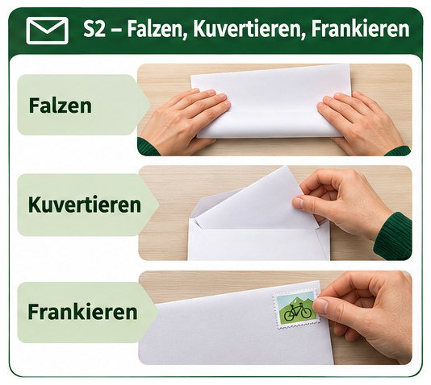
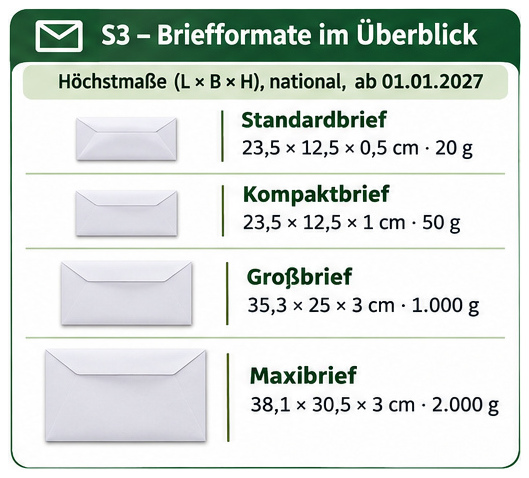
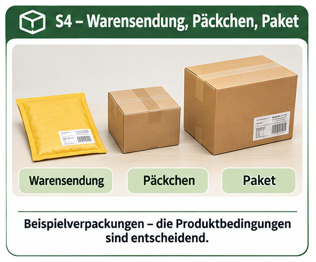

# M2 – Postausgang

Versand vorbereiten.

## Wie wird die Ausgangspost vorbereitet?

1. **Unterschriftsvorbereitung:** erforderliche Unterschriften einholen bzw. kontrollieren.
2. **Anlagenüberprüfung:** alle genannten Anlagen auf Vollständigkeit prüfen.
3. **Falzen:** Schriftstücke auf das passende Format falten.
4. **Kuvertieren und Verschließen:** Schriftstücke einlegen und Umschlag verschließen.
5. **Adressieren:** vollständige Empfängeranschrift kontrollieren.
6. **Wiegen und Frankieren:** Maße und Gewicht der fertigen Sendung ermitteln und das passende Porto entrichten.

## Welche Briefformate gibt es?

Höchstmaße im nationalen Versand der Deutschen Post, Stand für Unterricht ab **01.01.2027**:

| Format | Länge × Breite × Dicke max. | Gewicht max. |
|---|---|---:|
| Standardbrief | 23,5 × 12,5 × 0,5 cm | 20 g |
| Kompaktbrief | 23,5 × 12,5 × 1 cm | 50 g |
| Großbrief | 35,3 × 25 × 3 cm | 1.000 g |
| Maxibrief | 38,1 × 30,5 × 3 cm | 2.000 g |

Alle maßgeblichen Produktbedingungen (auch Mindestmaße und Formvorgaben) sind einzuhalten.

## Welche Versandarten sind geeignet?

- **Gewöhnlicher Brief:** für Dokumente ohne besonderen Zustellnachweis; Basis-Sendungsverfolgung ist nicht mit einem individuellen Zustellnachweis gleichzusetzen.
- **Werbesendungen:** z. B. DIALOGPOST für geeignete Werbeinhalte und Mengen. Infobrief ist eine historische Bezeichnung, kein aktuelles Angebot.
- **Warensendung:** für geeignete Waren unter den jeweiligen Produktbedingungen, wenn besondere Zustellanforderungen nicht im Vordergrund stehen.
- **Päckchen:** für kleinere, leichtere Waren mit geringem Wert. DHL national ab 01.01.2027: bis 1 kg, Sendungsverfolgung und Haftung bis 20 €.
- **Paket:** für größere, schwerere oder höherwertige Waren; DHL national bietet bei regulären Paketen beispielsweise Sendungsverfolgung und Haftung bis 500 €. Bei wertvollen Waren zusätzliche Absicherung prüfen.

Die Verpackung allein legt die Versandart nicht fest. Entscheidend sind Inhalt, Maße, Gewicht, Wert, Frist, Nachweisbedarf und die Bedingungen des Versanddienstleisters.

## Welche Zusatzleistungen gibt es?

- Einschreiben Einwurf: dokumentierter Einwurf in Briefkasten oder Postfach.
- Einschreiben (Übergabe): dokumentierte Übergabe an eine empfangsberechtigte Person.
- Einschreiben Rückschein: zusätzliche Zustellbestätigung nach den Produktbedingungen.
- Transportversicherung: gegebenenfalls zusätzliche finanzielle Absicherung.

Ein Einschreiben weist nicht automatisch den Inhalt des Schreibens nach und garantiert keinen bestimmten Zustelltermin.

## Was sind KEP-Dienste?

Kurierdienste ermöglichen individuell organisierte Transporte, Expressdienste eine besonders schnelle Beförderung mit produktabhängigen Zustellbedingungen, Paketdienste die reguläre Beförderung über ein Verteilernetz. Die Sendungsverfolgung ermöglicht Statusabfragen, aber keine automatische Zustellgarantie oder vollständige Absicherung.

## Wie wird elektronische Ausgangspost vorbereitet?

Empfänger, Betreff, Inhalt, richtige Anlagen und Schutz vertraulicher Informationen prüfen. Relevante Geschäftsdokumente nach den Ablagevorgaben sichern.

**Anbieterquelle (Abruf 26.11.2026):** https://www.deutschepost.de/de/a/aenderungen2027.html – angekündigte Änderungen ab 01.01.2027. Preise und Produktbedingungen können sich ändern; vor dem Unterricht bei Bedarf abgleichen.
