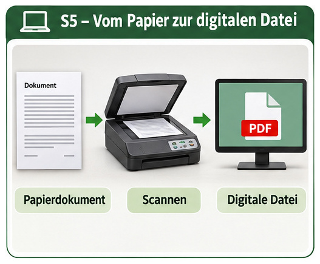
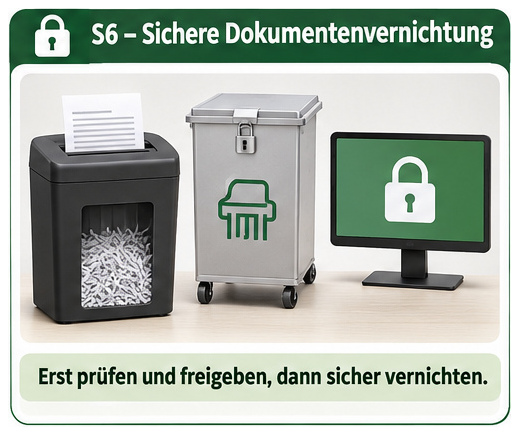

# M3 – Dokumente richtig verwalten

Digitale Ablage und Zugriff.

## Warum werden Dokumente digital abgelegt?

Einheitliche Ablage erleichtert das Wiederfinden von Unterlagen und die Bearbeitung von Geschäftsvorgängen. Sie schützt Informationen vor Verlust und unberechtigtem Zugriff.

Beim Scannen müssen die Unterlagen vollständig und lesbar sein. Elektronische Originale sind in ihrer erforderlichen Form aufzubewahren; ein Scan erlaubt nicht in jedem Fall die Vernichtung des Papieroriginals. Aufbewahrung, Unveränderbarkeit und Nachvollziehbarkeit sind sicherzustellen.

## Wie werden Dateien benannt?

**Datum_Dokumentenart_Geschäftspartner_Belegnummer**

Datum im Format 20XX-MM-DD. Wenn keine Belegnummer vorhanden ist, entfällt dieser Bestandteil; für interne Dokumente wird ein sinnvoller interner Bezeichner verwendet. Keine unbekannten Belegnummern erfinden.

## Wie werden Dokumente abgelegt?

| Hauptordner | Unterordner |
|---|---|
| 01 Verwaltung | Allgemeiner Schriftverkehr; Verträge |
| 02 Verkauf und Marketing | Kundenanfragen; Angebote; Kundenbestellungen; Auftragsbestätigungen; Reklamationen |
| 03 Einkauf | Lieferantenangebote; Bestellungen an Lieferanten |
| 04 Rechnungswesen | Eingangsrechnungen; Ausgangsrechnungen; Jahresabschlüsse; Inventare |
| 05 Personal | Personalunterlagen; Gehaltsabrechnungen |
| 06 Lager und Logistik | Lieferscheine; Versandunterlagen |

Innerhalb der Unterordner erfolgt die Ablage nach Kalenderjahren.

## Wer darf auf Dokumente zugreifen?

Die zuständige Abteilung erhält die für ihre Aufgaben erforderlichen Rechte. Die Geschäftsleitung erhält Zugriff bei betrieblichem Bedarf. Andere Bereiche erhalten Zugriff nur, wenn dies erforderlich und genehmigt ist. Das Sekretariat verfügt über die zur Weiterleitung und Ablage erforderlichen Rechte. Besonders vertrauliche Personalunterlagen werden nur Berechtigten zugänglich gemacht.

## Wie lange werden Dokumente aufbewahrt?

| Frist | Beispiele |
|---|---|
| 6 Jahre | Empfangene und abgesandte Handels- bzw. Geschäftsbriefe, geschäftsbezogene Angebote, Bestellungen, Auftragsbestätigungen, Reklamationen |
| 8 Jahre | Buchungsbelege, Eingangs- und Ausgangsrechnungen, Quittungen, Gehaltsabrechnungen soweit als Buchungsbelege verwendet |
| 10 Jahre | Handelsbücher, Inventare, Jahresabschlüsse, Bilanzen |

Bei Geschäftsbriefen beginnt die Frist mit Ablauf des Kalenderjahres des Empfangs oder Versands; bei Buchungsbelegen mit Ablauf des Entstehungsjahres. Bei Jahresabschlüssen sind die gesetzlichen Anknüpfungspunkte zu beachten (HGB: Feststellung; AO: Aufstellung). Weitere Aufbewahrungsgründe können eine längere Aufbewahrung notwendig machen.

## Wann und wie werden Dokumente vernichtet?

Fristablauf, weitere Aufbewahrungsgründe (z. B. laufende Prüfungen oder Rechtsstreitigkeiten) und betriebliche Freigabe prüfen. Vertrauliches Papier mit geeigneten Aktenvernichtern oder über einen zugelassenen betrieblichen Vernichtungsdienst entsorgen. Digitale Unterlagen nach Freigabe durch die zuständige IT sicher löschen lassen; der digitale Papierkorb reicht nicht.

Rechtsgrundlagen: [§ 257 HGB](https://www.gesetze-im-internet.de/hgb/__257.html) und [§ 147 AO](https://www.gesetze-im-internet.de/ao_1977/__147.html), Abruf 26.11.2026. Didaktisch vereinfachte Zuordnung für die vorliegenden Geschäftsfälle.
