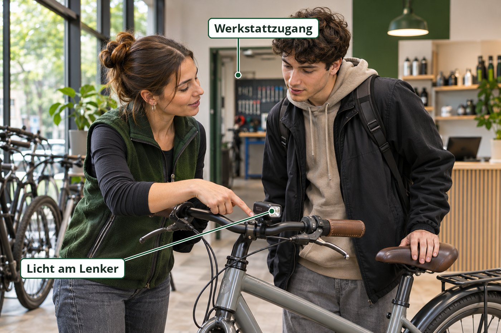
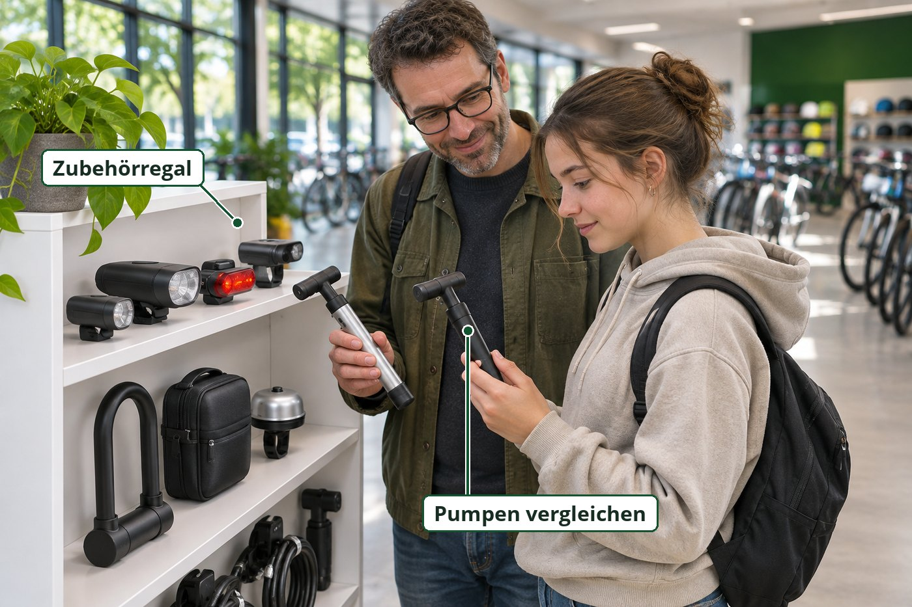
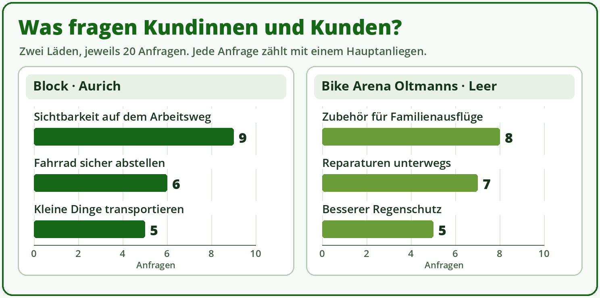

# BFS dual · LF 06 · LS 6.1 · Die Nachfrage an zwei Standorten vergleichen

**Zwei Läden, eine Freigabe** · Global Bike Deutschland GmbH · 2. Halbjahr

**Zeit** · 6 Unterrichtsstunden · 270 Minuten

## Orientierung

### Warum wir das lernen

5 Minuten

Passt das neue Licht an euren Lenker? Welche Pumpe passt zu den Rädern für den Familienausflug? Für die Aktion vergleicht ihr die Kundenanfragen, die Beratung und den Platz bei Block in Aurich und in der Bike Arena in Leer. So könnt ihr begründen, welche Waren jeder Laden braucht und wie die Kundschaft sie dort findet oder ausprobiert.

### Das übe ich

| Kompetenz | Wie stark? (1–6) | Das übe ich |
| --- | ---: | --- |
| Fachkompetenz | 6 | Ich vergleiche zwei Läden. Ich schaue auf Nachfrage, Verkaufsform und Fläche. Aus den Unterschieden leite ich Anforderungen an das Sortiment und die Warenpräsentation ab. Ich begründe diese Anforderungen für jeden Laden. Ich erkenne, welche Vorgaben der Laden unbedingt erfüllen muss. |
| Personalkompetenz | 3 | Ich prüfe meine erste Idee mit Belegen. |
| Sozialkompetenz | 3 | Ich höre die Ideen der anderen an. Ich begründe im Team, was für mich am wichtigsten ist. |
| Methodenkompetenz | 4 | Ich ordne die Angaben zu beiden Läden nach denselben Kriterien. |
| Medienkompetenz | 3 | Ich finde in einer Tabelle, Sprachnachricht oder Skizze die Angaben für meine Entscheidung. |

## Handlungssituation

7 Minuten

Global Bike liefert Fahrradzubehör an Fachgeschäfte. Für das Frühjahr plant das Unternehmen eine Aktion mit zwei Fahrradläden in Ostfriesland. Beide wollen eine Woche lang ausgewähltes Zubehör in ihren Läden zeigen. Um 8.12 Uhr klingelt bei Global Bike das Telefon. Das 2-Rad Center Block aus Aurich ist dran. Dort lassen sich viele Menschen beraten, die mit dem Rad zur Arbeit fahren. Für die Aktion hat der Laden nur eine schmale Fläche.

Kurz darauf ruft die Bike Arena Oltmanns an, ein Fahrradgeschäft in Leer. Dort steht für die Aktion mehr Platz zur Verfügung. Am Samstag erwartet der Laden viele Familien, die eine Radtour planen. Sie sollen das Zubehör auf der Aktionsfläche selbst finden und vergleichen können.

Sarah Huber plant bei Global Bike die Werbung. Sie schlägt vor, für beide Läden dasselbe Angebot und denselben Aufbau zu planen. „So können wir die gemeinsame Aktion leichter vorbereiten.“ Sebastian Wolf betreut für Global Bike die beiden Geschäfte. Er zeigt Sarah, was die Läden über ihre Kundschaft berichtet haben. „Schau, wie die Leute dort einkaufen. Ein Aufbau kann in einem Laden gut passen. Im anderen Laden könnte er den Weg versperren oder die Auswahl erschweren.“

Um 10 Uhr kommen beide Läden zur Besprechung. Jan Richter leitet Verkauf und Marketing. Er braucht von euch einen Vergleich mit Belegen. Daraus muss er erkennen können, welche Vorgaben für jeden Laden zwingend sind. Er will auch wissen, welcher Unterschied für die Aktion am wichtigsten ist.

*2-Rad Center Block, Aurich · Beratung am eigenen Rad.*

*Bike Arena Oltmanns, Leer · Pumpen am Regal vergleichen.*

### Den Fall prüfen

### Aufgabe 01 · Was erfährt Global Bike beim ersten Anruf über Kundschaft, Beratung und Fläche?

3 Minuten

- Familien suchen Rat für Ausflüge. Für die Aktion gibt es eine große Fläche.
- Pendler suchen Rat zum Arbeitsweg. Für die Aktion gibt es eine schmale Fläche.
- Familien vergleichen selbst Zubehör. Für die Aktion gibt es eine schmale Fläche.
- Pendler vergleichen selbst Zubehör. Für die Aktion gibt es eine große Fläche.
- Pendler suchen Rat zum Arbeitsweg. Für die Aktion gibt es eine große Fläche.
- Familien suchen Rat für Radtouren. Für die Aktion gibt es eine schmale Fläche.

Hilfe

Lest den Absatz zu Block. Beginnt mit „Die Kundschaft sucht … Beim Kauf … Die Fläche …“.

### Aufgabe 02 · Was ist in der Bike Arena anders als bei Block?

3 Minuten

- Familien erhalten auf weniger Fläche eine persönliche Beratung für ihre Ausflüge.
- Pendler suchen auf mehr Fläche nach passendem Zubehör für ihren täglichen Arbeitsweg.
- Pendler erhalten auf weniger Fläche eine persönliche Beratung für ihren Arbeitsweg.
- Familien vergleichen auf mehr Fläche selbst passendes Zubehör für ihre Ausflüge.
- Familien vergleichen auf weniger Fläche das Zubehör für ihre geplanten Ausflüge.
- Pendler vergleichen auf weniger Fläche selbst das Zubehör für ihren Arbeitsweg.

Hilfe

Vergleicht die Absätze zum Anruf von Block und zum Anruf der Bike Arena. Beginnt mit „Bei Block … In der Bike Arena dagegen …“.

### Aufgabe 03 · Worin sind sich Sarah und Sebastian bei der Planung uneinig?

3 Minuten

- Sarah will einen gemeinsamen Aufbau. Sebastian will die Unterschiede der Läden berücksichtigen.
- Sarah will verschiedene Aufbauten. Sebastian will die gemeinsame Vorbereitung vereinfachen.
- Sarah will den Aufbau in Leer testen. Sebastian will die Aktion zuerst in Aurich erproben.
- Sarah will das Angebot verkleinern. Sebastian will das gesamte Zubehör in beiden Läden zeigen.
- Sarah will zuerst die Pendler ansprechen. Sebastian will zuerst die Familien in Leer erreichen.
- Sarah will in Aurich weniger Ware zeigen. Sebastian will in Leer die Angebotsfläche verkleinern.

Hilfe

Lest den Absatz über Sarah und Sebastian. Beginnt mit „Sarah möchte … Sebastian sagt dagegen …“.

### Aufgabe 04 · Was braucht Jan für die Besprechung um 10 Uhr?

3 Minuten

- Einen Warenplan mit Bestellmengen für beide Läden und den Lieferterminen für die Aktionswoche.
- Einen Aufbauplan mit Regalmaßen für beide Läden und den Laufwegen für Kundschaft und Personal.
- Einen Vergleich mit Belegen für die Pflichtvorgaben je Laden und für den wichtigsten Unterschied.
- Einen Werbeplan mit Texten für beide Läden und den passenden Bildern für die Frühjahrsaktion.
- Einen Zeitplan für die Lieferungen an beide Läden und für das Einräumen der Ware vor Aktionsbeginn.
- Einen Preisvergleich für das Zubehör beider Läden und einen Vorschlag für gemeinsame Aktionspreise.

Hilfe

Lest den letzten Absatz. Beginnt mit „Für das Treffen braucht Jan … Daraus will er erkennen, …“.

## Informieren

### Aufgabe 05 · Die beiden Läden vergleichen

29 Minuten

**Kundenorientierung** heißt, dass das Angebot zu den Menschen passt, die im Laden einkaufen.

**Vergleicht** die Läden mit [M1](#m1) bis [M3](#m3). Notiert mindestens einen Unterschied bei der Nachfrage, einen bei der Verkaufsform und einen bei der Fläche. Schreibt jeweils dazu, woran ihr den Unterschied erkennt.

## Fachbegriffscheck

17 Minuten

**Wählt** zu jedem Fachbegriff die passende Erklärung aus sechs Möglichkeiten. Die Begriffe findet ihr in [M6](#m6).

**1. Nachfragebeleg**

- A · Eine Übersicht über die Artikel im Katalog.
- B · Eine Liste der Regale, die der Laden nutzen kann.
- C · Eine festgehaltene Frage oder Rückmeldung. Sie zeigt, was die Kundschaft im Laden sucht.
- D · Eine Übersicht über wichtige Merkmale eines Ladens. Dazu gehören hier Kundschaft, Verkaufsform und Fläche.
- E · Die Menschen, für die ein Angebot oder eine Aktion gedacht ist.
- F · Das wichtigste Thema einer einzelnen Anfrage. In der Auswertung zählt die Anfrage zu diesem Thema.

**2. Verkaufsform**

- A · Die Fläche, die der Laden für eine Aktion frei hält.
- B · Die Art, wie die Kundschaft Ware auswählt und bekommt. Dazu gehört auch, wie das Personal dabei hilft.
- C · Die Artikelgruppe, die beide Läden anbieten.
- D · Der Bereich im Laden, den das Geschäft für eine Verkaufsaktion nutzt.
- E · Ein festes Verhältnis. Es zeigt, welche Länge im Laden zu einer Länge im Plan passt.
- F · Ein freistehendes Regal. Die Kundschaft kommt von zwei gegenüberliegenden Seiten an das Regal.

**3. Aktionsfläche**

- A · Die Zeit, in der es das beworbene Angebot gibt.
- B · Der gesamte Bereich zwischen Eingang und Kasse.
- C · Der Bereich im Laden, den das Geschäft für eine Verkaufsaktion nutzt.
- D · Ein festes Verhältnis. Es zeigt, welche Länge im Laden zu einer Länge im Plan passt.
- E · Ein freistehendes Regal. Die Kundschaft kommt von zwei gegenüberliegenden Seiten an das Regal.
- F · Die Art, wie die Kundschaft Ware auswählt und bekommt. Dazu gehört auch, wie das Personal dabei hilft.

**4. Zwingende Anforderung**

- A · Eine Vorgabe, die ihr im Vorschlag unbedingt einhalten müsst.
- B · Eine Verbesserung, die das Team bei mehr Platz umsetzen kann.
- C · Eine Anforderung, für die sich die meisten Kunden interessieren.
- D · Eine sinnvolle Verbesserung. Wenn Platz oder andere Möglichkeiten fehlen, könnt ihr darauf verzichten.
- E · Das wichtigste Thema einer einzelnen Anfrage. In der Auswertung zählt die Anfrage zu diesem Thema.
- F · Eine Übersicht über wichtige Merkmale eines Ladens. Dazu gehören hier Kundschaft, Verkaufsform und Fläche.

**5. Standortprofil**

- A · Ein Plan mit allen Wänden und Wegen im Laden.
- B · Eine Liste, in der nur verkaufte Artikel stehen.
- C · Eine Übersicht über wichtige Merkmale eines Ladens. Dazu gehören hier Kundschaft, Verkaufsform und Fläche.
- D · Eine festgehaltene Frage oder Rückmeldung. Sie zeigt, was die Kundschaft im Laden sucht.
- E · Die Menschen, für die ein Angebot oder eine Aktion gedacht ist.
- F · Das wichtigste Thema einer einzelnen Anfrage. In der Auswertung zählt die Anfrage zu diesem Thema.

**6. Zielgruppe**

- A · Die Menschen, für die ein Angebot oder eine Aktion gedacht ist.
- B · Die Personen, die das Angebot im Laden zusammenstellen.
- C · Die Artikel, die zur gleichen Aktion gehören.
- D · Eine festgehaltene Frage oder Rückmeldung. Sie zeigt, was die Kundschaft im Laden sucht.
- E · Eine Übersicht über wichtige Merkmale eines Ladens. Dazu gehören hier Kundschaft, Verkaufsform und Fläche.
- F · Das wichtigste Thema einer einzelnen Anfrage. In der Auswertung zählt die Anfrage zu diesem Thema.

**7. Hauptanliegen**

- A · Das wichtigste Thema einer einzelnen Anfrage. In der Auswertung zählt die Anfrage zu diesem Thema.
- B · Das Thema, nach dem die Kundschaft im ganzen Laden am häufigsten fragt.
- C · Die Frage, die das Personal im Gespräch zuerst beantwortet.
- D · Eine festgehaltene Frage oder Rückmeldung. Sie zeigt, was die Kundschaft im Laden sucht.
- E · Eine Übersicht über wichtige Merkmale eines Ladens. Dazu gehören hier Kundschaft, Verkaufsform und Fläche.
- F · Die Menschen, für die ein Angebot oder eine Aktion gedacht ist.

**8. Maßstab**

- A · Das Verhältnis zwischen den Flächen beider Läden.
- B · Die Mindestbreite für einen Weg im Laden.
- C · Ein festes Verhältnis. Es zeigt, welche Länge im Laden zu einer Länge im Plan passt.
- D · Der Bereich im Laden, den das Geschäft für eine Verkaufsaktion nutzt.
- E · Ein freistehendes Regal. Die Kundschaft kommt von zwei gegenüberliegenden Seiten an das Regal.
- F · Die Art, wie die Kundschaft Ware auswählt und bekommt. Dazu gehört auch, wie das Personal dabei hilft.

**9. Gondel**

- A · Ein Regal an der Wand, das nur von einer Seite erreichbar ist.
- B · Ein freistehender Halter für ein Schild.
- C · Ein freistehendes Regal. Die Kundschaft kommt von zwei gegenüberliegenden Seiten an das Regal.
- D · Der Bereich im Laden, den das Geschäft für eine Verkaufsaktion nutzt.
- E · Ein festes Verhältnis. Es zeigt, welche Länge im Laden zu einer Länge im Plan passt.
- F · Die Art, wie die Kundschaft Ware auswählt und bekommt. Dazu gehört auch, wie das Personal dabei hilft.

**10. Wünschenswerte Anforderung**

- A · Ein Kundenwunsch, den der Laden bereits erfüllt hat.
- B · Eine sinnvolle Verbesserung. Wenn Platz oder andere Möglichkeiten fehlen, könnt ihr darauf verzichten.
- C · Eine Vorgabe, die ihr beim Aufbau unbedingt einhalten müsst.
- D · Eine Vorgabe, die ihr im Vorschlag unbedingt einhalten müsst.
- E · Das wichtigste Thema einer einzelnen Anfrage. In der Auswertung zählt die Anfrage zu diesem Thema.
- F · Eine Übersicht über wichtige Merkmale eines Ladens. Dazu gehören hier Kundschaft, Verkaufsform und Fläche.

## Planen

### Aufgabe 06 · Belege ordnen

20 Minuten

**Ordnet** eure Belege nach Laden und Thema. Markiert, welche Hinweise zur Auswahl der Waren gehören und welche dazu, wie der Laden sie zeigt.

## Entscheiden

### Aufgabe 07 · Lernpaket wählen und begründen

8 Minuten

**Wählt** einen der drei Arbeitswege. Überlegt, welcher Weg euch bei der Entscheidung am besten hilft. **Haltet** beim Arbeiten ein Zwischenergebnis und einen Beleg für den Pitch fest. Ein Beleg kann zum Beispiel eine Zahl, ein Maß oder eine Kundenstimme sein.

**Euer Auftrag für Jan Richter.** Vergleicht die Nachfrage, die Verkaufsform und die Fläche der beiden Läden. Leitet daraus Anforderungen an das Sortiment und die Präsentation ab. Nutzt die Vergleichsmatrix in M5 für Jan Richter. Nennt je Laden drei Anforderungen und belegt sie. Erklärt, welche davon zwingend und welche wünschenswert sind. Nennt zum Schluss den wichtigsten Unterschied und seine Folge für die Aktion.

| Lernpaket | Lernzugänge | So arbeitet ihr | Euer Zwischenergebnis | Wählt dieses Paket, wenn … |
| --- | --- | --- | --- | --- |
| **A · Ladenprofile und Flächen vergleichen** | Lesen, vergleichen und skizzieren | Legt die Profile M1 und M2 nebeneinander. Kennzeichnet Nachfrage und Verkaufsform mit Farben oder Kürzeln. Zeichnet beide Flächen mit der Skizzenhilfe in M3. Markiert die Wege, die frei bleiben müssen. | Ihr habt zwei beschriftete Skizzen und markierte Belege. Damit erkennt ihr Gemeinsamkeiten und Unterschiede beim Angebot und beim Aufbau. | … ihr Unterschiede gern in Texten und Zeichnungen markiert. |
| **B · Die Stimmen beider Läden auswerten** | Zuhören, besprechen und notieren | Hört M4 an oder lest euch die Nachrichten vor. Sprecht darüber, was ihr zu Nachfrage, Verkaufsform und Fläche erfahren habt. Prüft Zahlen und Maße in M1 bis M3. | Ihr habt eine kurze Notiz für jeden Laden. Darin steht, welche Aussage eure Anforderung stützt und welche Angaben ihr geprüft habt. | … ihr Informationen gern hört und im Gespräch ordnet. |
| **C · Ladenflächen im Modell erproben** | Grundrisse legen und Modelle ausprobieren | Zeichnet oder legt beide Flächen mit der Skizzenhilfe in M3. Schreibt Beobachtungen aus M1 und M2 auf Karten. Ordnet sie den Läden zu. Verschiebt Regale und Tische aus Papier. Probiert aus, was auf der Fläche erreichbar bleibt. | Ihr habt markierte Grundrisse und Karten mit Belegen zur Nachfrage und zur Verkaufsform. Im Modell seht ihr, wo der Platz den Zugriff auf Waren erschwert. | … ihr Raum und Wege gern mit einem Modell erkundet. |

### Aufgabe 08 · Anforderungen festlegen

42 Minuten

**Leitet** mit eurem Lernpaket für jeden Laden drei Anforderungen aus den Belegen ab. Schreibt zu jeder Anforderung „zwingend“ oder „wünschenswert“. Entscheidet, welcher Unterschied zwischen den Läden für die Aktion am wichtigsten ist.

## Durchführen

### Aufgabe 09 · Vergleichsmatrix ausfüllen

#### A · Ladenprofile und Flächen vergleichen

30 Minuten

Legt die Profile M1 und M2 nebeneinander. Kennzeichnet Nachfrage und Verkaufsform mit Farben oder Kürzeln. Zeichnet beide Flächen mit der Skizzenhilfe in M3. Markiert die Wege, die frei bleiben müssen.

Ihr habt zwei beschriftete Skizzen und markierte Belege. Damit erkennt ihr Gemeinsamkeiten und Unterschiede beim Angebot und beim Aufbau.

#### B · Die Stimmen beider Läden auswerten

30 Minuten

Hört M4 an oder lest euch die Nachrichten vor. Sprecht darüber, was ihr zu Nachfrage, Verkaufsform und Fläche erfahren habt. Prüft Zahlen und Maße in M1 bis M3.

Ihr habt eine kurze Notiz für jeden Laden. Darin steht, welche Aussage eure Anforderung stützt und welche Angaben ihr geprüft habt.

#### C · Ladenflächen im Modell erproben

30 Minuten

Zeichnet oder legt beide Flächen mit der Skizzenhilfe in M3. Schreibt Beobachtungen aus M1 und M2 auf Karten. Ordnet sie den Läden zu. Verschiebt Regale und Tische aus Papier. Probiert aus, was auf der Fläche erreichbar bleibt.

Ihr habt markierte Grundrisse und Karten mit Belegen zur Nachfrage und zur Verkaufsform. Im Modell seht ihr, wo der Platz den Zugriff auf Waren erschwert.

**Füllt** die Vergleichsmatrix in [M5](#m5) aus. Schreibt die Anforderungen so, dass Jan Richter weiß, worauf Global Bike bei der Warenauswahl und beim Aufbau achten muss.

### Aufgabe 10 · Den wichtigsten Unterschied erklären

25 Minuten

**Schreibt** unter die sechs Zeilen in [M5](#m5), welcher Unterschied die Aktion am stärksten verändert. Zeigt an einer Zeile aus jedem Laden, warum ihr ihn gewählt habt.

## Bewerten

### Aufgabe 11 · Die Arbeit prüfen und kurz vorstellen

46 Minuten

#### Belege prüfen

**Prüft** zu jeder Anforderung, ob der gewählte Beleg dazu passt. **Verbessert** eure Formulierung, wenn sie für den Laden zu allgemein ist oder sich aus dem Beleg nicht ableiten lässt.

#### Die eigene Arbeit einschätzen

**Nennt** den Beleg, der eure erste Einschätzung am stärksten verändert hat. Erklärt kurz, was ihr jetzt anders seht.

**Schätzt** euch zur Fachkompetenz dieser LS ein. Wählt eine Stufe. Zeigt eine Stelle in eurer Arbeit, die dazu passt.

1 · Ich brauche Hilfe bei jedem Schritt. 2 · Mit einzelnen Tipps komme ich weiter. 3 · Ich kann die Aufgabe selbst lösen und begründen. 4 · Ich kann das auch in einem neuen Fall.

#### Abschlusspitch

**Pitcht** euer Lernpaket. Ein Pitch ist eine kurze Vorstellung. Nutzt euer Handlungsprodukt und eure Unterlagen. Ihr habt für den Kurzpitch etwa zwei Minuten. Wenn noch Zeit ist, beantwortet eine Rückfrage.

1.  **Ergebnis zeigen.** Zeigt euer Handlungsprodukt. Sagt, was ihr entschieden habt.
2.  **Entscheidung belegen.** Zeigt einen Beleg aus den Unterlagen. Erklärt, wie er eure Entscheidung stützt.
3.  **Arbeitsweg begründen.** Sagt, warum ihr euer Lernpaket gewählt habt. Zeigt ein Zwischenergebnis. Erklärt, wie es euch bei der Entscheidung geholfen hat.

Zeigt eine Anforderung aus eurer Matrix. Sagt, ob sie zwingend oder wünschenswert ist. Zeigt die Kundenstimme, die Zahl oder das Flächenmaß, mit dem ihr das begründet.

Sprachhilfe für den Pitch

- „Unser Ergebnis ist … Wir schlagen vor, dass …“
- „Unser Beleg ist … Er zeigt, dass …“
- „Wir haben Paket … gewählt. Beim Arbeiten hat uns … geholfen.“

### Aufgabe 12 · Das Produkt für den Peer-Check bereitstellen

6 Minuten

**Ladet eure Vergleichsmatrix hoch.** Bei einer Teamarbeit gibt jede Person eine Kopie im eigenen Moodle-Konto ab. Wählt einen Titel und einen Dateinamen ohne eure Namen. Entfernt eure Namen aus der Arbeit und aus den Dateieigenschaften.

Ohne eingerichtete Moodle-Aktivität erhältst du von der Lehrkraft eine codierte Arbeit.

### Aufgabe 13 · Ein fremdes Produkt prüfen

12 Minuten

**Schaut euch die zugeteilte Arbeit an.** Moodle lost aus, welche Arbeit ihr bekommt. Ihr seht die Arbeit ohne Namen.

**Gebt Rückmeldung.** Nutzt die Fragen unter dieser Aufgabe. Nennt eine Stelle, die gut gelungen ist. Schreibt, was die Person verbessern kann. Die Person sieht bei eurer Antwort euren Klarnamen.

- Nennt die Matrix je Laden drei klare Anforderungen an Sortiment und Präsentation?
- Passen die Belege dazu? Ist klar, was zwingend und was wünschenswert ist?
- Zeigt die Matrix den wichtigsten Unterschied und seine Folge für die Aktion?

[Peer-Check im Lernpaket öffnen](peer-check.html)

### Aufgabe 14 · Die empfangene Rückmeldung nutzen

6 Minuten

**Lest** nach der Freigabe die Rückmeldung zu eurer Arbeit. Verbessert eine Stelle oder erklärt, warum ihr bei eurer Lösung bleibt.

## Reflektieren

### Aufgabe 15 · Feedback zur Lernsituation

5 Minuten

**Füllt** die Aktivität „Feedback“ im Moodle-Kurs aus und sendet eure Rückmeldung dort ab. Falls der Verweis fehlt, öffnet „Feedback“ in der Kursübersicht.

[Feedback in Moodle öffnen](https://bbs1aur.moodle-nds.de/mod/feedback/view.php?id=79763)

## Handlungsprodukt und Kriterien

**Vergleichsmatrix für Jan Richter.** Für jeden Laden stehen drei verschiedene Anforderungen an Sortiment und Präsentation in der Matrix. Zu jeder nennt ihr einen Beleg und begründet, ob sie zwingend oder wünschenswert ist. Im letzten Feld stehen der wichtigste Unterschied und seine Folge für die Aktion.

## Materialien

### M1 · Kurzprofil 2-Rad Center Block, Aurich

**Website des Betriebs.** Das Auricher Fachgeschäft beschreibt persönliche Beratung und Probefahrten. <a href="https://www.zweirad-block.de/unternehmen/" target="_blank" rel="noopener noreferrer">Unternehmensprofil</a>

**[Standortprofil](#gl-standortprofil) für die Frühjahrsaktion**

| Merkmal                               | Beobachtung                                                                                                                                                                                                             |
|---------------------------------------|-------------------------------------------------------------------------------------------------------------------------------------------------------------------------------------------------------------------------|
| [Nachfragebelege](#gl-nachfragebeleg) | Block hat 20 Anfragen notiert. Neun betrafen Sichtbarkeit auf dem Arbeitsweg, sechs sicheres Abstellen und fünf den Transport kleiner Dinge. Zu jeder Anfrage hat Block ein [Hauptanliegen](#gl-hauptanliegen) notiert. |
| [Verkaufsform](#gl-verkaufsform)      | Eine Fachkraft berät persönlich. Viele Kundinnen und Kunden bringen ihr Fahrrad mit. Die Beratung findet am Werkstattzugang statt. Dort ist Platz, um das Fahrrad abzustellen.                                          |
| Kundenstimme                          | „Ich stelle mein Rad jeden Tag am Bahnhof ab. Vor dem Kauf möchte ich sehen, ob das Schloss durch den Rahmen passt.“                                                                                                    |
| Kundenstimme                          | „Ich bin abends unterwegs. Könnte ich sehen, wie man das Licht am Lenker befestigt?“                                                                                                                                    |

*Bei Block zeigt die Verkäuferin das Licht am Fahrrad des Kunden.*

### M2 · Kurzprofil Bike Arena Oltmanns, Leer

**Website des Betriebs.** Das Fahrradfachgeschäft in Leer nennt eine Ladenfläche von 1.400 m². Es bietet Beratung und Zubehör im Laden an. <a href="https://www.bikearena-oltmanns.de/unser-laden" target="_blank" rel="noopener noreferrer">Unser Laden</a>

| Merkmal                                      | Beobachtung                                                                                                                                                                                                       |
|----------------------------------------------|-------------------------------------------------------------------------------------------------------------------------------------------------------------------------------------------------------------------|
| Kundschaft und [Zielgruppen](#gl-zielgruppe) | Die Bike Arena hat 20 Anfragen notiert. Acht betrafen Zubehör für Familienausflüge, sieben Reparaturen unterwegs und fünf besseren Regenschutz. Zu jeder Anfrage hat der Laden ein Hauptanliegen notiert.         |
| Verkauf                                      | Die Kundschaft wählt die Ware auf der Aktionsfläche selbst aus. Das nennt man Selbstbedienung. Samstags ist dort niemand fest für die Beratung eingeteilt. Fragen kann die Kundschaft an der Information stellen. |
| Kundenstimme                                 | „Wir wollen am Wochenende mit den Kindern los. Ich möchte auf einen Blick erkennen, welche Pumpe zu unseren Ventilen passt.“                                                                                      |
| Kundenstimme                                 | „Wo liegt das Zubehör, das wir unterwegs bei einer Panne brauchen?“                                                                                                                                               |

*In der Bike Arena vergleicht die Kundschaft die Pumpen direkt am Regal.*

*Beide Läden haben je 20 Anfragen erfasst. Die Anliegen unterscheiden sich je nach Standort.*

### M3 · Flächen und Warenträger

Ein [Maßstab](#gl-ma%C3%9Fstab) hilft beim Verkleinern. Zum Beispiel steht bei 1:20 ein Zentimeter im Plan für 20 Zentimeter im Laden. Haltet die genannten Gänge und Zugänge frei. Das ist eine [zwingende Anforderung](#gl-zwingende-anforderung).

| Standort   | Verfügbare [Aktionsfläche](#gl-aktionsfl%C3%A4che)                  | Umgebung und Ausstattung                                                                                                                                                                                         |
|------------|---------------------------------------------------------------------|------------------------------------------------------------------------------------------------------------------------------------------------------------------------------------------------------------------|
| Block      | 3,60 m × 3,20 m. Der feste Beratungstresen steht auf dieser Fläche. | Links verläuft ein 1,20 m breiter Hauptdurchgang zum Werkstattzugang. Ihr habt zwei Rollregale (je 1,00 m × 0,40 m) und einen niedrigen Tisch (0,80 m × 0,55 m). Lasst Platz für die Beratung mit einem Fahrrad. |
| Bike Arena | Die Fläche ist rechteckig und misst 6,40 m × 3,50 m.                | Der Hauptgang verläuft an der 6,40-m-Seite. Ihr habt zwei [Gondeln](#gl-gondel) (je 1,60 m × 0,60 m). Die Ware steht dort auf beiden Seiten. Dazu gibt es einen freistehenden Schildhalter (0,40 m × 0,40 m).    |

**Skizzenhilfe für die beiden Ladenflächen.** Zeichnet pro Laden ein Rechteck für die Aktionsfläche. Nutzt je ein A4-Blatt im Querformat und den Maßstab 1:25. Ein Zentimeter auf dem Blatt steht für 25 Zentimeter im Laden. Zeichnet die breite Seite waagerecht.

- **Block.** Zeichnet links neben die Aktionsfläche den 1,20 m breiten Durchgang. Markiert am oberen Ende den Werkstattzugang. Zeichnet den festen Tresen rechts unten in die Aktionsfläche. Er ist 1,20 m breit und 0,70 m tief.
- **Bike Arena.** Zeichnet den 1,50 m breiten Hauptgang unter die lange Seite der Aktionsfläche. Markiert den Zugang links am Gang.

*Die Skizzen zeigen die Flächen und Warenträger beider Läden. Die Maße stehen direkt daneben.*

### M4 · Aussagen aus den beiden Läden

**Nachricht Block.** „Hier ist das 2-Rad Center Block in Aurich. Wir haben zwanzig Zubehöranfragen ausgewertet. Neun Fragen betrafen die Sichtbarkeit auf dem Arbeitsweg. Sechs betrafen sicheres Abstellen und fünf den Transport kleiner Dinge. Wir beraten persönlich. Wir sollten einer Kundin zeigen, wie sie das Licht am Lenker befestigt. Ein Kunde wollte ausprobieren, ob ein Schloss durch seinen Rahmen passt. Die Fläche ist drei Meter sechzig breit und drei Meter zwanzig tief. Darin steht der feste Tresen. Links liegt der einen Meter zwanzig breite Durchgang zur Werkstatt. Wir haben zwei Rollregale und einen kleinen Tisch. Wir brauchen Platz für ein Fahrrad bei der Beratung. Gang und Zugang müssen frei bleiben.“

**Nachricht Bike Arena.** „Hier meldet sich die Bike Arena Oltmanns aus Leer. Wir haben zwanzig Anfragen gezählt. Acht betrafen Familienausflüge, sieben Reparaturen unterwegs und fünf Regenschutz. Samstags ist dort niemand fest für die Beratung eingeteilt. Kunden fragen zum Beispiel nach Zubehör für Pannen. Sie wollen wissen, welche Pumpe zu ihrem Ventil passt. Unsere freie Fläche ist sechs Meter vierzig breit und drei Meter fünfzig tief. An der langen Seite ist der Hauptgang. Wir haben zwei Regale und einen Schildhalter. Die Kundschaft muss an beide langen Seiten der Regale kommen.“

### M5 · Vorlage für die Vergleichsmatrix

| Standort       | Bereich                     | Anforderung | Konkreter Beleg | Priorität und kurze Begründung  |
|----------------|-----------------------------|-------------|-----------------|---------------------------------|
| Block · 1      | Sortiment oder Präsentation | …           | …               | zwingend oder wünschenswert · … |
| Block · 2      | Sortiment oder Präsentation | …           | …               | zwingend oder wünschenswert · … |
| Block · 3      | Sortiment oder Präsentation | …           | …               | zwingend oder wünschenswert · … |
| Bike Arena · 1 | Sortiment oder Präsentation | …           | …               | zwingend oder wünschenswert · … |
| Bike Arena · 2 | Sortiment oder Präsentation | …           | …               | zwingend oder wünschenswert · … |
| Bike Arena · 3 | Sortiment oder Präsentation | …           | …               | zwingend oder wünschenswert · … |

Gebt bei jeder Anforderung die Priorität an. Unterscheidet zwischen zwingenden und [wünschenswerten Anforderungen](#gl-w%C3%BCnschenswerte-anforderung).

**Größter Unterschied und Folge für die Aktion:** …

### M6 · Fachbegriffe zu dieser Lernsituation

- **Nachfragebeleg.** Eine festgehaltene Frage oder Rückmeldung. Sie zeigt, was die Kundschaft im Laden sucht.
- **Verkaufsform.** Die Art, wie die Kundschaft Ware auswählt und bekommt. Dazu gehört auch, wie das Personal dabei hilft.
- **Aktionsfläche.** Der Bereich im Laden, den das Geschäft für eine Verkaufsaktion nutzt.
- **Zwingende Anforderung.** Eine Vorgabe, die ihr im Vorschlag unbedingt einhalten müsst.
- **Standortprofil.** Eine Übersicht über wichtige Merkmale eines Ladens. Dazu gehören hier Kundschaft, Verkaufsform und Fläche.
- **Zielgruppe.** Die Menschen, für die ein Angebot oder eine Aktion gedacht ist.
- **Hauptanliegen.** Das wichtigste Thema einer einzelnen Anfrage. In der Auswertung zählt die Anfrage zu diesem Thema.
- **Maßstab.** Ein festes Verhältnis. Es zeigt, welche Länge im Laden zu einer Länge im Plan passt.
- **Gondel.** Ein freistehendes Regal. Die Kundschaft kommt von zwei gegenüberliegenden Seiten an das Regal.
- **Wünschenswerte Anforderung.** Eine sinnvolle Verbesserung. Wenn Platz oder andere Möglichkeiten fehlen, könnt ihr darauf verzichten.

## Glossar

### Aktionsfläche

Der Bereich im Laden, den das Geschäft für eine Verkaufsaktion nutzt.

**Beispiel.** Beide Läden haben für die Frühjahrsaktion einen eigenen Bereich für Fahrradzubehör ([M3](#m3)).

### Gondel

Ein freistehendes Regal. Die Kundschaft kommt von zwei gegenüberliegenden Seiten an das Regal.

**Beispiel.** Auf der geplanten Aktionsfläche der Bike Arena gibt es zwei Gondeln. Auf beiden Seiten steht Ware ([M3](#m3)).

### Hauptanliegen

Das wichtigste Thema einer einzelnen Anfrage. In der Auswertung zählt die Anfrage zu diesem Thema.

**Beispiel.** Bei Block fragt ein Kunde nach einem passenden Schloss. Die Anfrage zählt zu „Fahrrad sicher abstellen“ ([M1](#m1)).

### Maßstab

Ein festes Verhältnis. Es zeigt, welche Länge im Laden zu einer Länge im Plan passt.

**Beispiel.** Bei 1:20 steht 1 cm im Plan für 20 cm im Laden ([M3](#m3)).

### Nachfragebeleg

Eine festgehaltene Frage oder Rückmeldung. Sie zeigt, was die Kundschaft im Laden sucht.

**Beispiel.** Bei Block geht es in neun Anfragen um Sichtbarkeit auf dem Arbeitsweg ([M1](#m1)).

### Standortprofil

Eine Übersicht über wichtige Merkmale eines Ladens. Dazu gehören hier Kundschaft, Verkaufsform und Fläche.

**Beispiel.** Im Profil von Block stehen zum Beispiel die persönliche Beratung und der freie Zugang zur Werkstatt ([M1](#m1), [M3](#m3)).

### Verkaufsform

Die Art, wie die Kundschaft Ware auswählt und bekommt. Dazu gehört auch, wie das Personal dabei hilft.

**Beispiel.** Block berät persönlich. Auf der geplanten Aktionsfläche der Bike Arena wählt die Kundschaft selbst aus ([M1](#m1), [M2](#m2)).

### Wünschenswerte Anforderung

Eine sinnvolle Verbesserung. Wenn Platz oder andere Möglichkeiten fehlen, könnt ihr darauf verzichten.

**Beispiel.** Gänge müssen frei bleiben. Bei der Beschriftung könnt ihr wählen. Nutzt ein zusätzliches Schild oder beschriftet das Regal direkt ([M3](#m3) und [M5](#m5)).

### Zielgruppe

Die Menschen, für die ein Angebot oder eine Aktion gedacht ist.

**Beispiel.** In der Bike Arena kommt zum Beispiel eine Aktion für Familien infrage, die am Wochenende Radtouren planen ([M2](#m2)).

### Zwingende Anforderung

Eine Vorgabe, die ihr im Vorschlag unbedingt einhalten müsst.

**Beispiel.** Der Zugang zur Werkstatt bei Block muss frei bleiben ([M3](#m3)).
