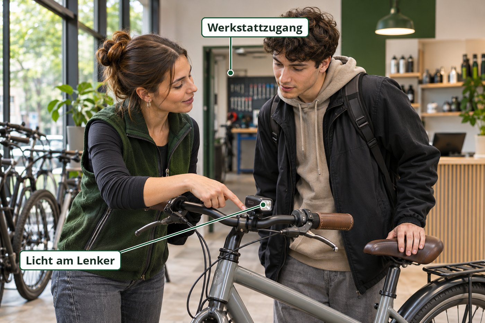

# M1 – Kurzprofil 2-Rad Center Block, Aurich

<figure>

<figcaption>Bei Block zeigt die Verkäuferin das Licht am Fahrrad des Kunden.</figcaption>
</figure>

**Website des Betriebs.** Das Auricher Fachgeschäft beschreibt persönliche Beratung und Probefahrten. <a href="https://www.zweirad-block.de/unternehmen/" target="_blank" rel="noopener noreferrer">Unternehmensprofil</a>

**<a href="../ls-glossar.html?from=material%2Fm1.html%23begriffsstelle-2#gl-standortprofil" id="begriffsstelle-2">Standortprofil</a> für die Frühjahrsaktion**

| Merkmal                                                                                                                             | Beobachtung                                                                                                                                                                                                                                                                                                           |
|-------------------------------------------------------------------------------------------------------------------------------------|-----------------------------------------------------------------------------------------------------------------------------------------------------------------------------------------------------------------------------------------------------------------------------------------------------------------------|
| <a href="../ls-glossar.html?from=material%2Fm1.html%23begriffsstelle-3#gl-nachfragebeleg" id="begriffsstelle-3">Nachfragebelege</a> | Block hat 20 Anfragen notiert. Neun betrafen Sichtbarkeit auf dem Arbeitsweg, sechs sicheres Abstellen und fünf den Transport kleiner Dinge. Zu jeder Anfrage hat Block ein <a href="../ls-glossar.html?from=material%2Fm1.html%23begriffsstelle-4#gl-hauptanliegen" id="begriffsstelle-4">Hauptanliegen</a> notiert. |
| <a href="../ls-glossar.html?from=material%2Fm1.html%23begriffsstelle-5#gl-verkaufsform" id="begriffsstelle-5">Verkaufsform</a>      | Eine Fachkraft berät persönlich. Viele Kundinnen und Kunden bringen ihr Fahrrad mit. Die Beratung findet am Werkstattzugang statt. Dort ist Platz, um das Fahrrad abzustellen.                                                                                                                                        |
| Kundenstimme                                                                                                                        | „Ich stelle mein Rad jeden Tag am Bahnhof ab. Vor dem Kauf möchte ich sehen, ob das Schloss durch den Rahmen passt.“                                                                                                                                                                                                  |
| Kundenstimme                                                                                                                        | „Ich bin abends unterwegs. Könnte ich sehen, wie man das Licht am Lenker befestigt?“                                                                                                                                                                                                                                  |

