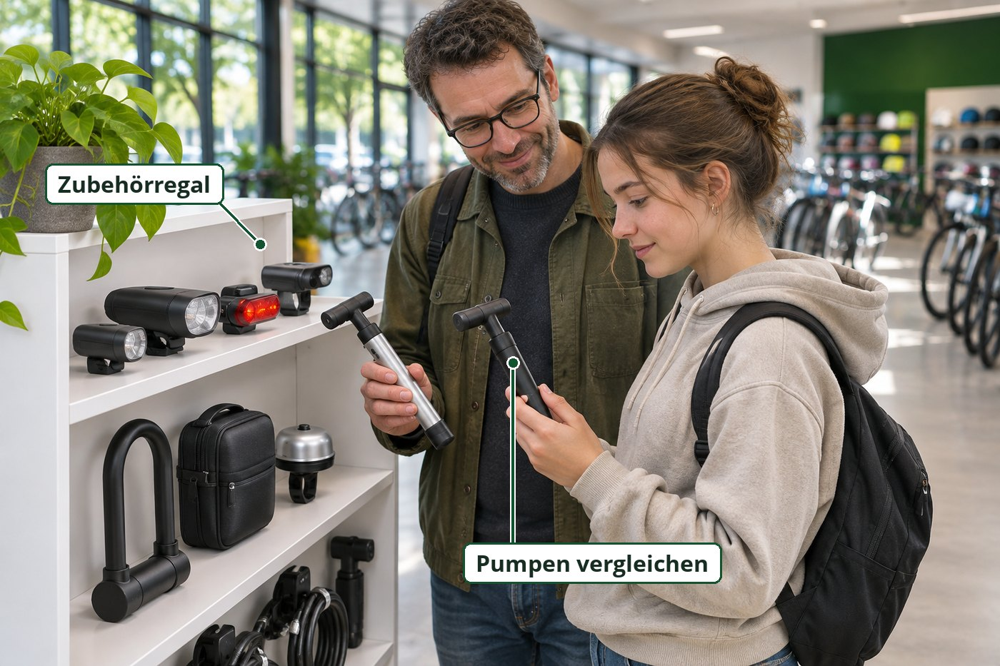
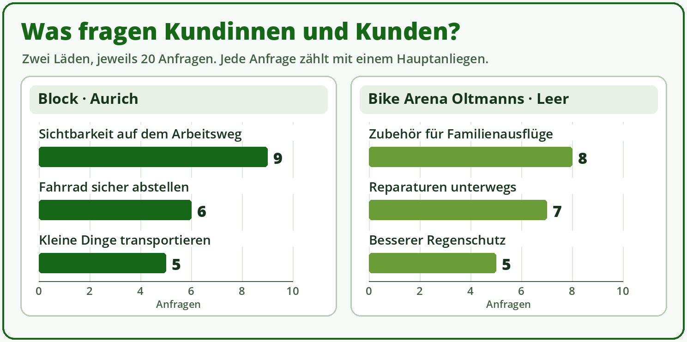

# M2 – Kurzprofil Bike Arena Oltmanns, Leer

<figure>

<figcaption>In der Bike Arena vergleicht die Kundschaft die Pumpen direkt am Regal.</figcaption>
</figure>

<figure>

<figcaption>Beide Läden haben je 20 Anfragen erfasst. Die Anliegen unterscheiden sich je nach Standort.</figcaption>
</figure>

**Website des Betriebs.** Das Fahrradfachgeschäft in Leer nennt eine Ladenfläche von 1.400 m². Es bietet Beratung und Zubehör im Laden an. <a href="https://www.bikearena-oltmanns.de/unser-laden" target="_blank" rel="noopener noreferrer">Unser Laden</a>

| Merkmal                                                                                                                                    | Beobachtung                                                                                                                                                                                                       |
|--------------------------------------------------------------------------------------------------------------------------------------------|-------------------------------------------------------------------------------------------------------------------------------------------------------------------------------------------------------------------|
| Kundschaft und <a href="../ls-glossar.html?from=material%2Fm2.html%23begriffsstelle-2#gl-zielgruppe" id="begriffsstelle-2">Zielgruppen</a> | Die Bike Arena hat 20 Anfragen notiert. Acht betrafen Zubehör für Familienausflüge, sieben Reparaturen unterwegs und fünf besseren Regenschutz. Zu jeder Anfrage hat der Laden ein Hauptanliegen notiert.         |
| Verkauf                                                                                                                                    | Die Kundschaft wählt die Ware auf der Aktionsfläche selbst aus. Das nennt man Selbstbedienung. Samstags ist dort niemand fest für die Beratung eingeteilt. Fragen kann die Kundschaft an der Information stellen. |
| Kundenstimme                                                                                                                               | „Wir wollen am Wochenende mit den Kindern los. Ich möchte auf einen Blick erkennen, welche Pumpe zu unseren Ventilen passt.“                                                                                      |
| Kundenstimme                                                                                                                               | „Wo liegt das Zubehör, das wir unterwegs bei einer Panne brauchen?“                                                                                                                                               |

