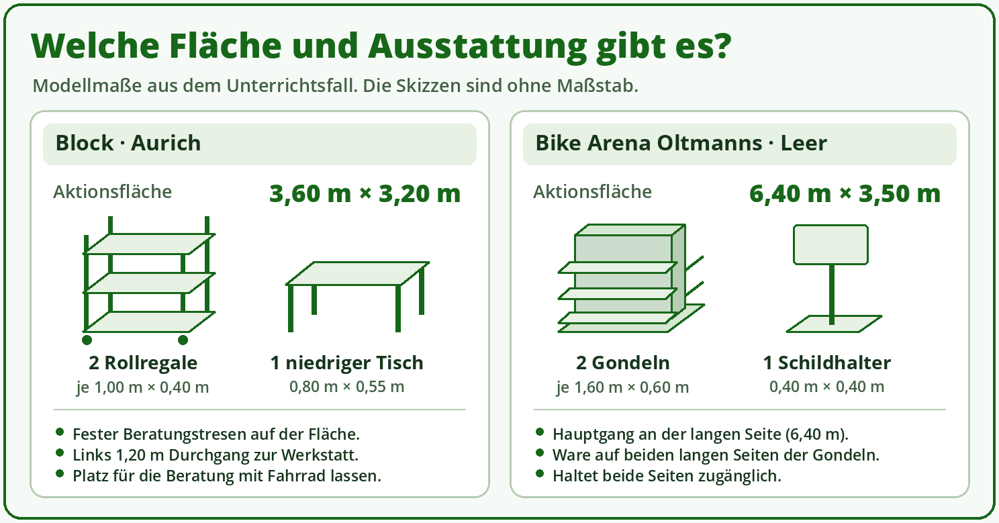

# M3 – Flächen und Warenträger

<figure>

<figcaption>Die Skizzen zeigen die Flächen und Warenträger beider Läden. Die Maße stehen direkt daneben.</figcaption>
</figure>

Ein <a href="../ls-glossar.html?from=material%2Fm3.html%23begriffsstelle-1#gl-ma%C3%9Fstab" id="begriffsstelle-1">Maßstab</a> hilft beim Verkleinern. Zum Beispiel steht bei 1:20 ein Zentimeter im Plan für 20 Zentimeter im Laden. Haltet die genannten Gänge und Zugänge frei. Das ist eine <a href="../ls-glossar.html?from=material%2Fm3.html%23begriffsstelle-2#gl-zwingende-anforderung" id="begriffsstelle-2">zwingende Anforderung</a>.

| Standort   | Verfügbare <a href="../ls-glossar.html?from=material%2Fm3.html%23begriffsstelle-3#gl-aktionsfl%C3%A4che" id="begriffsstelle-3">Aktionsfläche</a> | Umgebung und Ausstattung                                                                                                                                                                                                                                                                                    |
|------------|--------------------------------------------------------------------------------------------------------------------------------------------------|-------------------------------------------------------------------------------------------------------------------------------------------------------------------------------------------------------------------------------------------------------------------------------------------------------------|
| Block      | 3,60 m × 3,20 m. Der feste Beratungstresen steht auf dieser Fläche.                                                                              | Links verläuft ein 1,20 m breiter Hauptdurchgang zum Werkstattzugang. Ihr habt zwei Rollregale (je 1,00 m × 0,40 m) und einen niedrigen Tisch (0,80 m × 0,55 m). Lasst Platz für die Beratung mit einem Fahrrad.                                                                                            |
| Bike Arena | Die Fläche ist rechteckig und misst 6,40 m × 3,50 m.                                                                                             | Der Hauptgang verläuft an der 6,40-m-Seite. Ihr habt zwei <a href="../ls-glossar.html?from=material%2Fm3.html%23begriffsstelle-4#gl-gondel" id="begriffsstelle-4">Gondeln</a> (je 1,60 m × 0,60 m). Die Ware steht dort auf beiden Seiten. Dazu gibt es einen freistehenden Schildhalter (0,40 m × 0,40 m). |

**Skizzenhilfe für die beiden Ladenflächen.** Zeichnet pro Laden ein Rechteck für die Aktionsfläche. Nutzt je ein A4-Blatt im Querformat und den Maßstab 1:25. Ein Zentimeter auf dem Blatt steht für 25 Zentimeter im Laden. Zeichnet die breite Seite waagerecht.

- **Block.** Zeichnet links neben die Aktionsfläche den 1,20 m breiten Durchgang. Markiert am oberen Ende den Werkstattzugang. Zeichnet den festen Tresen rechts unten in die Aktionsfläche. Er ist 1,20 m breit und 0,70 m tief.
- **Bike Arena.** Zeichnet den 1,50 m breiten Hauptgang unter die lange Seite der Aktionsfläche. Markiert den Zugang links am Gang.

