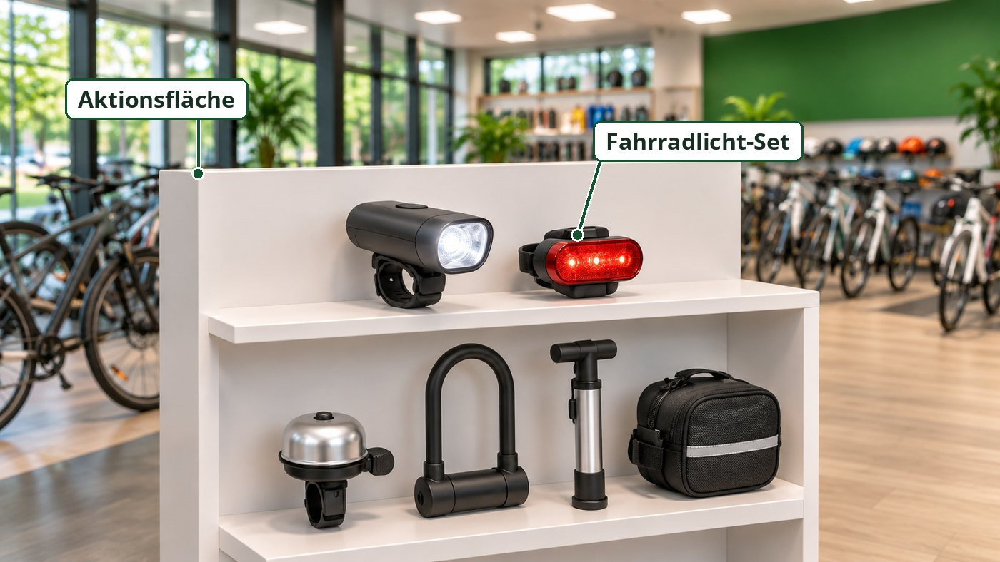
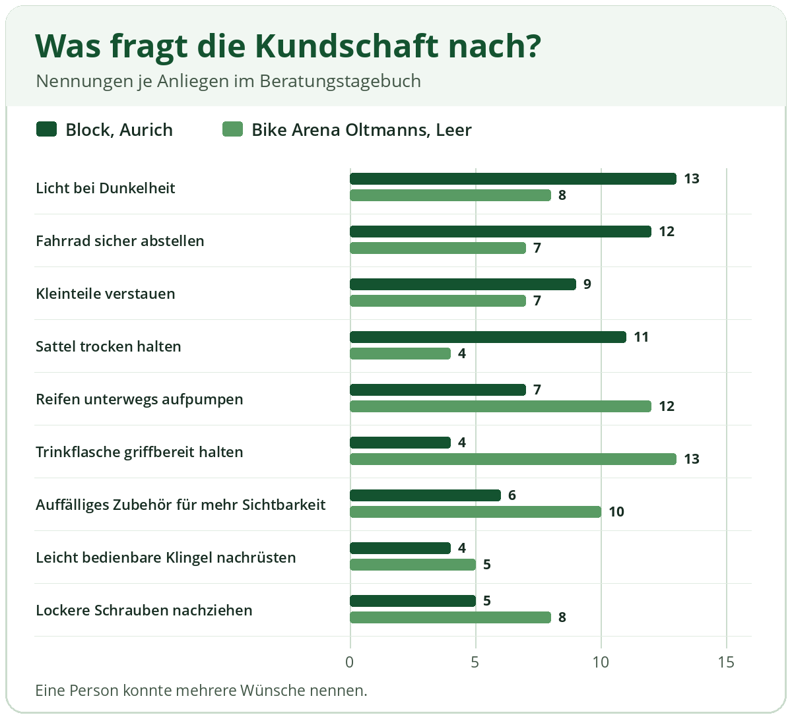
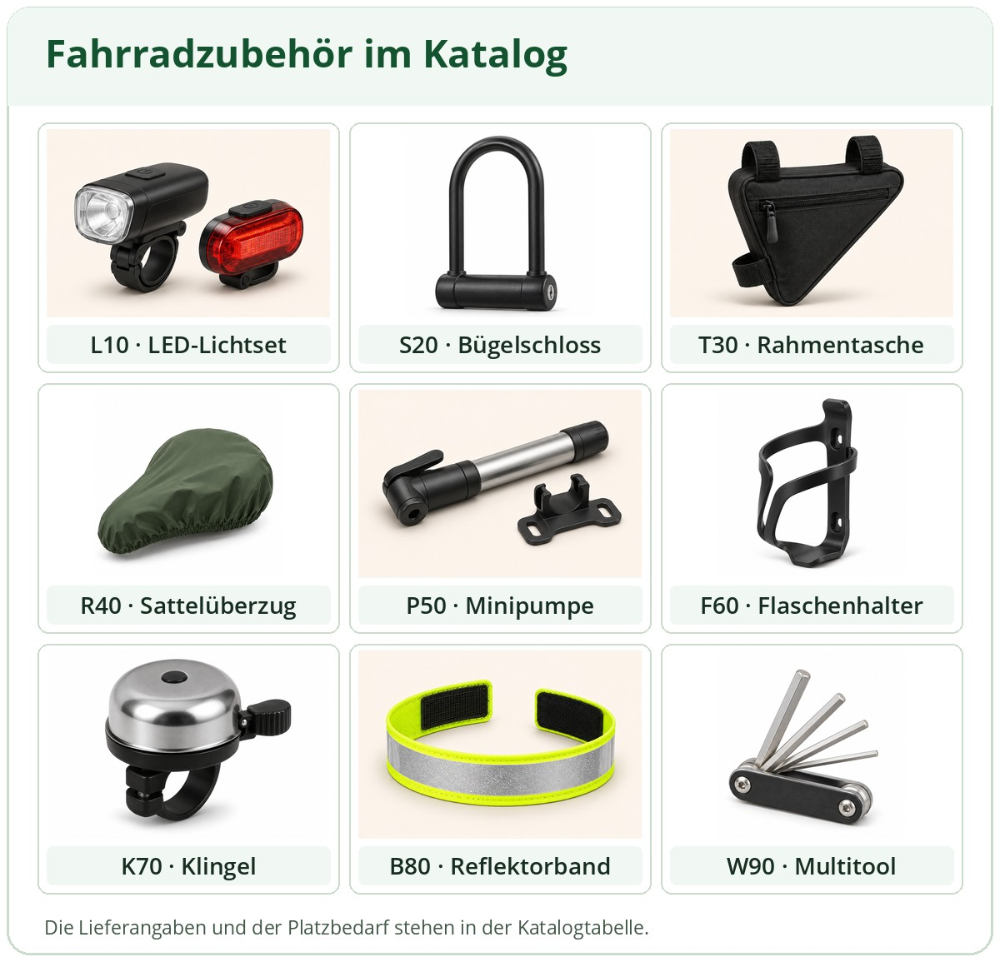
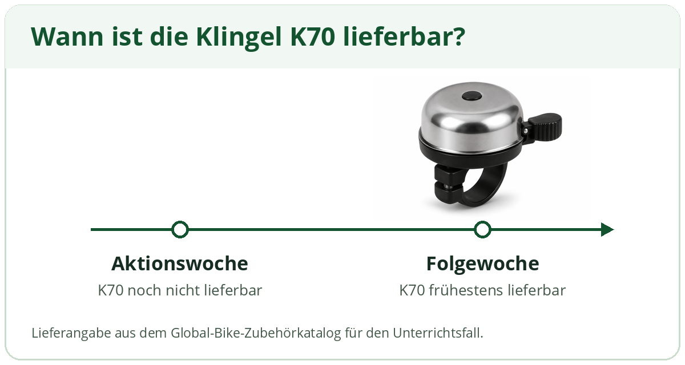
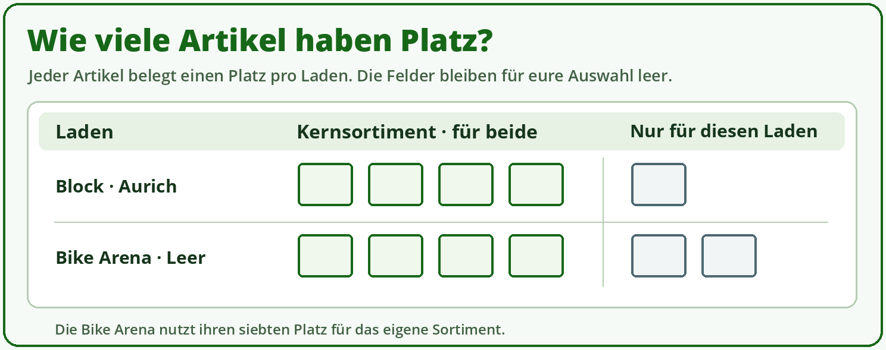

# BFS dual · LF 06 · LS 6.2 · Ein gemeinsames Sortiment mit lokalen Ergänzungen zusammenstellen

**Zwei Läden, eine Freigabe** · Global Bike Deutschland GmbH · 2. Halbjahr

**Zeit** · 10 Unterrichtsstunden · 450 Minuten

## Orientierung

### Warum wir das lernen

7 Minuten

Für den Schulweg bei Regen braucht ihr anderes Zubehör als für eine lange Radtour. Manche Artikel helfen euch in beiden Fällen. Für die Aktion bei Block und in der Bike Arena entscheidet ihr, welche Waren beide Läden anbieten und was jeder Laden zusätzlich braucht. Prüft dafür Kundenanfragen, Lieferbarkeit und freie Plätze.

### Das übe ich

| Kompetenz | Wie stark? (1–6) | Das übe ich |
| --- | ---: | --- |
| Fachkompetenz | 6 | Ich wähle ein gemeinsames Kernsortiment für beide Läden. Ich wähle passende Ergänzungen für jeden Laden. Ich begründe jeden Artikel mit Nachfragebelegen. Ich achte darauf, wie viel Platz da ist und ob die Waren lieferbar sind. |
| Personalkompetenz | 3 | Ich prüfe, ob meine Lieblingsartikel auch zur Nachfrage passen. |
| Sozialkompetenz | 4 | Ich erkläre meine Gründe im Team. Ich einige mich mit den anderen auf eine Auswahl. |
| Methodenkompetenz | 4 | Ich prüfe die Liste mit den Angaben zur Nachfrage, zum Platz und zur Lieferung. |
| Medienkompetenz | 3 | Ich finde im Katalog Angaben zu den Artikeln. Ich halte die Auswahl übersichtlich fest. |

## Handlungssituation

9 Minuten

Sebastian Wolf arbeitet bei Global Bike im Außendienst. Er besucht Fahrradgeschäfte und bespricht mit ihnen, welches Zubehör sie für ihre Kundschaft brauchen. Das 2-Rad Center Block in Aurich und die Bike Arena Oltmanns in Leer wollen bei ihm Zubehör für eine gemeinsame Frühjahrsaktion bestellen.

Sebastian hat versprochen, beiden Läden bis heute Nachmittag passende Artikel zu empfehlen. Auf seiner Liste steht die neue Fahrradklingel K70. In beiden Geschäften haben Kunden danach gefragt.

Sein Kollege Christian Klein kümmert sich bei Global Bike um die Lieferung. Er zeigt Sebastian, wann die Artikel bei den Läden ankommen können. „Die K70 kommt frühestens in der Woche danach. Wenn wir sie fest einplanen, bleibt zum Start ein Platz leer.“

Sebastian prüft die Liste noch einmal. „Wir müssen auf beide Läden achten. Block hat wenig Platz. Viele fragen dort nach Zubehör für den Arbeitsweg. Die Bike Arena erwartet Familien, die Zubehör für ihre Ausflüge suchen. Ich will beiden Läden erklären können, warum wir ihnen genau diese Artikel empfehlen.“

Jan Richter leitet bei Global Bike den Verkauf. Er gibt die Liste noch nicht frei. Vier Artikel sollen in beiden Läden stehen. Block bekommt einen zusätzlichen Artikel, die Bike Arena bekommt zwei. Jan gibt euch die Ladenprofile, die Vorgaben für die Auswahl und den aktuellen Katalog. Für die zugesagte Rückmeldung braucht er eure Artikelliste. Die Artikel müssen zur Aktion lieferbar sein. Für beide Läden braucht Jan eine Begründung.

*Welches Zubehör soll bei beiden Läden ins Aktionsregal?*

### Den Fall prüfen

### Aufgabe 01 · Warum steht die K70 auf Sebastians Liste und was wendet Christian ein?

4 Minuten

- Beide Läden melden Interesse. Christian rechnet mit der Lieferung erst nach dem Aktionsstart.
- Beide Läden melden Interesse. Christian kann zum Start nur den Laden in Aurich beliefern.
- Nur Block meldet Interesse. Christian rechnet mit der Lieferung erst nach dem Aktionsstart.
- Nur die Bike Arena meldet Interesse. Christian kann zum Start beide Läden rechtzeitig beliefern.
- Beide Läden melden Interesse. Christian hat zum Start nur die Lieferung nach Leer bestätigt.
- Nur die Bike Arena meldet Interesse. Christian plant die erste Lieferung für die Woche danach.

Hilfe

Lest Sebastians Zusage und Christians Nachricht zur Klingel K70. Beginnt mit „Sebastian hat die K70 auf seiner Liste, weil … Christian sagt dazu, dass …“.

### Aufgabe 02 · Welche Unterschiede der beiden Läden nennt Sebastian für die Auswahl?

4 Minuten

- Block hat wenig Platz für Familienzubehör. In der Bike Arena suchen Pendler Zubehör für den Arbeitsweg.
- Block hat viel Platz für Pendlerzubehör. In der Bike Arena suchen Familien Zubehör für den Ausflug.
- Block hat wenig Platz für Pendlerzubehör. In der Bike Arena suchen Familien Zubehör für den Ausflug.
- Block hat viel Platz für Familienzubehör. In der Bike Arena suchen Pendler Zubehör für den Arbeitsweg.
- Block erwartet Familien, die Zubehör für Ausflüge suchen. In der Bike Arena suchen Pendler ein neues Licht.
- Block hat viel Platz für Tourenzubehör. In der Bike Arena suchen Familien Zubehör für den Arbeitsweg.

Hilfe

Lest Sebastians Aussage nach dem Lieferhinweis. Beginnt mit „Bei Block … In der Bike Arena …“.

### Aufgabe 03 · Wie viele gemeinsame und wie viele lokale Artikel sind vorgesehen?

4 Minuten

- Vier Artikel für beide Läden, zwei zusätzlich für Block und einer zusätzlich für die Bike Arena.
- Vier Artikel für beide Läden, einer zusätzlich für Block und zwei zusätzlich für die Bike Arena.
- Drei Artikel für beide Läden, einer zusätzlich für Block und drei zusätzlich für die Bike Arena.
- Drei Artikel für beide Läden, zwei zusätzlich für Block und zwei zusätzlich für die Bike Arena.
- Fünf Artikel für beide Läden, einer zusätzlich für Block und einer zusätzlich für die Bike Arena.
- Zwei Artikel für beide Läden, drei zusätzlich für Block und zwei zusätzlich für die Bike Arena.

Hilfe

Lest den letzten Absatz. Sucht je eine Zahl für „beide Läden“, „nur Block“ und „nur Bike Arena“.

### Aufgabe 04 · Was braucht Jan bis zur Rückmeldung an die Händler?

4 Minuten

- Eine Artikelliste mit den Verkaufspreisen und einer Kalkulation der erwarteten Gewinne für jeden Laden.
- Eine Artikelliste mit den bisherigen Verkäufen und einer Auswertung der Bestellungen für jeden Laden.
- Eine Artikelliste mit den jeweiligen Regalplätzen und einer Skizze des geplanten Aufbaus für jeden Laden.
- Eine Artikelliste mit rechtzeitig lieferbarer Ware und einer Begründung für die Auswahl je Laden.
- Eine Artikelliste mit den Werbetexten zur Frühjahrsaktion und einem Entwurf für das Schild je Laden.
- Eine Artikelliste mit alternativen Lieferanten und einem Vergleich der Versandkosten für jeden Laden.

Hilfe

Schaut auf den Anfang und den Schluss der Szene. Beginnt mit „Bis … braucht Jan eine Empfehlung. Sie soll …“.

## Informieren

### Aufgabe 05 · Kundenwünsche ordnen

35 Minuten

Das **Kernsortiment** besteht aus den wichtigsten Artikeln eines Angebots.

**Sucht** in [M1](#m1) die häufigsten und wichtigsten Wünsche pro Laden.

### Aufgabe 06 · Artikel und Lieferbarkeit prüfen

30 Minuten

**Prüft** im Katalog [M2](#m2) für jeden wichtigen Wunsch, welcher Artikel passt und ob er rechtzeitig kommt. Markiert verspätete Ware.

## Fachbegriffscheck

23 Minuten

**Wählt** zu jedem Fachbegriff die passende Erklärung aus sechs Möglichkeiten. Die Begriffe findet ihr in [M6](#m6).

**1. Kernsortiment**

- A · Alle Artikel im Katalog von Global Bike.
- B · Die Artikel, die nur die Bike Arena zusätzlich anbietet.
- C · Die wichtigsten Waren, die die Kundschaft in diesem Angebot erwartet. In der Aktion sind es die vier Artikel, die beide Läden anbieten.
- D · Ein zusätzlicher Artikel, der zu einem Kundenwunsch in einem bestimmten Laden passt.
- E · Die Zahl der verschiedenen Warengruppen im Angebot.
- F · Die Kundschaft fragt nach etwas. Der Laden hat dafür keinen passenden Artikel im Angebot.

**2. Lokale Sortimentsergänzung**

- A · Ein Artikel, den das Lager erst in der nächsten Woche liefern kann.
- B · Ein Artikel, den beide Läden im Kernsortiment anbieten müssen.
- C · Ein zusätzlicher Artikel, der zu einem Kundenwunsch in einem bestimmten Laden passt.
- D · Die wichtigsten Waren, die die Kundschaft in diesem Angebot erwartet. In der Aktion sind es die vier Artikel, die beide Läden anbieten.
- E · Die Zahl der verschiedenen Warengruppen im Angebot.
- F · Die Kundschaft fragt nach etwas. Der Laden hat dafür keinen passenden Artikel im Angebot.

**3. Lieferbarkeit**

- A · Ob und wann ihr einen Artikel für den geplanten Zeitraum bekommen könnt.
- B · Die Zahl der Kunden, die nach dem Artikel gefragt haben.
- C · Die Zahl der Plätze, die ein Artikel auf der Fläche braucht.
- D · Der Raum oder die Zahl der Stellplätze, die ein Artikel braucht.
- E · Ein Code, der im Katalog für genau einen Artikel steht.
- F · Ein Platz im Laden, der für einen Artikel der Aktion frei ist.

**4. Platzbedarf**

- A · Die Menge, die das Lager hat.
- B · Die Menge, die beide Läden zusammen verkaufen wollen.
- C · Der Raum oder die Zahl der Stellplätze, die ein Artikel braucht.
- D · Ob und wann ihr einen Artikel für den geplanten Zeitraum bekommen könnt.
- E · Ein Code, der im Katalog für genau einen Artikel steht.
- F · Ein Platz im Laden, der für einen Artikel der Aktion frei ist.

**5. Sortimentsbreite**

- A · Die Zahl der Stücke, die von einem Artikel vorhanden sind.
- B · Die Zahl der verschiedenen Warengruppen im Angebot.
- C · Die Zahl der Varianten in einer Warengruppe.
- D · Die wichtigsten Waren, die die Kundschaft in diesem Angebot erwartet. In der Aktion sind es die vier Artikel, die beide Läden anbieten.
- E · Ein zusätzlicher Artikel, der zu einem Kundenwunsch in einem bestimmten Laden passt.
- F · Die Kundschaft fragt nach etwas. Der Laden hat dafür keinen passenden Artikel im Angebot.

**6. Sortimentslücke**

- A · Die Kundschaft fragt nach etwas. Der Laden hat dafür keinen passenden Artikel im Angebot.
- B · Eine Information, die in der Beschreibung eines Artikels fehlt.
- C · Ein leerer Stellplatz zwischen zwei Artikeln.
- D · Die wichtigsten Waren, die die Kundschaft in diesem Angebot erwartet. In der Aktion sind es die vier Artikel, die beide Läden anbieten.
- E · Ein zusätzlicher Artikel, der zu einem Kundenwunsch in einem bestimmten Laden passt.
- F · Die Zahl der verschiedenen Warengruppen im Angebot.

**7. Beratungstagebuch**

- A · Ein Plan für die Beratungstermine.
- B · Eine Liste der Artikel, die Kunden nach der Beratung gekauft haben.
- C · Notizen darüber, was die Kundschaft in Beratungsgesprächen gefragt oder gewünscht hat.
- D · Ein Wunsch, der einmal in der Nachfrageübersicht gezählt wird.
- E · Die Kundschaft fragt nach etwas. Der Laden hat dafür keinen passenden Artikel im Angebot.
- F · Ein Code, der im Katalog für genau einen Artikel steht.

**8. Nennung**

- A · Eine Person, die nur einmal gezählt wird, auch wenn sie mehrere Wünsche hat.
- B · Ein Wunsch, der einmal in der Nachfrageübersicht gezählt wird.
- C · Ein verkaufter Artikel, den der Laden einmal zählt.
- D · Notizen darüber, was die Kundschaft in Beratungsgesprächen gefragt oder gewünscht hat.
- E · Die Kundschaft fragt nach etwas. Der Laden hat dafür keinen passenden Artikel im Angebot.
- F · Ein Code, der im Katalog für genau einen Artikel steht.

**9. Artikelkennung**

- A · Die Zahl, die zeigt, wie oft Kunden nach dem Artikel gefragt haben.
- B · Ein Code, der im Katalog für genau einen Artikel steht.
- C · Die Nummer des Stellplatzes im Laden.
- D · Ob und wann ihr einen Artikel für den geplanten Zeitraum bekommen könnt.
- E · Der Raum oder die Zahl der Stellplätze, die ein Artikel braucht.
- F · Ein Platz im Laden, der für einen Artikel der Aktion frei ist.

**10. Aktionsplatz**

- A · Der gesamte Bereich, den Kunden während der Aktion betreten dürfen.
- B · Ein Platz im Laden, der für einen Artikel der Aktion frei ist.
- C · Ein Platz, auf dem Vorräte für die Aktion im Lager liegen.
- D · Ob und wann ihr einen Artikel für den geplanten Zeitraum bekommen könnt.
- E · Der Raum oder die Zahl der Stellplätze, die ein Artikel braucht.
- F · Ein Code, der im Katalog für genau einen Artikel steht.

## Planen

### Aufgabe 07 · Die Auswahl vorbereiten

40 Minuten

**Plant** eure Auswahl mit den Vorgaben aus [M3](#m3). Schreibt auf, woran ihr einen Artikel für beide Läden erkennt. Schreibt auch auf, wann ein Artikel nur für einen Laden als Ergänzung passt.

## Entscheiden

### Aufgabe 08 · Lernpaket wählen und begründen

8 Minuten

**Wählt** einen der drei Arbeitswege. Überlegt, welcher Weg euch bei der Entscheidung am besten hilft. **Haltet** beim Arbeiten ein Zwischenergebnis und einen Beleg für den Pitch fest. Ein Beleg kann zum Beispiel eine Zahl, ein Maß oder eine Kundenstimme sein.

**Euer Auftrag für Jan Richter.** Wählt ein gemeinsames Kernsortiment und passende lokale Ergänzungen. Erstellt für Jan Richter die Sortimentsliste aus M5. Begründet vier gemeinsame Artikel, eine Ergänzung für Block und zwei für die Bike Arena mit Nachfragebelegen. Prüft, ob die Artikel lieferbar sind und auf die freien Plätze passen. Erklärt auch, warum ihr einen lieferbaren Artikel weglasst.

| Lernpaket | Lernzugänge | So arbeitet ihr | Euer Zwischenergebnis | Wählt dieses Paket, wenn … |
| --- | --- | --- | --- | --- |
| **A · Artikeldaten gegenüberstellen** | Daten lesen, vergleichen und markieren | Listet die Artikel aus M2 auf. Schreibt zu jedem Artikel, wonach die Kundschaft in beiden Läden fragt (M1) und ob er lieferbar ist (M2). Markiert die freien und belegten Plätze nach M3. | Ihr habt eine Übersicht. Sie zeigt, welche Artikel beide Läden brauchen, welche vor allem in einem Laden gefragt sind und wie viele Plätze frei sind. | … ihr Daten gern nebeneinander seht und Unterschiede markiert. |
| **B · Das Sortiment im Gespräch abstimmen** | Zuhören, Vorschläge besprechen und begründen | Hört M4 an oder lest euch die Gespräche vor. Übernehmt die Rollen Global Bike, Block und Bike Arena. Sprecht über Kundenwünsche und passende Artikel. Prüft Belege, Lieferbarkeit und freie Plätze mit M1 bis M3. | Ihr habt eine Notiz aus der Sortimentsrunde. Sie zeigt Gründe für gemeinsame und zusätzliche Artikel. Haltet auch fest, warum ihr einen lieferbaren Artikel weglasst. | … ihr Vorschläge gern besprecht und mit Nachfragen prüft. |
| **C · Artikelkarten im Flächenraster legen** | Karten legen und mehrere Auswahlen testen | Erstellt für jeden Artikel aus M2 zwei Karten. Probiert mehrere Auswahlen in den beiden Rastern aus M3 aus. Markiert die gemeinsamen Artikel. Legt zu jedem Vorschlag einen passenden Nachfragebeleg aus M1. | Ihr habt zwei Raster mit Artikeln und Belegen. In den Rastern seht ihr, welche Artikel zu den Läden passen und welche ihr wegen der knappen Plätze weglasst. | … ihr Optionen gern mit Karten legt und ausprobiert. |

### Aufgabe 09 · Zwei Varianten testen

40 Minuten

**Testet** im gewählten Lernpaket zwei mögliche Auswahlen. Tauscht dabei mindestens einen lieferbaren Artikel aus. Vergleicht für jeden Vorschlag Nachfrage und freie Plätze in beiden Läden.

### Aufgabe 10 · Das Sortiment festlegen

32 Minuten

**Wählt** vier gemeinsame Artikel und die Ergänzungen für die beiden Läden. Legt mit einem Nachfragebeleg fest, welchen lieferbaren Artikel ihr weglasst. Haltet euren Grund fest.

## Durchführen

### Aufgabe 11 · Das gemeinsame Sortiment eintragen

#### A · Artikeldaten gegenüberstellen

40 Minuten

Listet die Artikel aus M2 auf. Schreibt zu jedem Artikel, wonach die Kundschaft in beiden Läden fragt (M1) und ob er lieferbar ist (M2). Markiert die freien und belegten Plätze nach M3.

Ihr habt eine Übersicht. Sie zeigt, welche Artikel beide Läden brauchen, welche vor allem in einem Laden gefragt sind und wie viele Plätze frei sind.

#### B · Das Sortiment im Gespräch abstimmen

40 Minuten

Hört M4 an oder lest euch die Gespräche vor. Übernehmt die Rollen Global Bike, Block und Bike Arena. Sprecht über Kundenwünsche und passende Artikel. Prüft Belege, Lieferbarkeit und freie Plätze mit M1 bis M3.

Ihr habt eine Notiz aus der Sortimentsrunde. Sie zeigt Gründe für gemeinsame und zusätzliche Artikel. Haltet auch fest, warum ihr einen lieferbaren Artikel weglasst.

#### C · Artikelkarten im Flächenraster legen

40 Minuten

Erstellt für jeden Artikel aus M2 zwei Karten. Probiert mehrere Auswahlen in den beiden Rastern aus M3 aus. Markiert die gemeinsamen Artikel. Legt zu jedem Vorschlag einen passenden Nachfragebeleg aus M1.

Ihr habt zwei Raster mit Artikeln und Belegen. In den Rastern seht ihr, welche Artikel zu den Läden passen und welche ihr wegen der knappen Plätze weglasst.

**Tragt** für den gemeinsamen Teil von [M5](#m5) die vier Artikel ein. Schreibt zu jedem Artikel je einen Nachfragebeleg aus beiden Läden.

### Aufgabe 12 · Lokale Artikel ergänzen

40 Minuten

**Ergänzt** in [M5](#m5) die drei lokalen Artikel. Nennt jeweils den Laden, einen passenden Nachfragebeleg und den Grund für die Ergänzung.

### Aufgabe 13 · Plätze und Liefertermine prüfen

25 Minuten

**Rechnet** in [M5](#m5) die Plätze je Laden zusammen. Haltet mit dem Katalog [M2](#m2) fest, ob eure Auswahl rechtzeitig da ist. Schreibt auf, welchen lieferbaren Artikel Jan weglassen sollte und warum.

## Bewerten

### Aufgabe 14 · Die Arbeit prüfen und kurz vorstellen

61 Minuten

#### Die Auswahl überprüfen

**Prüft** eure Liste. Reichen die Plätze? Kommt die Ware rechtzeitig? Gibt es für jeden gewählten Artikel einen Nachfragebeleg? **Verbessert** die Auswahl oder Begründung, wenn etwas fehlt oder nicht passt.

#### Die eigene Arbeit einschätzen

**Nennt** zwei Artikel, die für die Aktion gepasst hätten, zwischen denen ihr aber wählen musstet. Erklärt kurz, was den Ausschlag gegeben hat.

**Schätzt** euch zur Fachkompetenz dieser LS ein. Wählt eine Stufe. Zeigt eine Stelle in eurer Arbeit, die dazu passt.

1 · Ich brauche Hilfe bei jedem Schritt. 2 · Mit einzelnen Tipps komme ich weiter. 3 · Ich kann die Aufgabe selbst lösen und begründen. 4 · Ich kann das auch in einem neuen Fall.

#### Abschlusspitch

**Pitcht** euer Lernpaket. Ein Pitch ist eine kurze Vorstellung. Nutzt euer Handlungsprodukt und eure Unterlagen. Ihr habt für den Kurzpitch etwa zwei Minuten. Wenn noch Zeit ist, beantwortet eine Rückfrage.

1.  **Ergebnis zeigen.** Zeigt euer Handlungsprodukt. Sagt, was ihr entschieden habt.
2.  **Entscheidung belegen.** Zeigt einen Beleg aus den Unterlagen. Erklärt, wie er eure Entscheidung stützt.
3.  **Arbeitsweg begründen.** Sagt, warum ihr euer Lernpaket gewählt habt. Zeigt ein Zwischenergebnis. Erklärt, wie es euch bei der Entscheidung geholfen hat.

Zeigt in eurer Liste einen gemeinsamen Artikel und eine Ergänzung für einen Laden. Wählt einen der beiden Artikel. Erklärt mit einem Nachfragebeleg, warum er zum Laden passt.

Sprachhilfe für den Pitch

- „Unser Ergebnis ist … Wir schlagen vor, dass …“
- „Unser Beleg ist … Er zeigt, dass …“
- „Wir haben Paket … gewählt. Beim Arbeiten hat uns … geholfen.“

### Aufgabe 15 · Das Produkt für den Peer-Check bereitstellen

10 Minuten

**Ladet eure Sortimentsliste hoch.** Bei einer Teamarbeit gibt jede Person eine Kopie im eigenen Moodle-Konto ab. Wählt einen Titel und einen Dateinamen ohne eure Namen. Entfernt eure Namen aus der Arbeit und aus den Dateieigenschaften.

Ohne eingerichtete Moodle-Aktivität erhältst du von der Lehrkraft eine codierte Arbeit.

### Aufgabe 16 · Ein fremdes Produkt prüfen

18 Minuten

**Schaut euch die zugeteilte Arbeit an.** Moodle lost aus, welche Arbeit ihr bekommt. Ihr seht die Arbeit ohne Namen.

**Gebt Rückmeldung.** Nutzt die Fragen unter dieser Aufgabe. Nennt eine Stelle, die gut gelungen ist. Schreibt, was die Person verbessern kann. Die Person sieht bei eurer Antwort euren Klarnamen.

- Stehen vier gemeinsame Artikel, eine Ergänzung für Block und zwei für die Bike Arena in der Liste? Sind sie zum Start lieferbar?
- Passt die Begründung für jeden Artikel zu den Nachfragebelegen im jeweiligen Laden?
- Erklärt die Liste, warum das Team einen lieferbaren Artikel weglässt?

[Peer-Check im Lernpaket öffnen](peer-check.html)

### Aufgabe 17 · Die empfangene Rückmeldung nutzen

10 Minuten

**Lest** nach der Freigabe die Rückmeldung zu eurer Arbeit. Verbessert eine Stelle oder erklärt, warum ihr bei eurer Lösung bleibt.

## Reflektieren

### Aufgabe 18 · Feedback zur Lernsituation

6 Minuten

**Füllt** die Aktivität „Feedback“ im Moodle-Kurs aus und sendet eure Rückmeldung dort ab. Falls der Verweis fehlt, öffnet „Feedback“ in der Kursübersicht.

[Feedback in Moodle öffnen](https://bbs1aur.moodle-nds.de/mod/feedback/view.php?id=79775)

## Handlungsprodukt und Kriterien

**Begründete Sortimentsliste.** Eure Liste enthält vier gemeinsame Artikel, eine Ergänzung für Block und zwei für die Bike Arena. Alle gewählten Artikel sind während der Aktion lieferbar. Zu jedem Artikel nutzt ihr Kundendaten aus dem jeweiligen Laden. Ihr nennt auch einen lieferbaren Artikel, den ihr weglasst, und erklärt warum.

## Materialien

### M1 · Nachfrageübersicht beider Handelspartner

**Websites der Betriebe.** Auf seiner Zubehörseite zeigt Block zum Beispiel Beleuchtung, Pumpen und Schlösser. Die Bike Arena zeigt ihr Fahrradzubehör im Onlineangebot. <a href="https://www.zweirad-block.de/fahrraeder/zubehoer/" target="_blank" rel="noopener noreferrer">Zubehör bei Block</a> · <a href="https://www.bikearena-oltmanns.de/" target="_blank" rel="noopener noreferrer">Bike Arena Oltmanns</a>

Die Zahlen zeigen, wie oft Kunden nach etwas gefragt haben. Diese [Nennungen](#gl-nennung) stehen im [Beratungstagebuch](#gl-beratungstagebuch). Eine Person konnte mehrere Wünsche nennen. Auch wenige Anfragen können für eine Kundengruppe wichtig sein.

| Was Kundinnen und Kunden angesprochen haben          | Block, Aurich | Bike Arena Oltmanns, Leer |
|------------------------------------------------------|--------------:|--------------------------:|
| Licht für Fahrten bei Dunkelheit                     |            13 |                         8 |
| Fahrrad sicher abstellen                             |            12 |                         7 |
| Schlüssel und Kleinteile während der Fahrt verstauen |             9 |                         7 |
| Nassen Sattel unterwegs trocken halten               |            11 |                         4 |
| Einen Reifen unterwegs aufpumpen                     |             7 |                        12 |
| Trinkflasche auf längeren Fahrten griffbereit halten |             4 |                        13 |
| Auffälliges Zubehör für bessere Sichtbarkeit suchen  |             6 |                        10 |
| Eine leicht bedienbare Klingel nachrüsten            |             4 |                         5 |
| Unterwegs lockere Fahrradschrauben nachziehen        |             5 |                         8 |

**Beobachtung bei Block.** Kundinnen und Kunden fahren häufig bei Regen zur Arbeit und stellen ihr Rad tagsüber draußen ab. Kunden haben mehrfach nach Schutz für nasse Sättel gefragt.

**Beobachtung in der Bike Arena.** Familien fragen für ihre Ausflüge nach Zubehör fürs Trinken, für Pannen und für bessere Sichtbarkeit. Nach Regenschutz haben sie vor allem nach zwei nassen Wochenenden gefragt.

Die Nachfrageübersicht hilft dabei, mögliche [Sortimentslücken](#gl-sortimentsl%C3%BCcke) zu erkennen.

*Die Balken zeigen, wie oft die Kundschaft das jeweilige Anliegen in beiden Läden genannt hat.*

### M2 · Global-Bike-Zubehörkatalog für die Aktionswoche

| Artikel            | Kurzbeschreibung                                                                           | [Lieferbarkeit](#gl-lieferbarkeit) zum Aktionsbeginn | [Platzbedarf](#gl-platzbedarf) je Laden |
|--------------------|--------------------------------------------------------------------------------------------|------------------------------------------------------|----------------------------------------:|
| L10 LED-Lichtset   | Licht für vorne am Lenker und hinten an der Sattelstütze                                   | ja                                                   |                                 1 Platz |
| S20 Bügelschloss   | Zum Anschließen des Rahmens oder eines Laufrads, etwa an einem passenden Fahrradständer    | ja                                                   |                                 1 Platz |
| T30 Rahmentasche   | Tasche für Schlüssel und kleine Gegenstände, mit Klettgurten                               | ja                                                   |                                 1 Platz |
| R40 Sattelüberzug  | Wasserabweisender Überzug für den Sattel eines abgestellten Fahrrads                       | ja                                                   |                                 1 Platz |
| P50 Minipumpe      | Pumpe für unterwegs. Passt auf zwei gängige Ventilarten. Die Typen stehen auf dem Artikel. | ja                                                   |                                 1 Platz |
| F60 Flaschenhalter | Halter für einen Rahmen mit passenden Schraublöchern (Gewindeösen)                         | ja                                                   |                                 1 Platz |
| K70 Klingel        | Klingel mit Daumenhebel für Lenker mit passendem Durchmesser                               | nein, ab Folgewoche                                  |                                 1 Platz |
| B80 Reflektorband  | Klettband, das Licht zurückwirft. Es macht euch besser sichtbar.                           | ja                                                   |                                 1 Platz |
| W90 Multitool      | Kleines Werkzeug für gängige Innensechskantschrauben                                       | ja                                                   |                                 1 Platz |

*So sehen die neun Artikel aus dem Modellkatalog aus.*

*Liefertermin aus M2. Die Klingel K70 kommt frühestens in der Woche nach der Aktion.*

### M3 · Sortimentsvorgaben aus dem Vertrieb

- Block hat fünf [Aktionsplätze](#gl-aktionsplatz), die Bike Arena sechs. Dadurch bleibt die [Sortimentsbreite](#gl-sortimentsbreite) der Aktion begrenzt. Den siebten Platz nutzt die Bike Arena für ihr eigenes Sortiment.
- Global Bike kündigt **vier gemeinsame Artikel** als [Kernsortiment](#gl-kernsortiment) an. Diese Artikel bieten beide Läden an.
- Block erhält **einen**, die Bike Arena **zwei** zusätzliche Artikel. Eine [lokale Sortimentsergänzung](#gl-lokale-sortimentserg%C3%A4nzung) bietet nur der Laden an, für den ihr sie auswählt. Jeder gewählte Artikel belegt einen Platz pro Laden.
- Für jeden Artikel, der zum Start lieferbar ist, hat das Lager genug Stück für beide Läden.

**Raster zum Ausschneiden oder Nachzeichnen**

| Laden      | Gemeinsame Plätze | Lokale Plätze |
|------------|-------------------|---------------|
| Block      | □ □ □ □           | □             |
| Bike Arena | □ □ □ □           | □ □           |

*Legt oder schreibt die Artikel für beide Läden und die lokalen Ergänzungen in die freien Felder.*

### M4 · Gespräch in der Sortimentsrunde

**Block.** „Wir haben fünf Plätze. Viele haben nach Licht, Schlössern oder einem Schutz für nasse Sättel gefragt. Tagsüber stehen die Räder oft draußen. Morgens brauchen viele auch einen Platz für Schlüssel oder Karten.“

**Bike Arena.** „Sechs Plätze sind für die Aktion fest eingeplant. In den letzten Gesprächen ging es vor allem um Trinkpausen und Pannen. Familien wollten auch wissen, wie man sie unterwegs besser sieht. Einige haben nach Licht und Schlössern gefragt. Den Hauptteil der Aktion möchten wir gerne zusammen bewerben.“

**Global Bike.** „Vier Artikel sollen in beiden Läden stehen. Dazu kommt ein lokaler Artikel bei Block und zwei in der Bike Arena. Nehmt den aktuellen Katalog. Das Lager meldet gerade: Die Klingel K70 kommt erst in der Woche nach der Aktion.“

### M5 · Ergebnisblatt für Jan Richter

| Artikel und [Artikelkennung](#gl-artikelkennung) | Bereich          | Laden      | Nachfragebeleg und Begründung | Lieferbereit |
|--------------------------------------------------|------------------|------------|-------------------------------|--------------|
| …                                                | gemeinsamer Kern | beide      | …                             | …            |
| …                                                | gemeinsamer Kern | beide      | …                             | …            |
| …                                                | gemeinsamer Kern | beide      | …                             | …            |
| …                                                | gemeinsamer Kern | beide      | …                             | …            |
| …                                                | lokale Ergänzung | Block      | …                             | …            |
| …                                                | lokale Ergänzung | Bike Arena | …                             | …            |
| …                                                | lokale Ergänzung | Bike Arena | …                             | …            |

**Platzprüfung.** Block … von 5 Aktionsplätzen belegt · Bike Arena … von 6 Aktionsplätzen belegt.

**Ausgelassener lieferbarer Artikel und Grund:** …

### M6 · Fachbegriffe zu dieser Lernsituation

- **Kernsortiment.** Die wichtigsten Waren, die die Kundschaft in diesem Angebot erwartet. In der Aktion sind es die vier Artikel, die beide Läden anbieten.
- **Lokale Sortimentsergänzung.** Ein zusätzlicher Artikel, der zu einem Kundenwunsch in einem bestimmten Laden passt.
- **Lieferbarkeit.** Ob und wann ihr einen Artikel für den geplanten Zeitraum bekommen könnt.
- **Platzbedarf.** Der Raum oder die Zahl der Stellplätze, die ein Artikel braucht.
- **Sortimentsbreite.** Die Zahl der verschiedenen Warengruppen im Angebot.
- **Sortimentslücke.** Die Kundschaft fragt nach etwas. Der Laden hat dafür keinen passenden Artikel im Angebot.
- **Beratungstagebuch.** Notizen darüber, was die Kundschaft in Beratungsgesprächen gefragt oder gewünscht hat.
- **Nennung.** Ein Wunsch, der einmal in der Nachfrageübersicht gezählt wird.
- **Artikelkennung.** Ein Code, der im Katalog für genau einen Artikel steht.
- **Aktionsplatz.** Ein Platz im Laden, der für einen Artikel der Aktion frei ist.

## Glossar

### Aktionsplatz

Ein Platz im Laden, der für einen Artikel der Aktion frei ist.

**Beispiel.** Die Bike Arena hat sechs Plätze für die Aktion. Den siebten nutzt sie für ihr eigenes Sortiment ([M3](#m3)).

### Artikelkennung

Ein Code, der im Katalog für genau einen Artikel steht.

**Beispiel.** P50 steht für die Minipumpe. Tragt P50 ins Ergebnisblatt ein, wenn ihr genau diese Pumpe meint ([M2](#m2) und [M5](#m5)).

### Beratungstagebuch

Notizen darüber, was die Kundschaft in Beratungsgesprächen gefragt oder gewünscht hat.

**Beispiel.** In beiden Läden hat das Personal Fragen nach Licht oder Schlössern notiert. Die Zahlen dazu stehen in [M1](#m1).

### Kernsortiment

Die wichtigsten Waren, die die Kundschaft in diesem Angebot erwartet. In der Aktion sind es die vier Artikel, die beide Läden anbieten.

**Beispiel.** Die vier gemeinsamen Artikel werden in beiden Läden angeboten. Sie bilden das Kernsortiment der Aktion ([M3](#m3)).

### Lieferbarkeit

Ob und wann ihr einen Artikel für den geplanten Zeitraum bekommen könnt.

**Beispiel.** Bei K70 steht „ab Folgewoche“. Deshalb ist die Klingel zu Beginn der Aktion noch nicht da ([M2](#m2)).

### Lokale Sortimentsergänzung

Ein zusätzlicher Artikel, der zu einem Kundenwunsch in einem bestimmten Laden passt.

**Beispiel.** Wenn ein Laden oft Fragen zu nassen Sätteln bekommt, kann er einen Sattelüberzug zusätzlich anbieten ([M1](#m1), [M2](#m2)).

### Nennung

Ein Wunsch, der einmal in der Nachfrageübersicht gezählt wird.

**Beispiel.** Fragt jemand nach Licht und nach einem Schloss, können daraus zwei Nennungen werden ([M1](#m1)).

### Platzbedarf

Der Raum oder die Zahl der Stellplätze, die ein Artikel braucht.

**Beispiel.** Jeder gewählte Artikel belegt bei der Aktion einen Platz je Laden ([M2](#m2), [M3](#m3)).

### Sortimentsbreite

Die Zahl der verschiedenen Warengruppen im Angebot.

**Beispiel.** Beleuchtung, Schlösser und Taschen zählen zu drei Warengruppen ([M2](#m2)).

### Sortimentslücke

Die Kundschaft fragt nach etwas. Der Laden hat dafür keinen passenden Artikel im Angebot.

**Beispiel.** Kunden fragen nach Schutz für nasse Sättel. Wenn der Laden keinen passenden Artikel anbietet, kann es eine Lücke geben ([M1](#m1), [M2](#m2)).
