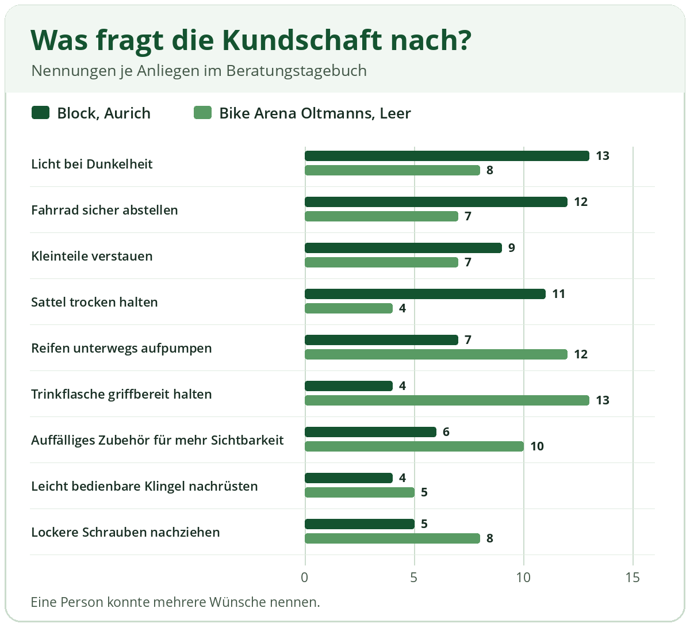

# M1 – Nachfrageübersicht beider Handelspartner

<figure>

<figcaption>Die Balken zeigen, wie oft die Kundschaft das jeweilige Anliegen in beiden Läden genannt hat.</figcaption>
</figure>

**Websites der Betriebe.** Auf seiner Zubehörseite zeigt Block zum Beispiel Beleuchtung, Pumpen und Schlösser. Die Bike Arena zeigt ihr Fahrradzubehör im Onlineangebot. <a href="https://www.zweirad-block.de/fahrraeder/zubehoer/" target="_blank" rel="noopener noreferrer">Zubehör bei Block</a> · <a href="https://www.bikearena-oltmanns.de/" target="_blank" rel="noopener noreferrer">Bike Arena Oltmanns</a>

Die Zahlen zeigen, wie oft Kunden nach etwas gefragt haben. Diese <a href="../ls-glossar.html?from=material%2Fm1.html%23begriffsstelle-3#gl-nennung" id="begriffsstelle-3">Nennungen</a> stehen im <a href="../ls-glossar.html?from=material%2Fm1.html%23begriffsstelle-4#gl-beratungstagebuch" id="begriffsstelle-4">Beratungstagebuch</a>. Eine Person konnte mehrere Wünsche nennen. Auch wenige Anfragen können für eine Kundengruppe wichtig sein.

| Was Kundinnen und Kunden angesprochen haben          | Block, Aurich | Bike Arena Oltmanns, Leer |
|------------------------------------------------------|--------------:|--------------------------:|
| Licht für Fahrten bei Dunkelheit                     |            13 |                         8 |
| Fahrrad sicher abstellen                             |            12 |                         7 |
| Schlüssel und Kleinteile während der Fahrt verstauen |             9 |                         7 |
| Nassen Sattel unterwegs trocken halten               |            11 |                         4 |
| Einen Reifen unterwegs aufpumpen                     |             7 |                        12 |
| Trinkflasche auf längeren Fahrten griffbereit halten |             4 |                        13 |
| Auffälliges Zubehör für bessere Sichtbarkeit suchen  |             6 |                        10 |
| Eine leicht bedienbare Klingel nachrüsten            |             4 |                         5 |
| Unterwegs lockere Fahrradschrauben nachziehen        |             5 |                         8 |

**Beobachtung bei Block.** Kundinnen und Kunden fahren häufig bei Regen zur Arbeit und stellen ihr Rad tagsüber draußen ab. Kunden haben mehrfach nach Schutz für nasse Sättel gefragt.

**Beobachtung in der Bike Arena.** Familien fragen für ihre Ausflüge nach Zubehör fürs Trinken, für Pannen und für bessere Sichtbarkeit. Nach Regenschutz haben sie vor allem nach zwei nassen Wochenenden gefragt.

Die Nachfrageübersicht hilft dabei, mögliche <a href="../ls-glossar.html?from=material%2Fm1.html%23begriffsstelle-5#gl-sortimentsl%C3%BCcke" id="begriffsstelle-5">Sortimentslücken</a> zu erkennen.

