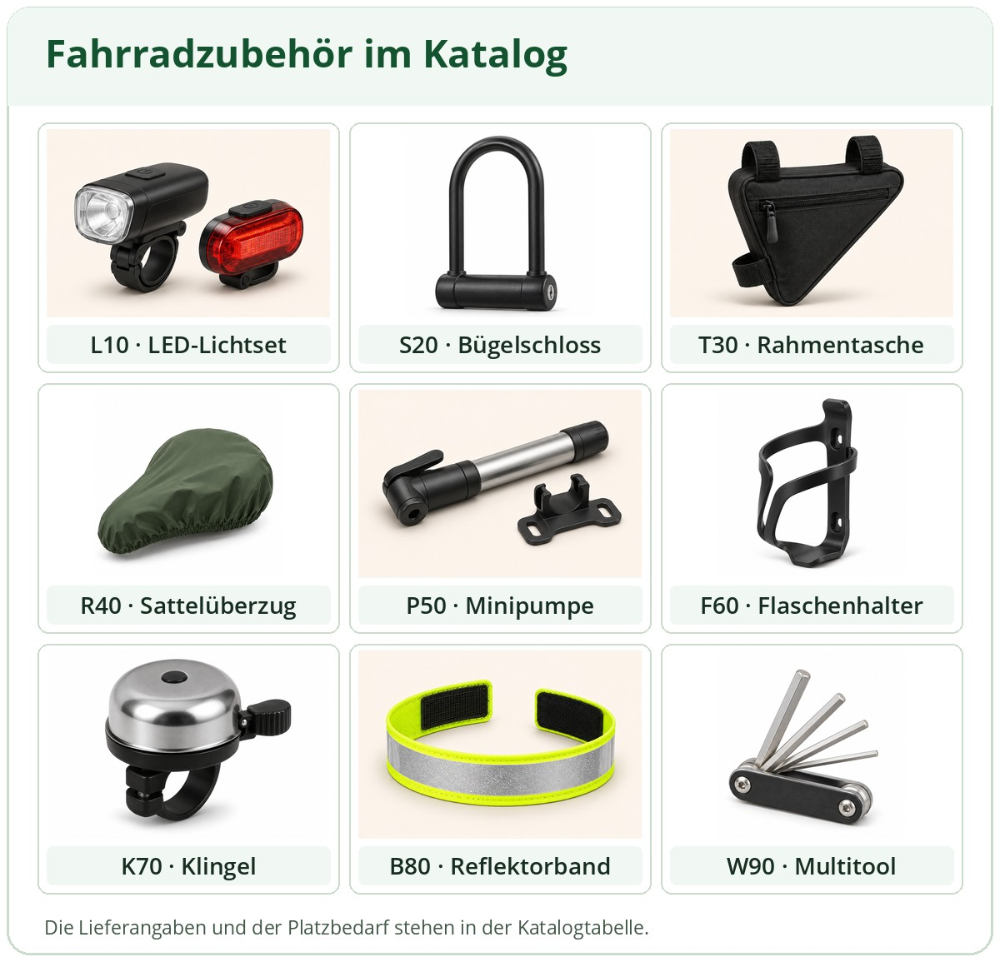
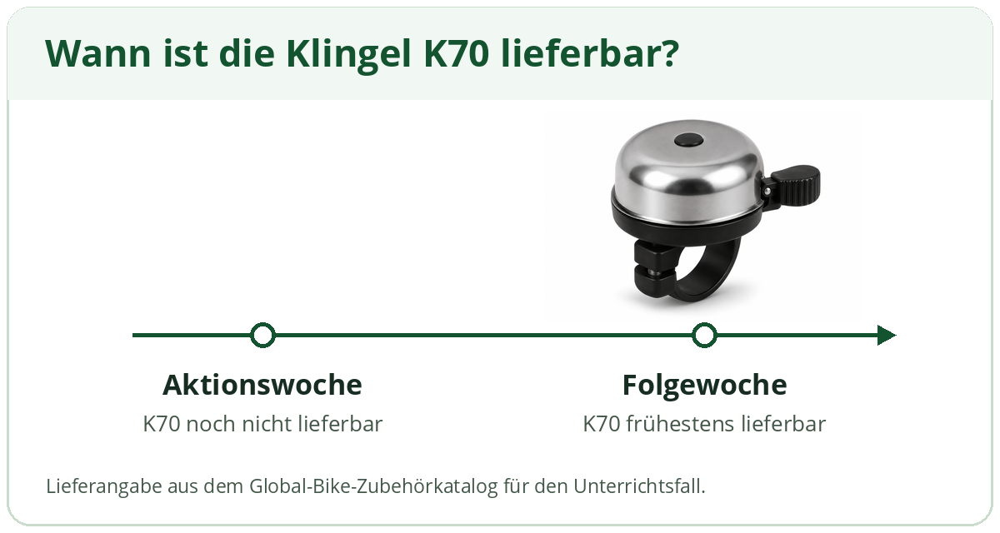

# M2 – Global-Bike-Zubehörkatalog für die Aktionswoche

<figure>

<figcaption>So sehen die neun Artikel aus dem Modellkatalog aus.</figcaption>
</figure>

<figure>

<figcaption>Liefertermin aus M2. Die Klingel K70 kommt frühestens in der Woche nach der Aktion.</figcaption>
</figure>

| Artikel            | Kurzbeschreibung                                                                           | <a href="../ls-glossar.html?from=material%2Fm2.html%23begriffsstelle-1#gl-lieferbarkeit" id="begriffsstelle-1">Lieferbarkeit</a> zum Aktionsbeginn | <a href="../ls-glossar.html?from=material%2Fm2.html%23begriffsstelle-2#gl-platzbedarf" id="begriffsstelle-2">Platzbedarf</a> je Laden |
|--------------------|--------------------------------------------------------------------------------------------|----------------------------------------------------------------------------------------------------------------------------------------------------|--------------------------------------------------------------------------------------------------------------------------------------:|
| L10 LED-Lichtset   | Licht für vorne am Lenker und hinten an der Sattelstütze                                   | ja                                                                                                                                                 |                                                                                                                               1 Platz |
| S20 Bügelschloss   | Zum Anschließen des Rahmens oder eines Laufrads, etwa an einem passenden Fahrradständer    | ja                                                                                                                                                 |                                                                                                                               1 Platz |
| T30 Rahmentasche   | Tasche für Schlüssel und kleine Gegenstände, mit Klettgurten                               | ja                                                                                                                                                 |                                                                                                                               1 Platz |
| R40 Sattelüberzug  | Wasserabweisender Überzug für den Sattel eines abgestellten Fahrrads                       | ja                                                                                                                                                 |                                                                                                                               1 Platz |
| P50 Minipumpe      | Pumpe für unterwegs. Passt auf zwei gängige Ventilarten. Die Typen stehen auf dem Artikel. | ja                                                                                                                                                 |                                                                                                                               1 Platz |
| F60 Flaschenhalter | Halter für einen Rahmen mit passenden Schraublöchern (Gewindeösen)                         | ja                                                                                                                                                 |                                                                                                                               1 Platz |
| K70 Klingel        | Klingel mit Daumenhebel für Lenker mit passendem Durchmesser                               | nein, ab Folgewoche                                                                                                                                |                                                                                                                               1 Platz |
| B80 Reflektorband  | Klettband, das Licht zurückwirft. Es macht euch besser sichtbar.                           | ja                                                                                                                                                 |                                                                                                                               1 Platz |
| W90 Multitool      | Kleines Werkzeug für gängige Innensechskantschrauben                                       | ja                                                                                                                                                 |                                                                                                                               1 Platz |

