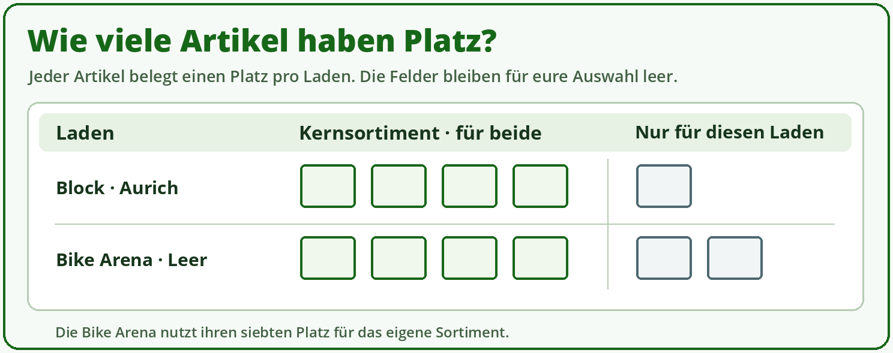

# M3 – Sortimentsvorgaben aus dem Vertrieb

<figure>

<figcaption>Legt oder schreibt die Artikel für beide Läden und die lokalen Ergänzungen in die freien Felder.</figcaption>
</figure>

- Block hat fünf <a href="../ls-glossar.html?from=material%2Fm3.html%23begriffsstelle-1#gl-aktionsplatz" id="begriffsstelle-1">Aktionsplätze</a>, die Bike Arena sechs. Dadurch bleibt die <a href="../ls-glossar.html?from=material%2Fm3.html%23begriffsstelle-2#gl-sortimentsbreite" id="begriffsstelle-2">Sortimentsbreite</a> der Aktion begrenzt. Den siebten Platz nutzt die Bike Arena für ihr eigenes Sortiment.
- Global Bike kündigt **vier gemeinsame Artikel** als <a href="../ls-glossar.html?from=material%2Fm3.html%23begriffsstelle-3#gl-kernsortiment" id="begriffsstelle-3">Kernsortiment</a> an. Diese Artikel bieten beide Läden an.
- Block erhält **einen**, die Bike Arena **zwei** zusätzliche Artikel. Eine <a href="../ls-glossar.html?from=material%2Fm3.html%23begriffsstelle-4#gl-lokale-sortimentserg%C3%A4nzung" id="begriffsstelle-4">lokale Sortimentsergänzung</a> bietet nur der Laden an, für den ihr sie auswählt. Jeder gewählte Artikel belegt einen Platz pro Laden.
- Für jeden Artikel, der zum Start lieferbar ist, hat das Lager genug Stück für beide Läden.

**Raster zum Ausschneiden oder Nachzeichnen**

| Laden      | Gemeinsame Plätze | Lokale Plätze |
|------------|-------------------|---------------|
| Block      | □ □ □ □           | □             |
| Bike Arena | □ □ □ □           | □ □           |

