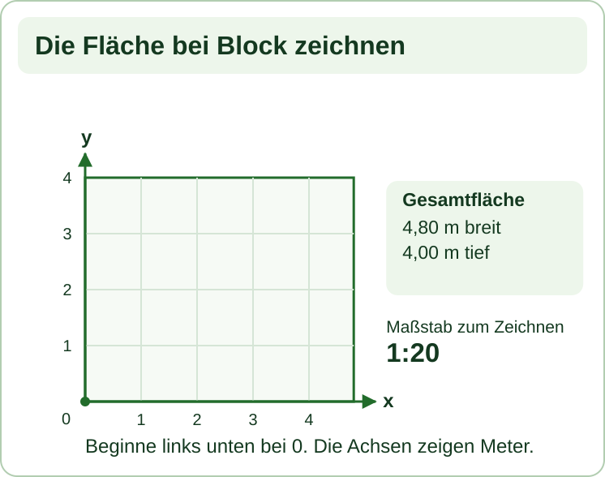
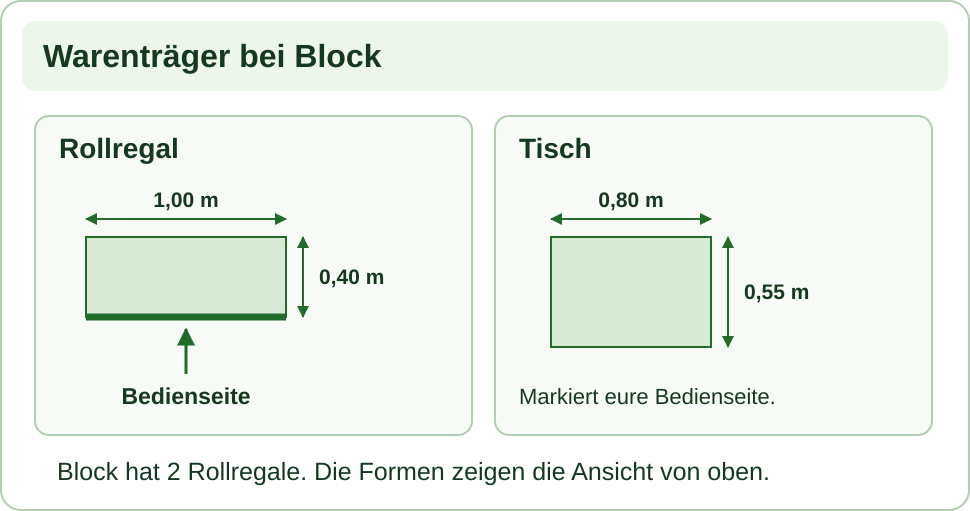

# BFS dual · LF 06 · LS 6.3 · Waren im Fahrradfachgeschäft präsentieren

**Zwei Läden, eine Freigabe** · Global Bike Deutschland GmbH · 2. Halbjahr

**Zeit** · 8 Unterrichtsstunden · 360 Minuten

## Orientierung

### Warum wir das lernen

5 Minuten

Beim Kauf eines Fahrradlichts könnt ihr am eigenen Rad prüfen, ob die Halterung neben die Klingel passt. Dafür brauchen euer Rad und die Verkäuferin Platz im Laden. Das Personal muss an das Muster und an die verpackte Ware kommen. Ihr plant für Block, welche Artikel zusammenstehen und wo das Personal das Licht zeigen kann. Andere sollen mit ihrem Fahrrad vorbeikommen können.

### Das übe ich

| Kompetenz | Wie stark? (1–6) | Das übe ich |
| --- | ---: | --- |
| Fachkompetenz | 6 | Ich plane eine kleine Beratungsfläche. Ich begründe, welche Artikel ich zusammen zeige. Ich erkläre, wie man die Artikel gut erreicht und am Fahrrad zeigen kann. |
| Personalkompetenz | 3 | Ich ändere meinen Entwurf, wenn er bei der Beratung zu Problemen führt. |
| Sozialkompetenz | 3 | Ich bespreche mit anderen, welche Wege die Kundschaft und das Verkaufspersonal brauchen. |
| Methodenkompetenz | 4 | Ich übertrage Maße in eine Skizze oder ein Modell. Damit vergleiche ich zwei Anordnungen. |
| Medienkompetenz | 4 | Ich beschrifte den Plan und erkläre die Zeichen in einer Legende. So können andere ihn lesen. |

## Handlungssituation

8 Minuten

Im 2-Rad Center Block in Aurich bringen viele Kunden ihr Fahrrad mit. So kann das Team direkt am Rad zeigen, ob ein Licht oder ein Schloss passt. Für eine Frühjahrsaktion bekommt das Fachgeschäft Zubehör von Global Bike.

Heute sind Sebastian Wolf und Christian Klein von Global Bike zu Besuch. Sebastian ist im Außendienst und hält Kontakt zu den Läden. Christian kümmert sich darum, dass die Ware dort ankommt. Mit Block haben sie schon geklärt, welche Artikel zur Aktion gehören. Für den Aufbau hat die Ladenleitung zwei Rollregale und einen schmalen Tisch reserviert. Morgen Vormittag will sie den Aufbau testen.

Eine Kundin schiebt ihr Rad in den Laden. Sie möchte sehen, wie die Halterung eines Lichts am Lenker sitzt. Die Verkäuferin bringt ihr das Muster. Gerade in diesem Moment kommt ein zweiter Kunde mit seinem Fahrrad durch denselben Bereich. Beide halten an. Sebastian möchte mehr Platz einplanen, damit das Personal Zubehör am Rad zeigen kann. Christian tippt auf den Ladenplan. „Wenn wir zu viel Platz am Tisch brauchen, kommt das Personal bei der Beratung schlecht an die verpackte Ware heran.“

Die Ladenleitung schaut auf die beiden Räder im Gang. „Am Samstag passiert das mehrmals am Vormittag. Wo können wir etwas am Rad zeigen? Wie kommen alle dabei vorbei?“ Für die Probe braucht sie euren Plan. Er soll zeigen, wie das Personal etwas vorführen und gleichzeitig die Ware erreichen kann. Die Wege sollen dabei frei bleiben.

*Bei Block treffen die Beratung am Rad und der Kundenverkehr im selben Gang aufeinander.*

### Den Fall prüfen

### Aufgabe 01 · Nennt, was für den Aufbau bereitsteht und wann die Ladenleitung den Aufbau testet.

3 Minuten

- Zwei schmale Tische und ein Rollregal stehen bereit. Die Probe ist morgen Nachmittag.
- Zwei Rollregale und ein schmaler Tisch stehen bereit. Die Probe ist morgen Nachmittag.
- Zwei schmale Tische und ein Rollregal stehen bereit. Die Probe ist morgen Vormittag.
- Zwei Rollregale und ein schmaler Tisch stehen bereit. Die Probe ist morgen Vormittag.
- Ein Rollregal und ein schmaler Tisch stehen bereit. Die Probe ist morgen Vormittag.
- Zwei Rollregale und zwei schmale Tische stehen bereit. Die Probe ist heute Nachmittag.

Hilfe

Sucht die Stelle, an der die Ladenleitung den Aufbau vorbereitet. Beginnt mit „Für den Aufbau gibt es …“ und „Die Ladenleitung testet den Aufbau …“.

### Aufgabe 02 · Beschreibt, was passiert, als die Verkäuferin das Licht am Rad zeigen will.

3 Minuten

- Ein zweiter Kunde prüft ein Licht am Nachbarregal. Die Verkäuferin holt ein weiteres Muster.
- Ein zweiter Kunde kommt mit seinem Rad durch denselben Bereich. Beide Kunden halten an.
- Ein zweiter Kunde wartet mit seinem Rad vor der Kasse. Die Kundin schiebt ihr Fahrrad weiter.
- Ein zweiter Kunde stellt sein Rad vor dem Tisch ab. Die Verkäuferin bringt das Muster zurück.
- Ein zweiter Kunde kommt mit seinem Rad zum Tisch. Die Kundin fährt für die Vorführung vor die Tür.
- Ein zweiter Kunde schiebt sein Rad durch den Gang. Die Verkäuferin bringt das Muster zur Kasse.

Hilfe

Lest ab „Eine Kundin schiebt ihr Rad in den Laden“ bis zu „Beide halten an“. Beginnt mit „Die Verkäuferin kommt mit dem Muster. In diesem Moment …“.

### Aufgabe 03 · Erklärt, worauf Sebastian bei der Planung achtet und was Christian wichtig ist.

3 Minuten

- Sebastian will schnell an verpackte Ware kommen. Christian will mehr Platz für Vorführungen am Rad.
- Sebastian will freie Sicht auf die Kasse. Christian will mehr Platz zum Abstellen der Kundenräder.
- Sebastian will mehr Platz für Vorführungen am Rad. Christian will die verpackte Ware gut erreichen.
- Sebastian will mehr Platz für zusätzliche Regale. Christian will freie Sicht auf die Beratung am Rad.
- Sebastian will mehr Platz für wartende Kunden. Christian will die verpackte Ware im Lager lassen.
- Sebastian will die Muster gut sichtbar aufhängen. Christian will mehr Platz für Beratung am Tisch.

Hilfe

Sucht nach den Stellen, an denen Sebastian und Christian über die Fläche sprechen. Beginnt mit „Sebastian möchte …“ und „Christian achtet darauf, dass …“.

### Aufgabe 04 · Nennt drei Dinge, die der Plan für die Ladenleitung möglich machen soll.

3 Minuten

- Wie das Team Zubehör am Rad zeigt, verpackte Ware erreicht und die Wege im Laden frei hält.
- Wie das Team Zubehör am Rad zeigt, neue Preise auszeichnet und die Werbung im Laden verteilt.
- Wie das Team Zubehör im Regal zählt, verpackte Ware erreicht und die Nachbestellung vorbereitet.
- Wie das Team Zubehör im Lager prüft, Muster am Tisch beschriftet und die Wege im Laden frei hält.
- Wie das Team die Muster am Rad befestigt, die Liefermenge prüft und die Artikel im Lager sortiert.
- Wie das Team Zubehör vor der Kasse zeigt, Preisschilder anbringt und die Muster im Laden verteilt.

Hilfe

Lest die letzten beiden Sätze. Beginnt mit „Der Plan soll zeigen, wie …“.

## Informieren

### Aufgabe 05 · Maße und Ladenregeln sammeln

30 Minuten

Bei Block gehört es zur Beratung, Ware am Fahrrad zu zeigen. Prüft mit [M1](#m1) und [M2](#m2), ob alle an die Ware kommen und genug Platz am Vorführrad haben. Nutzt [M3](#m3), um zu begründen, welche Artikel zusammengehören und wo sie stehen sollen.

**Sucht** in [M1](#m1) bis [M3](#m3) die Maße, die Ladenregeln und die Vorgaben für die Artikel. **Markiert** im Plan, wo das Personal Ware greifen und am Rad zeigen können muss. Markiert auch die Wege, die dafür frei bleiben müssen.

## Fachbegriffscheck

20 Minuten

**Wählt** zu jedem Fachbegriff die passende Erklärung aus sechs Möglichkeiten. Die Begriffe findet ihr in [M6](#m6).

**1. Warenträger**

- A · Ein Weg vom Eingang zur Werkstatt.
- B · Eine markierte Fläche, um einen Artikel vorzuführen.
- C · Ein Regal, ein Tisch oder etwas Ähnliches, auf oder an dem ein Laden seine Ware zeigt.
- D · Die Seite eines Regals oder eines anderen Warenträgers, an der man die Ware ansehen und greifen kann.
- E · Ein Bereich des Regals auf einer bestimmten Höhe. Je nach Höhe sieht oder erreicht man die Ware unterschiedlich gut.
- F · Die feste Stelle im Laden oder im Regal, an der die Kundschaft einen bestimmten Artikel findet.

**2. Bedienseite**

- A · Die Seite des Regals, die dem Eingang am nächsten liegt.
- B · Der Teil des Bodens, auf dem das Fahrrad für die Beratung steht.
- C · Die Seite eines Regals oder eines anderen Warenträgers, an der man die Ware ansehen und greifen kann.
- D · Ein Regal, ein Tisch oder etwas Ähnliches, auf oder an dem ein Laden seine Ware zeigt.
- E · Ein Bereich des Regals auf einer bestimmten Höhe. Je nach Höhe sieht oder erreicht man die Ware unterschiedlich gut.
- F · Die feste Stelle im Laden oder im Regal, an der die Kundschaft einen bestimmten Artikel findet.

**3. Vorführplatz**

- A · Der Durchgang, durch den Fahrräder zur Werkstatt geschoben werden.
- B · Ein freier Platz, an dem man einen Artikel zeigen und ausprobieren kann.
- C · Der Platz für verpackte Ware im Rollregal.
- D · Der wichtigste freie Weg für Kundinnen und Kunden im Laden.
- E · Ein Bereich im Laden für ein Angebot, das es nur eine bestimmte Zeit gibt.
- F · Eine Theke im Laden, an der das Verkaufspersonal die Kundschaft berät und bedient.

**4. Hauptdurchgang**

- A · Die Bedienseite, an der die Ware aus dem Regal gegriffen wird.
- B · Der für die Aktion reservierte Teil der Verkaufsfläche.
- C · Der wichtigste freie Weg für Kundinnen und Kunden im Laden.
- D · Ein freier Platz, an dem man einen Artikel zeigen und ausprobieren kann.
- E · Ein Bereich im Laden für ein Angebot, das es nur eine bestimmte Zeit gibt.
- F · Eine Theke im Laden, an der das Verkaufspersonal die Kundschaft berät und bedient.

**5. Regalzone**

- A · Ein Bereich des Regals auf einer bestimmten Höhe. Je nach Höhe sieht oder erreicht man die Ware unterschiedlich gut.
- B · Die Seite des Regals, an der Kundschaft und Personal die Ware greifen.
- C · Die Reihenfolge, in der die Warenträger nebeneinanderstehen.
- D · Ein Regal, ein Tisch oder etwas Ähnliches, auf oder an dem ein Laden seine Ware zeigt.
- E · Die Seite eines Regals oder eines anderen Warenträgers, an der man die Ware ansehen und greifen kann.
- F · Die feste Stelle im Laden oder im Regal, an der die Kundschaft einen bestimmten Artikel findet.

**6. Warenplatz**

- A · Der ganze Bereich des Ladens, den das Geschäft für die Aktion freihält.
- B · Die feste Stelle im Laden oder im Regal, an der die Kundschaft einen bestimmten Artikel findet.
- C · Der Platz, an dem das Personal ein Produkt am Fahrrad zeigt.
- D · Ein Regal, ein Tisch oder etwas Ähnliches, auf oder an dem ein Laden seine Ware zeigt.
- E · Die Seite eines Regals oder eines anderen Warenträgers, an der man die Ware ansehen und greifen kann.
- F · Ein Bereich des Regals auf einer bestimmten Höhe. Je nach Höhe sieht oder erreicht man die Ware unterschiedlich gut.

**7. Aktionsfläche**

- A · Der Platz im Regal, an dem ein einzelner Artikel steht.
- B · Ein Bereich im Laden für ein Angebot, das es nur eine bestimmte Zeit gibt.
- C · Der wichtigste Weg für die Kundschaft durch den Laden.
- D · Ein freier Platz, an dem man einen Artikel zeigen und ausprobieren kann.
- E · Der wichtigste freie Weg für Kundinnen und Kunden im Laden.
- F · Eine Theke im Laden, an der das Verkaufspersonal die Kundschaft berät und bedient.

**8. Beratungstresen**

- A · Eine frei gehaltene Fläche, auf der ein Fahrrad für die Vorführung steht.
- B · Ein beweglicher Tisch zur Präsentation der Aktionsartikel.
- C · Eine Theke im Laden, an der das Verkaufspersonal die Kundschaft berät und bedient.
- D · Ein freier Platz, an dem man einen Artikel zeigen und ausprobieren kann.
- E · Der wichtigste freie Weg für Kundinnen und Kunden im Laden.
- F · Ein Bereich im Laden für ein Angebot, das es nur eine bestimmte Zeit gibt.

**9. Vorführmodell**

- A · Ein Gegenstand, an dem man zeigen kann, wie ein Produkt funktioniert oder wie man es benutzt.
- B · Eine Skizze, die die Maße der Aktionsfläche zeigt.
- C · Ein Warenträger, auf dem nur verpackte Artikel stehen.
- D · Ein Exemplar eines Artikels, das der Laden zum Ansehen, Prüfen oder Ausprobieren bereitlegt.
- E · Ein freier Platz, an dem man einen Artikel zeigen und ausprobieren kann.
- F · Die feste Stelle im Laden oder im Regal, an der die Kundschaft einen bestimmten Artikel findet.

**10. Muster**

- A · Ein Exemplar eines Artikels, das der Laden zum Ansehen, Prüfen oder Ausprobieren bereitlegt.
- B · Eine Packung, die den festen Platz eines Artikels markiert.
- C · Ware, die das Geschäft bis zum Ende der Aktion im Lager behält.
- D · Ein Gegenstand, an dem man zeigen kann, wie ein Produkt funktioniert oder wie man es benutzt.
- E · Ein freier Platz, an dem man einen Artikel zeigen und ausprobieren kann.
- F · Die feste Stelle im Laden oder im Regal, an der die Kundschaft einen bestimmten Artikel findet.

## Planen

### Aufgabe 06 · Zwei Aufbauten skizzieren

40 Minuten

**Skizziert** zwei Möglichkeiten, Regale, Tisch und Vorführplatz anzuordnen. **Notiert** die Zugänge, Maße und Vorgaben, die ihr für beide Skizzen prüfen müsst.

## Entscheiden

### Aufgabe 07 · Lernpaket wählen und begründen

8 Minuten

**Wählt** einen der drei Arbeitswege. Überlegt, welcher Weg euch bei der Entscheidung am besten hilft. **Haltet** beim Arbeiten ein Zwischenergebnis und einen Beleg für den Pitch fest. Ein Beleg kann zum Beispiel eine Zahl, ein Maß oder eine Kundenstimme sein.

Plant eine kleine Beratungsfläche. Begründet, welche Artikel zusammenstehen. Erklärt, wie das Personal sie gut erreicht und am Rad zeigen kann. Erstellt einen Flächenplan mit Maßen, Beschriftungen und einer kurzen Begründung. Vergleicht eure Entwürfe mit denselben Kriterien aus M5.

| Lernpaket | Lernzugänge | So arbeitet ihr | Euer Zwischenergebnis | Wählt dieses Paket, wenn … |
| --- | --- | --- | --- | --- |
| **A · Beratungsflächen maßstäblich zeichnen** | Zeichnen und Abstände vergleichen | Zeichnet beide Anordnungen mit M1 und M4 im Maßstab 1:20. Markiert den Vorführplatz, die Stellen zum Greifen und die freien Wege. | Eure beiden Skizzen zeigen, wo genug Platz ist und wo es eng wird. | … ihr Wege und Abstände gern auf einer Zeichnung vergleicht. |
| **B · Eine Beratung nachspielen** | Zuhören, in Rollen sprechen und eine Beratung nachspielen | Hört den Dialog aus M4 oder lest ihn in Rollen vor. Spielt die Beratung zur Minipumpe nach. Sagt laut, wer sich wohin bewegt und was die Person greift. Markiert diese Stellen in beiden Skizzen. | Eure Skizzen und Notizen zeigen, wann jemand schlecht an die Ware kommt oder ein Fahrrad im Weg steht. | … ihr im Gespräch gut erkennt, was die Personen nacheinander tun. |
| **C · Die Beratungsfläche im Modell aufbauen** | Aufbauen und den Zugriff am Fahrradmodell testen | Legt den Grundriss mit Rollregalen und Tisch nach M4 als Modell aus. Bewegt das Fahrrad durch beide Anordnungen. Testet, wo ihr die Muster gut erreichen könnt. Notiert eure Beobachtungen in beiden Skizzen. | Die beiden Aufbauten zeigen am Modell, wie sich Wege und Zugriff auf die Ware ändern, wenn ihr Regale verschiebt. | … ihr durch Aufbauen und Verschieben sehen möchtet, welche Anordnung gut funktioniert. |

### Aufgabe 08 · Einen Aufbau auswählen

42 Minuten

**Vergleicht** mit eurem Lernpaket beide Anordnungen anhand der Kriterien aus M5. **Begründet** eure Empfehlung für die Ladenleitung. Nennt einen konkreten Vorteil für die Beratung und ein mögliches Problem bei der anderen Anordnung.

## Durchführen

### Aufgabe 09 · Den Flächenplan zeichnen

#### A · Beratungsflächen maßstäblich zeichnen

40 Minuten

Zeichnet beide Anordnungen mit M1 und M4 im Maßstab 1:20. Markiert den Vorführplatz, die Stellen zum Greifen und die freien Wege.

Eure beiden Skizzen zeigen, wo genug Platz ist und wo es eng wird.

#### B · Eine Beratung nachspielen

40 Minuten

Hört den Dialog aus M4 oder lest ihn in Rollen vor. Spielt die Beratung zur Minipumpe nach. Sagt laut, wer sich wohin bewegt und was die Person greift. Markiert diese Stellen in beiden Skizzen.

Eure Skizzen und Notizen zeigen, wann jemand schlecht an die Ware kommt oder ein Fahrrad im Weg steht.

#### C · Die Beratungsfläche im Modell aufbauen

40 Minuten

Legt den Grundriss mit Rollregalen und Tisch nach M4 als Modell aus. Bewegt das Fahrrad durch beide Anordnungen. Testet, wo ihr die Muster gut erreichen könnt. Notiert eure Beobachtungen in beiden Skizzen.

Die beiden Aufbauten zeigen am Modell, wie sich Wege und Zugriff auf die Ware ändern, wenn ihr Regale verschiebt.

**Zeichnet** eure gewählte Anordnung im Maßstab aus [M1](#m1) und [M4](#m4). Tragt die Warenträger und die Bereiche ein, die frei bleiben müssen. Schreibt die Maße an den Plan.

### Aufgabe 10 · Ware und Muster beschriften

35 Minuten

**Beschriftet** im Plan die fünf Verkaufsartikel und die Vorführmuster aus [M2](#m2) und [M3](#m3). Zeigt, welche Artikel ihr zusammen anbietet.

### Aufgabe 11 · Die Vorführung einzeichnen

20 Minuten

**Zeigt** im Plan, wo Licht und Minipumpe am Fahrrad vorgeführt werden. Markiert den Weg zur Ware und den Weg zur Werkstatt. Schreibt dazu, wo eine zweite Person mit Rad vorbeikommt.

## Bewerten

### Aufgabe 12 · Die Arbeit prüfen und kurz vorstellen

62 Minuten

#### Den Plan bei der Beratung prüfen

**Prüft** den Plan mit [M5](#m5) bei einer Beratung zum Licht und einer Beratung zur Minipumpe. **Verbessert** eine Stelle, falls die Ware schwer erreichbar ist oder der Platz zum Vorführen oder Vorbeigehen fehlt.

#### Die eigene Arbeit einschätzen

**Notiert**, welche Beobachtung bei eurer Entscheidung am wichtigsten war. **Erklärt**, was ihr am Plan ändern würdet, wenn Block nur noch eines der beiden Rollregale bereitstellen könnte.

**Wählt** die Stufe, die zu euch passt. Zeigt eine Stelle in eurem Flächenplan, die eure Wahl erklärt.

1 · Ich brauche Hilfe bei jedem Schritt. 2 · Mit einzelnen Tipps komme ich weiter. 3 · Ich kann die Aufgabe selbst lösen und begründen. 4 · Ich kann das auch in einem neuen Fall.

#### Abschlusspitch

**Stellt** euren Flächenplan in etwa zwei Minuten vor. Wenn noch Zeit ist, beantwortet eine Rückfrage.

1.  **Ergebnis zeigen.** Zeigt im Plan den Platz für die Beratung und die Vorführung. Zeigt, wie das Personal an die Ware kommt. Markiert den Weg, der dabei frei bleibt.
2.  **Entscheidung belegen.** Zeigt einen Beleg aus dem Fall. Erklärt, wie er eure Entscheidung stützt.
3.  **Arbeitsweg begründen.** Sagt, warum ihr euer Lernpaket gewählt habt. Zeigt ein Zwischenergebnis. Erklärt, wie es euch bei der Entscheidung geholfen hat.

Sprachhilfe für den Pitch

- „Unser Ergebnis ist … Wir schlagen vor, dass …“
- „Unser Beleg ist … Er zeigt, dass …“
- „Wir haben Paket … gewählt. Beim Arbeiten hat uns … geholfen.“

### Aufgabe 13 · Das Produkt für den Peer-Check bereitstellen

8 Minuten

**Ladet euren Flächenplan mit Maßen für Block hoch.** Bei einer Teamarbeit gibt jede Person eine Kopie im eigenen Moodle-Konto ab. Wählt einen Titel und einen Dateinamen ohne eure Namen. Entfernt eure Namen aus der Arbeit und aus den Dateieigenschaften.

Ohne eingerichtete Moodle-Aktivität erhältst du von der Lehrkraft eine codierte Arbeit.

### Aufgabe 14 · Ein fremdes Produkt prüfen

16 Minuten

**Schaut euch die zugeteilte Arbeit an.** Moodle lost aus, welche Arbeit ihr bekommt. Ihr seht die Arbeit ohne Namen.

**Gebt Rückmeldung.** Nutzt die Fragen unter dieser Aufgabe. Nennt eine Stelle, die gut gelungen ist. Schreibt, was die Person verbessern kann. Die Person sieht bei eurer Antwort euren Klarnamen.

- Passen Warenträger, Vorführplatz und freie Durchgänge zu den Maßen und Vorgaben?
- Stehen passende Artikel zusammen und lässt sich die Ware gut erreichen?
- Kann das Personal das Zubehör am Fahrrad zeigen, während andere die Fläche nutzen?

[Peer-Check im Lernpaket öffnen](peer-check.html)

### Aufgabe 15 · Die empfangene Rückmeldung nutzen

8 Minuten

**Lest** nach der Freigabe die Rückmeldung zu eurer Arbeit. Verbessert eine Stelle oder erklärt, warum ihr bei eurer Lösung bleibt.

## Reflektieren

### Aufgabe 16 · Feedback zur Lernsituation

6 Minuten

**Füllt** die Aktivität „Feedback“ im Moodle-Kurs aus und sendet eure Rückmeldung dort ab. Falls der Verweis fehlt, öffnet „Feedback“ in der Kursübersicht.

[Feedback in Moodle öffnen](https://bbs1aur.moodle-nds.de/mod/feedback/view.php?id=79787)

## Handlungsprodukt und Kriterien

Block erhält einen Flächenplan mit Maßen, Beschriftungen und einer kurzen Begründung. Passende Artikel stehen zusammen. Die Maße und die Flächenvorgaben sind eingehalten. Die Ware bleibt erreichbar. Es gibt genug Platz, um Zubehör am Fahrrad zu zeigen.

## Materialien

### M1 · Modellgrundriss für die Beratung bei Block

Bei Block kann die Kundschaft auf einem Fahrrad probesitzen und eine Probefahrt machen. Plant für die Aktion einen Platz ein, an dem das Personal Zubehör am Rad zeigen kann. <a href="https://www.zweirad-block.de/unternehmen/" target="_blank" rel="noopener noreferrer">Über das 2-Rad Center Block</a>

Der Verkaufsbereich ist 4,80 m breit und 4,00 m tief. Der Nullpunkt liegt im Südwesten, also links unten im Plan. Nach rechts laufen die x-Werte, nach oben die y-Werte. **Zeichnet** ein Rechteck im Maßstab 1:20 und tragt die Bereiche aus der Tabelle ein. Das Rechteck ist auf dem Blatt 24 cm breit und 20 cm hoch. Auf ein DIN-A4-Blatt im Querformat passt es knapp.

| Bereich                                       |    x in m |    y in m | Bedeutung                                                                                               |
|-----------------------------------------------|----------:|----------:|---------------------------------------------------------------------------------------------------------|
| Haupteingang                                  | 0,00–1,20 |      0,00 | Die Kundschaft kommt von Süden und schiebt die Fahrräder hinein.                                        |
| [Hauptdurchgang](#gl-hauptdurchgang)          | 0,00–1,20 | 0,00–4,00 | Die volle Breite bleibt für Kunden und Fahrräder frei. Der Weg führt oben im Plan weiter zur Werkstatt. |
| [Aktionsfläche](#gl-aktionsfl%C3%A4che)       | 1,20–4,80 | 0,80–4,00 | Hier ist Platz für die Warenträger und die Vorführung.                                                  |
| Fester [Beratungstresen](#gl-beratungstresen) | 3,60–4,80 | 0,80–1,50 | Am Tresen verkauft Block weiter Ware wie sonst auch. Der Tresen bleibt an seinem Platz.                 |

*Die Zeichenhilfe zeigt die Gesamtfläche und den Nullpunkt. Zeichnet euren Plan mit den Maßen aus der Tabelle. Auf Papier ist der Plan 24 cm breit und 20 cm hoch.*

### M2 · Ladenregeln und Warenträger

- Der [Vorführplatz](#gl-vorf%C3%BChrplatz) braucht eine durchgehend freie Fläche von mindestens 2,00 m × 1,30 m. Im Plan darf seine lange Seite in x- oder y-Richtung liegen.
- Vom Hauptdurchgang führt ein freier Weg zum Vorführplatz und zur [Bedienseite](#gl-bedienseite) jedes Warenträgers. Dieser Weg ist überall mindestens 0,90 m breit. Er bleibt auch frei, wenn am Fahrrad etwas gezeigt wird. Hauptdurchgang und Zugang zum Tresen bleiben frei.
- Die zwei Rollregale lassen sich frei drehen. Sie sind jeweils 1,00 m × 0,40 m groß. An der markierten langen Seite greift man die Ware. Der Tisch ist 0,80 m × 0,55 m groß. Markiert beim Tisch die Seite, von der man etwas greift. Alle [Warenträger](#gl-warentr%C3%A4ger) stehen ganz auf der markierten Aktionsfläche. Sie stehen weder am Platz des festen Tresens noch auf dem Vorführplatz oder auf den Wegen.
- Block stellt ein Fahrrad als [Vorführmodell](#gl-vorf%C3%BChrmodell) bereit. Es hat einen geraden Lenker und einen Reifen mit Sclaverandventil. Das Personal muss bei der Beratung auch an die verpackte Ware kommen.

*Am grünen Rand des Rollregals greift man die Ware. Markiert im eigenen Plan auch beim Tisch, von welcher Seite man etwas greift.*

### M3 · Festes Aktionssortiment

| Artikel           | Was die Kundschaft beim Kauf wissen will                             | Vorgabe bei Block                                                                                                                       |
|-------------------|----------------------------------------------------------------------|-----------------------------------------------------------------------------------------------------------------------------------------|
| L10 LED-Lichtset  | Wie sitzt die Halterung am Lenker und wie löse ich das Licht wieder? | Ein Muster am Vorführplatz. Die Schachteln stehen erreichbar am [Warenplatz](#gl-warenplatz).                                           |
| R40 Sattelüberzug | Kann ich den Überzug am eigenen Sattel ausprobieren?                 | Die Kundschaft darf ein [Muster](#gl-muster) anfassen. Das Personal kann es am Vorführrad zeigen. Die verpackte Ware bleibt erreichbar. |
| P50 Minipumpe     | Passt die Pumpe zu meinem Ventil und wie setze ich sie an?           | Das Personal soll die Pumpe am Ventil des Fahrrads zeigen können.                                                                       |
| T30 Rahmentasche  | Komme ich leicht an meine Kleinteile?                                | Die Kundschaft darf ein leeres Muster anfassen und öffnen.                                                                              |
| S20 Bügelschloss  | Wie groß ist der Bügel und wie schwer ist das Schloss?               | Zeigt das Schloss wegen seines Gewichts in der unteren [Regalzone](#gl-regalzone).                                                      |

### M4 · Bauteile für die Beratungsfläche

**Schneidet** aus Papier oder Pappe zwei Rechtecke von je 5,0 cm × 2,0 cm für die Regale und ein Rechteck von 4,0 cm × 2,75 cm für den Tisch aus. Die Stücke passen zum Maßstab 1:20. Legt sie auf den Plan aus [M1](#m1). Schneidet für die Fahrräder zwei Streifen von je 9,0 cm × 3,25 cm aus. Nutzt kleine Papierstücke für die beratende Person und die Kundschaft. Legt in jeder Anordnung Fäden für die Wege und beschriftete Karten für die Artikelplätze. Prüft mit dem Lineal, ob die Wege auf dem Plan mindestens 4,5 cm breit bleiben.

### M5 · Kurzprüfung für die Beratung

| Beobachtung                                                                        | Eintrag                                 |
|------------------------------------------------------------------------------------|-----------------------------------------|
| Kommt die Kundschaft mit einem Fahrrad am Vorführplatz vorbei?                     | Stelle im Plan und Beobachtung          |
| Kommt das Personal ohne Umweg an L10 und P50, wenn es beide Artikel zeigen möchte? | Stelle im Plan und Beobachtung          |
| Ist verständlich, warum bestimmte Artikel zusammenstehen?                          | Welche Artikel zusammenstehen und warum |
| Wo liegen das Bügelschloss und das Muster der Rahmentasche?                        | Platzierung und Grund                   |

### M6 · Fachbegriffe zu dieser Lernsituation

- **Warenträger.** Ein Regal, ein Tisch oder etwas Ähnliches, auf oder an dem ein Laden seine Ware zeigt.
- **Bedienseite.** Die Seite eines Regals oder eines anderen Warenträgers, an der man die Ware ansehen und greifen kann.
- **Vorführplatz.** Ein freier Platz, an dem man einen Artikel zeigen und ausprobieren kann.
- **Hauptdurchgang.** Der wichtigste freie Weg für Kundinnen und Kunden im Laden.
- **Regalzone.** Ein Bereich des Regals auf einer bestimmten Höhe. Je nach Höhe sieht oder erreicht man die Ware unterschiedlich gut.
- **Warenplatz.** Die feste Stelle im Laden oder im Regal, an der die Kundschaft einen bestimmten Artikel findet.
- **Aktionsfläche.** Ein Bereich im Laden für ein Angebot, das es nur eine bestimmte Zeit gibt.
- **Beratungstresen.** Eine Theke im Laden, an der das Verkaufspersonal die Kundschaft berät und bedient.
- **Vorführmodell.** Ein Gegenstand, an dem man zeigen kann, wie ein Produkt funktioniert oder wie man es benutzt.
- **Muster.** Ein Exemplar eines Artikels, das der Laden zum Ansehen, Prüfen oder Ausprobieren bereitlegt.

## Glossar

### Aktionsfläche

Ein Bereich im Laden für ein Angebot, das es nur eine bestimmte Zeit gibt.

**Beispiel.** Auf der Aktionsfläche stehen die Warenträger. Dort ist auch Platz für die Vorführung. Der Hauptdurchgang ist extra eingezeichnet ([M1](#m1)).

### Bedienseite

Die Seite eines Regals oder eines anderen Warenträgers, an der man die Ware ansehen und greifen kann.

**Beispiel.** Die Kundschaft und das Personal greifen an der markierten langen Seite ins Rollregal ([M2](#m2)).

### Beratungstresen

Eine Theke im Laden, an der das Verkaufspersonal die Kundschaft berät und bedient.

**Beispiel.** Der Tresen bleibt an der Stelle im Plan. Auch während der Aktion muss man ihn erreichen können ([M1](#m1) und [M2](#m2)).

### Hauptdurchgang

Der wichtigste freie Weg für Kundinnen und Kunden im Laden.

**Beispiel.** Durch den Hauptdurchgang schiebt die Kundschaft ihre Fahrräder Richtung Werkstatt ([M1](#m1)).

### Muster

Ein Exemplar eines Artikels, das der Laden zum Ansehen, Prüfen oder Ausprobieren bereitlegt.

**Beispiel.** Die Kundschaft darf das Muster des Sattelüberzugs anfassen und am Vorführrad ausprobieren ([M3](#m3)).

### Regalzone

Ein Bereich des Regals auf einer bestimmten Höhe. Je nach Höhe sieht oder erreicht man die Ware unterschiedlich gut.

**Beispiel.** Das schwere Bügelschloss gehört in die untere Regalzone ([M3](#m3)).

### Vorführmodell

Ein Gegenstand, an dem man zeigen kann, wie ein Produkt funktioniert oder wie man es benutzt.

**Beispiel.** Am Vorführrad zeigt die Verkäuferin, wie sie die Minipumpe am Ventil ansetzt ([M2](#m2) und [M3](#m3)).

### Vorführplatz

Ein freier Platz, an dem man einen Artikel zeigen und ausprobieren kann.

**Beispiel.** Hier kann die Verkäuferin zeigen, wie die Halterung des Lichts am Lenker sitzt ([M2](#m2), [M3](#m3)).

### Warenplatz

Die feste Stelle im Laden oder im Regal, an der die Kundschaft einen bestimmten Artikel findet.

**Beispiel.** Das Musterlicht ist beim Vorführen griffbereit. Die verpackten Lichtsets stehen am vorgesehenen Warenplatz ([M3](#m3)).

### Warenträger

Ein Regal, ein Tisch oder etwas Ähnliches, auf oder an dem ein Laden seine Ware zeigt.

**Beispiel.** Das Fachgeschäft zeigt die Ware in zwei Rollregalen und auf einem Tisch ([M2](#m2)).
