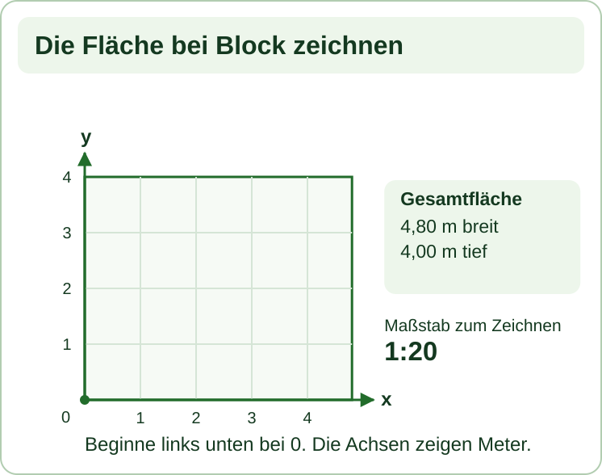

# M1 – Modellgrundriss für die Beratung bei Block

<figure>

<figcaption>Die Zeichenhilfe zeigt die Gesamtfläche und den Nullpunkt. Zeichnet euren Plan mit den Maßen aus der Tabelle. Auf Papier ist der Plan 24 cm breit und 20 cm hoch.</figcaption>
</figure>

Bei Block kann die Kundschaft auf einem Fahrrad probesitzen und eine Probefahrt machen. Plant für die Aktion einen Platz ein, an dem das Personal Zubehör am Rad zeigen kann. <a href="https://www.zweirad-block.de/unternehmen/" target="_blank" rel="noopener noreferrer">Über das 2-Rad Center Block</a>

Der Verkaufsbereich ist 4,80 m breit und 4,00 m tief. Der Nullpunkt liegt im Südwesten, also links unten im Plan. Nach rechts laufen die x-Werte, nach oben die y-Werte. **Zeichnet** ein Rechteck im Maßstab 1:20 und tragt die Bereiche aus der Tabelle ein. Das Rechteck ist auf dem Blatt 24 cm breit und 20 cm hoch. Auf ein DIN-A4-Blatt im Querformat passt es knapp.

| Bereich                                                                                                                                     |    x in m |    y in m | Bedeutung                                                                                               |
|---------------------------------------------------------------------------------------------------------------------------------------------|----------:|----------:|---------------------------------------------------------------------------------------------------------|
| Haupteingang                                                                                                                                | 0,00–1,20 |      0,00 | Die Kundschaft kommt von Süden und schiebt die Fahrräder hinein.                                        |
| <a href="../ls-glossar.html?from=material%2Fm1.html%23begriffsstelle-2#gl-hauptdurchgang" id="begriffsstelle-2">Hauptdurchgang</a>          | 0,00–1,20 | 0,00–4,00 | Die volle Breite bleibt für Kunden und Fahrräder frei. Der Weg führt oben im Plan weiter zur Werkstatt. |
| <a href="../ls-glossar.html?from=material%2Fm1.html%23begriffsstelle-3#gl-aktionsfl%C3%A4che" id="begriffsstelle-3">Aktionsfläche</a>       | 1,20–4,80 | 0,80–4,00 | Hier ist Platz für die Warenträger und die Vorführung.                                                  |
| Fester <a href="../ls-glossar.html?from=material%2Fm1.html%23begriffsstelle-4#gl-beratungstresen" id="begriffsstelle-4">Beratungstresen</a> | 3,60–4,80 | 0,80–1,50 | Am Tresen verkauft Block weiter Ware wie sonst auch. Der Tresen bleibt an seinem Platz.                 |

