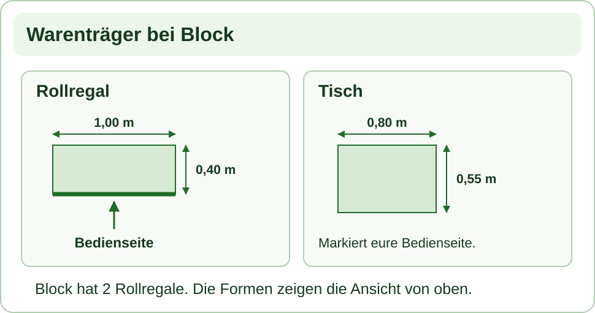

# M2 – Ladenregeln und Warenträger

<figure>

<figcaption>Am grünen Rand des Rollregals greift man die Ware. Markiert im eigenen Plan auch beim Tisch, von welcher Seite man etwas greift.</figcaption>
</figure>

- Der <a href="../ls-glossar.html?from=material%2Fm2.html%23begriffsstelle-1#gl-vorf%C3%BChrplatz" id="begriffsstelle-1">Vorführplatz</a> braucht eine durchgehend freie Fläche von mindestens 2,00 m × 1,30 m. Im Plan darf seine lange Seite in x- oder y-Richtung liegen.
- Vom Hauptdurchgang führt ein freier Weg zum Vorführplatz und zur <a href="../ls-glossar.html?from=material%2Fm2.html%23begriffsstelle-2#gl-bedienseite" id="begriffsstelle-2">Bedienseite</a> jedes Warenträgers. Dieser Weg ist überall mindestens 0,90 m breit. Er bleibt auch frei, wenn am Fahrrad etwas gezeigt wird. Hauptdurchgang und Zugang zum Tresen bleiben frei.
- Die zwei Rollregale lassen sich frei drehen. Sie sind jeweils 1,00 m × 0,40 m groß. An der markierten langen Seite greift man die Ware. Der Tisch ist 0,80 m × 0,55 m groß. Markiert beim Tisch die Seite, von der man etwas greift. Alle <a href="../ls-glossar.html?from=material%2Fm2.html%23begriffsstelle-3#gl-warentr%C3%A4ger" id="begriffsstelle-3">Warenträger</a> stehen ganz auf der markierten Aktionsfläche. Sie stehen weder am Platz des festen Tresens noch auf dem Vorführplatz oder auf den Wegen.
- Block stellt ein Fahrrad als <a href="../ls-glossar.html?from=material%2Fm2.html%23begriffsstelle-4#gl-vorf%C3%BChrmodell" id="begriffsstelle-4">Vorführmodell</a> bereit. Es hat einen geraden Lenker und einen Reifen mit Sclaverandventil. Das Personal muss bei der Beratung auch an die verpackte Ware kommen.

