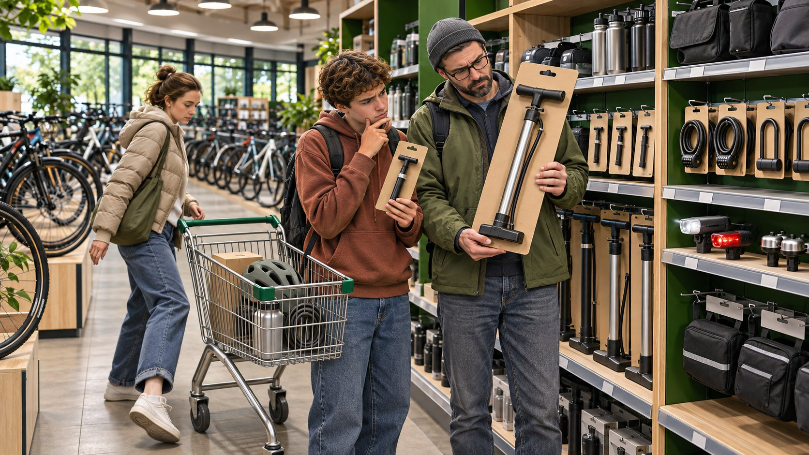
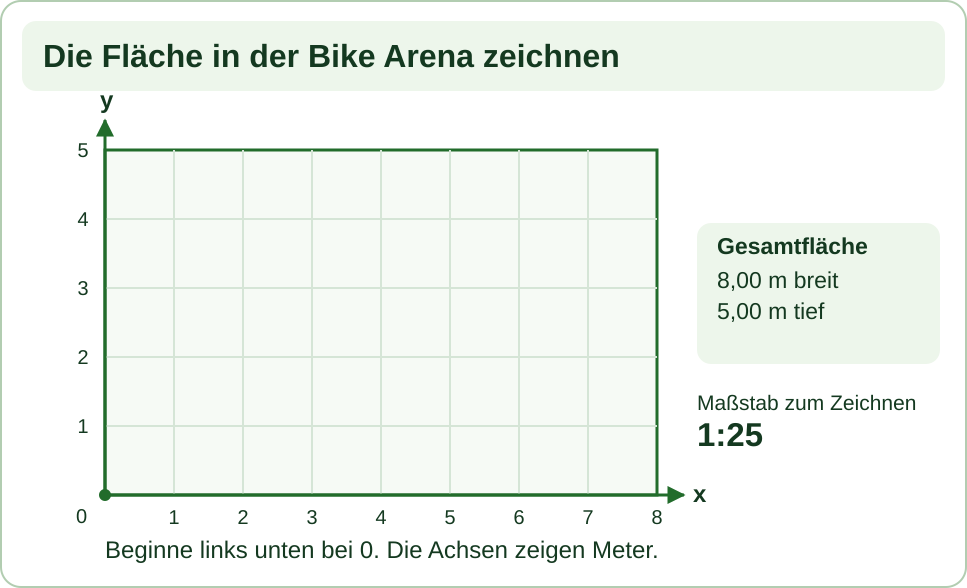
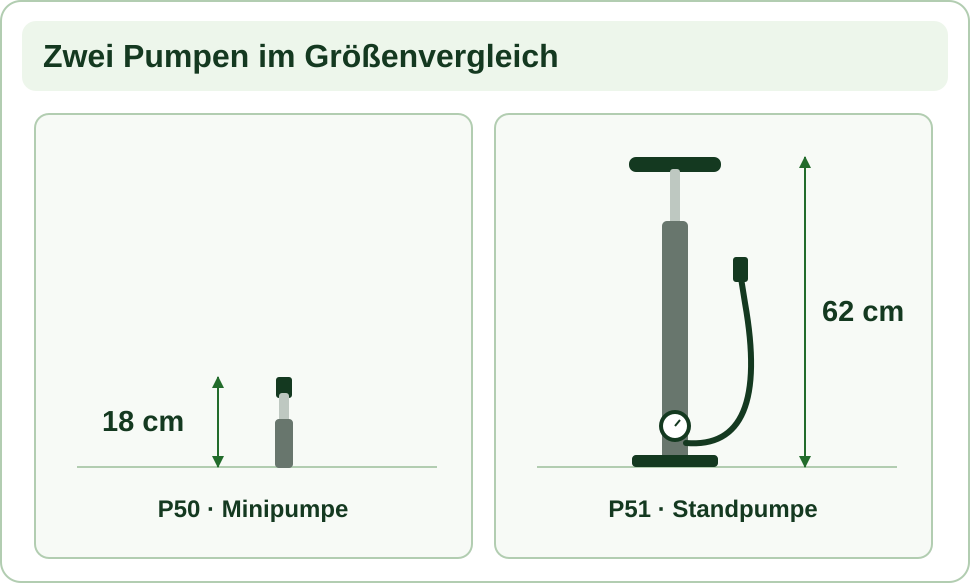

# BFS dual · LF 06 · LS 6.4 · Waren auf einer Selbstbedienungsfläche präsentieren

**Zwei Läden, eine Freigabe** · Global Bike Deutschland GmbH · 2. Halbjahr

**Zeit** · 8 Unterrichtsstunden · 360 Minuten

## Orientierung

### Warum wir das lernen

5 Minuten

Zwei Pumpen sehen auf der Packung ähnlich aus. Welche passt zu eurem Ventil? Ihr müsst das richtige Regal finden und dort die Angaben gut lesen können. Für die Zubehörfläche der Bike Arena plant ihr den Weg zum Regal und die Hinweise am Regal. So soll die Kundschaft die Ware selbst vergleichen und auswählen können.

### Das übe ich

| Kompetenz | Wie stark? (1–6) | Das übe ich |
| --- | ---: | --- |
| Fachkompetenz | 6 | Ich gestalte eine Selbstbedienungsfläche. Ich begründe, wie der Kundenlauf, die Plätze für die Artikel und die Produktinformationen der Kundschaft helfen. Die Kundschaft soll die Ware selbst finden, vergleichen und auswählen können. |
| Personalkompetenz | 3 | Ich prüfe, ob eine Person sich mit meinem Entwurf zurechtfindet, wenn sie die Aktionsfläche noch nicht kennt. |
| Sozialkompetenz | 3 | Ich höre mir Rückmeldungen dazu an, wie gut andere sich zurechtfinden. Ich erkläre dem Team, was ich deshalb ändere. |
| Methodenkompetenz | 4 | Ich trage meine Beobachtungen zu den Kundenwegen und die Produktdaten in den Lageplan ein. |
| Medienkompetenz | 4 | Ich gestalte Orientierungsschilder und Produktinformationen so, dass die Kundschaft sie an der vorgesehenen Stelle gut lesen und verstehen kann. |

## Handlungssituation

8 Minuten

In der Bike Arena Oltmanns in Leer können Familien Fahrräder und Zubehör für ihre Ausflüge kaufen. Für eine Frühjahrsaktion bekommt das Fahrradgeschäft unter anderem Pumpen von Global Bike. Die Kundschaft soll die Pumpen im Laden selbst finden und vergleichen können.

Sarah Huber plant bei Global Bike die Werbung. Ihr Kollege Sebastian Wolf betreut die Fahrradläden. Heute schauen sich die beiden in der Bike Arena die freie Fläche an. Sarah möchte die Regale mit dem Zubehör nah am Eingang aufstellen. „Die Familien sollen die Aktion sehen, bevor sie zur Fahrradabteilung weitergehen.“

Am üblichen Zubehörregal nehmen ein Vater und sein Sohn je eine Pumpe in die Hand. Der Sohn fragt, welche Pumpe zu seinem Rad passt. Sein Vater sucht auf der Rückseite der Packung nach einer Angabe zum Ventil. Sein Einkaufswagen steht im Weg. Andere Kundinnen und Kunden müssen ausweichen. Der Vater stellt beide Pumpen zurück und geht weiter. Sebastian schaut zu Sarah. „Vorn am Eingang sieht man den Aufbau sofort. Aber haben die Leute dort genug Platz, wenn sie stehen bleiben und die Ware vergleichen?“

Die Ladenleitung gibt euch einen Modellgrundriss, Produktkarten und ihre Notizen vom letzten Wochenende. Am Samstag ist an der Zubehörfläche keine feste Beratung eingeplant. Bis morgen braucht die Leitung euren Aufbauplan. Die Kundschaft soll die Aktion bemerken und passende Ware selbst finden. Die Wege sollen frei bleiben, wenn jemand zum Vergleichen stehen bleibt.

*In der Bike Arena vergleichen Vater und Sohn zwei Pumpen. Der Einkaufswagen steht im Gang.*

### Den Fall prüfen

### Aufgabe 01 · Erklärt, warum Sarah die Warenträger nah am Zugang aufstellen möchte.

3 Minuten

- Die Familien sollen die Fahrräder erreichen, bevor sie im Laden nach passendem Zubehör suchen.
- Die Familien sollen die Pumpen bezahlen, bevor sie mit ihrem Wagen zur Fahrradabteilung gehen.
- Die Familien sollen die Aktion bemerken, bevor sie im Laden zur Fahrradabteilung weitergehen.
- Die Familien sollen die Räder ausprobieren, bevor sie sich am Eingang über das Zubehör informieren.
- Die Familien sollen ihr Zubehör abholen, bevor sie mit dem Einkaufswagen zur Fahrradabteilung gehen.
- Die Familien sollen ihre Räder am Eingang testen, bevor sie das Zubehör in der Fahrradabteilung kaufen.

Hilfe

Lest, was Sarah über die Familien sagt. Beginnt mit „Sarah möchte, dass die Familien …“.

### Aufgabe 02 · Nennt die Angabe, die der Vater sucht. Beschreibt, was er am Ende tut.

3 Minuten

- Er sucht eine Angabe zum Ventil. Dann stellt er beide Pumpen zurück und geht weiter.
- Er sucht eine Angabe zum Ventil. Dann legt er beide Pumpen in seinen Einkaufswagen.
- Er sucht eine Angabe zum Preis. Dann stellt er beide Pumpen zurück und geht weiter.
- Er sucht eine Angabe zum Preis. Dann nimmt er eine der Pumpen mit zur Fahrradabteilung.
- Er sucht eine Angabe zum Gewicht. Dann legt er eine der beiden Pumpen in seinen Wagen.
- Er sucht eine Angabe zur Länge. Dann bringt er beide Pumpen zur Verkäuferin an der Kasse.

Hilfe

Lest die Sätze über den Vater am Zubehörregal. Beginnt mit „Der Vater sucht …“ und „Dann …“.

### Aufgabe 03 · Erklärt, welches Problem Sebastian sieht, wenn die Kundschaft am Zubehör stehen bleibt.

3 Minuten

- Beim Vergleichen verdeckt die Kundschaft die Preisschilder. Andere können die Angebote schlecht lesen.
- Beim Vergleichen geraten die Verpackungen durcheinander. Andere finden die passenden Pumpen schwer.
- Beim Vergleichen braucht die Kundschaft zusätzliche Beratung. Andere müssen am Regal länger warten.
- Beim Vergleichen braucht die Kundschaft Platz im Gang. Andere kommen mit ihren Wagen schlecht vorbei.
- Beim Vergleichen verliert die Kundschaft den Blick auf das Schild. Andere übersehen dadurch die Aktion.
- Beim Vergleichen vertauscht die Kundschaft die Artikel. Andere finden die passenden Preisschilder schwer.

Hilfe

Lest Sebastians Antwort und den Satz zum Einkaufswagen. Nutzt den Satzanfang „Wenn Kundinnen und Kunden stehen bleiben, dann …“.

### Aufgabe 04 · Nennt, was die Kundschaft am Samstag am neuen Aufbau selbst schaffen soll.

3 Minuten

- Die Aktion entdecken, ein Fahrrad zur Probe auswählen und das Zubehör an der Kasse bestellen.
- Die Aktion entdecken, das Zubehör vergleichen und eine passende Pumpe für das eigene Rad finden.
- Die Aktion entdecken, einen Beratungstermin auswählen und die passende Pumpe zur Abholung reservieren.
- Die Aktion entdecken, ein Muster am eigenen Rad testen und das Zubehör beim Verkaufsteam erfragen.
- Die Aktion entdecken, eine Pumpe vorbestellen und den Abholtermin direkt an der Kasse vereinbaren.
- Die Aktion entdecken, das Zubehör für eine Vorführung auswählen und am Beratungstisch darauf warten.

Hilfe

Lest im letzten Absatz die letzten beiden Sätze. Beginnt mit „Die Kundschaft soll …“.

## Informieren

### Aufgabe 05 · Grundriss und Produktkarten lesen

30 Minuten

Bei der Selbstbedienung findet die Kundschaft die Ware selbst und wählt sie am Regal aus. Nutzt [M1](#m1) und [M2](#m2), um gut sichtbare Plätze für Schilder und freie Wege zum Regal zu finden. Schreibt die wichtigen Angaben aus [M3](#m3) so auf, dass die Kundschaft die Produkte vergleichen und selbst prüfen kann, welches passt.

**Prüft** den Grundriss, die Beobachtungen und die Produktkarten in [M1](#m1) bis [M3](#m3). **Notiert**, welche Wege die Kundschaft nimmt und welche Angaben sie braucht, um am Regal einen Artikel auszuwählen.

## Fachbegriffscheck

20 Minuten

**Wählt** zu jedem Fachbegriff die passende Erklärung aus sechs Möglichkeiten. Die Begriffe findet ihr in [M6](#m6).

**1. Selbstbedienung**

- A · Eine Fachkraft wählt bei jedem Einkauf die passenden Artikel aus.
- B · Die Kundschaft holt fertig zusammengestellte Ware an der Kasse ab.
- C · Eine Verkaufsform, bei der die Kundschaft die Ware meist selbst findet, auswählt und vom Warenplatz nimmt.
- D · Der Weg, den viele Kundinnen und Kunden im Laden nehmen, etwa vom Eingang zu den Warengruppen.
- E · Ein Verkaufsregal, das frei im Raum steht. In der Bike Arena steht hier Ware auf beiden langen Seiten.
- F · Der freie Platz vor einem Regal, an dem die Kundschaft Artikel ansehen und aus dem Regal nehmen kann.

**2. Kundenlauf**

- A · Die Zeit, die eine Person am Regal für die Produktauswahl braucht.
- B · Die Reihenfolge, in der das Personal die Regale auffüllt.
- C · Der Weg, den viele Kundinnen und Kunden im Laden nehmen, etwa vom Eingang zu den Warengruppen.
- D · Eine Verkaufsform, bei der die Kundschaft die Ware meist selbst findet, auswählt und vom Warenplatz nimmt.
- E · Ein Verkaufsregal, das frei im Raum steht. In der Bike Arena steht hier Ware auf beiden langen Seiten.
- F · Der freie Platz vor einem Regal, an dem die Kundschaft Artikel ansehen und aus dem Regal nehmen kann.

**3. Orientierungsschild**

- A · Ein Schild im Laden, das hilft, eine Abteilung, eine Aktionsfläche oder eine Warengruppe zu finden.
- B · Ein Preisaufkleber an einer einzelnen Packung.
- C · Eine Tabelle mit technischen Angaben zu mehreren Produkten.
- D · Eine Produktangabe, mit der man Artikel vergleichen oder ihre Eignung prüfen kann.
- E · Eine Gruppe von Artikeln, die einem ähnlichen Zweck dienen. Das Geschäft fasst sie zusammen.
- F · Der Weg, den viele Kundinnen und Kunden im Laden nehmen, etwa vom Eingang zu den Warengruppen.

**4. Vergleichsinformation**

- A · Eine Produktangabe, mit der man Artikel vergleichen oder ihre Eignung prüfen kann.
- B · Eine Artikelnummer, die dem Personal den Platz im Lager zeigt.
- C · Eine Überschrift, die nur den Weg zur Warengruppe zeigt.
- D · Ein Schild im Laden, das hilft, eine Abteilung, eine Aktionsfläche oder eine Warengruppe zu finden.
- E · Eine Gruppe von Artikeln, die einem ähnlichen Zweck dienen. Das Geschäft fasst sie zusammen.
- F · Der Weg, den viele Kundinnen und Kunden im Laden nehmen, etwa vom Eingang zu den Warengruppen.

**5. Kompatibilität**

- A · Zwei Artikel sind gleich groß.
- B · Zwei Dinge passen zusammen und lassen sich gemeinsam wie geplant nutzen.
- C · Zwei Artikel gehören zur gleichen Warengruppe.
- D · Eine Anzeige, auf der man den Druck ablesen kann.
- E · Eine Stelle am Fahrradrahmen, in die man eine passende Schraube drehen kann. Die Rillen für die Schraube bilden das Gewinde.
- F · Eine Produktangabe, mit der man Artikel vergleichen oder ihre Eignung prüfen kann.

**6. Warengruppe**

- A · Eine Gruppe von Artikeln, die einem ähnlichen Zweck dienen. Das Geschäft fasst sie zusammen.
- B · Alle Artikel auf derselben Aktionsfläche.
- C · Mehrere Varianten eines Produkts, die immer dieselbe Artikelnummer haben.
- D · Ein Schild im Laden, das hilft, eine Abteilung, eine Aktionsfläche oder eine Warengruppe zu finden.
- E · Eine Produktangabe, mit der man Artikel vergleichen oder ihre Eignung prüfen kann.
- F · Der Weg, den viele Kundinnen und Kunden im Laden nehmen, etwa vom Eingang zu den Warengruppen.

**7. Gondel**

- A · Ein Verkaufsregal, das frei im Raum steht. In der Bike Arena steht hier Ware auf beiden langen Seiten.
- B · Ein Regal an der Wand, an das man nur von vorn kommt.
- C · Ein freistehender Aufsteller, an dem nur ein Hinweisschild hängt.
- D · Eine Verkaufsform, bei der die Kundschaft die Ware meist selbst findet, auswählt und vom Warenplatz nimmt.
- E · Der Weg, den viele Kundinnen und Kunden im Laden nehmen, etwa vom Eingang zu den Warengruppen.
- F · Der freie Platz vor einem Regal, an dem die Kundschaft Artikel ansehen und aus dem Regal nehmen kann.

**8. Bedienzone**

- A · Der freie Platz vor einem Regal, an dem die Kundschaft Artikel ansehen und aus dem Regal nehmen kann.
- B · Das vordere Stück eines Regalfachs, auf dem die Ware steht.
- C · Der Bereich, in dem nur das Personal Ware entgegennimmt.
- D · Eine Verkaufsform, bei der die Kundschaft die Ware meist selbst findet, auswählt und vom Warenplatz nimmt.
- E · Der Weg, den viele Kundinnen und Kunden im Laden nehmen, etwa vom Eingang zu den Warengruppen.
- F · Ein Verkaufsregal, das frei im Raum steht. In der Bike Arena steht hier Ware auf beiden langen Seiten.

**9. Manometer**

- A · Eine Anzeige dafür, wie viel Luft man mit einer Bewegung der Pumpe fördert.
- B · Eine Anzeige, auf der man den Druck ablesen kann.
- C · Ein Aufsatz, der zu mehreren Ventilen passt.
- D · Zwei Dinge passen zusammen und lassen sich gemeinsam wie geplant nutzen.
- E · Eine Stelle am Fahrradrahmen, in die man eine passende Schraube drehen kann. Die Rillen für die Schraube bilden das Gewinde.
- F · Eine Produktangabe, mit der man Artikel vergleichen oder ihre Eignung prüfen kann.

**10. Rahmengewinde**

- A · Eine Stelle am Fahrradrahmen, in die man eine passende Schraube drehen kann. Die Rillen für die Schraube bilden das Gewinde.
- B · Ein Band, mit dem man Zubehör am Rahmen festmacht.
- C · Der Durchmesser des Fahrradrohrs an der Stelle, an der das Zubehör befestigt wird.
- D · Zwei Dinge passen zusammen und lassen sich gemeinsam wie geplant nutzen.
- E · Eine Anzeige, auf der man den Druck ablesen kann.
- F · Eine Produktangabe, mit der man Artikel vergleichen oder ihre Eignung prüfen kann.

## Planen

### Aufgabe 06 · Zwei Aufbauten skizzieren

45 Minuten

**Skizziert** zwei Möglichkeiten, die Warenträger aufzustellen und die Wege zu führen. **Markiert** in beiden Skizzen, wo die Kundschaft ein Schild zur Orientierung oder Angaben zum Vergleichen braucht.

## Entscheiden

### Aufgabe 07 · Lernpaket wählen und begründen

8 Minuten

**Wählt** einen der drei Arbeitswege. Überlegt, welcher Weg euch bei der Entscheidung am besten hilft. **Haltet** beim Arbeiten ein Zwischenergebnis und einen Beleg für den Pitch fest. Ein Beleg kann zum Beispiel eine Zahl, ein Maß oder eine Kundenstimme sein.

Gestaltet eine Selbstbedienungsfläche und begründet, wie die Kundschaft die Ware selbst findet, vergleicht und auswählt. Erstellt einen Flächenplan mit Maßen und Beschriftungen. Tragt die Kundenwege, Orientierungsschilder und die richtigen Vergleichsangaben für Pumpen und Flaschenhalter ein. Vergleicht eure Entwürfe mit denselben Kriterien aus M5.

| Lernpaket | Lernzugänge | So arbeitet ihr | Euer Zwischenergebnis | Wählt dieses Paket, wenn … |
| --- | --- | --- | --- | --- |
| **A · Kundenwege und Schilder einzeichnen** | Wege und Angaben in einer Zeichnung zeigen | Nutzt den Grundriss aus M1. Zeichnet die Kundenwege aus M2 in beide Pläne ein. Zeichnet die Regale und die Schilder. Ergänzt Angaben aus M3, mit denen die Kundschaft vergleichen kann. | Eure beiden Pläne zeigen, wo ein Schild aus beiden Richtungen zu sehen ist und wo die Kundschaft zum Vergleichen stehen bleibt. | … ihr Wege und Angaben gern auf einen Blick seht und vergleicht. |
| **B · Einen Einkauf nachspielen** | Zuhören, in Rollen sprechen und Kundenfragen notieren | Hört den Dialog aus M4 oder lest ihn in Rollen. Spielt den Einkauf der Pumpe und des Flaschenhalters nach. Markiert in beiden Entwürfen, an welcher Stelle die Kundschaft Antworten braucht. | Aus euren Entwürfen und den Kundenfragen geht hervor, welche Angaben am Regal bei der Auswahl helfen. | … ihr im Gespräch gut erkennt, wann die Kundschaft eine Auskunft braucht. |
| **C · Einkaufswege am Regalmodell erproben** | Regale und Schilder verschieben und Wege testen | Baut das Modell aus M4. Verschiebt die Artikel- und Schilderkarten. Spielt beide Einkaufsfälle aus M2 mit dem Wagenmodell in beiden Anordnungen nach. Notiert eure Beobachtungen in den Entwürfen. | Beide Anordnungen zeigen am Modell, wo man an die Ware kommt, wo man sie vergleichen kann und wo ein Einkaufswagen im Weg steht. | … ihr ausprobieren möchtet, wie sich Wege und Platz ändern, wenn ihr den Aufbau verändert. |

### Aufgabe 08 · Einen Aufbau auswählen

42 Minuten

**Vergleicht** mit eurem Lernpaket beide Anordnungen anhand der Kriterien aus M5. **Begründet**, bei welcher Anordnung die Kundschaft den Weg besser findet und die Produkte besser vergleichen kann.

## Durchführen

### Aufgabe 09 · Die Aktionsfläche zeichnen

#### A · Kundenwege und Schilder einzeichnen

40 Minuten

Nutzt den Grundriss aus M1. Zeichnet die Kundenwege aus M2 in beide Pläne ein. Zeichnet die Regale und die Schilder. Ergänzt Angaben aus M3, mit denen die Kundschaft vergleichen kann.

Eure beiden Pläne zeigen, wo ein Schild aus beiden Richtungen zu sehen ist und wo die Kundschaft zum Vergleichen stehen bleibt.

#### B · Einen Einkauf nachspielen

40 Minuten

Hört den Dialog aus M4 oder lest ihn in Rollen. Spielt den Einkauf der Pumpe und des Flaschenhalters nach. Markiert in beiden Entwürfen, an welcher Stelle die Kundschaft Antworten braucht.

Aus euren Entwürfen und den Kundenfragen geht hervor, welche Angaben am Regal bei der Auswahl helfen.

#### C · Einkaufswege am Regalmodell erproben

40 Minuten

Baut das Modell aus M4. Verschiebt die Artikel- und Schilderkarten. Spielt beide Einkaufsfälle aus M2 mit dem Wagenmodell in beiden Anordnungen nach. Notiert eure Beobachtungen in den Entwürfen.

Beide Anordnungen zeigen am Modell, wo man an die Ware kommt, wo man sie vergleichen kann und wo ein Einkaufswagen im Weg steht.

**Zeichnet** eure gewählte Anordnung im Maßstab aus [M1](#m1) und [M4](#m4). Tragt die Warenträger, den Hauptgang und die Wege zu beiden Regalseiten ein. Schreibt die Maße an den Plan.

### Aufgabe 10 · Artikelgruppen und Wege beschriften

30 Minuten

**Beschriftet** die Artikelgruppen im Plan. Setzt die Schilder so, dass man vom Eingang die richtige Stelle findet. Zeigt an einem Weg, wo jemand zum Vergleichen stehen kann.

### Aufgabe 11 · Vergleichskarten schreiben

20 Minuten

**Schreibt** je eine Vergleichskarte für Pumpen und Flaschenhalter. Nehmt die Angaben aus [M3](#m3), mit denen sich die beiden Einkaufsfälle aus [M2](#m2) lösen lassen. Markiert den Platz der Karten im Plan.

## Bewerten

### Aufgabe 12 · Die Arbeit prüfen und kurz vorstellen

62 Minuten

#### Zwei Einkäufe durchspielen

**Testet** mit den beiden Einkaufsfällen aus [M2](#m2), ob euer Plan funktioniert. Fragt eine Person, die den Plan noch nicht kennt, wie gut sie sich zurechtfindet. **Verbessert** bei Bedarf eine Stelle und notiert den Grund.

#### Die eigene Arbeit einschätzen

**Erklärt**, an welcher Stelle die Information für die Kaufentscheidung am wichtigsten war. **Notiert**, woran ihr bei einer anderen Selbstbedienungsfläche früh erkennen könnt, dass die Kundschaft mehr Angaben zum Produkt braucht.

**Wählt** die Stufe, die zu euch passt. Zeigt eine Stelle in eurem Flächenplan, die eure Wahl erklärt.

1 · Ich brauche Hilfe bei jedem Schritt. 2 · Mit einzelnen Tipps komme ich weiter. 3 · Ich kann die Aufgabe selbst lösen und begründen. 4 · Ich kann das auch in einem neuen Fall.

#### Abschlusspitch

**Stellt** euren Flächenplan in etwa zwei Minuten vor. Wenn noch Zeit ist, beantwortet eine Rückfrage.

1.  **Ergebnis zeigen.** Zeigt im Plan den Weg vom Eingang zu den Pumpen. Zeigt dann die Angabe, mit der die Kundschaft am Regal selbst prüft, welche Pumpe zu ihrem Ventil passt.
2.  **Entscheidung belegen.** Zeigt einen Beleg aus dem Fall. Erklärt, wie er eure Entscheidung stützt.
3.  **Arbeitsweg begründen.** Sagt, warum ihr euer Lernpaket gewählt habt. Zeigt ein Zwischenergebnis. Erklärt, wie es euch bei der Entscheidung geholfen hat.

Sprachhilfe für den Pitch

- „Unser Ergebnis ist … Wir schlagen vor, dass …“
- „Unser Beleg ist … Er zeigt, dass …“
- „Wir haben Paket … gewählt. Beim Arbeiten hat uns … geholfen.“

### Aufgabe 13 · Das Produkt für den Peer-Check bereitstellen

8 Minuten

**Ladet euren Flächenplan für die Bike Arena mit Maßen, Schildern und Produktangaben hoch.** Bei einer Teamarbeit gibt jede Person eine Kopie im eigenen Moodle-Konto ab. Wählt einen Titel und einen Dateinamen ohne eure Namen. Entfernt eure Namen aus der Arbeit und aus den Dateieigenschaften.

Ohne eingerichtete Moodle-Aktivität erhältst du von der Lehrkraft eine codierte Arbeit.

### Aufgabe 14 · Ein fremdes Produkt prüfen

16 Minuten

**Schaut euch die zugeteilte Arbeit an.** Moodle lost aus, welche Arbeit ihr bekommt. Ihr seht die Arbeit ohne Namen.

**Gebt Rückmeldung.** Nutzt die Fragen unter dieser Aufgabe. Nennt eine Stelle, die gut gelungen ist. Schreibt, was die Person verbessern kann. Die Person sieht bei eurer Antwort euren Klarnamen.

- Führt der Plan vom Hauptgang verständlich zur Ware und hält er die Wege frei?
- Helfen die Schilder, die passenden Artikel selbst zu finden?
- Sind die Vergleichsangaben korrekt und reichen sie für eine selbstständige Auswahl?

[Peer-Check im Lernpaket öffnen](peer-check.html)

### Aufgabe 15 · Die empfangene Rückmeldung nutzen

8 Minuten

**Lest** nach der Freigabe die Rückmeldung zu eurer Arbeit. Verbessert eine Stelle oder erklärt, warum ihr bei eurer Lösung bleibt.

## Reflektieren

### Aufgabe 16 · Feedback zur Lernsituation

6 Minuten

**Füllt** die Aktivität „Feedback“ im Moodle-Kurs aus und sendet eure Rückmeldung dort ab. Falls der Verweis fehlt, öffnet „Feedback“ in der Kursübersicht.

[Feedback in Moodle öffnen](https://bbs1aur.moodle-nds.de/mod/feedback/view.php?id=79799)

## Handlungsprodukt und Kriterien

Die Bike Arena erhält einen Flächenplan mit Maßen, Beschriftungen, Schildern und Angaben zum Vergleichen. Die Wege sind verständlich. Die Artikel stehen an passenden Stellen. Die Schilder helfen bei der Suche. Die Angaben stimmen und helfen der Kundschaft, die Produkte selbst zu vergleichen und auszuwählen.

## Materialien

### M1 · Modellgrundriss und Vorgaben für die Aktionsfläche in der Bike Arena

Die Bike Arena hat ein 1.400 m² großes Fahrradfachgeschäft mit Beratung und Zubehör. Auf eurer Aktionsfläche soll die Kundschaft das Zubehör selbst auswählen. <a href="https://www.bikearena-oltmanns.de/unser-laden" target="_blank" rel="noopener noreferrer">Das Geschäft der Bike Arena</a>

Der Bereich ist 8,00 m breit und 5,00 m tief. Der Nullpunkt liegt im Südwesten, also links unten im Plan. Nach rechts laufen die x-Werte, nach oben die y-Werte. **Zeichnet** die Fläche im Maßstab 1:25. Nutzt dafür die x- und y-Werte aus der Tabelle. Auf Papier misst der ganze Plan 32 cm × 20 cm. Nutzt ein DIN-A3-Blatt oder klebt zwei DIN-A4-Blätter nebeneinander.

| Bereich                        |    x in m |    y in m | Bedeutung                                                                                                                   |
|--------------------------------|----------:|----------:|-----------------------------------------------------------------------------------------------------------------------------|
| Zugang aus dem Eingangsbereich | 0,00–2,00 |      0,00 | Die meisten Personen kommen hier in den Bereich.                                                                            |
| Hauptgang von West nach Ost    | 0,00–8,00 | 0,00–1,50 | Die ganze Gangbreite bleibt frei.                                                                                           |
| Durchgang zur Fahrradabteilung | 6,40–8,00 | 1,50–5,00 | Der Weg bleibt überall in seiner ganzen Breite frei.                                                                        |
| Aktionsfläche                  | 0,00–6,40 | 1,50–5,00 | Hier stehen die Warenträger und Schilder. Hier bringt ihr auch die [Vergleichsinformationen](#gl-vergleichsinformation) an. |

Ihr könnt zwei frei drehbare [Gondeln](#gl-gondel) benutzen. Jede Gondel ist 1,60 m × 0,60 m groß und trägt Artikel auf beiden langen Seiten. Der freie Streifen vor jeder langen Warenseite bildet eine 1,20 m breite [Bedienzone](#gl-bedienzone). Dort steht kein Warenträger oder Schildfuß. Die Kundschaft muss alle Bedienseiten vom Hauptgang aus erreichen können. Ihr habt ein freistehendes [Orientierungsschild](#gl-orientierungsschild) mit einem Fuß von 0,40 m × 0,40 m. Kleine Schilder und Karten mit Vergleichsangaben könnt ihr an den Gondeln befestigen. Die Artikel aus [M3](#m3) passen auf die Gondeln. Auch die Standpumpe P51 kann dort stehen.

*Die Zeichenhilfe zeigt die Gesamtfläche und den Nullpunkt. Zeichnet euren Plan mit den Maßen aus der Tabelle. Auf Papier ist der Plan 32 cm breit und 20 cm hoch.*

### M2 · Kundenlauf und zwei Einkaufsfälle

**Beobachtungen zum [Kundenlauf](#gl-kundenlauf).** Ein Teil der Kundschaft geht vom Zugang geradewegs in die Fahrradabteilung. Familien lassen den Einkaufswagen oft kurz am Rand der Aktionsfläche stehen. Dort lesen sie die Angaben. Viele nehmen eine Pumpe in die Hand und legen sie wieder zurück. Die Packungen sehen ähnlich aus. Deshalb erkennen Testkundinnen und Testkunden die Ventilart oft erst beim genauen Hinsehen.

1.  **Fall Pumpe.** Eine Person kommt mit dem Einkaufswagen vom Zugang. Das Fahrrad ihres Kindes hat ein Autoventil. Sie sucht eine Pumpe und kann zwischen zwei Größen wählen. Sie prüft die [Kompatibilität](#gl-kompatibilit%C3%A4t). Das heißt hier, sie will wissen, ob beide Pumpen zum Autoventil passen.
2.  **Fall Flaschenhalter.** Eine Person kommt aus der Fahrradabteilung. Ihre Flasche hat 74 mm Durchmesser. Am Rad gibt es zwei frei zugängliche Rahmengewinde. Ihren Abstand kennt die Person noch nicht. Sie möchte wissen, ob der Halter zur Flasche passt und was sie vor dem Kauf am Fahrrad prüfen muss.

### M3 · Festes Aktionssortiment und Angaben für die Auswahl

Die Mini- und die Standpumpe gehören zur gleichen [Warengruppe](#gl-warengruppe). Prüft anhand der Produktkarten, wofür sich welche Pumpe eignet.

| Artikel            | Angaben laut Produktkarte                                                                                                                                                                                                |
|--------------------|--------------------------------------------------------------------------------------------------------------------------------------------------------------------------------------------------------------------------|
| P50 Minipumpe      | 18 cm lang. Der Pumpenkopf passt auf Auto- und Sclaverandventile. Die Pumpe ist für unterwegs gedacht und hat keine Druckanzeige.                                                                                        |
| P51 Standpumpe     | 62 cm hoch. Der Pumpenkopf passt auf Auto- und Sclaverandventile. Die Pumpe hat ein [Manometer](#gl-manometer). Sie gehört zum normalen Angebot. Für den Vergleich dürft ihr ein Exemplar auf die Aktionsfläche stellen. |
| F60 Flaschenhalter | Für Flaschen mit 72 bis 75 mm Durchmesser. Am Rad braucht man zwei passende [Rahmengewinde](#gl-rahmengewinde) mit 64 mm Abstand. Die Schrauben zum Befestigen liegen bei.                                               |
| L10 LED-Lichtset   | Enthält Vorder- und Rücklicht. Die Halterung fürs Vorderlicht passt auf Lenker mit 22 bis 32 mm Durchmesser. Weitere Angaben stehen auf der Packung.                                                                     |
| B80 Reflektorband  | Ein verstellbares Klettband für 20–40 cm Umfang. Es wirft Licht zurück, wenn man es anleuchtet.                                                                                                                          |
| S20 Bügelschloss   | Damit kann man den Rahmen oder ein Laufrad an einem geeigneten Platz anschließen, zum Beispiel an einem passenden Fahrradständer. Stellt das Schloss unten im Regal aus.                                                 |
| T30 Rahmentasche   | Die Tasche ist wasserabweisend und fasst 1,2 Liter. Sie hat verstellbare Klettbänder.                                                                                                                                    |

*Hier seht ihr den Größenunterschied. Welche Pumpe zum Ventil passt, prüft ihr mit den Produktkarten.*

### M4 · Bauteile für die Selbstbedienungsfläche

**Nutzt** den Plan aus [M1](#m1) im Maßstab 1:25. Schneidet aus Papier oder Pappe zwei Gondeln von je 6,4 cm × 2,4 cm und einen Schildfuß von 1,6 cm × 1,6 cm aus. Beschriftet kleine Karten mit den Artikeln aus [M3](#m3) und legt sie an die Gondeln. Nutzt ein Papierstück von 4,0 cm × 2,4 cm als Einkaufswagen. Spielt damit beide Fälle nach. Markiert jede Stelle, an der jemand zum Lesen stehen bleibt. Messt nach, ob die Bedienzonen auf dem Plan jeweils 4,8 cm breit sind und der Hauptgang frei bleibt.

### M5 · Kurzprüfung für die Selbstbedienung

Mit den Fragen prüft ihr die Fläche für die [Selbstbedienung](#gl-selbstbedienung).

| Prüffrage                                                                                                            | Beobachtung oder Beleg                          |
|----------------------------------------------------------------------------------------------------------------------|-------------------------------------------------|
| Findet man vom Zugang und von der Fahrradabteilung den Weg zur Aktion?                                               | Wo bemerkt die Testperson den ersten Hinweis?   |
| Findet die Testperson die Pumpen und kann sie selbst vergleichen, welche zu ihrem Bedarf passt?                      | Welche Angabe ist leicht oder schwer zu finden? |
| Kann die Testperson prüfen, ob der Flaschenhalter zur Flasche passt? Weiß sie, was sie am Fahrrad noch messen muss?  | Welche Angaben hat sie benutzt?                 |
| Bleiben Hauptgang und Durchgang frei? Erreicht die Testperson die Bedienseiten, wenn jemand zum Lesen stehen bleibt? | Wo sieht man das im Plan?                       |

### M6 · Fachbegriffe zu dieser Lernsituation

- **Selbstbedienung.** Eine Verkaufsform, bei der die Kundschaft die Ware meist selbst findet, auswählt und vom Warenplatz nimmt.
- **Kundenlauf.** Der Weg, den viele Kundinnen und Kunden im Laden nehmen, etwa vom Eingang zu den Warengruppen.
- **Orientierungsschild.** Ein Schild im Laden, das hilft, eine Abteilung, eine Aktionsfläche oder eine Warengruppe zu finden.
- **Vergleichsinformation.** Eine Produktangabe, mit der man Artikel vergleichen oder ihre Eignung prüfen kann.
- **Kompatibilität.** Zwei Dinge passen zusammen und lassen sich gemeinsam wie geplant nutzen.
- **Warengruppe.** Eine Gruppe von Artikeln, die einem ähnlichen Zweck dienen. Das Geschäft fasst sie zusammen.
- **Gondel.** Ein Verkaufsregal, das frei im Raum steht. In der Bike Arena steht hier Ware auf beiden langen Seiten.
- **Bedienzone.** Der freie Platz vor einem Regal, an dem die Kundschaft Artikel ansehen und aus dem Regal nehmen kann.
- **Manometer.** Eine Anzeige, auf der man den Druck ablesen kann.
- **Rahmengewinde.** Eine Stelle am Fahrradrahmen, in die man eine passende Schraube drehen kann. Die Rillen für die Schraube bilden das Gewinde.

## Glossar

### Bedienzone

Der freie Platz vor einem Regal, an dem die Kundschaft Artikel ansehen und aus dem Regal nehmen kann.

**Beispiel.** Die Bike Arena lässt vor jeder langen Regalseite mit Ware einen Platz von 1,20 m Breite frei ([M1](#m1)).

### Gondel

Ein Verkaufsregal, das frei im Raum steht. In der Bike Arena steht hier Ware auf beiden langen Seiten.

**Beispiel.** An beiden langen Seiten der Gondeln ist Platz für die Ware und Karten mit Produktangaben ([M1](#m1)).

### Kompatibilität

Zwei Dinge passen zusammen und lassen sich gemeinsam wie geplant nutzen.

**Beispiel.** Die Minipumpe P50 passt unter anderem zu einem Autoventil ([M3](#m3)).

### Kundenlauf

Der Weg, den viele Kundinnen und Kunden im Laden nehmen, etwa vom Eingang zu den Warengruppen.

**Beispiel.** Viele Kundinnen und Kunden gehen vom Zugang zuerst Richtung Fahrradabteilung ([M1](#m1), [M2](#m2)).

### Manometer

Eine Anzeige, auf der man den Druck ablesen kann.

**Beispiel.** Die Standpumpe P51 hat ein Manometer. Beim Vergleich mit der Minipumpe kann das für die Auswahl wichtig sein ([M3](#m3)).

### Orientierungsschild

Ein Schild im Laden, das hilft, eine Abteilung, eine Aktionsfläche oder eine Warengruppe zu finden.

**Beispiel.** Ein Schild mit der Aufschrift „Fahrradzubehör“ weist auf die Aktionsfläche hin ([M1](#m1), [M5](#m5)).

### Rahmengewinde

Eine Stelle am Fahrradrahmen, in die man eine passende Schraube drehen kann. Die Rillen für die Schraube bilden das Gewinde.

**Beispiel.** Für den Flaschenhalter F60 braucht das Fahrrad zwei passende Rahmengewinde. Der Abstand zwischen ihnen muss 64 mm betragen ([M3](#m3)).

### Selbstbedienung

Eine Verkaufsform, bei der die Kundschaft die Ware meist selbst findet, auswählt und vom Warenplatz nimmt.

**Beispiel.** Eine Kundin liest die Ventilangaben auf der Produktkarte und wählt selbst eine Pumpe ([M2](#m2), [M3](#m3)).

### Vergleichsinformation

Eine Produktangabe, mit der man Artikel vergleichen oder ihre Eignung prüfen kann.

**Beispiel.** Bei beiden Pumpen könnt ihr die passenden Ventilarten, die Maße und die Ausstattung nebeneinander schreiben ([M3](#m3)).

### Warengruppe

Eine Gruppe von Artikeln, die einem ähnlichen Zweck dienen. Das Geschäft fasst sie zusammen.

**Beispiel.** Mini- und Standpumpen bilden auf der Aktionsfläche in der Bike Arena eine Warengruppe ([M3](#m3)).
