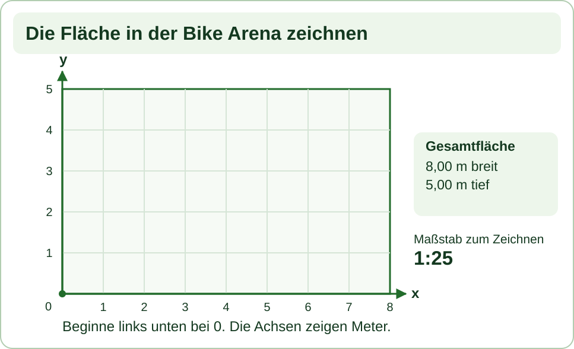

# M1 – Modellgrundriss und Vorgaben für die Aktionsfläche in der Bike Arena

<figure>

<figcaption>Die Zeichenhilfe zeigt die Gesamtfläche und den Nullpunkt. Zeichnet euren Plan mit den Maßen aus der Tabelle. Auf Papier ist der Plan 32 cm breit und 20 cm hoch.</figcaption>
</figure>

Die Bike Arena hat ein 1.400 m² großes Fahrradfachgeschäft mit Beratung und Zubehör. Auf eurer Aktionsfläche soll die Kundschaft das Zubehör selbst auswählen. <a href="https://www.bikearena-oltmanns.de/unser-laden" target="_blank" rel="noopener noreferrer">Das Geschäft der Bike Arena</a>

Der Bereich ist 8,00 m breit und 5,00 m tief. Der Nullpunkt liegt im Südwesten, also links unten im Plan. Nach rechts laufen die x-Werte, nach oben die y-Werte. **Zeichnet** die Fläche im Maßstab 1:25. Nutzt dafür die x- und y-Werte aus der Tabelle. Auf Papier misst der ganze Plan 32 cm × 20 cm. Nutzt ein DIN-A3-Blatt oder klebt zwei DIN-A4-Blätter nebeneinander.

| Bereich                        |    x in m |    y in m | Bedeutung                                                                                                                                                                                                                 |
|--------------------------------|----------:|----------:|---------------------------------------------------------------------------------------------------------------------------------------------------------------------------------------------------------------------------|
| Zugang aus dem Eingangsbereich | 0,00–2,00 |      0,00 | Die meisten Personen kommen hier in den Bereich.                                                                                                                                                                          |
| Hauptgang von West nach Ost    | 0,00–8,00 | 0,00–1,50 | Die ganze Gangbreite bleibt frei.                                                                                                                                                                                         |
| Durchgang zur Fahrradabteilung | 6,40–8,00 | 1,50–5,00 | Der Weg bleibt überall in seiner ganzen Breite frei.                                                                                                                                                                      |
| Aktionsfläche                  | 0,00–6,40 | 1,50–5,00 | Hier stehen die Warenträger und Schilder. Hier bringt ihr auch die <a href="../ls-glossar.html?from=material%2Fm1.html%23begriffsstelle-2#gl-vergleichsinformation" id="begriffsstelle-2">Vergleichsinformationen</a> an. |

Ihr könnt zwei frei drehbare <a href="../ls-glossar.html?from=material%2Fm1.html%23begriffsstelle-3#gl-gondel" id="begriffsstelle-3">Gondeln</a> benutzen. Jede Gondel ist 1,60 m × 0,60 m groß und trägt Artikel auf beiden langen Seiten. Der freie Streifen vor jeder langen Warenseite bildet eine 1,20 m breite <a href="../ls-glossar.html?from=material%2Fm1.html%23begriffsstelle-4#gl-bedienzone" id="begriffsstelle-4">Bedienzone</a>. Dort steht kein Warenträger oder Schildfuß. Die Kundschaft muss alle Bedienseiten vom Hauptgang aus erreichen können. Ihr habt ein freistehendes <a href="../ls-glossar.html?from=material%2Fm1.html%23begriffsstelle-5#gl-orientierungsschild" id="begriffsstelle-5">Orientierungsschild</a> mit einem Fuß von 0,40 m × 0,40 m. Kleine Schilder und Karten mit Vergleichsangaben könnt ihr an den Gondeln befestigen. Die Artikel aus [M3](m3.html) passen auf die Gondeln. Auch die Standpumpe P51 kann dort stehen.

