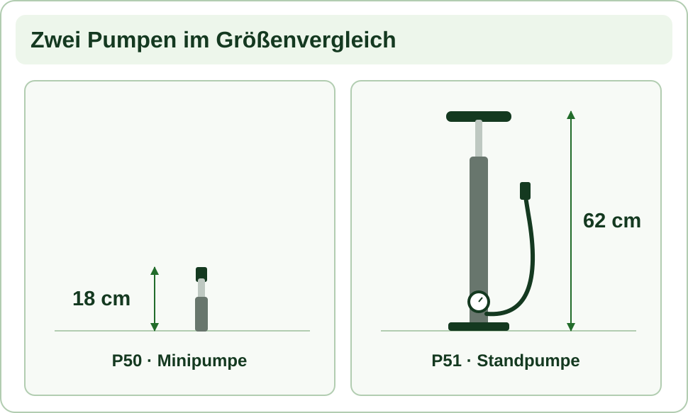

# M3 – Festes Aktionssortiment und Angaben für die Auswahl

<figure>

<figcaption>Hier seht ihr den Größenunterschied. Welche Pumpe zum Ventil passt, prüft ihr mit den Produktkarten.</figcaption>
</figure>

Die Mini- und die Standpumpe gehören zur gleichen <a href="../ls-glossar.html?from=material%2Fm3.html%23begriffsstelle-1#gl-warengruppe" id="begriffsstelle-1">Warengruppe</a>. Prüft anhand der Produktkarten, wofür sich welche Pumpe eignet.

| Artikel            | Angaben laut Produktkarte                                                                                                                                                                                                                                                                                              |
|--------------------|------------------------------------------------------------------------------------------------------------------------------------------------------------------------------------------------------------------------------------------------------------------------------------------------------------------------|
| P50 Minipumpe      | 18 cm lang. Der Pumpenkopf passt auf Auto- und Sclaverandventile. Die Pumpe ist für unterwegs gedacht und hat keine Druckanzeige.                                                                                                                                                                                      |
| P51 Standpumpe     | 62 cm hoch. Der Pumpenkopf passt auf Auto- und Sclaverandventile. Die Pumpe hat ein <a href="../ls-glossar.html?from=material%2Fm3.html%23begriffsstelle-2#gl-manometer" id="begriffsstelle-2">Manometer</a>. Sie gehört zum normalen Angebot. Für den Vergleich dürft ihr ein Exemplar auf die Aktionsfläche stellen. |
| F60 Flaschenhalter | Für Flaschen mit 72 bis 75 mm Durchmesser. Am Rad braucht man zwei passende <a href="../ls-glossar.html?from=material%2Fm3.html%23begriffsstelle-3#gl-rahmengewinde" id="begriffsstelle-3">Rahmengewinde</a> mit 64 mm Abstand. Die Schrauben zum Befestigen liegen bei.                                               |
| L10 LED-Lichtset   | Enthält Vorder- und Rücklicht. Die Halterung fürs Vorderlicht passt auf Lenker mit 22 bis 32 mm Durchmesser. Weitere Angaben stehen auf der Packung.                                                                                                                                                                   |
| B80 Reflektorband  | Ein verstellbares Klettband für 20–40 cm Umfang. Es wirft Licht zurück, wenn man es anleuchtet.                                                                                                                                                                                                                        |
| S20 Bügelschloss   | Damit kann man den Rahmen oder ein Laufrad an einem geeigneten Platz anschließen, zum Beispiel an einem passenden Fahrradständer. Stellt das Schloss unten im Regal aus.                                                                                                                                               |
| T30 Rahmentasche   | Die Tasche ist wasserabweisend und fasst 1,2 Liter. Sie hat verstellbare Klettbänder.                                                                                                                                                                                                                                  |

