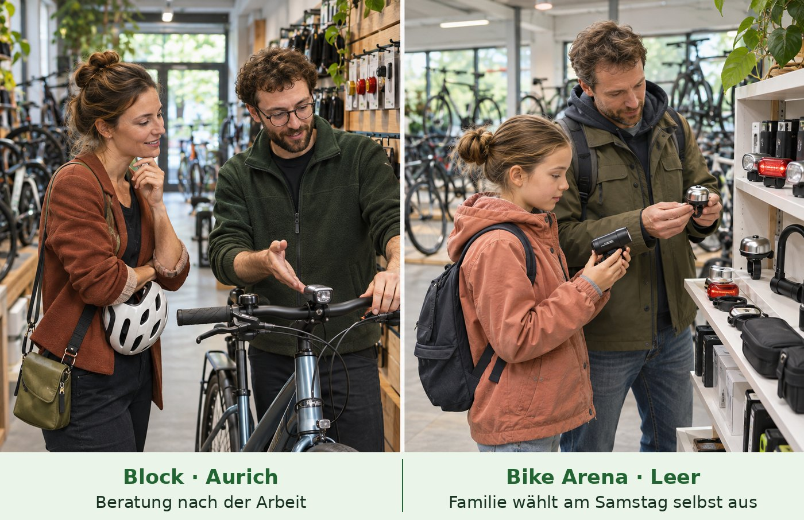
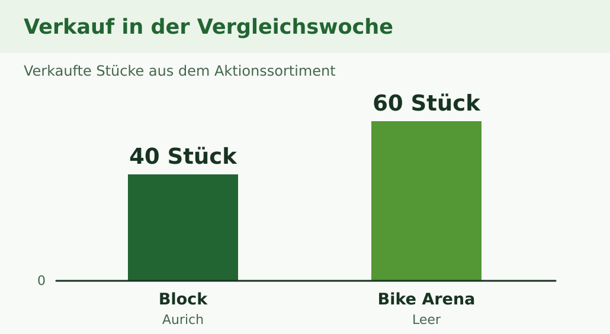
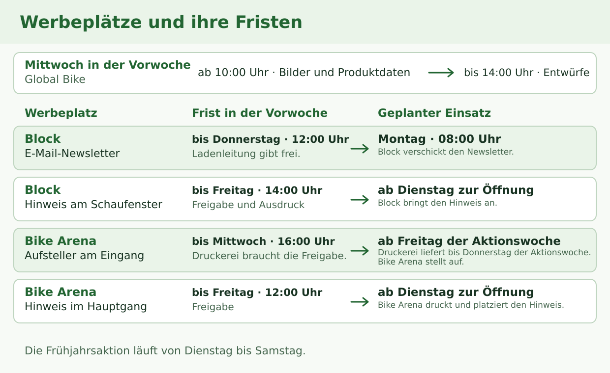

# BFS dual · LF 06 · LS 6.5 · Eine gemeinsame Werbeaktion abstimmen

**Zwei Läden, eine Freigabe** · Global Bike Deutschland GmbH · 2. Halbjahr

**Zeit** · 6 Unterrichtsstunden · 270 Minuten

## Orientierung

### Warum wir das lernen

5 Minuten

Ihr sucht ein Licht für den Schulweg. Eine Nachricht auf dem Handy kann euch rechtzeitig zur Beratung einladen. Wer erst am Samstag einkauft, kann den Hinweis auch im Laden entdecken. Für Global Bike plant ihr mit Block und der Bike Arena, wann und wo die Werbung erscheint. Ihr klärt, wer was übernimmt und wie beide Läden den Erfolg messen.

### Das übe ich

| Kompetenz | Wie stark? (1–6) | Das übe ich |
| --- | ---: | --- |
| Fachkompetenz | 6 | Ich vereinbare mit zwei Handelspartnern ein Werbeziel, das wir überprüfen können. Ich stimme passende Werbeträger und feste Termine ab. Ich kläre, welche Aufgaben der Großhandel und welche die beiden Läden übernehmen. |
| Personalkompetenz | 3 | Ich habe die Fristen im Blick und prüfe, ob ich meine Zusagen einhalten kann. |
| Sozialkompetenz | 4 | Ich höre, was den Beteiligten wichtig ist. Ich helfe, feste Absprachen zu finden. |
| Methodenkompetenz | 4 | Ich halte Ziel, Maßnahmen und Termine in einem gemeinsamen Plan fest. |
| Medienkompetenz | 4 | Ich wähle einen Werbeträger, der die gewünschte Kundschaft am jeweiligen Standort erreicht. |

## Handlungssituation

8 Minuten

Es ist Mittwoch. Bei Global Bike plant Sarah Huber die Werbung für eine Frühjahrsaktion. Zwei Fahrradgeschäfte bieten dafür Zubehör von Global Bike an. Sie wollen ihre Kundschaft auf verschiedenen Wegen erreichen.

Im Terminplan steht zuerst das 2-Rad Center Block in Aurich. Das Fachgeschäft will per E-Mail zur Beratung im Laden einladen. Für diesen Newsletter muss die Ladenleitung den Text bis Donnerstag um 12 Uhr freigeben. Die Bike Arena Oltmanns in Leer setzt auf ein Schild am Eingang. Das Schild soll dort am Freitag der Aktionswoche stehen. Damit die Druckerei es rechtzeitig drucken kann, braucht sie die Freigabe noch heute bis 16 Uhr.

„Lasst uns die Werbeplätze jetzt bestätigen, damit sie für uns frei bleiben“, sagt Sarah. Jan Richter leitet Verkauf und Marketing. Er schaut sich die Rückmeldungen der Läden an. „Block möchte Beratungen zählen. Die Bike Arena zählt verkaufte Artikel. So können wir schwer gemeinsam prüfen, ob die Aktion Erfolg hat. Ich muss auch wissen, wer die Freigaben rechtzeitig einholt.“

Bis zum ersten Termin braucht ihr einen Werbeplan für beide Läden. Jan und Sarah wollen ein gemeinsames Ziel vereinbaren, das sich überprüfen lässt. Sie wollen außerdem wissen, wer die Werbung vorbereitet, prüft und einsetzt. Für jeden Schritt brauchen sie einen Termin.

*Jan Richter und Sarah Huber planen bei Global Bike die Werbung für beide Läden.*

### Den Fall prüfen

### Aufgabe 01 · Nennt das Werbemittel für jeden Laden. Bis wann muss der Text oder das Schild freigegeben sein?

3 Minuten

- Block gibt den Newsletter bis Mittwoch um 16 Uhr frei, die Bike Arena ihr Schild bis Donnerstag um 12 Uhr.
- Block gibt das Schild bis Donnerstag um 12 Uhr frei, die Bike Arena ihren Newsletter bis Mittwoch um 16 Uhr.
- Block gibt den Newsletter bis Donnerstag um 12 Uhr frei, die Bike Arena ihr Schild bis Mittwoch um 16 Uhr.
- Block gibt das Schild bis Mittwoch um 16 Uhr frei, die Bike Arena ihren Newsletter bis Donnerstag um 12 Uhr.
- Block gibt den Newsletter bis Donnerstag um 16 Uhr frei, die Bike Arena ihr Schild bis Mittwoch um 12 Uhr.
- Block gibt den Newsletter bis Freitag um 12 Uhr frei, die Bike Arena ihr Schild bis Donnerstag um 16 Uhr.

Hilfe

Sucht die Termine bei Block und bei der Bike Arena im Abschnitt zum Terminplan. Achtet darauf, ob es um die Vorbereitung oder den Einsatz der Werbung geht.

### Aufgabe 02 · Erklärt, warum Sarah die Werbeplätze sofort bestätigen möchte.

3 Minuten

- Sie will die Plätze für die Aktion sichern, solange sie noch frei sind.
- Sie will die Zahl der Beratungen schon vor Beginn der Aktion ermitteln.
- Sie will die Druckvorlage vor dem Gespräch mit der Ladenleitung prüfen.
- Sie will die ersten Rückmeldungen der Kundschaft vor dem Termin sammeln.
- Sie will die Freigabe für beide Werbetexte beim selben Termin einholen.
- Sie will die Aktion für beide Läden noch am Mittwoch im Laden starten.

Hilfe

Lest Sarahs Vorschlag zu den Werbeplätzen. Beginnt mit „Sarah möchte die Werbeplätze bestätigen, weil …“.

### Aufgabe 03 · Nennt, was Block und die Bike Arena jeweils zählen wollen. Erklärt, welches Problem Jan sieht.

3 Minuten

- Block zählt Verkäufe, die Bike Arena zählt Beratungen. So lassen sich die Ergebnisse schwer vergleichen.
- Block zählt Beratungen, die Bike Arena zählt Verkäufe. So lassen sich die Ergebnisse schwer vergleichen.
- Block zählt Beratungen, die Bike Arena zählt Beratungen. Den Läden fehlen dafür noch gemeinsame Termine.
- Block zählt Verkäufe, die Bike Arena zählt Verkäufe. Den Läden fehlen dafür noch gemeinsame Produktpreise.
- Block zählt Bestellungen, die Bike Arena zählt Klicks. So lassen sich die Ergebnisse schwer vergleichen.
- Block zählt Newsletter, die Bike Arena zählt Schilder. So messen beide bisher nur die eingesetzte Werbung.

Hilfe

Lest Jans Antwort auf Sarahs Vorschlag. Sucht zuerst, was jeder Laden zählt. Lest danach, was Jan daran schwierig findet.

### Aufgabe 04 · Nennt, was Jan und Sarah mit eurem Werbeplan festlegen wollen.

3 Minuten

- Welchen Umsatz jeder Laden erwartet, welche Artikel er bestellt und wann die Ware bei ihm eintrifft.
- Welche Kunden jeder Laden anspricht, wie viel sie ausgeben und wann sie den Laden am liebsten besuchen.
- Welche Flächen jeder Laden frei hält, wer sie ausmisst und wann die neuen Warenträger dort eintreffen.
- Welches Ziel beide Läden messen und wer die Werbung bis zu welchem Termin vorbereitet, prüft und einsetzt.
- Welchen Preis jeder Laden verlangt, wer die Angebote vergleicht und wann die neuen Preislisten gelten.
- Welche Ware jeder Laden erhält, wer ihre Lieferung überprüft und wann das Zubehör ins Regal kommt.

Hilfe

Lest den letzten Absatz. Beginnt mit „Der Plan enthält ein gemeinsames … und zeigt, wer … bis …“.

## Informieren

### Aufgabe 05 · Zielgruppen und Werbeplätze klären

25 Minuten

Ein gemeinsamer Werbeplan zeigt, wen die Werbung erreichen soll. Er zeigt auch, wann sie erscheint und wer welche Aufgabe übernimmt. Die Verkaufszahlen in [M2](#m2) zeigen euch, wie viele Stücke jeder Laden in der Vergleichswoche verkauft hat.

**Klärt** mit [M1](#m1) bis [M3](#m3), wen die beiden Läden erreichen wollen. Findet heraus, welche Werbeplätze frei sind. Haltet fest, bis wann die Werbung fertig und freigegeben sein muss.

## Fachbegriffscheck

20 Minuten

**Wählt** zu jedem Fachbegriff die passende Erklärung aus sechs Möglichkeiten. Die Begriffe findet ihr in [M6](#m6).

**1. Überprüfbares Werbeziel**

- A · Eine Liste mit allen Werbewegen, die für die Aktion möglich wären.
- B · Der Tag, an dem jemand das Werbemittel freigeben soll.
- C · Ein Ziel für die Werbung. Es nennt, was ihr messt, welchen Wert ihr erreichen wollt und in welcher Zeit das gelingen soll.
- D · Ein messbarer Wert, mit dem ihr ein Ergebnis beschreiben oder prüfen könnt.
- E · Eine frühere Woche mit ähnlichen Bedingungen. Ihre Zahlen dienen als Ausgangspunkt für einen Vergleich.
- F · Ihr prüft mit den gemessenen Ergebnissen, ob die Aktion das vereinbarte Ziel erreicht hat.

**2. Werbeträger**

- A · Die Zahl der Artikel, die durch die Werbung verkauft werden sollen.
- B · Die Botschaft, die die Kundschaft aus der Werbung mitnehmen soll.
- C · Der Kanal, das Medium oder der Platz, über den die Werbung die gewünschte Kundschaft erreicht.
- D · Mehrere Unternehmen werben gemeinsam. Sie stimmen das Ziel ab und klären, wer was beiträgt.
- E · Eine Übersicht über das Werbeziel, die Werbung und ihre Verbreitung. Sie nennt die Termine und zeigt, wer welche Aufgabe übernimmt.
- F · Eine Absprache, wer einen bestimmten Arbeitsschritt übernimmt.

**3. Kooperative Werbung**

- A · Mehrere Unternehmen werben gemeinsam. Sie stimmen das Ziel ab und klären, wer was beiträgt.
- B · Ein Laden nutzt für eine Aktion mehrere Werbeträger.
- C · Jeder Partner macht seine eigene Werbung und verfolgt sein eigenes Ziel.
- D · Der Kanal, das Medium oder der Platz, über den die Werbung die gewünschte Kundschaft erreicht.
- E · Eine Übersicht über das Werbeziel, die Werbung und ihre Verbreitung. Sie nennt die Termine und zeigt, wer welche Aufgabe übernimmt.
- F · Eine Absprache, wer einen bestimmten Arbeitsschritt übernimmt.

**4. Freigabefrist**

- A · Der späteste Zeitpunkt, bis zu dem die Fassung bestätigt sein muss. So lässt sich die Werbung rechtzeitig einsetzen.
- B · Der Termin, an dem die Läden ihre Verkaufszahlen melden.
- C · Der erste Zeitpunkt, zu dem die Kundschaft die Werbung sieht.
- D · Eine Absprache, wer einen bestimmten Arbeitsschritt übernimmt.
- E · Der Zeitpunkt, ab dem ein Werbemittel zu sehen ist, verteilt oder aufgestellt wird.
- F · Eine Übersicht über das Werbeziel, die Werbung und ihre Verbreitung. Sie nennt die Termine und zeigt, wer welche Aufgabe übernimmt.

**5. Kennzahl**

- A · Der Zeitpunkt, an dem die Werbung erscheint.
- B · Ein messbarer Wert, mit dem ihr ein Ergebnis beschreiben oder prüfen könnt.
- C · Der Mindestwert, den die Partner erreichen wollen.
- D · Ein Ziel für die Werbung. Es nennt, was ihr messt, welchen Wert ihr erreichen wollt und in welcher Zeit das gelingen soll.
- E · Eine frühere Woche mit ähnlichen Bedingungen. Ihre Zahlen dienen als Ausgangspunkt für einen Vergleich.
- F · Ihr prüft mit den gemessenen Ergebnissen, ob die Aktion das vereinbarte Ziel erreicht hat.

**6. Werbeplan**

- A · Eine Sammlung fertiger Werbetexte und Produktfotos für beide Läden.
- B · Eine Übersicht über das Werbeziel, die Werbung und ihre Verbreitung. Sie nennt die Termine und zeigt, wer welche Aufgabe übernimmt.
- C · Ein Bericht mit Verkaufszahlen nach der Aktion.
- D · Der Kanal, das Medium oder der Platz, über den die Werbung die gewünschte Kundschaft erreicht.
- E · Mehrere Unternehmen werben gemeinsam. Sie stimmen das Ziel ab und klären, wer was beiträgt.
- F · Eine Absprache, wer einen bestimmten Arbeitsschritt übernimmt.

**7. Zuständigkeit**

- A · Die Reihenfolge der Arbeitsschritte bis zur Veröffentlichung.
- B · Der späteste Zeitpunkt, bis zu dem jemand eine Aufgabe erledigen muss.
- C · Eine Absprache, wer einen bestimmten Arbeitsschritt übernimmt.
- D · Der Kanal, das Medium oder der Platz, über den die Werbung die gewünschte Kundschaft erreicht.
- E · Mehrere Unternehmen werben gemeinsam. Sie stimmen das Ziel ab und klären, wer was beiträgt.
- F · Eine Übersicht über das Werbeziel, die Werbung und ihre Verbreitung. Sie nennt die Termine und zeigt, wer welche Aufgabe übernimmt.

**8. Einsatztermin**

- A · Der Zeitpunkt, an dem Global Bike Bilder bereitstellt.
- B · Der Zeitpunkt, ab dem ein Werbemittel zu sehen ist, verteilt oder aufgestellt wird.
- C · Der späteste Zeitpunkt, bis zu dem jemand die Fassung für die Produktion freigibt.
- D · Der späteste Zeitpunkt, bis zu dem die Fassung bestätigt sein muss. So lässt sich die Werbung rechtzeitig einsetzen.
- E · Eine Absprache, wer einen bestimmten Arbeitsschritt übernimmt.
- F · Eine Übersicht über das Werbeziel, die Werbung und ihre Verbreitung. Sie nennt die Termine und zeigt, wer welche Aufgabe übernimmt.

**9. Vergleichswoche**

- A · Eine frühere Woche mit ähnlichen Bedingungen. Ihre Zahlen dienen als Ausgangspunkt für einen Vergleich.
- B · Die Woche nach der Aktion, in der die Läden ihre Verkaufszahlen melden.
- C · Die Woche, in der die Werbung in beiden Läden läuft.
- D · Ein Ziel für die Werbung. Es nennt, was ihr messt, welchen Wert ihr erreichen wollt und in welcher Zeit das gelingen soll.
- E · Ein messbarer Wert, mit dem ihr ein Ergebnis beschreiben oder prüfen könnt.
- F · Ihr prüft mit den gemessenen Ergebnissen, ob die Aktion das vereinbarte Ziel erreicht hat.

**10. Erfolgskontrolle**

- A · Ihr prüft mit den gemessenen Ergebnissen, ob die Aktion das vereinbarte Ziel erreicht hat.
- B · Ihr prüft, ob der Newsletter die richtigen Angaben zu den Produkten enthält.
- C · Ihr plant, an welchem Tag beide Läden die Werbemittel einsetzen.
- D · Ein Ziel für die Werbung. Es nennt, was ihr messt, welchen Wert ihr erreichen wollt und in welcher Zeit das gelingen soll.
- E · Ein messbarer Wert, mit dem ihr ein Ergebnis beschreiben oder prüfen könnt.
- F · Eine frühere Woche mit ähnlichen Bedingungen. Ihre Zahlen dienen als Ausgangspunkt für einen Vergleich.

## Planen

### Aufgabe 06 · Zwei Abläufe skizzieren

25 Minuten

**Skizziert** zwei mögliche Abläufe für die Werbeaktion. Notiert die wichtigen Fristen. Wählt eine Kennzahl, die beide Läden für das gemeinsame Ziel erfassen können.

## Entscheiden

### Aufgabe 07 · Lernpaket wählen und begründen

8 Minuten

**Wählt** einen der drei Arbeitswege. Überlegt, welcher Weg euch bei der Entscheidung am besten hilft. **Haltet** beim Arbeiten ein Zwischenergebnis und einen Beleg für den Pitch fest. Ein Beleg kann zum Beispiel eine Zahl, ein Maß oder eine Kundenstimme sein.

**Euer Auftrag.** Ihr stimmt die Werbung mit Block und der Bike Arena ab. Euer Ergebnis ist ein gemeinsamer Werbeplan. Nennt darin das überprüfbare Ziel mit Kennzahl, Zielwert und Zeitraum. Begründet die Wahl des Werbeträgers für jeden Laden. Haltet fest, wann die Werbung zu sehen ist, wer welche Aufgabe übernimmt und bis wann die Freigabe vorliegen muss. Die Kriterien findet ihr unter „Handlungsprodukt und Kriterien“.

| Lernpaket | Lernzugänge | So arbeitet ihr | Euer Zwischenergebnis | Wählt dieses Paket, wenn … |
| --- | --- | --- | --- | --- |
| **A · Werbetermine vergleichen** | Angaben lesen, ordnen und vergleichen | Tragt Werbeplätze, Freigabefristen und Aufgaben aus M1–M3 in zwei Kalenderzeilen ein. Markiert enge Termine. Verbindet mit Pfeilen, welche Schritte aufeinander folgen. | Eure Kalenderzeilen zeigen, wann Werbung möglich ist, welche Zusagen zusammenpassen und welche Aufgaben noch offen sind. | … ihr Termine und ihre Reihenfolge besser seht, wenn ihr beide Kalenderzeilen vor euch habt. |
| **B · Mit beiden Partnern abstimmen** | Zuhören, nachfragen und sich einigen | Hört die drei Stimmen aus M4 oder lest sie mit verteilten Rollen vor. Einigt euch im Gespräch auf einen Ablauf. Prüft die Zusagen mit M1–M3. | Eure Gesprächsnotiz zeigt, was den Beteiligten wichtig ist, was sie vereinbaren und wer welche Aufgabe fest übernimmt. | … ihr gern nachfragt und Absprachen im Gespräch klärt. |
| **C · Abläufe mit Karten erproben** | Karten legen und die Reihenfolge prüfen | Legt die Karten aus M5 auf zwei Zeitachsen. Verschiebt die Karten für Entwurf, Freigabe und Veröffentlichung. Prüft die Fristen aus M3. Legt zu jedem Schritt, wer ihn übernimmt. | Eure Zeitachsen zeigen, in welcher Reihenfolge die Schritte klappen und was vor der nächsten Zusage fertig sein muss. | … ihr durch Verschieben ausprobieren wollt, welche Freigabe zuerst nötig ist. |

### Aufgabe 08 · Werbeziel und Termine vereinbaren

32 Minuten

**Stimmt** mit eurem Lernpaket den Ablauf ab. Einigt euch auf ein Werbeziel mit Kennzahl, Zielwert und Zeitraum. Wählt für jeden Standort eine Möglichkeit aus M3. Begründet die Wahl des Werbeträgers und nennt das Werbemittel und den Einsatztermin.

## Durchführen

### Aufgabe 09 · Den Werbeplan schreiben

#### A · Werbetermine vergleichen

35 Minuten

Tragt Werbeplätze, Freigabefristen und Aufgaben aus M1–M3 in zwei Kalenderzeilen ein. Markiert enge Termine. Verbindet mit Pfeilen, welche Schritte aufeinander folgen.

Eure Kalenderzeilen zeigen, wann Werbung möglich ist, welche Zusagen zusammenpassen und welche Aufgaben noch offen sind.

#### B · Mit beiden Partnern abstimmen

35 Minuten

Hört die drei Stimmen aus M4 oder lest sie mit verteilten Rollen vor. Einigt euch im Gespräch auf einen Ablauf. Prüft die Zusagen mit M1–M3.

Eure Gesprächsnotiz zeigt, was den Beteiligten wichtig ist, was sie vereinbaren und wer welche Aufgabe fest übernimmt.

#### C · Abläufe mit Karten erproben

35 Minuten

Legt die Karten aus M5 auf zwei Zeitachsen. Verschiebt die Karten für Entwurf, Freigabe und Veröffentlichung. Prüft die Fristen aus M3. Legt zu jedem Schritt, wer ihn übernimmt.

Eure Zeitachsen zeigen, in welcher Reihenfolge die Schritte klappen und was vor der nächsten Zusage fertig sein muss.

**Erstellt** für Block und die Bike Arena je eine Zeile im Werbeplan. Nennt das gemeinsame Ziel, den Werbeträger, das Werbemittel und den Einsatztermin. Schreibt dazu, warum die Wahl zur Kundschaft passt.

### Aufgabe 10 · Aufgaben und Fristen ergänzen

20 Minuten

**Ergänzt** die Zuständigkeiten. Wer erstellt, prüft und veröffentlicht die Werbung? Wer gibt wann den Druck oder Versand frei? Tragt auch ein, wer nach der Aktion welche Zahl an Global Bike meldet. Nutzt [M2](#m2) und [M3](#m3).

## Bewerten

### Aufgabe 11 · Die Arbeit prüfen und kurz vorstellen

47 Minuten

#### Termine und Ziel prüfen

**Prüft** die Termine im Plan mit [M3](#m3). Klärt mit den vorhandenen Daten, ob sich euer Ziel messen lässt. **Korrigiert** eine Lücke oder erklärt, warum eure Reihenfolge funktioniert.

#### Die eigene Arbeit einschätzen

**Notiert**, welche Absprache zwischen Global Bike und den beiden Läden für euren Plan am wichtigsten war. Erklärt, warum.

**Schätzt** euch zur Fachkompetenz dieser LS ein. Wählt eine Stufe. Zeigt eine Stelle in eurer Arbeit, die dazu passt.

1 · Ich brauche Hilfe bei jedem Schritt. 2 · Mit einzelnen Tipps komme ich weiter. 3 · Ich kann die Aufgabe selbst lösen und begründen. 4 · Ich kann das auch in einem neuen Fall.

#### Abschlusspitch

**Pitcht** euer Lernpaket. Ein Pitch ist eine kurze Vorstellung. Nutzt euer Handlungsprodukt und eure Unterlagen. Ihr habt für den Kurzpitch etwa zwei Minuten. Wenn noch Zeit ist, beantwortet eine Rückfrage.

1.  **Ergebnis zeigen.** Zeigt euer Handlungsprodukt. Sagt, was ihr entschieden habt.
2.  **Entscheidung belegen.** Zeigt einen Beleg aus dem Fall. Erklärt, wie er eure Entscheidung stützt.
3.  **Arbeitsweg begründen.** Sagt, warum ihr euer Lernpaket gewählt habt. Zeigt ein Zwischenergebnis. Erklärt, wie es euch bei der Entscheidung geholfen hat.

**Das könnt ihr zeigen.** Zeigt im Werbeplan einen Werbeträger. Nennt, wer die Werbung bis wann freigibt. Erklärt, wie der Werbeträger dem gemeinsamen Ziel hilft.

Sprachhilfe für den Pitch

- „Unser Ergebnis ist … Wir schlagen vor, dass …“
- „Unser Beleg ist … Er zeigt, dass …“
- „Wir haben Paket … gewählt. Beim Arbeiten hat uns … geholfen.“

### Aufgabe 12 · Das Produkt für den Peer-Check bereitstellen

7 Minuten

**Ladet euren gemeinsamen Werbeplan hoch.** Bei einer Teamarbeit gibt jede Person eine Kopie im eigenen Moodle-Konto ab. Wählt einen Titel und einen Dateinamen ohne eure Namen. Entfernt eure Namen aus der Arbeit und aus den Dateieigenschaften.

Ohne eingerichtete Moodle-Aktivität erhältst du von der Lehrkraft eine codierte Arbeit.

### Aufgabe 13 · Ein fremdes Produkt prüfen

14 Minuten

**Schaut euch die zugeteilte Arbeit an.** Moodle lost aus, welche Arbeit ihr bekommt. Ihr seht die Arbeit ohne Namen.

**Gebt Rückmeldung.** Nutzt die Fragen unter dieser Aufgabe. Nennt eine Stelle, die gut gelungen ist. Schreibt, was die Person verbessern kann. Die Person sieht bei eurer Antwort euren Klarnamen.

- Prüft, ob das gemeinsame Werbeziel eine Kennzahl, einen Zielwert und einen Zeitraum nennt.
- Prüft, ob der Werbeträger zu den Kundinnen und Kunden passt und im jeweiligen Laden möglich ist.
- Prüft, ob Einsatztermine, Freigabefristen und Aufgaben klar sind und zusammenpassen.

[Peer-Check im Lernpaket öffnen](peer-check.html)

### Aufgabe 14 · Die empfangene Rückmeldung nutzen

7 Minuten

**Lest** nach der Freigabe die Rückmeldung zu eurer Arbeit. Verbessert eine Stelle oder erklärt, warum ihr bei eurer Lösung bleibt.

## Reflektieren

### Aufgabe 15 · Feedback zur Lernsituation

5 Minuten

**Füllt** die Aktivität „Feedback“ im Moodle-Kurs aus und sendet eure Rückmeldung dort ab. Falls der Verweis fehlt, öffnet „Feedback“ in der Kursübersicht.

[Feedback in Moodle öffnen](https://bbs1aur.moodle-nds.de/mod/feedback/view.php?id=79811)

## Handlungsprodukt und Kriterien

Ein gemeinsamer Werbeplan, den die Beteiligten freigeben können. Der Plan nennt ein überprüfbares Ziel. Für jeden Standort nennt und begründet ihr einen Werbeträger. Ihr haltet die Einsatzzeit fest und klärt, wer welche Aufgabe übernimmt. Die Werbemittel werden rechtzeitig freigegeben. Mit den genannten Daten lässt sich für beide Standorte prüfen, ob sie das Ziel erreichen.

## Materialien

### M1 · Kurzprofile der Handelspartner

| Standort                   | Kundschaft und Besuchszeit                                                                                                                                                                                                      | Interessen des Geschäfts                                                                                           |
|----------------------------|---------------------------------------------------------------------------------------------------------------------------------------------------------------------------------------------------------------------------------|--------------------------------------------------------------------------------------------------------------------|
| 2-Rad Center Block, Aurich | Viele Menschen, die im Alltag Rad fahren, kommen unter der Woche nach der Arbeit. Sie lassen sich persönlich beraten. Der Newsletter erreicht Menschen, die schon Kontakt zu Block hatten.                                      | Auf Zubehör und Beratung aufmerksam machen. Die Ladenleitung möchte auch wissen, wie viele Beratungen stattfinden. |
| Bike Arena Oltmanns, Leer  | Die Bike Arena erwartet Familien und Menschen, die in der Freizeit Rad fahren, vor allem samstags. Auf der geplanten Aktionsfläche wählen sie das Zubehör selbst aus. Am Eingang und im Hauptgang kommen viele Menschen vorbei. | Beim Einkauf auf das Zubehör aufmerksam machen und die Verkäufe zählen.                                            |

*Links lässt sich eine Kundin bei Block in Aurich beraten. Rechts sucht eine Familie in der Bike Arena in Leer selbst Zubehör aus.*

### M2 · Eckdaten und messbare Ausgangslage

- Die Frühjahrsaktion läuft von Dienstag bis Samstag. Block kann den Newsletter schon am Montag verschicken. Öffnungstage der Läden: <a href="https://www.zweirad-block.de/unternehmen/" target="_blank" rel="noopener noreferrer">Block</a> · <a href="https://www.bikearena-oltmanns.de/" target="_blank" rel="noopener noreferrer">Bike Arena</a>
- Beide Läden wollen auf Fahrradzubehör für den Frühjahrsstart aufmerksam machen. Jeder Laden kann einen [Werbeträger](#gl-werbetr%C3%A4ger) aus [M3](#m3) fest einplanen. Der Werbeträger sorgt dafür, dass die Werbung die Kundschaft erreicht. Das Werbemittel ist die gestaltete Werbung, zum Beispiel der fertige Beitrag oder das bedruckte Schild.
- In der [Vergleichswoche](#gl-vergleichswoche) verkaufte Block **40 Stück** aus dem Aktionssortiment. Die Bike Arena verkaufte **60 Stück**. Beide Läden können als [Kennzahl](#gl-kennzahl) die Zahl der verkauften Stücke dieser Artikel in der Aktionswoche erfassen. In der Vergleichswoche waren die Läden an denselben Tagen geöffnet.
- Block kann die Beratungen zählen. Die Bike Arena hat für diese Aktion keine verlässlichen Zahlen zu Beratungen und zu Menschen, die spontan in den Laden kommen. Beide Läden können Global Bike am Montag nach der Aktion melden, wie viele Stücke sie verkauft haben. Vor dem Start vereinbaren die Beteiligten ein [überprüfbares Werbeziel](#gl-%C3%BCberpr%C3%BCfbares-werbeziel). Die Verkaufszahlen zeigen, ob das vereinbarte Ziel erreicht wurde. Auch andere Einflüsse können verändern, wie viel ein Laden verkauft.

*Verkaufte Stücke aus dem Aktionssortiment in der Vergleichswoche. Beide Läden waren an denselben Tagen geöffnet.*

### M3 · Werbeplätze, Fristen und Rollen

Die Fristen für die Vorbereitung liegen in der Woche vor der Aktion. Die Spalte „Einsatztermin“ zeigt die Termine in der Aktionswoche. Der Versand am Montag findet einen Tag vor dem Verkaufsstart statt.

| Standort und Werbeträger             | Werbemittel                     | Reservierter [Einsatztermin](#gl-einsatztermin) | Freigabe und Übergabe                                                                                                                                               |
|--------------------------------------|---------------------------------|-------------------------------------------------|---------------------------------------------------------------------------------------------------------------------------------------------------------------------|
| Block · E-Mail-Newsletter            | Werbebeitrag im Newsletter      | Montag, 08:00 Uhr                               | Freigabe der Ladenleitung bis Donnerstag, 12:00 Uhr. Block plant und verschickt den Newsletter selbst.                                                              |
| Block · Schaufenster                 | Gedruckter Aushang              | Ab Dienstag zur Öffnung                         | Freigabe und Ausdruck bis Freitag, 14:00 Uhr. Block bringt den Aushang an.                                                                                          |
| Bike Arena · Aufsteller am Eingang   | Bedrucktes Schild im Aufsteller | Ab Freitag                                      | [Freigabefrist](#gl-freigabefrist) für den Druck: Mittwoch, 16:00 Uhr. Die Druckerei liefert bis Donnerstag der Aktionswoche. Die Bike Arena stellt das Schild auf. |
| Bike Arena · Werbeplatz am Hauptgang | Gedrucktes Hinweisschild        | Ab Dienstag zur Öffnung                         | Freigabe bis Freitag, 12:00 Uhr. Die Bike Arena druckt das Schild selbst und bringt es an.                                                                          |

Für die [kooperative Werbung](#gl-kooperative-werbung) stellt Sarah Huber am Mittwoch ab 10:00 Uhr Produktangaben und Bilder bereit. Global Bike kann bis 14:00 Uhr einen gemeinsamen Textentwurf und je eine Fassung für Block und die Bike Arena liefern. Die Ladenleitungen prüfen ihre Fassung und geben sie frei. Sie prüfen den Platz und die Produktangaben sowie Preise, falls die Werbung Preise nennt. Jan Richter koordiniert bei Global Bike die Absprachen. Wählt die Bike Arena den Aufsteller am Eingang, meldet ihre Ladenleitung die Freigabe bis Mittwoch, 16:00 Uhr, an die Druckerei. Nutzt die Tabelle, um zu prüfen, ob jede Maßnahme rechtzeitig fertig wird.

*Die Zeiten zu den vier möglichen Werbeplätzen stehen in derselben Reihenfolge wie in der Tabelle. Die Pfeile führen von der Frist zum Einsatz.*

### M4 · Drei Partnerstimmen zum Vorlesen oder Einsprechen

**Sarah Huber, Global Bike (Marketing).** „Die Unterlagen liegen heute ab zehn Uhr bereit. Bis zwei Uhr können wir euch je einen Entwurf für Block und die Bike Arena schicken. Jede Ladenleitung gibt ihre Fassung frei. Wenn wir den Aufsteller am Eingang der Bike Arena nutzen, braucht die Druckerei die Freigabe heute um vier Uhr. Nach der Aktion brauchen wir Verkaufszahlen aus beiden Kassen für den Vergleich.“

**Ladenleitung bei Block.** „Viele meiner Stammkundinnen und Stammkunden kommen nach der Arbeit mit dem Rad vorbei. Ich möchte sie vorher zur Beratung einladen. Unser Newsletter ist für Montag um acht Uhr geplant. Bis Donnerstagmittag gebe ich den Text frei. Einen Aushang im Schaufenster kann ich bis Freitag um zwei Uhr freigeben und drucken. In der Vergleichswoche haben wir 40 Stück aus dem Aktionssortiment verkauft. Beratungen kann ich auch zählen.“

**Ladenleitung in der Bike Arena.** „Am Samstag kommen besonders viele Familien zu uns. Den Aufsteller können wir in der Aktionswoche ab Freitag an den Eingang stellen. Die Druckerei braucht meine Freigabe heute bis vier Uhr. Wenn ich das Schild für den Hauptgang bis Freitagmittag freigebe, können wir es am Dienstag zur Öffnung aufstellen. In der Vergleichswoche haben wir 60 Stück aus dem Aktionssortiment verkauft. Ich kann nicht sicher sagen, wie viele Menschen nur zur Beratung kamen.“

### M5 · Gesprächsnotiz und gemeinsamer Werbeplan

**Haltet** für den [Werbeplan](#gl-werbeplan) pro Laden fest, was im Gespräch vereinbart wurde. Prüft die Termine mit [M3](#m3). Nutzt die Angaben unten, wenn ihr bei einer Rückfrage Unterstützung braucht.

| Thema                                                  | Angaben für das Gespräch                                                                                                                                                  |
|--------------------------------------------------------|---------------------------------------------------------------------------------------------------------------------------------------------------------------------------|
| Werbeträger                                            | E-Mail-Newsletter · Schaufenster · Aufsteller am Eingang · Werbeplatz am Hauptgang                                                                                        |
| Werbemittel                                            | Werbebeitrag im Newsletter · gedruckter Aushang · bedrucktes Schild im Aufsteller · gedrucktes Hinweisschild                                                              |
| Arbeitsschritte                                        | Produktdaten bereitstellen · Werbung für den Laden erstellen · Produktangaben prüfen · Werbung freigeben · drucken · veröffentlichen oder aufstellen · Stückzahlen melden |
| [Zuständigkeiten](#gl-zust%C3%A4ndigkeit)              | Global Bike · Block · Bike Arena · Druckerei                                                                                                                              |
| Daten für die [Erfolgskontrolle](#gl-erfolgskontrolle) | 40 Stück Vergleichswoche · 60 Stück Vergleichswoche · Stückzahlen Aktionswoche · Beratungszahl nur bei Block                                                              |

**Ein Blatt für euren gemeinsamen Werbeplan.** Tragt oben ein, welche Zahl sich in beiden Läden bis wann ändern soll. Schreibt den Zielwert für jeden Laden dazu.

| Laden      | Werbeträger, Werbemittel und Grund | Wer erstellt, prüft und erteilt die Freigabe? Bis wann? | Wer setzt die Werbung wann ein? | Wer meldet wann welche Zahl? |
|------------|------------------------------------|---------------------------------------------------------|---------------------------------|------------------------------|
| Block      | …                                  | …                                                       | …                               | …                            |
| Bike Arena | …                                  | …                                                       | …                               | …                            |

### M6 · Fachbegriffe zu dieser Lernsituation

- **Überprüfbares Werbeziel.** Ein Ziel für die Werbung. Es nennt, was ihr messt, welchen Wert ihr erreichen wollt und in welcher Zeit das gelingen soll.
- **Werbeträger.** Der Kanal, das Medium oder der Platz, über den die Werbung die gewünschte Kundschaft erreicht.
- **Kooperative Werbung.** Mehrere Unternehmen werben gemeinsam. Sie stimmen das Ziel ab und klären, wer was beiträgt.
- **Freigabefrist.** Der späteste Zeitpunkt, bis zu dem die Fassung bestätigt sein muss. So lässt sich die Werbung rechtzeitig einsetzen.
- **Kennzahl.** Ein messbarer Wert, mit dem ihr ein Ergebnis beschreiben oder prüfen könnt.
- **Werbeplan.** Eine Übersicht über das Werbeziel, die Werbung und ihre Verbreitung. Sie nennt die Termine und zeigt, wer welche Aufgabe übernimmt.
- **Zuständigkeit.** Eine Absprache, wer einen bestimmten Arbeitsschritt übernimmt.
- **Einsatztermin.** Der Zeitpunkt, ab dem ein Werbemittel zu sehen ist, verteilt oder aufgestellt wird.
- **Vergleichswoche.** Eine frühere Woche mit ähnlichen Bedingungen. Ihre Zahlen dienen als Ausgangspunkt für einen Vergleich.
- **Erfolgskontrolle.** Ihr prüft mit den gemessenen Ergebnissen, ob die Aktion das vereinbarte Ziel erreicht hat.

## Glossar

### Einsatztermin

Der Zeitpunkt, ab dem ein Werbemittel zu sehen ist, verteilt oder aufgestellt wird.

**Beispiel.** Der Aufsteller steht ab Freitag der Aktionswoche am Eingang. Die Druckerei braucht die Freigabe schon vorher ([M3](#m3)).

### Erfolgskontrolle

Ihr prüft mit den gemessenen Ergebnissen, ob die Aktion das vereinbarte Ziel erreicht hat.

**Beispiel.** Beide Läden melden die verkauften Stücke. Aus der Veränderung zur Vergleichswoche ermitteln sie, ob sie ihren Zielwert erreicht haben ([M2](#m2), [M5](#m5)).

### Freigabefrist

Der späteste Zeitpunkt, bis zu dem die Fassung bestätigt sein muss. So lässt sich die Werbung rechtzeitig einsetzen.

**Beispiel.** Die Druckerei braucht die Freigabe für den Aufsteller am Mittwoch vor der Aktionswoche bis 16 Uhr ([M3](#m3)).

### Kennzahl

Ein messbarer Wert, mit dem ihr ein Ergebnis beschreiben oder prüfen könnt.

**Beispiel.** Beide Läden zählen, wie viele Stücke aus dem Aktionssortiment sie in der Aktionswoche verkaufen ([M2](#m2)).

### Kooperative Werbung

Mehrere Unternehmen werben gemeinsam. Sie stimmen das Ziel ab und klären, wer was beiträgt.

**Beispiel.** Global Bike liefert Produktdaten und Entwürfe. Die Läden geben ihre Fassungen frei und setzen sie ein ([M3](#m3)).

### Vergleichswoche

Eine frühere Woche mit ähnlichen Bedingungen. Ihre Zahlen dienen als Ausgangspunkt für einen Vergleich.

**Beispiel.** An denselben Öffnungstagen verkaufte Block 40 Stück und die Bike Arena 60 Stück ([M2](#m2), [M4](#m4)).

### Werbeplan

Eine Übersicht über das Werbeziel, die Werbung und ihre Verbreitung. Sie nennt die Termine und zeigt, wer welche Aufgabe übernimmt.

**Beispiel.** Der Plan zeigt, wer den Newsletter vorbereitet und bis wann die Ladenleitung ihn freigibt ([M3](#m3)).

### Werbeträger

Der Kanal, das Medium oder der Platz, über den die Werbung die gewünschte Kundschaft erreicht.

**Beispiel.** Bei Block verbreitet der E-Mail-Newsletter den Werbebeitrag. In der Bike Arena trägt der Aufsteller am Eingang das bedruckte Schild ([M3](#m3)).

### Zuständigkeit

Eine Absprache, wer einen bestimmten Arbeitsschritt übernimmt.

**Beispiel.** Block plant und verschickt seinen Newsletter selbst ([M3](#m3), [M5](#m5)).

### Überprüfbares Werbeziel

Ein Ziel für die Werbung. Es nennt, was ihr messt, welchen Wert ihr erreichen wollt und in welcher Zeit das gelingen soll.

**Beispiel.** Die Läden können als Ziel festlegen, um wie viel sie ihre Verkäufe in der Aktionswoche im Vergleich zur früheren Woche steigern wollen ([M2](#m2)).
