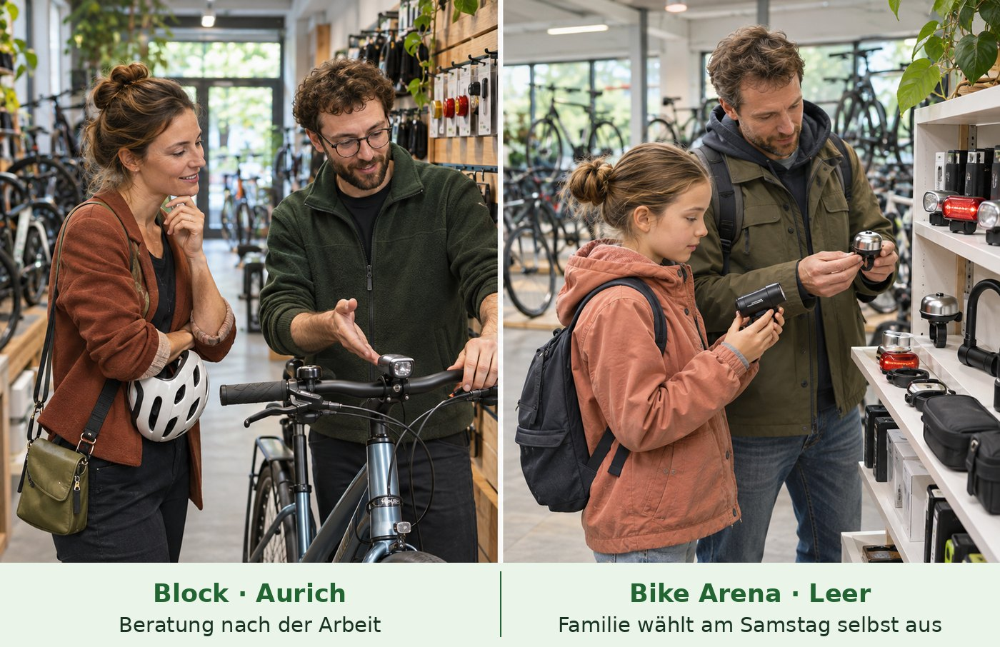

# M1 – Kurzprofile der Handelspartner

<figure>

<figcaption>Links lässt sich eine Kundin bei Block in Aurich beraten. Rechts sucht eine Familie in der Bike Arena in Leer selbst Zubehör aus.</figcaption>
</figure>

| Standort                   | Kundschaft und Besuchszeit                                                                                                                                                                                                      | Interessen des Geschäfts                                                                                           |
|----------------------------|---------------------------------------------------------------------------------------------------------------------------------------------------------------------------------------------------------------------------------|--------------------------------------------------------------------------------------------------------------------|
| 2-Rad Center Block, Aurich | Viele Menschen, die im Alltag Rad fahren, kommen unter der Woche nach der Arbeit. Sie lassen sich persönlich beraten. Der Newsletter erreicht Menschen, die schon Kontakt zu Block hatten.                                      | Auf Zubehör und Beratung aufmerksam machen. Die Ladenleitung möchte auch wissen, wie viele Beratungen stattfinden. |
| Bike Arena Oltmanns, Leer  | Die Bike Arena erwartet Familien und Menschen, die in der Freizeit Rad fahren, vor allem samstags. Auf der geplanten Aktionsfläche wählen sie das Zubehör selbst aus. Am Eingang und im Hauptgang kommen viele Menschen vorbei. | Beim Einkauf auf das Zubehör aufmerksam machen und die Verkäufe zählen.                                            |

