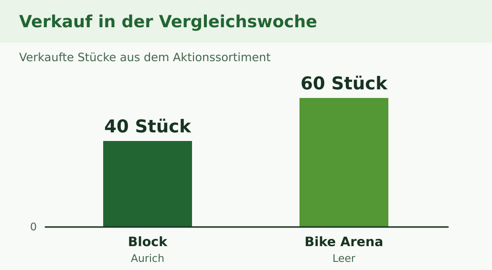

# M2 – Eckdaten und messbare Ausgangslage

<figure>

<figcaption>Verkaufte Stücke aus dem Aktionssortiment in der Vergleichswoche. Beide Läden waren an denselben Tagen geöffnet.</figcaption>
</figure>

- Die Frühjahrsaktion läuft von Dienstag bis Samstag. Block kann den Newsletter schon am Montag verschicken. Öffnungstage der Läden: <a href="https://www.zweirad-block.de/unternehmen/" target="_blank" rel="noopener noreferrer">Block</a> · <a href="https://www.bikearena-oltmanns.de/" target="_blank" rel="noopener noreferrer">Bike Arena</a>
- Beide Läden wollen auf Fahrradzubehör für den Frühjahrsstart aufmerksam machen. Jeder Laden kann einen <a href="../ls-glossar.html?from=material%2Fm2.html%23begriffsstelle-3#gl-werbetr%C3%A4ger" id="begriffsstelle-3">Werbeträger</a> aus [M3](m3.html) fest einplanen. Der Werbeträger sorgt dafür, dass die Werbung die Kundschaft erreicht. Das Werbemittel ist die gestaltete Werbung, zum Beispiel der fertige Beitrag oder das bedruckte Schild.
- In der <a href="../ls-glossar.html?from=material%2Fm2.html%23begriffsstelle-5#gl-vergleichswoche" id="begriffsstelle-5">Vergleichswoche</a> verkaufte Block **40 Stück** aus dem Aktionssortiment. Die Bike Arena verkaufte **60 Stück**. Beide Läden können als <a href="../ls-glossar.html?from=material%2Fm2.html%23begriffsstelle-6#gl-kennzahl" id="begriffsstelle-6">Kennzahl</a> die Zahl der verkauften Stücke dieser Artikel in der Aktionswoche erfassen. In der Vergleichswoche waren die Läden an denselben Tagen geöffnet.
- Block kann die Beratungen zählen. Die Bike Arena hat für diese Aktion keine verlässlichen Zahlen zu Beratungen und zu Menschen, die spontan in den Laden kommen. Beide Läden können Global Bike am Montag nach der Aktion melden, wie viele Stücke sie verkauft haben. Vor dem Start vereinbaren die Beteiligten ein <a href="../ls-glossar.html?from=material%2Fm2.html%23begriffsstelle-7#gl-%C3%BCberpr%C3%BCfbares-werbeziel" id="begriffsstelle-7">überprüfbares Werbeziel</a>. Die Verkaufszahlen zeigen, ob das vereinbarte Ziel erreicht wurde. Auch andere Einflüsse können verändern, wie viel ein Laden verkauft.

