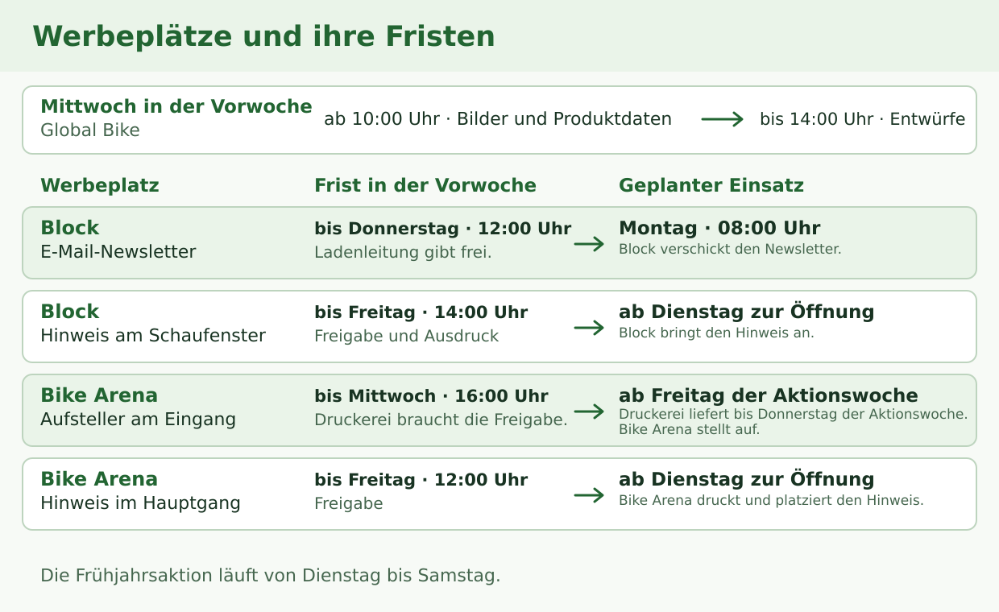

# M3 – Werbeplätze, Fristen und Rollen

<figure>

<figcaption>Die Zeiten zu den vier möglichen Werbeplätzen stehen in derselben Reihenfolge wie in der Tabelle. Die Pfeile führen von der Frist zum Einsatz.</figcaption>
</figure>

Die Fristen für die Vorbereitung liegen in der Woche vor der Aktion. Die Spalte „Einsatztermin“ zeigt die Termine in der Aktionswoche. Der Versand am Montag findet einen Tag vor dem Verkaufsstart statt.

| Standort und Werbeträger             | Werbemittel                     | Reservierter <a href="../ls-glossar.html?from=material%2Fm3.html%23begriffsstelle-1#gl-einsatztermin" id="begriffsstelle-1">Einsatztermin</a> | Freigabe und Übergabe                                                                                                                                                                                                                                             |
|--------------------------------------|---------------------------------|-----------------------------------------------------------------------------------------------------------------------------------------------|-------------------------------------------------------------------------------------------------------------------------------------------------------------------------------------------------------------------------------------------------------------------|
| Block · E-Mail-Newsletter            | Werbebeitrag im Newsletter      | Montag, 08:00 Uhr                                                                                                                             | Freigabe der Ladenleitung bis Donnerstag, 12:00 Uhr. Block plant und verschickt den Newsletter selbst.                                                                                                                                                            |
| Block · Schaufenster                 | Gedruckter Aushang              | Ab Dienstag zur Öffnung                                                                                                                       | Freigabe und Ausdruck bis Freitag, 14:00 Uhr. Block bringt den Aushang an.                                                                                                                                                                                        |
| Bike Arena · Aufsteller am Eingang   | Bedrucktes Schild im Aufsteller | Ab Freitag                                                                                                                                    | <a href="../ls-glossar.html?from=material%2Fm3.html%23begriffsstelle-2#gl-freigabefrist" id="begriffsstelle-2">Freigabefrist</a> für den Druck: Mittwoch, 16:00 Uhr. Die Druckerei liefert bis Donnerstag der Aktionswoche. Die Bike Arena stellt das Schild auf. |
| Bike Arena · Werbeplatz am Hauptgang | Gedrucktes Hinweisschild        | Ab Dienstag zur Öffnung                                                                                                                       | Freigabe bis Freitag, 12:00 Uhr. Die Bike Arena druckt das Schild selbst und bringt es an.                                                                                                                                                                        |

Für die <a href="../ls-glossar.html?from=material%2Fm3.html%23begriffsstelle-3#gl-kooperative-werbung" id="begriffsstelle-3">kooperative Werbung</a> stellt Sarah Huber am Mittwoch ab 10:00 Uhr Produktangaben und Bilder bereit. Global Bike kann bis 14:00 Uhr einen gemeinsamen Textentwurf und je eine Fassung für Block und die Bike Arena liefern. Die Ladenleitungen prüfen ihre Fassung und geben sie frei. Sie prüfen den Platz und die Produktangaben sowie Preise, falls die Werbung Preise nennt. Jan Richter koordiniert bei Global Bike die Absprachen. Wählt die Bike Arena den Aufsteller am Eingang, meldet ihre Ladenleitung die Freigabe bis Mittwoch, 16:00 Uhr, an die Druckerei. Nutzt die Tabelle, um zu prüfen, ob jede Maßnahme rechtzeitig fertig wird.

