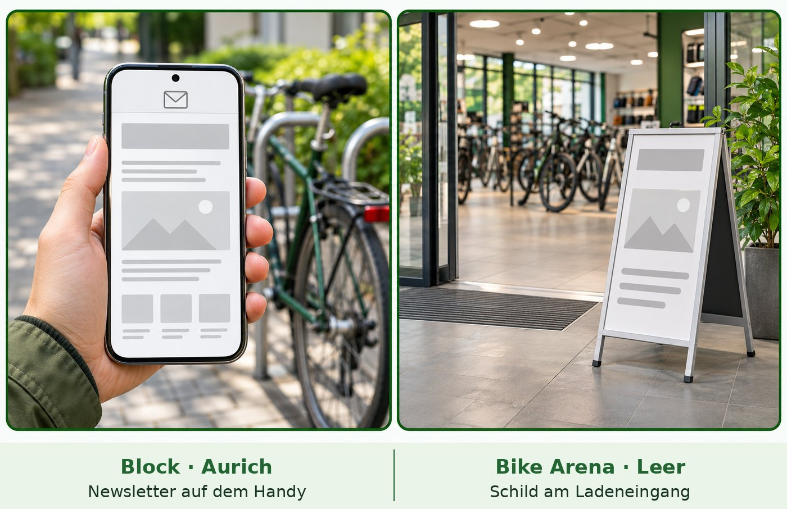
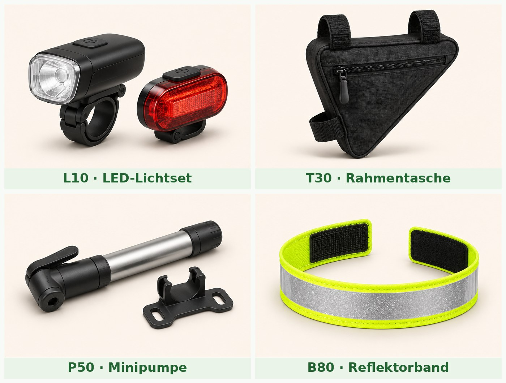
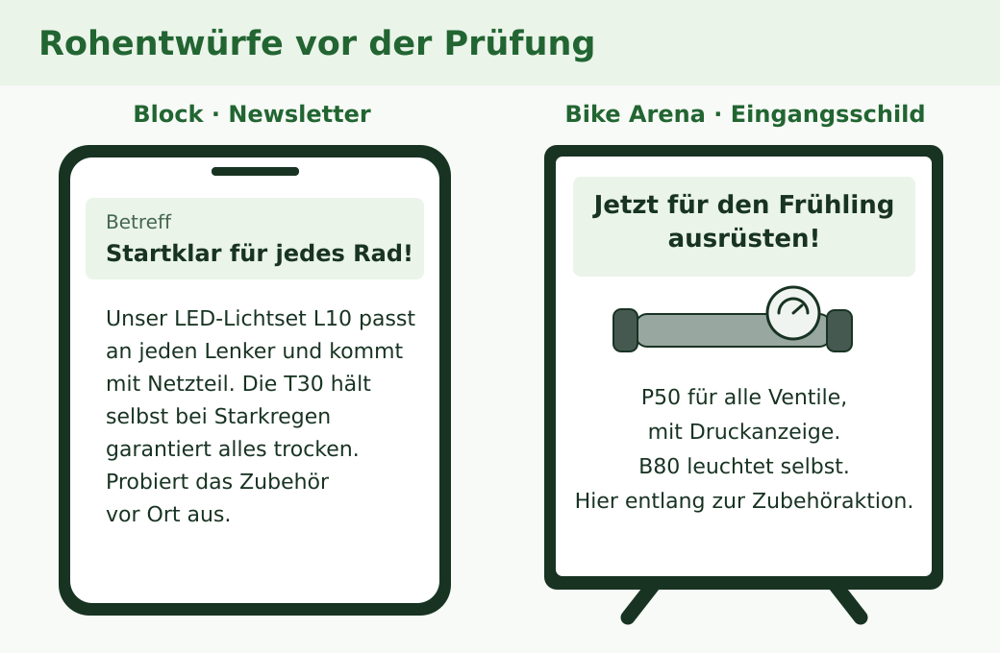
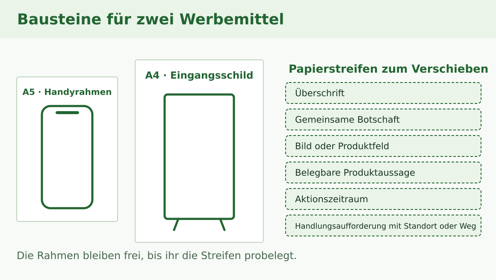

# BFS dual · LF 06 · LS 6.6 · Werbemittel für beide Standorte gestalten

**Zwei Läden, eine Freigabe** · Global Bike Deutschland GmbH · 2. Halbjahr

**Zeit** · 8 Unterrichtsstunden · 360 Minuten

## Orientierung

### Warum wir das lernen

5 Minuten

Ihr sucht ein Licht für euer Rad. „Passt an jeden Lenker“ klingt erst mal praktisch. Ob das Licht passt, hängt vom Lenker und von der Halterung ab. Für Global Bike prüft ihr solche Angaben mit den Produktblättern. Dann bewerbt ihr dieselbe Aktion im Newsletter für Block und auf dem Eingangsschild für die Bike Arena.

### Das übe ich

| Kompetenz | Wie stark? (1–6) | Das übe ich |
| --- | ---: | --- |
| Fachkompetenz | 6 | Ich gestalte dieselbe Werbebotschaft für zwei Zielgruppen und zwei Werbeformate. Ich prüfe meine Aussagen zu den Produkten mit den Produktblättern. |
| Personalkompetenz | 3 | Ich plane so, dass mein Entwurf vor der Freigabe geprüft werden kann. |
| Sozialkompetenz | 3 | Ich nutze Rückmeldungen dazu, wie verständlich der Text ist. Ich erkläre, warum ich bestimmte Formulierungen auswähle. |
| Methodenkompetenz | 4 | Ich prüfe eine Werbeaussage mit einer passenden Quelle. |
| Medienkompetenz | 5 | Ich gestalte Text, Bild und Blickfang passend zum jeweiligen Werbeträger. |

## Handlungssituation

8 Minuten

Global Bike beliefert Fahrradgeschäfte mit Zubehör. Im Frühjahr wollen zwei dieser Läden gemeinsam für die Aktion „Frühjahrsstart mit Fahrradzubehör von Global Bike“ werben.

Das 2-Rad Center Block in Aurich berät viele Menschen, die im Alltag mit dem Rad fahren. Ein Newsletter soll sie per E-Mail zur Beratung einladen. In der Bike Arena Oltmanns in Leer kaufen auch Familien und Freizeitradler für ihre nächste Tour ein. Sie sollen die Aktion schon beim Betreten des Geschäfts entdecken. Dafür ist ein Schild am Eingang vorgesehen.

Sarah Huber plant bei Global Bike die Werbung und schaut sich die ersten Entwürfe an. Global Bike will sie gleich freigeben. „Im Newsletter muss sofort klar sein, worum es geht. Sonst scrollen die Leute weiter. Auch das Bild auf dem Schild müssen sie schnell verstehen.“ Alexander Sahin kauft für Global Bike Handelswaren ein. Er legt die Produktblätter neben die Entwürfe. „Hier steht, das Lichtset passe an jeden Lenker. Auf dem Schild hat die Pumpe eine Druckanzeige. Die sieht aus wie beim Modell auf der anderen Vorlage. So würde ich die beiden Entwürfe noch nicht freigeben.“

Jan Richter leitet bei Global Bike den Verkauf. Er braucht heute zwei fertige Fassungen, die die Läden einsetzen können. Ihr bekommt den Werbeauftrag und die Produktblätter. Macht die gemeinsame Botschaft im Newsletter und auf dem Schild verständlich. Prüft, ob die Angaben zu den Produkten stimmen.

*Der Newsletter erreicht die Kundschaft zu Hause oder unterwegs. Das Schild steht am Ladeneingang.*

### Den Fall prüfen

### Aufgabe 01 · Nennt für jedes Werbemittel die Menschen, die es erreichen soll.

3 Minuten

- Der Newsletter richtet sich an Familien auf Radtour, das Schild an Menschen, die mit dem Rad zur Arbeit fahren.
- Der Newsletter richtet sich an Menschen, die im Alltag Rad fahren, das Schild an Familien und Freizeitradler.
- Der Newsletter richtet sich an Anbieter von Radtouren, das Schild an Menschen auf dem täglichen Weg zur Arbeit.
- Der Newsletter richtet sich an Menschen, die Radrennen fahren, das Schild an Vereine auf der Suche nach Zubehör.
- Der Newsletter richtet sich an Familien auf Wochenendtour, das Schild an Radreisende auf mehrtägigen Strecken.
- Der Newsletter richtet sich an Gäste geführter Radtouren, das Schild an Menschen auf dem Weg zur Arbeit.

Hilfe

Sucht bei Block und bei der Bike Arena die Werbung und die Menschen, die sie sehen sollen. Nutzt „Mit … erreicht der Laden …“.

### Aufgabe 02 · Erklärt, was Sarah am Anfang des Newsletters und beim Bild auf dem Schild wichtig ist.

3 Minuten

- Der Newsletter beginnt mit allen Produktpreisen, auf dem Schild sieht man jede Variante des Zubehörs.
- Der Newsletter beginnt mit den Ladenöffnungszeiten, auf dem Schild sieht man beide Läden von außen.
- Der Newsletter beginnt mit einer Anfahrtsbeschreibung, auf dem Schild sieht man den Weg zur Kasse.
- Der Newsletter macht das Thema sofort klar, auf dem Schild versteht man das Bild auf den ersten Blick.
- Der Newsletter nennt zuerst beide Adressen, auf dem Schild sieht man den Weg bis zur Fahrradabteilung.
- Der Newsletter beginnt mit dem Aktionszeitraum, auf dem Schild sieht man die Öffnungszeiten beider Läden.

Hilfe

Lest, was Sarah zu den beiden Entwürfen sagt. Beginnt mit „Beim Newsletter möchte Sarah …“ und „Beim Schild soll das Bild …“.

### Aufgabe 03 · Nennt die zwei Stellen, die Alexander in den Entwürfen auffallen.

3 Minuten

- Das Lichtset soll an jeden Lenker passen. Die abgebildete Pumpe hat eine Druckanzeige.
- Das Lichtset soll an jeden Gepäckträger passen. Die abgebildete Pumpe hat einen Standfuß.
- Das Lichtset soll mit jedem Akku laufen. Die abgebildete Pumpe hat einen langen Schlauch.
- Das Lichtset soll ohne Werkzeug halten. Die abgebildete Pumpe hat einen zweiten Griff.
- Das Lichtset soll an jeden Rahmen passen. Die abgebildete Pumpe hat einen Druckschlauch.
- Das Lichtset soll an jeden Lenker passen. Die abgebildete Pumpe hat ein zweites Ventil.

Hilfe

Lest, was Alexander über das Lichtset und die Pumpe sagt. Sucht, was zum Lichtset versprochen wird und was auf dem Bild der Pumpe zu sehen ist.

### Aufgabe 04 · Nennt, was Jan heute braucht und welche Unterlagen ihr dafür bekommt.

3 Minuten

- Einen Plan für die Aktionsflächen beider Läden. Dafür nutzen wir die Flächenpläne und die Produktblätter.
- Eine Bestellung für die Ausrüstung beider Läden. Dafür nutzen wir den Werbeauftrag und die Lagerlisten.
- Den fertigen Newsletter und das fertige Schild. Dafür nutzen wir den Werbeauftrag und die Produktblätter.
- Einen Preisvergleich für die Produkte beider Läden. Dafür nutzen wir die Einkaufslisten und die Preislisten.
- Den fertigen Newsletter und das fertige Schild. Dafür nutzen wir die Verkaufszahlen und die Flächenpläne.
- Zwei Flächenpläne mit den Plätzen für das Zubehör. Dafür nutzen wir den Werbeauftrag und die Grundrisse.

Hilfe

Lest den letzten Absatz. Ergänzt „Jan braucht heute … Die Unterlagen dafür sind …“.

## Informieren

### Aufgabe 05 · Werbeauftrag und Produktdaten lesen

32 Minuten

Newsletter und Eingangsschild können anders klingen und anders aussehen. Die Kundschaft soll in beiden dieselbe Aktion erkennen. In [M4](#m4) erzählen zwei Kunden, welche Informationen sie brauchen.

**Lest** den Werbeauftrag und die Produktdaten in [M1](#m1) und [M2](#m2). Schaut, wen beide Läden erreichen wollen. **Markiert** dann in [M3](#m3), welche Aussagen ihr behalten, genauer schreiben oder streichen müsst.

## Fachbegriffscheck

18 Minuten

**Wählt** zu jedem Fachbegriff die passende Erklärung aus sechs Möglichkeiten. Die Begriffe findet ihr in [M6](#m6).

**1. Werbebotschaft**

- A · Die wichtigste Aussage, die der Kundschaft von der Werbung im Kopf bleiben soll.
- B · Die Reihenfolge, in der jemand die Produktdaten prüft.
- C · Der Ort oder Weg, über den die Werbung erscheint.
- D · Die Menschen, die eine Werbung erreichen soll. Die Werbung passt zu dem, was sie interessiert oder brauchen.
- E · Ein Hinweis darauf, was Kundinnen und Kunden als Nächstes tun können oder sollen.
- F · Etwas in der Werbung, das zuerst auffällt, zum Beispiel eine Überschrift oder ein Bild.

**2. Zielgruppe**

- A · Die Menschen, die eine Werbung erreichen soll. Die Werbung passt zu dem, was sie interessiert oder brauchen.
- B · Die Artikel, die in der Werbung zu sehen sind.
- C · Die Menschen im Betrieb, die die Werbung freigeben und anbringen.
- D · Die wichtigste Aussage, die der Kundschaft von der Werbung im Kopf bleiben soll.
- E · Ein Hinweis darauf, was Kundinnen und Kunden als Nächstes tun können oder sollen.
- F · Etwas in der Werbung, das zuerst auffällt, zum Beispiel eine Überschrift oder ein Bild.

**3. Belegbare Produktaussage**

- A · Eine Einladung, die der Kundschaft den Weg zur Aktionsfläche zeigt.
- B · Eine Aussage darüber, was ein Artikel kann, wofür er geeignet ist oder was dazugehört. Die Aussage stimmt mit einer geprüften Produktangabe überein.
- C · Eine Vermutung über das Produkt, die allein auf den Wünschen der Zielgruppe beruht.
- D · Ein Blatt mit geprüften Angaben zu einem Artikel.
- E · Alles, was beim Kauf eines Artikels mitgeliefert wird.
- F · Ihr vergleicht eine Werbeaussage mit ihrer Quelle. Dann gebt ihr die Aussage frei, schreibt sie genauer oder streicht sie.

**4. Handlungsaufforderung**

- A · Eine Anweisung für den Betrieb, wann die Ladenleitung die Werbung freigibt.
- B · Ein Hinweis darauf, was Kundinnen und Kunden als Nächstes tun können oder sollen.
- C · Eine Beschreibung der Maße oder des Materials eines Produkts.
- D · Die wichtigste Aussage, die der Kundschaft von der Werbung im Kopf bleiben soll.
- E · Die Menschen, die eine Werbung erreichen soll. Die Werbung passt zu dem, was sie interessiert oder brauchen.
- F · Etwas in der Werbung, das zuerst auffällt, zum Beispiel eine Überschrift oder ein Bild.

**5. Blickfang**

- A · Etwas in der Werbung, das zuerst auffällt, zum Beispiel eine Überschrift oder ein Bild.
- B · Eine Notiz für Global Bike zur Freigabe des Entwurfs.
- C · Eine genaue Produktangabe, die man erst beim Lesen entdeckt.
- D · Die wichtigste Aussage, die der Kundschaft von der Werbung im Kopf bleiben soll.
- E · Die Menschen, die eine Werbung erreichen soll. Die Werbung passt zu dem, was sie interessiert oder brauchen.
- F · Ein Hinweis darauf, was Kundinnen und Kunden als Nächstes tun können oder sollen.

**6. Werbemittel**

- A · Der Kanal oder Platz, über den die Werbung die Kundschaft erreicht.
- B · Die gestaltete Werbung, etwa der Newsletter-Ausschnitt oder das Schild. Sie macht die Werbebotschaft sichtbar oder hörbar.
- C · Die wichtigste Aussage, die in beiden Formaten gleich bleibt.
- D · Die Zeile einer E-Mail, die im Posteingang zeigt, worum es in der Nachricht geht.
- E · Etwas in der Werbung, das zuerst auffällt, zum Beispiel eine Überschrift oder ein Bild.
- F · Ein Hinweis darauf, was Kundinnen und Kunden als Nächstes tun können oder sollen.

**7. Betreffzeile**

- A · Ein kurzer Text unter dem Bild eines Artikels.
- B · Die letzte Zeile einer E-Mail, die zur Aktionsfläche einlädt.
- C · Die Zeile einer E-Mail, die im Posteingang zeigt, worum es in der Nachricht geht.
- D · Die gestaltete Werbung, etwa der Newsletter-Ausschnitt oder das Schild. Sie macht die Werbebotschaft sichtbar oder hörbar.
- E · Etwas in der Werbung, das zuerst auffällt, zum Beispiel eine Überschrift oder ein Bild.
- F · Ein Hinweis darauf, was Kundinnen und Kunden als Nächstes tun können oder sollen.

**8. Produktblatt**

- A · Eine Liste mit Dingen, die der Kundschaft im Laden gefallen.
- B · Ein Werbeentwurf, bei dem jemand die Aussagen erst noch prüfen muss.
- C · Ein Blatt mit geprüften Angaben zu einem Artikel.
- D · Eine Aussage darüber, was ein Artikel kann, wofür er geeignet ist oder was dazugehört. Die Aussage stimmt mit einer geprüften Produktangabe überein.
- E · Alles, was beim Kauf eines Artikels mitgeliefert wird.
- F · Ihr vergleicht eine Werbeaussage mit ihrer Quelle. Dann gebt ihr die Aussage frei, schreibt sie genauer oder streicht sie.

**9. Lieferumfang**

- A · Die Zahl der Stücke, die ein Laden während der Aktion anbietet.
- B · Alles, was beim Kauf eines Artikels mitgeliefert wird.
- C · Die Voraussetzungen dafür, dass sich ein Produkt nutzen lässt.
- D · Eine Aussage darüber, was ein Artikel kann, wofür er geeignet ist oder was dazugehört. Die Aussage stimmt mit einer geprüften Produktangabe überein.
- E · Ein Blatt mit geprüften Angaben zu einem Artikel.
- F · Ihr vergleicht eine Werbeaussage mit ihrer Quelle. Dann gebt ihr die Aussage frei, schreibt sie genauer oder streicht sie.

**10. Aussagencheck**

- A · Ihr vergleicht Überschriften, um die auffälligste auszuwählen.
- B · Ihr prüft, ob die Aktionsfläche groß genug für beide Werbeformate ist.
- C · Ihr vergleicht eine Werbeaussage mit ihrer Quelle. Dann gebt ihr die Aussage frei, schreibt sie genauer oder streicht sie.
- D · Eine Aussage darüber, was ein Artikel kann, wofür er geeignet ist oder was dazugehört. Die Aussage stimmt mit einer geprüften Produktangabe überein.
- E · Ein Blatt mit geprüften Angaben zu einem Artikel.
- F · Alles, was beim Kauf eines Artikels mitgeliefert wird.

## Planen

### Aufgabe 06 · Die Werbung für beide Läden planen

30 Minuten

**Haltet fest**, wen ihr mit dem Newsletter und dem Schild erreichen wollt. Notiert, was die Menschen nach dem Lesen tun sollen. Sammelt für beide Formate passende Produktangaben.

## Entscheiden

### Aufgabe 07 · Lernpaket wählen und begründen

8 Minuten

**Wählt** einen der drei Arbeitswege. Überlegt, welcher Weg euch bei der Entscheidung am besten hilft. **Haltet** beim Arbeiten ein Zwischenergebnis und einen Beleg für den Pitch fest. Ein Beleg kann zum Beispiel eine Zahl, ein Maß oder eine Kundenstimme sein.

**Euer Auftrag.** Ihr gestaltet dieselbe Botschaft für zwei Zielgruppen und prüft eure Produktaussagen mit M2. Euer Ergebnis besteht aus drei Teilen. Ihr erstellt einen fertigen Newsletter-Ausschnitt für Block und ein fertiges Eingangsschild für die Bike Arena. Im kurzen Aussagencheck zeigt ihr, wo die Produktangaben stehen. Die Kriterien findet ihr unter „Handlungsprodukt und Kriterien“.

| Lernpaket | Lernzugänge | So arbeitet ihr | Euer Zwischenergebnis | Wählt dieses Paket, wenn … |
| --- | --- | --- | --- | --- |
| **A · Bild und Text skizzieren** | Zeichnen und die Wirkung vergleichen | Skizziert Newsletter und Schild in den Formaten aus M1. Markiert den Blickfang und platziert die geprüften Angaben aus M2. Schaut euch die Entwürfe in der vorgesehenen Größe an. | Eure Skizzen zeigen, was sofort auffällt, wie Bild und Text zusammenpassen und wo man wichtige Angaben findet. | … ihr direkt an einer Skizze prüfen wollt, was auffällt und sich gut lesen lässt. |
| **B · Werbetexte laut erproben** | Zuhören, vorlesen und Texte verbessern | Hört die Kundenstimmen aus M4 oder lest sie im Team vor. Sprecht eure Überschriften und Texte zur Probe ein oder lest sie vor. Bittet jemanden, in eigenen Worten zu sagen, was angekommen ist. Setzt die verbesserten Texte dann in die Formate aus M1. | Eure Rückmeldungen und die verbesserten Texte zeigen, was man an der Botschaft und Einladung gut versteht. | … ihr durch Zuhören prüfen wollt, was von eurem Text hängen bleibt. |
| **C · Das Layout mit Bausteinen legen** | Bausteine verschieben und prüfen, was sich gut lesen lässt | Legt die Bausteine aus M5 in einen Handyrahmen und auf eine Schildfläche. Verschiebt Bilder, Überschriften und Angaben. Schaut euch das Schild auch aus ein paar Schritten Abstand an. | Eure Papierentwürfe zeigen, wo Text, Bild und geprüfte Angaben stehen sollen. Übernehmt diese Anordnung in eure fertigen Fassungen. | … ihr durch Verschieben von Text und Bild am besten ausprobieren könnt, was zusammenpasst. |

### Aufgabe 08 · Zwei Werbeentwürfe entwickeln

42 Minuten

**Entwickelt** eure Entwürfe mit dem gewählten Lernpaket. Nutzt die gemeinsame Botschaft aus M1 für beide Entwürfe. Wählt in jedem Format je eine passende Angabe zu den beiden Artikeln. Erklärt, warum die Angaben der jeweiligen Kundschaft helfen.

## Durchführen

### Aufgabe 09 · Den Newsletter gestalten

#### A · Bild und Text skizzieren

35 Minuten

Skizziert Newsletter und Schild in den Formaten aus M1. Markiert den Blickfang und platziert die geprüften Angaben aus M2. Schaut euch die Entwürfe in der vorgesehenen Größe an.

Eure Skizzen zeigen, was sofort auffällt, wie Bild und Text zusammenpassen und wo man wichtige Angaben findet.

#### B · Werbetexte laut erproben

35 Minuten

Hört die Kundenstimmen aus M4 oder lest sie im Team vor. Sprecht eure Überschriften und Texte zur Probe ein oder lest sie vor. Bittet jemanden, in eigenen Worten zu sagen, was angekommen ist. Setzt die verbesserten Texte dann in die Formate aus M1.

Eure Rückmeldungen und die verbesserten Texte zeigen, was man an der Botschaft und Einladung gut versteht.

#### C · Das Layout mit Bausteinen legen

35 Minuten

Legt die Bausteine aus M5 in einen Handyrahmen und auf eine Schildfläche. Verschiebt Bilder, Überschriften und Angaben. Schaut euch das Schild auch aus ein paar Schritten Abstand an.

Eure Papierentwürfe zeigen, wo Text, Bild und geprüfte Angaben stehen sollen. Übernehmt diese Anordnung in eure fertigen Fassungen.

**Gestaltet** den Newsletter für Block. Nutzt die gemeinsame Botschaft aus [M1](#m1). Baut die geprüften Angaben und die Einladung zur Beratung ein. Nutzt [M5](#m5) als Hilfe.

### Aufgabe 10 · Das Eingangsschild gestalten

35 Minuten

**Gestaltet** das Schild für die Bike Arena. Nutzt dieselbe Botschaft und die belegten Produktangaben. Zeigt der Kundschaft den Weg zur Aktionsfläche am Hauptgang. Prüft, ob Bild und Text zusammenpassen.

### Aufgabe 11 · Produktaussagen belegen

25 Minuten

**Belegt** jede Produktaussage der fertigen Werbung mit der passenden Stelle in [M2](#m2). Füllt dazu den Aussagencheck in [M5](#m5) aus. Korrigiert Text oder Bild, wenn ein Beleg fehlt.

## Bewerten

### Aufgabe 12 · Die Arbeit prüfen und kurz vorstellen

72 Minuten

#### Die Werbung prüfen

**Prüft**, ob man in beiden Werbemitteln dieselbe Botschaft erkennt. Vergleicht die Produktangaben mit [M2](#m2). **Überarbeitet** alles, was unklar ist oder nicht stimmt.

#### Die eigene Arbeit einschätzen

**Wählt** je eine Formulierung aus dem Newsletter und vom Schild. Erklärt daran, warum ihr am Handy anders formuliert als auf einem Schild am Eingang.

**Schätzt** euch zur Fachkompetenz dieser LS ein. Wählt eine Stufe. Zeigt eine Stelle in eurer Arbeit, die dazu passt.

1 · Ich brauche Hilfe bei jedem Schritt. 2 · Mit einzelnen Tipps komme ich weiter. 3 · Ich kann die Aufgabe selbst lösen und begründen. 4 · Ich kann das auch in einem neuen Fall.

#### Abschlusspitch

**Pitcht** euer Lernpaket. Ein Pitch ist eine kurze Vorstellung. Nutzt euer Handlungsprodukt und eure Unterlagen. Ihr habt für den Kurzpitch etwa zwei Minuten. Wenn noch Zeit ist, beantwortet eine Rückfrage.

1.  **Ergebnis zeigen.** Zeigt euer Handlungsprodukt. Sagt, was ihr entschieden habt.
2.  **Entscheidung belegen.** Zeigt einen Beleg aus dem Fall. Erklärt, wie er eure Entscheidung stützt.
3.  **Arbeitsweg begründen.** Sagt, warum ihr euer Lernpaket gewählt habt. Zeigt ein Zwischenergebnis. Erklärt, wie es euch bei der Entscheidung geholfen hat.

**Das könnt ihr zeigen.** Zeigt euren Newsletter-Ausschnitt und euer Eingangsschild. Erklärt, wo und warum ihr die Kundschaft unterschiedlich ansprecht. Wählt eine Aussage zu einem Produkt und zeigt die passende Stelle in M2.

Sprachhilfe für den Pitch

- „Unser Ergebnis ist … Wir schlagen vor, dass …“
- „Unser Beleg ist … Er zeigt, dass …“
- „Wir haben Paket … gewählt. Beim Arbeiten hat uns … geholfen.“

### Aufgabe 13 · Das Produkt für den Peer-Check bereitstellen

8 Minuten

**Ladet eure beiden Werbemittel mit dem Aussagencheck hoch.** Bei einer Teamarbeit gibt jede Person eine Kopie im eigenen Moodle-Konto ab. Wählt einen Titel und einen Dateinamen ohne eure Namen. Entfernt eure Namen aus der Arbeit und aus den Dateieigenschaften.

Ohne eingerichtete Moodle-Aktivität erhältst du von der Lehrkraft eine codierte Arbeit.

### Aufgabe 14 · Ein fremdes Produkt prüfen

16 Minuten

**Schaut euch die zugeteilte Arbeit an.** Moodle lost aus, welche Arbeit ihr bekommt. Ihr seht die Arbeit ohne Namen.

**Gebt Rückmeldung.** Nutzt die Fragen unter dieser Aufgabe. Nennt eine Stelle, die gut gelungen ist. Schreibt, was die Person verbessern kann. Die Person sieht bei eurer Antwort euren Klarnamen.

- Prüft, ob man in beiden Werbemitteln dieselbe Frühjahrsaktion erkennt.
- Prüft, ob Newsletter und Schild zur jeweiligen Kundschaft passen. Versteht ihr, was die Kundschaft nach dem Lesen tun soll?
- Prüft mit [M2](#m2), ob sich jede Aussage über ein Produkt mit dem passenden Produktblatt belegen lässt.

[Peer-Check im Lernpaket öffnen](peer-check.html)

### Aufgabe 15 · Die empfangene Rückmeldung nutzen

8 Minuten

**Lest** nach der Freigabe die Rückmeldung zu eurer Arbeit. Verbessert eine Stelle oder erklärt, warum ihr bei eurer Lösung bleibt.

## Reflektieren

### Aufgabe 16 · Feedback zur Lernsituation

6 Minuten

**Füllt** die Aktivität „Feedback“ im Moodle-Kurs aus und sendet eure Rückmeldung dort ab. Falls der Verweis fehlt, öffnet „Feedback“ in der Kursübersicht.

[Feedback in Moodle öffnen](https://bbs1aur.moodle-nds.de/mod/feedback/view.php?id=79823)

## Handlungsprodukt und Kriterien

Ein Newsletter-Ausschnitt für Block und ein Eingangsschild für die Bike Arena. Beide zeigen dieselbe Frühjahrsaktion. Sie nennen den jeweiligen Laden und zeigen, was man dort tun kann. Die Werbung passt zu den Menschen, die sie lesen, und zu dem Ort, an dem sie zu sehen ist. Alle Produktaussagen lassen sich mit [M2](#m2) belegen. Im kurzen Aussagencheck zeigt ihr die passende Stelle im Produktblatt für jede Aussage.

## Materialien

### M1 · Werbeauftrag von Global Bike

| Vorgabe                        | 2-Rad Center Block, Aurich                                                                                                         | Bike Arena Oltmanns, Leer                                                                                            |
|--------------------------------|------------------------------------------------------------------------------------------------------------------------------------|----------------------------------------------------------------------------------------------------------------------|
| [Werbemittel](#gl-werbemittel) | Werbebeitrag für den E-Mail-Newsletter                                                                                             | Bedrucktes Schild für den Aufsteller am Eingang                                                                      |
| Format                         | Handyansicht in einem etwa 7 cm breiten Rahmen. Der Rahmen passt auf ein Blatt A5.                                                 | Druckvorlage im Hochformat auf einem Blatt A4. Die wichtigsten Angaben sind aus wenigen Schritten Entfernung lesbar. |
| [Zielgruppe](#gl-zielgruppe)   | Menschen, die im Alltag Rad fahren und passendes Zubehör für ihr Rad suchen                                                        | Familien und Menschen, die in der Freizeit Rad fahren. Sie wollen vor Ort schnell finden, was sie suchen.            |
| Nutzen und Aufforderung        | Zur Beratung und zur Aktionsfläche im Laden einladen                                                                               | Zur markierten Aktionsfläche am Hauptgang einladen. Dort können Kunden die Produkte selbst vergleichen.              |
| Umfang                         | Eine [Betreffzeile](#gl-betreffzeile), ein kurzer Absatz mit bis zu 75 Wörtern und ein klarer Hinweis, was die Kundschaft tun kann | Eine gut lesbare Überschrift als [Blickfang](#gl-blickfang), wenige klare Angaben und ein Hinweis auf den Weg        |
| Artikel                        | L10 LED-Lichtset und T30 Rahmentasche                                                                                              | P50 Minipumpe und B80 Reflektorband                                                                                  |

Die gemeinsame [Werbebotschaft](#gl-werbebotschaft) lautet **„Frühjahrsstart mit Fahrradzubehör von Global Bike“**. Die Aktion läuft in beiden Läden von Dienstag bis Samstag derselben Woche. Global Bike liefert die Produktdaten. Lasst Preise in diesem Auftrag weg. Wenn ihr ein Bild einbauen wollt, reichen eine einfache eigene Zeichnung oder ein Feld mit Produktnamen und Artikelnummer. Zeigt nur Ausstattung, die laut [Produktblatt](#gl-produktblatt) zum Artikel gehört.

*So sieht die Kundschaft den Newsletter auf dem Handy und das Schild am Eingang.*

### M2 · Produktblätter von Global Bike

| Artikel               | Gesicherte Angaben                                                                                                                                                                | [Lieferumfang](#gl-lieferumfang)                                                                 |
|-----------------------|-----------------------------------------------------------------------------------------------------------------------------------------------------------------------------------|--------------------------------------------------------------------------------------------------|
| **L10 LED-Lichtset**  | Vorder- und Rückleuchte. Ihr könnt beide über USB-C aufladen. Die Halterung für die Vorderleuchte passt an runde Lenker mit 22–32 mm Durchmesser.                                 | Vorder- und Rückleuchte, Halterungen und ein USB-C-Ladekabel. Ein Netzteil gehört nicht zum Set. |
| **T30 Rahmentasche**  | Die Tasche fasst 1,2 Liter. Sie wird mit verstellbaren Klettbändern befestigt. Das Material ist wasserabweisend. Bei Block könnt ihr prüfen, ob im Rahmendreieck genug Platz ist. | Eine Rahmentasche mit Befestigungsbändern.                                                       |
| **P50 Minipumpe**     | Passt zu Sclaverand- und Autoventilen. Höchstdruck 6 bar. Hat kein Manometer, also keine Druckanzeige.                                                                            | Eine Minipumpe und eine Rahmenhalterung.                                                         |
| **B80 Reflektorband** | Der Umfang ist zwischen 20 und 40 cm einstellbar. Das Band wirft Licht zurück, das darauf fällt.                                                                                  | Ein Reflektorband ohne eigene Beleuchtung.                                                       |

*Die neutralen Produktansichten könnt ihr für eure Werbung nutzen. Den vollständigen Lieferumfang und die geprüften Angaben findet ihr in den Produktblättern.*

### M3 · Rohentwürfe zur Überprüfung

**Block, Newsletter.** „Startklar für jedes Rad! Unser LED-Lichtset L10 passt an jeden Lenker und kommt mit Netzteil. Die T30 hält selbst bei Starkregen garantiert alles trocken. Probiert das Zubehör vor Ort aus.“

**Bike Arena, Eingangsschild.** „Jetzt für den Frühling ausrüsten! P50 für alle Ventile, mit Druckanzeige. B80 leuchtet selbst. Hier entlang zur Zubehöraktion.“ Auf der Skizze hat die Minipumpe eine runde Druckanzeige. Das Schild sagt nicht genau, wo die Aktionsfläche liegt.

*Zwei Rohentwürfe. Gleicht Wortlaut und Pumpenskizze mit den Produktblättern ab.*

### M4 · Was die Kundschaft über die Werbung wissen möchte

**Kundenstimme von Block.** „Mein Rad ist etwas älter und der Lenker eher dick. Vor dem Kauf möchte ich wissen, ob das Licht passt. Für meine Schlüssel suche ich eine Rahmentasche. Wenn ich das vor Ort anschauen kann, komme ich nach der Arbeit vorbei.“

**Kundenstimme aus der Bike Arena.** „Wir kommen am Samstag sowieso in die Bike Arena. Ich brauche eine kleine Pumpe für unterwegs. An unseren Rädern sind zwei verschiedene Ventile. Am Eingang würde ich gern direkt sehen, wo das Zubehör steht.“

### M5 · Bausteine für Entwurf und Prüfung

**Zeichnet** den Handyrahmen und das Schild nach den Maßen aus [M1](#m1). Schneidet oder faltet Papierstreifen, die ihr verschieben könnt. Nutzt Streifen für **Überschrift**, **gemeinsame Botschaft**, **Bild oder Produktfeld**, **[belegbare Produktaussage](#gl-belegbare-produktaussage)**, **Aktionszeitraum** und **[Handlungsaufforderung](#gl-handlungsaufforderung) mit Standort oder Weg**. Nehmt leere Streifen für weitere Angaben. Probiert die Anordnung im Handyrahmen aus. Schaut euch das Schild aus ein paar Schritten Abstand an.

**Nutzt** den [Aussagencheck](#gl-aussagencheck). Prüft die Aussagen der Rohentwürfe aus [M3](#m3). Haltet anschließend für jede Produktaussage eurer fertigen Werbung den Beleg aus [M2](#m2) fest. Ergänzt bei Bedarf Zeilen.

| Werbemittel                       | Aussage aus dem Entwurf | Beleg aus [M2](#m2) mit Artikelnummer | Freigeben, genauer schreiben oder streichen | Aussage in der fertigen Werbung |
|-----------------------------------|-------------------------|---------------------------------------|---------------------------------------------|---------------------------------|
| Newsletter für Block              | …                       | …                                     | …                                           | …                               |
| Eingangsschild für die Bike Arena | …                       | …                                     | …                                           | …                               |

*Papierstreifen für den Handyrahmen und das Eingangsschild. Probiert selbst aus, wie ihr sie anordnet.*

### M6 · Fachbegriffe zu dieser Lernsituation

- **Werbebotschaft.** Die wichtigste Aussage, die der Kundschaft von der Werbung im Kopf bleiben soll.
- **Zielgruppe.** Die Menschen, die eine Werbung erreichen soll. Die Werbung passt zu dem, was sie interessiert oder brauchen.
- **Belegbare Produktaussage.** Eine Aussage darüber, was ein Artikel kann, wofür er geeignet ist oder was dazugehört. Die Aussage stimmt mit einer geprüften Produktangabe überein.
- **Handlungsaufforderung.** Ein Hinweis darauf, was Kundinnen und Kunden als Nächstes tun können oder sollen.
- **Blickfang.** Etwas in der Werbung, das zuerst auffällt, zum Beispiel eine Überschrift oder ein Bild.
- **Werbemittel.** Die gestaltete Werbung, etwa der Newsletter-Ausschnitt oder das Schild. Sie macht die Werbebotschaft sichtbar oder hörbar.
- **Betreffzeile.** Die Zeile einer E-Mail, die im Posteingang zeigt, worum es in der Nachricht geht.
- **Produktblatt.** Ein Blatt mit geprüften Angaben zu einem Artikel.
- **Lieferumfang.** Alles, was beim Kauf eines Artikels mitgeliefert wird.
- **Aussagencheck.** Ihr vergleicht eine Werbeaussage mit ihrer Quelle. Dann gebt ihr die Aussage frei, schreibt sie genauer oder streicht sie.

## Glossar

### Aussagencheck

Ihr vergleicht eine Werbeaussage mit ihrer Quelle. Dann gebt ihr die Aussage frei, schreibt sie genauer oder streicht sie.

**Beispiel.** Der Entwurf verspricht eine Druckanzeige für die P50. Laut Produktblatt hat sie kein Manometer. Deshalb streicht ihr die Aussage ([M2](#m2), [M3](#m3), [M5](#m5)).

### Belegbare Produktaussage

Eine Aussage darüber, was ein Artikel kann, wofür er geeignet ist oder was dazugehört. Die Aussage stimmt mit einer geprüften Produktangabe überein.

**Beispiel.** Im Produktblatt der P50 steht „Höchstdruck 6 bar“. Damit könnt ihr diese Aussage belegen ([M2](#m2)).

### Betreffzeile

Die Zeile einer E-Mail, die im Posteingang zeigt, worum es in der Nachricht geht.

**Beispiel.** Block kann die Frühjahrsaktion in der Betreffzeile des Newsletters ankündigen ([M1](#m1)).

### Blickfang

Etwas in der Werbung, das zuerst auffällt, zum Beispiel eine Überschrift oder ein Bild.

**Beispiel.** Eine gut sichtbare Überschrift am Eingang der Bike Arena soll auf die Aktion aufmerksam machen ([M1](#m1), [M5](#m5)).

### Handlungsaufforderung

Ein Hinweis darauf, was Kundinnen und Kunden als Nächstes tun können oder sollen.

**Beispiel.** „Lasst euch bei Block beraten“ sagt den Menschen, was sie als Nächstes tun können ([M1](#m1)).

### Lieferumfang

Alles, was beim Kauf eines Artikels mitgeliefert wird.

**Beispiel.** Zum L10 gehören ein Ladekabel und Halterungen. Ein Netzteil gehört nicht dazu ([M2](#m2)).

### Produktblatt

Ein Blatt mit geprüften Angaben zu einem Artikel.

**Beispiel.** Im Produktblatt der P50 stehen die passenden Ventile und der Höchstdruck. Diese Angaben kann die Werbung nutzen ([M2](#m2)).

### Werbebotschaft

Die wichtigste Aussage, die der Kundschaft von der Werbung im Kopf bleiben soll.

**Beispiel.** Beide Werbemittel teilen dieselbe Botschaft zum Frühjahrsstart mit Fahrradzubehör von Global Bike ([M1](#m1)).

### Werbemittel

Die gestaltete Werbung, etwa der Newsletter-Ausschnitt oder das Schild. Sie macht die Werbebotschaft sichtbar oder hörbar.

**Beispiel.** Bei Block ist der fertige Beitrag das Werbemittel. Der E-Mail-Newsletter verbreitet ihn ([M1](#m1)).

### Zielgruppe

Die Menschen, die eine Werbung erreichen soll. Die Werbung passt zu dem, was sie interessiert oder brauchen.

**Beispiel.** Der Newsletter richtet sich an Menschen, die im Alltag Rad fahren und Zubehör am eigenen Rad ausprobieren möchten ([M1](#m1), [M4](#m4)).
