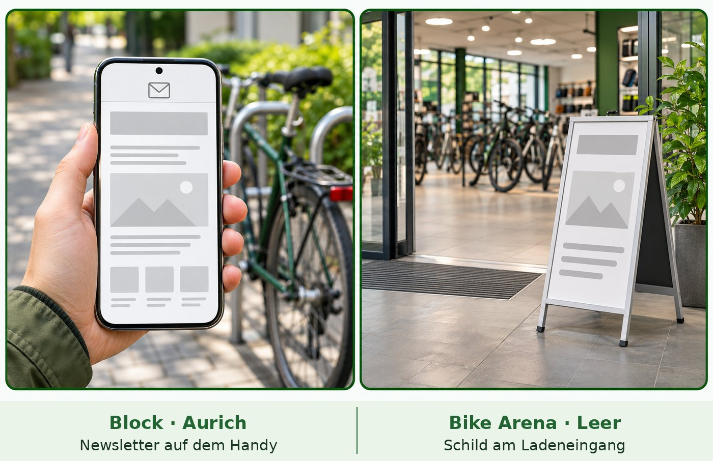

# M1 – Werbeauftrag von Global Bike

<figure>

<figcaption>So sieht die Kundschaft den Newsletter auf dem Handy und das Schild am Eingang.</figcaption>
</figure>

| Vorgabe                                                                                                                      | 2-Rad Center Block, Aurich                                                                                                                                                                                                       | Bike Arena Oltmanns, Leer                                                                                                                                                                                   |
|------------------------------------------------------------------------------------------------------------------------------|----------------------------------------------------------------------------------------------------------------------------------------------------------------------------------------------------------------------------------|-------------------------------------------------------------------------------------------------------------------------------------------------------------------------------------------------------------|
| <a href="../ls-glossar.html?from=material%2Fm1.html%23begriffsstelle-1#gl-werbemittel" id="begriffsstelle-1">Werbemittel</a> | Werbebeitrag für den E-Mail-Newsletter                                                                                                                                                                                           | Bedrucktes Schild für den Aufsteller am Eingang                                                                                                                                                             |
| Format                                                                                                                       | Handyansicht in einem etwa 7 cm breiten Rahmen. Der Rahmen passt auf ein Blatt A5.                                                                                                                                               | Druckvorlage im Hochformat auf einem Blatt A4. Die wichtigsten Angaben sind aus wenigen Schritten Entfernung lesbar.                                                                                        |
| <a href="../ls-glossar.html?from=material%2Fm1.html%23begriffsstelle-2#gl-zielgruppe" id="begriffsstelle-2">Zielgruppe</a>   | Menschen, die im Alltag Rad fahren und passendes Zubehör für ihr Rad suchen                                                                                                                                                      | Familien und Menschen, die in der Freizeit Rad fahren. Sie wollen vor Ort schnell finden, was sie suchen.                                                                                                   |
| Nutzen und Aufforderung                                                                                                      | Zur Beratung und zur Aktionsfläche im Laden einladen                                                                                                                                                                             | Zur markierten Aktionsfläche am Hauptgang einladen. Dort können Kunden die Produkte selbst vergleichen.                                                                                                     |
| Umfang                                                                                                                       | Eine <a href="../ls-glossar.html?from=material%2Fm1.html%23begriffsstelle-3#gl-betreffzeile" id="begriffsstelle-3">Betreffzeile</a>, ein kurzer Absatz mit bis zu 75 Wörtern und ein klarer Hinweis, was die Kundschaft tun kann | Eine gut lesbare Überschrift als <a href="../ls-glossar.html?from=material%2Fm1.html%23begriffsstelle-4#gl-blickfang" id="begriffsstelle-4">Blickfang</a>, wenige klare Angaben und ein Hinweis auf den Weg |
| Artikel                                                                                                                      | L10 LED-Lichtset und T30 Rahmentasche                                                                                                                                                                                            | P50 Minipumpe und B80 Reflektorband                                                                                                                                                                         |

Die gemeinsame <a href="../ls-glossar.html?from=material%2Fm1.html%23begriffsstelle-5#gl-werbebotschaft" id="begriffsstelle-5">Werbebotschaft</a> lautet **„Frühjahrsstart mit Fahrradzubehör von Global Bike“**. Die Aktion läuft in beiden Läden von Dienstag bis Samstag derselben Woche. Global Bike liefert die Produktdaten. Lasst Preise in diesem Auftrag weg. Wenn ihr ein Bild einbauen wollt, reichen eine einfache eigene Zeichnung oder ein Feld mit Produktnamen und Artikelnummer. Zeigt nur Ausstattung, die laut <a href="../ls-glossar.html?from=material%2Fm1.html%23begriffsstelle-6#gl-produktblatt" id="begriffsstelle-6">Produktblatt</a> zum Artikel gehört.

