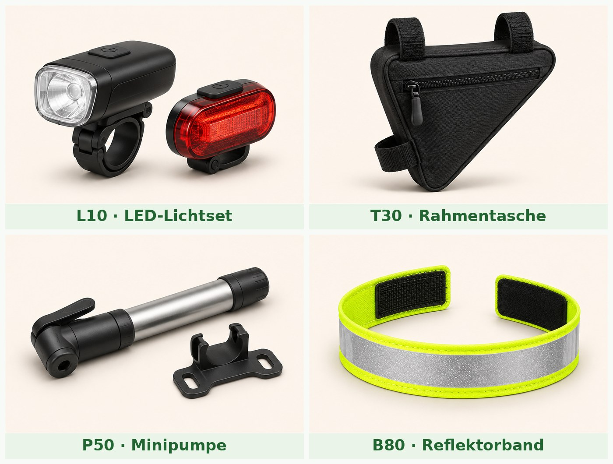

# M2 – Produktblätter von Global Bike

<figure>

<figcaption>Die neutralen Produktansichten könnt ihr für eure Werbung nutzen. Den vollständigen Lieferumfang und die geprüften Angaben findet ihr in den Produktblättern.</figcaption>
</figure>

| Artikel               | Gesicherte Angaben                                                                                                                                                                | <a href="../ls-glossar.html?from=material%2Fm2.html%23begriffsstelle-1#gl-lieferumfang" id="begriffsstelle-1">Lieferumfang</a> |
|-----------------------|-----------------------------------------------------------------------------------------------------------------------------------------------------------------------------------|--------------------------------------------------------------------------------------------------------------------------------|
| **L10 LED-Lichtset**  | Vorder- und Rückleuchte. Ihr könnt beide über USB-C aufladen. Die Halterung für die Vorderleuchte passt an runde Lenker mit 22–32 mm Durchmesser.                                 | Vorder- und Rückleuchte, Halterungen und ein USB-C-Ladekabel. Ein Netzteil gehört nicht zum Set.                               |
| **T30 Rahmentasche**  | Die Tasche fasst 1,2 Liter. Sie wird mit verstellbaren Klettbändern befestigt. Das Material ist wasserabweisend. Bei Block könnt ihr prüfen, ob im Rahmendreieck genug Platz ist. | Eine Rahmentasche mit Befestigungsbändern.                                                                                     |
| **P50 Minipumpe**     | Passt zu Sclaverand- und Autoventilen. Höchstdruck 6 bar. Hat kein Manometer, also keine Druckanzeige.                                                                            | Eine Minipumpe und eine Rahmenhalterung.                                                                                       |
| **B80 Reflektorband** | Der Umfang ist zwischen 20 und 40 cm einstellbar. Das Band wirft Licht zurück, das darauf fällt.                                                                                  | Ein Reflektorband ohne eigene Beleuchtung.                                                                                     |

