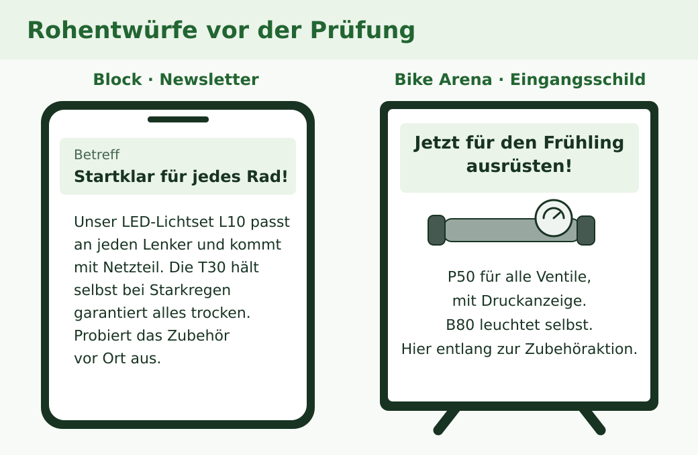

# M3 – Rohentwürfe zur Überprüfung

<figure>

<figcaption>Zwei Rohentwürfe. Gleicht Wortlaut und Pumpenskizze mit den Produktblättern ab.</figcaption>
</figure>

**Block, Newsletter.** „Startklar für jedes Rad! Unser LED-Lichtset L10 passt an jeden Lenker und kommt mit Netzteil. Die T30 hält selbst bei Starkregen garantiert alles trocken. Probiert das Zubehör vor Ort aus.“

**Bike Arena, Eingangsschild.** „Jetzt für den Frühling ausrüsten! P50 für alle Ventile, mit Druckanzeige. B80 leuchtet selbst. Hier entlang zur Zubehöraktion.“ Auf der Skizze hat die Minipumpe eine runde Druckanzeige. Das Schild sagt nicht genau, wo die Aktionsfläche liegt.

