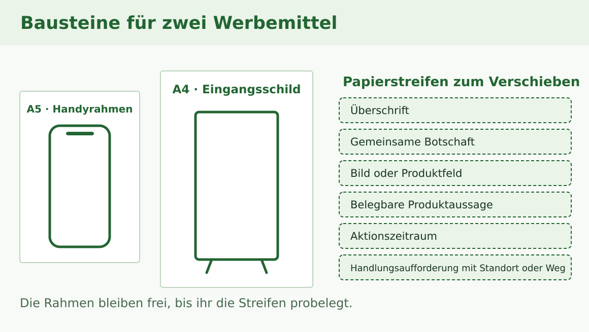

# M5 – Bausteine für Entwurf und Prüfung

<figure>

<figcaption>Papierstreifen für den Handyrahmen und das Eingangsschild. Probiert selbst aus, wie ihr sie anordnet.</figcaption>
</figure>

**Zeichnet** den Handyrahmen und das Schild nach den Maßen aus [M1](m1.html). Schneidet oder faltet Papierstreifen, die ihr verschieben könnt. Nutzt Streifen für **Überschrift**, **gemeinsame Botschaft**, **Bild oder Produktfeld**, **<a href="../ls-glossar.html?from=material%2Fm5.html%23begriffsstelle-2#gl-belegbare-produktaussage" id="begriffsstelle-2">belegbare Produktaussage</a>**, **Aktionszeitraum** und **<a href="../ls-glossar.html?from=material%2Fm5.html%23begriffsstelle-3#gl-handlungsaufforderung" id="begriffsstelle-3">Handlungsaufforderung</a> mit Standort oder Weg**. Nehmt leere Streifen für weitere Angaben. Probiert die Anordnung im Handyrahmen aus. Schaut euch das Schild aus ein paar Schritten Abstand an.

**Nutzt** den <a href="../ls-glossar.html?from=material%2Fm5.html%23begriffsstelle-4#gl-aussagencheck" id="begriffsstelle-4">Aussagencheck</a>. Prüft die Aussagen der Rohentwürfe aus [M3](m3.html). Haltet anschließend für jede Produktaussage eurer fertigen Werbung den Beleg aus [M2](m2.html) fest. Ergänzt bei Bedarf Zeilen.

| Werbemittel                       | Aussage aus dem Entwurf | Beleg aus [M2](m2.html) mit Artikelnummer | Freigeben, genauer schreiben oder streichen | Aussage in der fertigen Werbung |
|-----------------------------------|-------------------------|-------------------------------------------|---------------------------------------------|---------------------------------|
| Newsletter für Block              | …                       | …                                         | …                                           | …                               |
| Eingangsschild für die Bike Arena | …                       | …                                         | …                                           | …                               |

