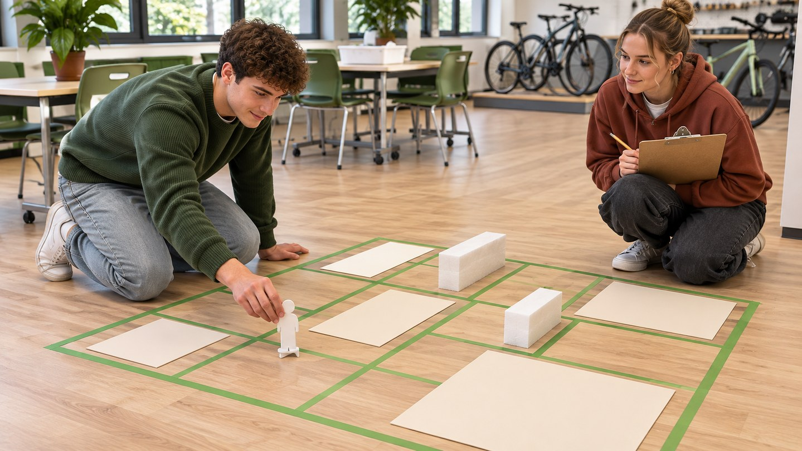
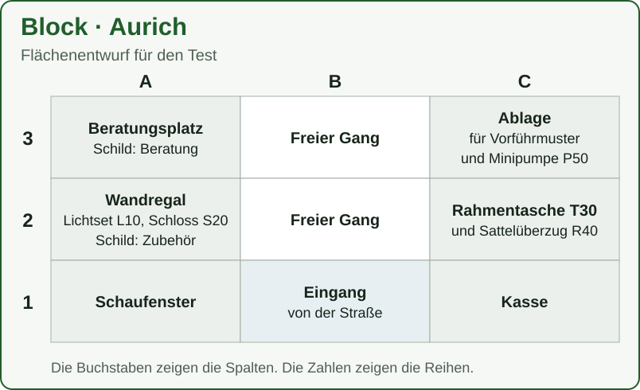
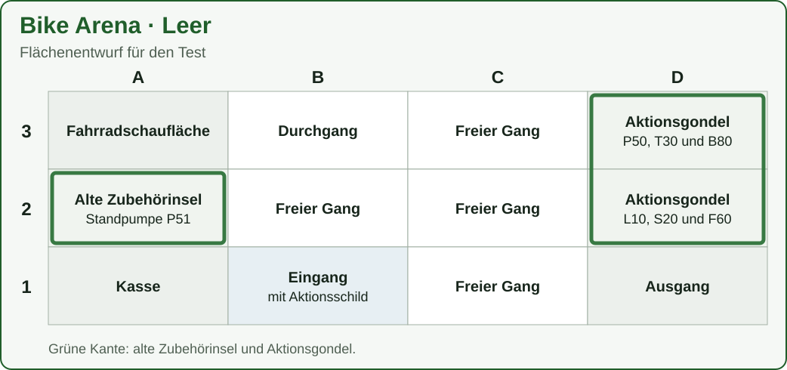

# BFS dual · LF 06 · LS 6.7 · Die Entwürfe vor der Freigabe prüfen

**Zwei Läden, eine Freigabe** · Global Bike Deutschland GmbH · 2. Halbjahr

**Zeit** · 8 Unterrichtsstunden · 360 Minuten

## Orientierung

### Warum wir das lernen

5 Minuten

Am Eingang seht ihr Werbung für eine Minipumpe. Versteht ihr den Hinweis auf dem Schild? Findet ihr die Pumpe, wenn ihr der grünen Markierung folgt? Lasst das für Block und die Bike Arena testen. An den Wegen und Antworten der Testpersonen seht ihr, ob ihr die Hinweise oder den Plan ändern müsst.

### Das übe ich

| Kompetenz | Wie stark? (1–6) | Das übe ich |
| --- | ---: | --- |
| Fachkompetenz | 6 | Ich teste, ob andere Personen die Ware finden und die Werbung verstehen. Ich begründe Änderungen mit meinen Beobachtungen. |
| Personalkompetenz | 4 | Ich halte auch fest, was mich im Test überrascht. |
| Sozialkompetenz | 4 | Ich leite den Test neutral an und höre den Personen zu. |
| Methodenkompetenz | 5 | Ich trenne, was ich beobachte und wie ich es erkläre. |
| Medienkompetenz | 3 | Ich mache einen Werbetext oder ein Schild leichter verständlich. |

## Handlungssituation

8 Minuten

Im 2-Rad Center Block in Aurich können Kunden Fahrradzubehör am eigenen Rad ausprobieren. Das Fahrradgeschäft will per Newsletter zur Beratung einladen. Die Bike Arena Oltmanns, ein Fahrradgeschäft in Leer, plant dagegen eine Fläche, auf der die Kundschaft das Zubehör selbst findet. Ein Schild am Eingang soll den Weg zeigen. Für die gemeinsame Frühjahrsaktion beliefert Global Bike beide Läden mit Zubehör.

Sarah Huber plant bei Global Bike die Werbung. Auf ihrem Tisch liegen zwei Flächenpläne und zwei Werbeentwürfe. Der Newsletter für Block ist vorbereitet. Die Druckerei wartet auf die Vorlage für das Eingangsschild der Bike Arena. Sarah sagt: „Um 16 Uhr ist die Abgabe. Ich möchte das Schild jetzt schicken. Dann bleibt Zeit für Rückfragen.“

Sebastian Wolf betreut für Global Bike die Fahrradgeschäfte. Er liest das Schild. „Darauf steht, dass die grüne Markierung den Weg zeigt. Auf dem Plan sind aber zwei Stellen grün. Wohin geht jemand, der zum ersten Mal im Laden ist?“ Sebastian will auch wissen, ob man die Artikel aus dem Newsletter mit dem Flächenplan findet.

Jan Richter leitet bei Global Bike den Verkauf. Er bittet euch um einen kurzen Test. Die Testpersonen sollen die Entwürfe zum ersten Mal sehen. Jan will vor der Freigabe wissen, wo das Suchen oder Lesen schwierig ist. Zeigt ihm für beide Läden, was ihr nach dem Test noch ändern müsst.

*Beim Modelltest zeigt die Testperson ihren Weg. Eine zweite Person beobachtet und hält fest, was passiert.*

### Den Fall prüfen

### Aufgabe 01 · Welche Unterlagen hat Sarah vor sich? Was erwartet die Druckerei?

3 Minuten

- Bei Sarah liegen zwei Flächenpläne und zwei Bestelllisten. Die Druckerei wartet auf die Vorlage für das Preisschild.
- Bei Sarah liegen zwei Werbeentwürfe und zwei Preislisten. Die Druckerei wartet auf die Vorlage für den Newsletter.
- Bei Sarah liegen zwei Flächenpläne und zwei Werbeentwürfe. Die Druckerei wartet auf die Vorlage für den Newsletter.
- Bei Sarah liegen zwei Flächenpläne und zwei Werbeentwürfe. Die Druckerei wartet auf die Vorlage für das Eingangsschild.
- Bei Sarah liegen zwei Flächenpläne und zwei Werbeentwürfe. Die Druckerei wartet auf die Vorlage für den Lageplan.
- Bei Sarah liegen zwei Preislisten und zwei Werbeentwürfe. Die Druckerei wartet auf die Vorlage für das Eingangsschild.

Hilfe

Lest den Abschnitt über Sarah und die Druckerei. Ergänzt die Sätze „Vor Sarah liegen … und …“ und „Die Druckerei wartet auf … für …“

### Aufgabe 02 · Warum möchte Sarah das Schild sofort abgeben?

3 Minuten

- Bis zur Abgabe um 16 Uhr sollen die Läden noch die Anzahl der bestellten Schilder ändern können.
- Bis zur Abgabe um 16 Uhr soll noch Zeit bleiben, um mögliche Rückfragen der Druckerei zu klären.
- Bis zur Abgabe um 16 Uhr soll die Druckerei noch die grünen Markierungen im Flächenplan prüfen.
- Bis zur Abgabe um 16 Uhr sollen die Testpersonen noch fertig gedruckte Schilder im Laden lesen.
- Bis zur Abgabe um 16 Uhr soll Sebastian noch einen zweiten Entwurf für das Eingangsschild anfertigen.
- Bis zur Abgabe um 16 Uhr sollen beide Läden noch ihre Bestellung für den Newsletter bestätigen können.

Hilfe

Lest, was Sarah sagt. Beginnt mit „Sarah will das Schild jetzt schicken, weil …“

### Aufgabe 03 · Welches Problem sieht Sebastian beim Hinweis auf den Weg?

3 Minuten

- Das Schild nennt eine blaue Markierung. Auf dem Plan sind alle markierten Stellen grün.
- Das Schild nennt eine grüne Markierung. Auf dem Plan ist nur der Eingang grün markiert.
- Das Schild nennt eine grüne Markierung. Auf dem Plan sind zwei Stellen grün markiert.
- Das Schild nennt zwei grüne Markierungen. Auf dem Plan ist nur eine Stelle grün markiert.
- Das Schild nennt eine grüne Markierung. Auf dem Plan sind die beiden Stellen gelb markiert.
- Das Schild nennt zwei blaue Markierungen. Auf dem Plan ist der Zubehörbereich grün markiert.

Hilfe

Lest, was Sebastian über das Schild und den Plan sagt. Ergänzt den Satz „Auf dem Schild steht … Auf dem Plan sieht Sebastian …“

### Aufgabe 04 · Was möchte Jan vor der Freigabe von euch erfahren?

3 Minuten

- Wo Testpersonen beim Suchen oder Lesen hängen bleiben und welche Änderungen das Team daraus ableitet.
- Wie Testpersonen auf die Preise der Artikel reagieren und welche Rabatte das Team daraus ableitet.
- Welche Produkte die Testpersonen kaufen möchten und welche Bestellmengen das Team daraus ableitet.
- Wie lange die Testpersonen in jedem Laden bleiben und welche Öffnungszeiten das Team daraus ableitet.
- Welche Farben den Testpersonen für die Aktion gefallen und welche Druckvorlagen das Team daraus ableitet.
- Wie viele Artikel die Testpersonen bereits kennen und welche Schulung das Team für die Läden daraus ableitet.

Hilfe

Lest den letzten Absatz. Beginnt mit „Jan will nach dem Test wissen, wo … und was das Team …“

## Informieren

### Aufgabe 05 · Testpersonen finden

12 Minuten

Beim Praxistest probieren andere Personen die Entwürfe aus [M1](#m1) und [M2](#m2) aus. Beobachtet, welchen Weg sie wählen und wo sie suchen. Lasst sie in eigenen Worten sagen, was sie aus der Werbung verstanden haben. Notiert die Beobachtungen in [M5](#m5). Erklärt damit, was ihr am Entwurf ändert.

**Klärt** vor dem Lesen, wer jeden Laden später testen kann. Die Person darf den Entwurf noch nicht kennen. Fragt zuerst eine Person, die bisher nichts von der Aktion gelesen hat. Wenn ihr euch im Kurs gegenseitig testet, teilt die Entwürfe vorher auf. Lasst die Testpersonen bis zur Probe nur mit dem anderen Laden arbeiten. Haltet den Entwurf, die Fundstelle und die Gespräche zu ihrem Testladen bis dahin getrennt. Nach ihrem Test liest sie auch den zweiten Entwurf.

### Aufgabe 06 · Werbung und Flächenplan vergleichen

24 Minuten

**Vergleicht** für jeden Laden die Werbung und den Flächenplan. Nutzt [M1](#m1) und [M2](#m2). Markiert in der Werbung den Artikel und den Hinweis auf den Weg. Schreibt „fehlt“, wenn es keinen Weghinweis gibt. Markiert im Plan, wo die Ware zum Kauf liegt.

## Fachbegriffscheck

19 Minuten

**Wählt** zu jedem Fachbegriff die passende Erklärung aus sechs Möglichkeiten. Die Begriffe findet ihr in [M6](#m6).

**1. Auffindbarkeit**

- A · Wie gut jemand den Inhalt der Werbung in eigenen Worten sagen kann.
- B · Wie leicht die Kundschaft einen Artikel mithilfe der Wege und Hinweise findet.
- C · Wie gut jemand die Farbe eines Schildes findet.
- D · Wie leicht die Kundschaft versteht, worum es in der Werbung geht und was sie tun kann.
- E · Eine Probe vor der Freigabe. Eine Testperson löst eine Aufgabe, wie es die Kundschaft im Laden tun würde.
- F · Die Stelle, an der jemand den gesuchten Artikel findet.

**2. Verständlichkeit**

- A · Wie leicht die Kundschaft versteht, worum es in der Werbung geht und was sie tun kann.
- B · Wie schnell jemand vom Eingang zum richtigen Regal kommt.
- C · Wie viele Werbemittel ein Laden während der Aktion einsetzt.
- D · Wie leicht die Kundschaft einen Artikel mithilfe der Wege und Hinweise findet.
- E · Eine Probe vor der Freigabe. Eine Testperson löst eine Aufgabe, wie es die Kundschaft im Laden tun würde.
- F · Die Stelle, an der jemand den gesuchten Artikel findet.

**3. Neutrale Testanleitung**

- A · Sie sagt der Testperson vor, was die Werbung bedeutet.
- B · Sie zeigt der Testperson den Weg zum richtigen Regal.
- C · Sie sagt, wo die Testperson startet und was sie tun soll. Die Person wählt den Weg selbst.
- D · Etwas, das ihr im Test seht oder hört.
- E · Eine Probe vor der Freigabe. Eine Testperson löst eine Aufgabe, wie es die Kundschaft im Laden tun würde.
- F · Darin steht, wie der Test lief, was ihr beobachtet habt und welche Änderungen sich daraus ergeben.

**4. Beobachtung**

- A · Ein Vorschlag, wie der Flächenplan aussehen soll.
- B · Etwas, das ihr im Test seht oder hört.
- C · Eine Vermutung, warum jemand falsch abgebogen ist.
- D · Sie sagt, wo die Testperson startet und was sie tun soll. Die Person wählt den Weg selbst.
- E · Eine Probe vor der Freigabe. Eine Testperson löst eine Aufgabe, wie es die Kundschaft im Laden tun würde.
- F · Darin steht, wie der Test lief, was ihr beobachtet habt und welche Änderungen sich daraus ergeben.

**5. Praxistest**

- A · Eine Probe vor der Freigabe. Eine Testperson löst eine Aufgabe, wie es die Kundschaft im Laden tun würde.
- B · Eine Befragung dazu, welche Farben der Kundschaft gefallen.
- C · Ein Gespräch, in dem das Team ohne Testpersonen über die Entwürfe entscheidet.
- D · Wie leicht die Kundschaft einen Artikel mithilfe der Wege und Hinweise findet.
- E · Wie leicht die Kundschaft versteht, worum es in der Werbung geht und was sie tun kann.
- F · Die Stelle, an der jemand den gesuchten Artikel findet.

**6. Testprotokoll**

- A · Ein Plan, der vor dem Test den richtigen Weg zum Regal zeigt.
- B · Darin steht, wie der Test lief, was ihr beobachtet habt und welche Änderungen sich daraus ergeben.
- C · Eine Liste mit den Verkäufen und dem Geld, das der Laden dafür bekommen hat.
- D · Sie sagt, wo die Testperson startet und was sie tun soll. Die Person wählt den Weg selbst.
- E · Etwas, das ihr im Test seht oder hört.
- F · Eine Probe vor der Freigabe. Eine Testperson löst eine Aufgabe, wie es die Kundschaft im Laden tun würde.

**7. Vorführmuster**

- A · Ein Bild mit allen Artikeln der Aktion.
- B · Ein Aufkleber, der die passende Zubehörgruppe im Laden markiert.
- C · Ein Artikel, an dem das Personal zeigt, wie er benutzt wird.
- D · Eine erste Fassung der Werbung. Das Team kann sie bis zur Freigabe prüfen und ändern.
- E · Die wichtigste Aussage, die die Kundschaft aus der Werbung mitnehmen soll.
- F · Die Stelle, an der jemand den gesuchten Artikel findet.

**8. Werbeentwurf**

- A · Eine Liste mit Notizen zu den Testpersonen.
- B · Eine Zeichnung mit Flächen und Wegen im Laden.
- C · Eine erste Fassung der Werbung. Das Team kann sie bis zur Freigabe prüfen und ändern.
- D · Ein Artikel, an dem das Personal zeigt, wie er benutzt wird.
- E · Die wichtigste Aussage, die die Kundschaft aus der Werbung mitnehmen soll.
- F · Die Stelle, an der jemand den gesuchten Artikel findet.

**9. Werbebotschaft**

- A · Der Platz für die Werbung im Laden.
- B · Die wichtigste Aussage, die die Kundschaft aus der Werbung mitnehmen soll.
- C · Der Weg, den eine Testperson bei der Suche nimmt.
- D · Ein Artikel, an dem das Personal zeigt, wie er benutzt wird.
- E · Eine erste Fassung der Werbung. Das Team kann sie bis zur Freigabe prüfen und ändern.
- F · Die Stelle, an der jemand den gesuchten Artikel findet.

**10. Fundstelle**

- A · Die Stelle, an der jemand den gesuchten Artikel findet.
- B · Der erste Ort, an dem jemand nach dem Artikel schaut.
- C · Der Eingang, an dem jemand mit dem Suchen beginnt.
- D · Wie leicht die Kundschaft einen Artikel mithilfe der Wege und Hinweise findet.
- E · Wie leicht die Kundschaft versteht, worum es in der Werbung geht und was sie tun kann.
- F · Eine Probe vor der Freigabe. Eine Testperson löst eine Aufgabe, wie es die Kundschaft im Laden tun würde.

## Planen

### Aufgabe 07 · Zwei Tests vorbereiten

30 Minuten

**Plant** für jeden Laden einen kurzen Test. Klärt im Team, wer den Test erklärt und wer beobachtet. Legt mit [M3](#m3) und [M5](#m5) fest, was ihr aufschreibt. Notiert vor dem Test für beide Läden, welche Botschaft die Werbung vermitteln soll.

## Entscheiden

### Aufgabe 08 · Lernpaket wählen und begründen

8 Minuten

**Wählt** ein Lernpaket. Hebt für den Pitch ein Zwischenergebnis und einen Beleg aus eurer Arbeit auf.

Prüft mit Testpersonen, ob sie das Zubehör finden und die Werbung verstehen. Nutzt in jedem Lernpaket das Testprotokoll M5 für beide Läden. Begründet Änderungen am Entwurf mit euren Beobachtungen.

| Lernpaket | Lernzugänge | So arbeitet ihr | Euer Zwischenergebnis | Wählt dieses Paket, wenn … |
| --- | --- | --- | --- | --- |
| **A · Suchwege einzeichnen** | Beobachten, Wege im Plan markieren und Antworten notieren | Nutzt pro Laden die Werbung und den Plan aus M1 oder M2. Bereitet den Plan wie in M3 vor. Zeichnet den Weg der Testperson ein. Markiert, wo sie stehen bleibt oder abbiegt. Notiert, was sie über die Werbung sagt. | Ein markierter Weg und die Antworten zur Werbung für jeden Laden. So erkennt ihr Stellen, die ihr ändern könnt. | … ihr Wege und Umwege gern auf dem Plan seht. |
| **B · Beim Suchen zuhören** | Zuhören, nachfragen und Aussagen festhalten | Nutzt M1 bis M3. Bittet die Personen zu sagen, worauf sie beim Suchen achten. Schreibt ihre Wege und wichtigen Aussagen auf. Fragt am Ende, was die Werbung ihnen sagt. | Notizen zu den Wegen und dazu, welche Hinweise die Personen gesehen und verstanden haben. | … ihr durch Zuhören herausfinden wollt, wie andere Personen einen Hinweis verstehen. |
| **C · Suchwege im Modell testen** | Mit einer Figur oder durch Bewegung im Bodenraster testen | Baut beide Ladenflächen nach M4. Lasst die Personen mit einer Figur oder auf dem Boden suchen. Fragt danach, was sie aus der Werbung verstanden haben. Markiert die Stellen, an denen sie gestoppt haben oder einen Umweg gegangen sind. | Markierte Stellen im Modell und die Aussagen zur Werbung. Damit könnt ihr prüfen, ob zum Beispiel ein Schild an einer anderen Stelle besser hilft. | … ihr einen Weg gern nachstellt und Schilder oder Regale im Modell verschiebt. |

### Aufgabe 09 · Die Testregeln festlegen

32 Minuten

**Legt fest**, wann ihr die Suche beendet. Nutzt für beide Läden dieselbe Zeit. Nehmt Startpunkt und Fragen aus M3. Lest die Aufgabe vor und gebt keine Tipps zum Weg.

## Durchführen

### Aufgabe 10 · Den Entwurf für Block testen

#### A · Suchwege einzeichnen

35 Minuten

Nutzt pro Laden die Werbung und den Plan aus M1 oder M2. Bereitet den Plan wie in M3 vor. Zeichnet den Weg der Testperson ein. Markiert, wo sie stehen bleibt oder abbiegt. Notiert, was sie über die Werbung sagt.

Ein markierter Weg und die Antworten zur Werbung für jeden Laden. So erkennt ihr Stellen, die ihr ändern könnt.

#### B · Beim Suchen zuhören

35 Minuten

Nutzt M1 bis M3. Bittet die Personen zu sagen, worauf sie beim Suchen achten. Schreibt ihre Wege und wichtigen Aussagen auf. Fragt am Ende, was die Werbung ihnen sagt.

Notizen zu den Wegen und dazu, welche Hinweise die Personen gesehen und verstanden haben.

#### C · Suchwege im Modell testen

35 Minuten

Baut beide Ladenflächen nach M4. Lasst die Personen mit einer Figur oder auf dem Boden suchen. Fragt danach, was sie aus der Werbung verstanden haben. Markiert die Stellen, an denen sie gestoppt haben oder einen Umweg gegangen sind.

Markierte Stellen im Modell und die Aussagen zur Werbung. Damit könnt ihr prüfen, ob zum Beispiel ein Schild an einer anderen Stelle besser hilft.

**Lest** zuerst die Werbung mit der Frage aus [M3](#m3) vor. Wartet auf die Antwort. Zeigt erst danach den Tischplan aus [M4](#m4). Bittet die Testperson, bei der Suche laut zu sagen, worauf sie achtet. Gebt keine Hinweise auf die Fundstelle.

**Testet** den Entwurf für Block mit der ersten Testperson. Nutzt die vereinbarte Suchzeit und die Anleitung aus [M3](#m3). Tragt Weg, Fund und Aussage zur Werbung in [M5](#m5) ein.

### Aufgabe 11 · Den Entwurf für die Bike Arena testen

35 Minuten

**Testet** den Entwurf für die Bike Arena mit einer Person, die diesen Entwurf noch nicht kennt. Nutzt dieselbe Suchzeit. Haltet in der zweiten Zeile von [M5](#m5) den Weg, den Fund und die Aussage zur Werbung fest.

## Bewerten

### Aufgabe 12 · Die Arbeit prüfen und kurz vorstellen

99 Minuten

#### Die Beobachtungen auswerten

**Wertet** den Test für jeden Laden aus. Trennt, was ihr beobachtet habt und wie ihr es erklärt.

#### Die Entwürfe verbessern

**Ändert** Stellen in der Werbung oder im Plan, bei denen der Test ein Problem zeigt. Schreibt den Text neu oder zeichnet die Änderung in den Plan ein. Nennt zu jeder Änderung eine Beobachtung. Begründet auch, warum ihr einen Entwurf so freigebt, wie er ist.

#### Die eigene Arbeit einschätzen

**Notiert** zuerst für euch allein: Welche Beobachtung hat euch bei der Entscheidung am meisten geholfen? Welche Frage würdet ihr beim nächsten Test klären? Sprecht danach kurz darüber.

Wie gut könnt ihr mit euren Beobachtungen eine Änderung begründen? **Wählt** eine Stufe und zeigt eine passende Stelle in eurer Arbeit.

1 · Ich brauche Hilfe bei jedem Schritt. 2 · Mit einzelnen Tipps komme ich weiter. 3 · Ich kann die Aufgabe selbst lösen und begründen. 4 · Ich kann das auch in einem neuen Fall.

#### Abschlusspitch

**Stellt** euer Ergebnis in etwa zwei Minuten vor. Bereitet euch darauf vor, eine Rückfrage zu beantworten.

1.  Zeigt eine Stelle im Entwurf und lest die passende Beobachtung aus M5 vor. Erklärt damit, warum ihr die Stelle ändert oder freigebt.
2.  Zeigt ein Zwischenergebnis aus eurem Lernpaket. Erklärt, warum ihr das Paket gewählt habt und wie euch das Ergebnis bei der Entscheidung geholfen hat.

Sprachhilfe für den Pitch

- „Unser Ergebnis ist … Wir schlagen vor, dass …“
- „Unser Beleg ist … Er zeigt, dass …“
- „Wir haben Paket … gewählt. Beim Arbeiten hat uns … geholfen.“

### Aufgabe 13 · Das Produkt für den Peer-Check bereitstellen

9 Minuten

**Ladet euer Testprotokoll und die geprüften Entwürfe hoch.** Bei einer Teamarbeit gibt jede Person eine Kopie im eigenen Moodle-Konto ab. Wählt einen Titel und einen Dateinamen ohne eure Namen. Entfernt eure Namen aus der Arbeit und aus den Dateieigenschaften. Nutzt im Protokoll nur neutrale Kürzel für die Testpersonen, etwa T1 und T2.

Ohne eingerichtete Moodle-Aktivität erhältst du von der Lehrkraft eine codierte Arbeit.

### Aufgabe 14 · Ein fremdes Produkt prüfen

17 Minuten

**Schaut euch die zugeteilte Arbeit an.** Moodle lost aus, welche Arbeit ihr bekommt. Ihr seht die Arbeit ohne Namen.

**Gebt Rückmeldung.** Nutzt die Fragen unter dieser Aufgabe. Nennt eine Stelle, die gut gelungen ist. Schreibt, was die Person verbessern kann. Die Person sieht bei eurer Antwort euren Klarnamen.

- Steht im Protokoll für jeden Laden, ob die Personen die Ware gefunden und die Werbung verstanden haben?
- Ist klar, was die Personen getan oder gesagt haben und wie ihr das erklärt?
- Zeigt ihr mit einer Beobachtung, warum ihr etwas ändert oder freigebt?

[Peer-Check im Lernpaket öffnen](peer-check.html)

### Aufgabe 15 · Die empfangene Rückmeldung nutzen

9 Minuten

**Lest** nach der Freigabe die Rückmeldung zu eurer Arbeit. Verbessert eine Stelle oder erklärt, warum ihr bei eurer Lösung bleibt.

## Reflektieren

### Aufgabe 16 · Feedback zur Lernsituation

6 Minuten

**Füllt** die Aktivität „Feedback“ im Moodle-Kurs aus und sendet eure Rückmeldung dort ab. Falls der Verweis fehlt, öffnet „Feedback“ in der Kursübersicht.

[Feedback in Moodle öffnen](https://bbs1aur.moodle-nds.de/mod/feedback/view.php?id=79835)

## Handlungsprodukt und Kriterien

Jan Richter bekommt das Testprotokoll und die geprüften Entwürfe für beide Läden. Zeigt im Protokoll für jeden Laden, ob die Person das Zubehör findet und wie sie die Werbung versteht. Begründet Änderungen mit dem Test. Markiert die Änderungen direkt in der Werbung oder im Plan.

## Materialien

### M1 · Newsletter und Flächenentwurf bei Block

> **Frühjahrsaktion im Fahrradfachgeschäft**  
> Frühjahrsstart mit Fahrradzubehör von Global Bike. Das LED-Lichtset L10 zeigen wir euch in der Aktionswoche direkt am Beratungsplatz. Auch die Rahmentasche T30 könnt ihr hier am eigenen Rad ansehen. Schaut während unserer Öffnungszeiten vorbei.

Der Plan zeigt einen Teil des Ladens. Die Buchstaben markieren die Spalten von links nach rechts. Die Zahlen zeigen die Reihen vom Eingang in den Laden hinein. Geht nur auf ein Feld, das eine Seite mit eurem Feld teilt.

| Reihe | A                                         | B                      | C                                          |
|-------|-------------------------------------------|------------------------|--------------------------------------------|
| 3     | Beratungsplatz                            | Freier Gang            | Ablage für Vorführmuster und Minipumpe P50 |
| 2     | Lichtset L10 und Schloss S20 am Wandregal | Freier Gang            | Rahmentasche T30 und Sattelüberzug R40     |
| 1     | Schaufenster                              | Eingang von der Straße | Kasse                                      |

Am Beratungsplatz steht „Beratung“, am Wandregal „Zubehör“. In Reihe 2 liegt das Lichtset L10 zum Verkauf. Am Beratungsplatz kann das Personal ein [Vorführmuster](#gl-vorf%C3%BChrmuster) zeigen.

*Flächenentwurf für Block. Nutzt die Buchstaben und die Zahlen, um einen Weg zu notieren.*

### M2 · Eingangsschild und Flächenentwurf der Bike Arena

> **Startklar für die nächste Tour**  
> Frühjahrsstart mit Fahrradzubehör von Global Bike. Die Minipumpe P50 und das Reflektorband B80 findet ihr in der Aktionswoche gleich vorn bei den Fahrrädern. Achtet auf die grüne Markierung.

Der Plan zeigt einen Teil des Ladens. Die alte Zubehörinsel und die neue Aktionsgondel haben beide eine grüne Kante. Von den freien Feldern im Gang kommt ihr zu den Regalen und Schildern.

| Reihe | A                                    | B                         | C           | D                                  |
|-------|--------------------------------------|---------------------------|-------------|------------------------------------|
| 3     | Fahrradschaufläche                   | Durchgang                 | Freier Gang | Aktionsgondel mit P50, T30 und B80 |
| 2     | Alte Zubehörinsel mit Standpumpe P51 | Freier Gang               | Freier Gang | Aktionsgondel mit L10, S20 und F60 |
| 1     | Kasse                                | Eingang mit Aktionsschild | Freier Gang | Ausgang                            |

*Flächenentwurf für die Bike Arena. Die grüne Kante steht an beiden Warenträgern.*

### M3 · Testanleitung und Vorlesefassung

Beginnt den [Praxistest](#gl-praxistest) für beide Läden am Eingang auf Feld B1. Legt pro Laden den [Werbeentwurf](#gl-werbeentwurf) und den Tischplan aus [M4](#m4) bereit. Zeichnet die Schilder und in der Bike Arena die beiden grünen Kanten ein. Deckt im Plan die Artikelnamen auf Regalen und Ablagen ab. Die Testperson kann die Namen lesen, sobald sie auf einem freien, benachbarten Gangfeld steht. So prüft ihr die [Auffindbarkeit](#gl-auffindbarkeit), ohne den richtigen Ort vorab zu zeigen.

**[Neutrale Testanleitung](#gl-neutrale-testanleitung) zum Vorlesen.**

> **Werbung.** „Schau dir diese Werbung an. Was bietet der Laden an? Sag es in eigenen Worten.“
>
> **Bei Block.** „Stell dir vor, du stehst am Eingang. Du willst das Lichtset L10 kaufen. Zeig deinen Weg und sag Bescheid, wenn du es gefunden hast.“
>
> **In der Bike Arena.** „Stell dir vor, du stehst am Eingang. Du willst die Minipumpe P50 kaufen. Zeig deinen Weg und sag Bescheid, wenn du sie gefunden hast.“

Mit der ersten Frage prüft ihr die [Verständlichkeit](#gl-verst%C3%A4ndlichkeit) der Werbung. Zeigt der Person den Plan erst nach ihrer Antwort. Lest dann nur die Suchaufgabe für ihren Laden vor.

Bittet die Person vor der Suche: „Sag beim Suchen gern laut, worauf du achtest.“ Testet jeden Laden mit einer Person, die den Entwurf zum ersten Mal sieht. Erklärt den Entwurf erst, wenn der Test vorbei ist.

### M4 · Tischpläne für die Suche mit lautem Denken

**Zeichnet** die Felder aus [M1](#m1) und [M2](#m2) für jeden Laden auf ein Blatt. Tragt Eingang, Warenträger, Beratung und Kasse ein. Schreibt die Artikel an ihre Plätze und deckt die Namen wie in [M3](#m3) beschrieben ab. Zeichnet in der Bike Arena auch die grünen Kanten ein. Legt eine Figur als Wegzeiger auf Feld B1. Die Testperson zeigt damit beim Sprechen ihren Weg. Die beobachtende Person notiert Weg, Fund und Aussagen in [M5](#m5).

### M5 · Testprotokoll

Haltet die Ergebnisse für jedes Geschäft im [Testprotokoll](#gl-testprotokoll) fest. Nutzt für die Personen neutrale Kürzel, etwa T1 und T2. Haltet unter „Beobachtung“ fest, was die Person getan oder gesagt hat. Erklärt erst im letzten Feld, was das für den Entwurf bedeutet.

| Laden und Testkürzel | Weg und [Fundstelle](#gl-fundstelle). Gefunden? Ja oder nein. | [Werbebotschaft](#gl-werbebotschaft) in eigenen Worten | [Beobachtung](#gl-beobachtung). Was tut oder sagt die Person? | Was ändert ihr oder gebt ihr frei? Warum? |
|----------------------|---------------------------------------------------------------|--------------------------------------------------------|---------------------------------------------------------------|-------------------------------------------|
| Block                |                                                               |                                                        |                                                               |                                           |
| Bike Arena           |                                                               |                                                        |                                                               |                                           |

### M6 · Fachbegriffe zu dieser Lernsituation

- **Auffindbarkeit.** Wie leicht die Kundschaft einen Artikel mithilfe der Wege und Hinweise findet.
- **Verständlichkeit.** Wie leicht die Kundschaft versteht, worum es in der Werbung geht und was sie tun kann.
- **Neutrale Testanleitung.** Sie sagt, wo die Testperson startet und was sie tun soll. Die Person wählt den Weg selbst.
- **Beobachtung.** Etwas, das ihr im Test seht oder hört.
- **Praxistest.** Eine Probe vor der Freigabe. Eine Testperson löst eine Aufgabe, wie es die Kundschaft im Laden tun würde.
- **Testprotokoll.** Darin steht, wie der Test lief, was ihr beobachtet habt und welche Änderungen sich daraus ergeben.
- **Vorführmuster.** Ein Artikel, an dem das Personal zeigt, wie er benutzt wird.
- **Werbeentwurf.** Eine erste Fassung der Werbung. Das Team kann sie bis zur Freigabe prüfen und ändern.
- **Werbebotschaft.** Die wichtigste Aussage, die die Kundschaft aus der Werbung mitnehmen soll.
- **Fundstelle.** Die Stelle, an der jemand den gesuchten Artikel findet.

## Glossar

### Auffindbarkeit

Wie leicht die Kundschaft einen Artikel mithilfe der Wege und Hinweise findet.

**Beispiel.** Beim Test seht ihr am Weg, ob eine Person die Minipumpe leicht findet ([M2](#m2), [M5](#m5)).

### Beobachtung

Etwas, das ihr im Test seht oder hört.

**Beispiel.** „Die Person blieb am ersten Regal stehen.“ Das könnt ihr im Test beobachten und aufschreiben ([M5](#m5)).

### Fundstelle

Die Stelle, an der jemand den gesuchten Artikel findet.

**Beispiel.** Die Suche startet am Eingang. Als Fundstelle notiert ihr zum Beispiel „Wandregal, Reihe 2“ ([M5](#m5)).

### Neutrale Testanleitung

Sie sagt, wo die Testperson startet und was sie tun soll. Die Person wählt den Weg selbst.

**Beispiel.** „Du willst die Minipumpe P50 kaufen. Zeig deinen Weg.“ Die Aufgabe gibt keinen Weg vor ([M3](#m3)).

### Praxistest

Eine Probe vor der Freigabe. Eine Testperson löst eine Aufgabe, wie es die Kundschaft im Laden tun würde.

**Beispiel.** Eine Testperson liest das Schild am Eingang und sucht die Minipumpe ([M2](#m2), [M3](#m3)).

### Testprotokoll

Darin steht, wie der Test lief, was ihr beobachtet habt und welche Änderungen sich daraus ergeben.

**Beispiel.** In [M5](#m5) schreibt ihr den Weg der Testperson auf. Ihr notiert auch, wie sie die Werbung erklärt ([M5](#m5)).

### Verständlichkeit

Wie leicht die Kundschaft versteht, worum es in der Werbung geht und was sie tun kann.

**Beispiel.** Die Testperson sagt in eigenen Worten, was im Newsletter angeboten wird ([M1](#m1), [M3](#m3)).

### Vorführmuster

Ein Artikel, an dem das Personal zeigt, wie er benutzt wird.

**Beispiel.** Das Personal zeigt am Beratungsplatz, wie man das Lichtset befestigt. Die Ware zum Kauf liegt am Wandregal ([M1](#m1)).

### Werbebotschaft

Die wichtigste Aussage, die die Kundschaft aus der Werbung mitnehmen soll.

**Beispiel.** Das Schild wirbt für Fahrradzubehör zum Start in den Frühling. Die Testperson sagt in eigenen Worten, was das Schild verspricht ([M2](#m2), [M3](#m3)).

### Werbeentwurf

Eine erste Fassung der Werbung. Das Team kann sie bis zur Freigabe prüfen und ändern.

**Beispiel.** Der Text für das Eingangsschild ist ein Werbeentwurf. Nach dem Test könnt ihr den Hinweis auf die grüne Markierung ändern ([M2](#m2), [M3](#m3)).
