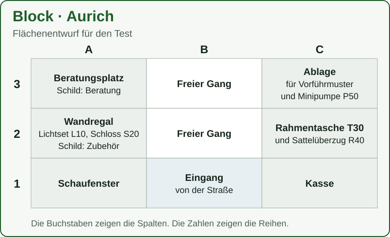

# M1 – Newsletter und Flächenentwurf bei Block

<figure>

<figcaption>Flächenentwurf für Block. Nutzt die Buchstaben und die Zahlen, um einen Weg zu notieren.</figcaption>
</figure>

> **Frühjahrsaktion im Fahrradfachgeschäft**  
> Frühjahrsstart mit Fahrradzubehör von Global Bike. Das LED-Lichtset L10 zeigen wir euch in der Aktionswoche direkt am Beratungsplatz. Auch die Rahmentasche T30 könnt ihr hier am eigenen Rad ansehen. Schaut während unserer Öffnungszeiten vorbei.

Der Plan zeigt einen Teil des Ladens. Die Buchstaben markieren die Spalten von links nach rechts. Die Zahlen zeigen die Reihen vom Eingang in den Laden hinein. Geht nur auf ein Feld, das eine Seite mit eurem Feld teilt.

| Reihe | A                                         | B                      | C                                          |
|-------|-------------------------------------------|------------------------|--------------------------------------------|
| 3     | Beratungsplatz                            | Freier Gang            | Ablage für Vorführmuster und Minipumpe P50 |
| 2     | Lichtset L10 und Schloss S20 am Wandregal | Freier Gang            | Rahmentasche T30 und Sattelüberzug R40     |
| 1     | Schaufenster                              | Eingang von der Straße | Kasse                                      |

Am Beratungsplatz steht „Beratung“, am Wandregal „Zubehör“. In Reihe 2 liegt das Lichtset L10 zum Verkauf. Am Beratungsplatz kann das Personal ein <a href="../ls-glossar.html?from=material%2Fm1.html%23begriffsstelle-1#gl-vorf%C3%BChrmuster" id="begriffsstelle-1">Vorführmuster</a> zeigen.

