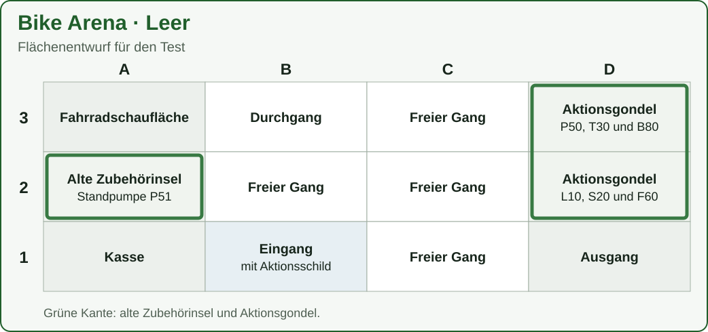

# M2 – Eingangsschild und Flächenentwurf der Bike Arena

<figure>

<figcaption>Flächenentwurf für die Bike Arena. Die grüne Kante steht an beiden Warenträgern.</figcaption>
</figure>

> **Startklar für die nächste Tour**  
> Frühjahrsstart mit Fahrradzubehör von Global Bike. Die Minipumpe P50 und das Reflektorband B80 findet ihr in der Aktionswoche gleich vorn bei den Fahrrädern. Achtet auf die grüne Markierung.

Der Plan zeigt einen Teil des Ladens. Die alte Zubehörinsel und die neue Aktionsgondel haben beide eine grüne Kante. Von den freien Feldern im Gang kommt ihr zu den Regalen und Schildern.

| Reihe | A                                    | B                         | C           | D                                  |
|-------|--------------------------------------|---------------------------|-------------|------------------------------------|
| 3     | Fahrradschaufläche                   | Durchgang                 | Freier Gang | Aktionsgondel mit P50, T30 und B80 |
| 2     | Alte Zubehörinsel mit Standpumpe P51 | Freier Gang               | Freier Gang | Aktionsgondel mit L10, S20 und F60 |
| 1     | Kasse                                | Eingang mit Aktionsschild | Freier Gang | Ausgang                            |

