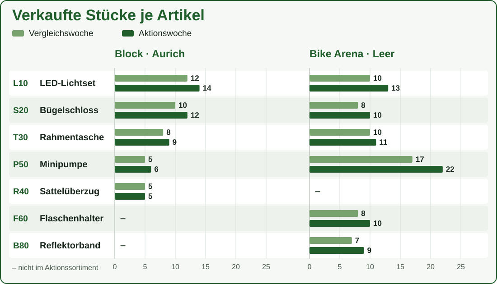

# BFS dual · LF 06 · LS 6.8 · Über die Fortführung der Aktion entscheiden

**Zwei Läden, eine Freigabe** · Global Bike Deutschland GmbH · 2. Halbjahr

**Zeit** · 6 Unterrichtsstunden · 270 Minuten

## Orientierung

### Warum wir das lernen

5 Minuten

Der Laden zählt, wie viele Pumpen verkauft wurden. Eure Rückmeldung zeigt, ob ihr die passende Pumpe leicht gefunden habt. Für Global Bike vergleicht ihr die Verkaufszahlen und Rückmeldungen von Block und der Bike Arena. So prüft ihr das Ziel der Aktion und empfehlt, was die Läden beim nächsten Mal ändern oder beibehalten sollten.

### Das übe ich

| Kompetenz | Wie stark? (1–6) | Das übe ich |
| --- | ---: | --- |
| Fachkompetenz | 6 | Ich vergleiche die Absatzzahlen und die Kundenrückmeldungen der beiden Läden. Ich prüfe, ob sie das Ziel erreicht haben. Ich begründe, was die Läden bei Sortiment, Platzierung und Werbung ändern oder beibehalten sollten. |
| Personalkompetenz | 4 | Ich erkläre, was die Daten über meine Empfehlung aussagen und was offen bleibt. |
| Sozialkompetenz | 3 | Ich beachte, was beiden Läden wichtig ist. Ich begründe eine gemeinsame Entscheidung. |
| Methodenkompetenz | 5 | Ich vergleiche die Absatzmengen mit der Vergleichswoche. Ich prüfe, ob das Ergebnis zum Zielwert passt. |
| Medienkompetenz | 3 | Ich stelle wichtige Zahlen und Rückmeldungen übersichtlich zusammen. |

## Handlungssituation

7 Minuten

Zwei Fahrradgeschäfte haben eine Woche lang Zubehör von Global Bike beworben. Im 2-Rad Center Block in Aurich konnte die Kundschaft das Zubehör bei der Beratung ausprobieren. In der Bike Arena Oltmanns in Leer konnte sie die Artikel auf einer eigenen Fläche selbst vergleichen. Jetzt ist die Frühjahrsaktion vorbei.

Bei Sebastian Wolf sind zwei Nachrichten eingegangen. Er betreut die Geschäfte für Global Bike. Die Bike Arena möchte gleich den nächsten Termin festlegen. Block hält seine Fläche gern wieder frei, möchte vorher aber etwas am Aufbau ändern. Beide Läden erwarten bis Freitag eine Antwort.

Sebastian möchte beiden Läden schnell zusagen. „Wenn wir länger warten, nutzen die Läden ihre Flächen vielleicht für etwas anderes.“ Sein Kollege Christian Klein kümmert sich bei Global Bike um die Lieferung an die Läden. Er legt den Aktionsbericht auf den Tisch. „Das Ziel war für jeden Laden gleich: mindestens 20 Prozent mehr verkaufte Stücke als in der Vergleichswoche. Prüfen wir zuerst, ob beide Läden das Ziel erreicht haben. Die Rückmeldungen der Kundschaft zeigen, was wir beim nächsten Mal ändern können.“

Jan Richter leitet bei Global Bike den Verkauf. Er braucht bis Freitag eure Empfehlung für jeden Laden. Prüft, ob die Läden das Ziel erreicht haben. Sagt, was Global Bike beim nächsten Mal an Sortiment, Platzierung und Werbung ändern oder beibehalten sollte. Später kommt für Jan ein drittes Geschäft infrage: der Zweiradladen Aurich. Er verkauft Fahrräder und hat eine Werkstatt. An der ersten Aktion war er nicht beteiligt.

*Nach der Aktionswoche wertet das Team die Rückmeldungen beider Läden aus.*

### Den Fall prüfen

### Aufgabe 01 · Was wünschen sich die beiden Läden? Bis wann wollen sie eine Antwort?

3 Minuten

- Die Bike Arena möchte einen neuen Termin, Block möchte vorher den Aufbau ändern. Beide erwarten eine Antwort.
- Die Bike Arena möchte den Aufbau ändern, Block möchte gleich einen neuen Termin. Beide erwarten eine Antwort.
- Die Bike Arena möchte Zubehör testen, Block möchte zuerst den Newsletter ändern. Beide erwarten eine Antwort.
- Die Bike Arena möchte den Termin absagen, Block möchte vorher den Umsatz prüfen. Beide erwarten eine Antwort.
- Die Bike Arena möchte den Standort wechseln, Block möchte zuerst die Werbung ändern. Beide erwarten eine Antwort.
- Die Bike Arena möchte erst den Aufbau testen, Block möchte den nächsten Termin buchen. Beide erwarten eine Antwort.

Hilfe

Lest die beiden Nachrichten am Anfang der Szene. Beginnt mit „Die Bike Arena möchte … Block möchte … Beide wollen bis … eine Antwort.“

### Aufgabe 02 · Warum will Sebastian den Läden schnell zusagen?

3 Minuten

- Er befürchtet, dass die Läden die Produkte sonst vor dem nächsten Termin aus dem Sortiment nehmen.
- Er befürchtet, dass die Läden die Werbung sonst vor der Auswertung an ihre gesamte Kundschaft schicken.
- Er befürchtet, dass die Läden ihre Aktionsflächen sonst in der Zwischenzeit für etwas anderes nutzen.
- Er befürchtet, dass die Läden ihre Verkaufszahlen sonst vor der Auswertung an andere Händler melden.
- Er befürchtet, dass die Läden die Werbeschilder sonst vor seinem nächsten Besuch in den Druck geben.
- Er befürchtet, dass die Läden ihre Aktionsware sonst bis Freitag an Global Bike zurückschicken.

Hilfe

Lest, warum Sebastian schnell antworten möchte. Ergänzt den Satz „Wenn Global Bike zu lange wartet, könnten die Läden …“

### Aufgabe 03 · Welches Ziel nennt Christian? Was will er zusätzlich prüfen?

3 Minuten

- Mindestens 20 Prozent mehr Umsatz als in der Vergleichswoche sowie die Rückmeldungen der Kundschaft.
- Mindestens 20 Prozent mehr verkaufte Stücke als im Vorjahr sowie die Rückmeldungen der beiden Läden.
- Mindestens 20 Prozent mehr Beratungen als in der Vorwoche sowie die Einschätzungen der Lieferanten.
- Mindestens 20 Prozent mehr Stücke verkauft als in der Vergleichswoche sowie Rückmeldungen der Kundschaft.
- Mindestens 20 Prozent mehr verkaufte Stücke als in der Vergleichswoche sowie die Liefertermine der Hersteller.
- Mindestens 20 Prozent mehr Kundschaft als in der Vergleichswoche sowie die Rückmeldungen zum Ladenaufbau.

Hilfe

Lest, welches Ziel Christian nennt. Achtet auf die Zahl in Prozent und darauf, mit welcher Woche er vergleicht. Sucht dann, was er außer den Zahlen braucht.

### Aufgabe 04 · Welche drei Bereiche soll eure Empfehlung für die Folgeaktion abdecken?

3 Minuten

- Zur Preisgestaltung, zur Lieferung der Artikel und zum Einsatz des Verkaufspersonals.
- Zum Sortiment, zur Platzierung der Artikel und zur Werbung für die gemeinsame Aktion.
- Zum Sortiment, zur Bestellung der Artikel und zur Einsatzplanung für die Verkaufsteams.
- Zur Lagerhaltung, zur Platzierung der Artikel und zur Abrechnung der gemeinsamen Aktion.
- Zur Anlieferung, zur Verteilung der Kartons und zur Rückgabe der übrigen Aktionsware.
- Zum Ladenpersonal, zur Öffnung der Werkstatt und zur Dauer der Beratung bei der Aktion.

Hilfe

Lest im letzten Absatz den Satz, der mit „Sagt“ beginnt. Ergänzt den Satz „Wir empfehlen für jeden Laden, bei ***,*** und \_\_\_ etwas zu ändern oder beizubehalten.“

## Informieren

### Aufgabe 05 · Ziele, Maßnahmen und Zahlen sammeln

25 Minuten

Vergleicht für jeden Laden die verkaufte Stückzahl in der Aktionswoche mit der Stückzahl in seiner Vergleichswoche. Prüft das Ergebnis am Ziel aus [M1](#m1). Nutzt die Rückmeldungen aus [M3](#m3), um Änderungen an Sortiment, Platzierung oder Werbung zu begründen. Die Zahlen zeigen, wie sich der Absatz verändert hat. Die Zahlen beweisen nicht, warum sich der Absatz verändert hat. Die Rückmeldungen zeigen einzelne Erfahrungen. Sie stehen nicht für alle Kundinnen und Kunden.

**Lest** in [M1](#m1) das Ziel und die Maßnahmen der Aktion. **Sucht** in [M2](#m2) die Absatzzahlen für beide Läden und Wochen. **Ordnet** jede Rückmeldung aus [M3](#m3) dem richtigen Laden und einem Bereich zu: Sortiment, Platzierung oder Werbung.

## Fachbegriffscheck

16 Minuten

**Wählt** zu jedem Fachbegriff die passende Erklärung aus sechs Möglichkeiten. Die Begriffe findet ihr in [M6](#m6).

**1. Absatzmenge**

- A · Das Geld in Euro, das der Laden durch die Verkäufe einnimmt.
- B · Die Zahl der verkauften Stücke in einem bestimmten Zeitraum. Sie kann einen Artikel oder eine Gruppe von Artikeln betreffen.
- C · Die Zahl der Anfragen zu einem Artikel.
- D · Eine frühere Woche, deren Verkaufszahlen ihr mit der Aktionswoche vergleicht.
- E · Sie zeigt, ob das erreichte Ergebnis das festgelegte Ziel erfüllt.
- F · Um wie viel Prozent ein Laden mehr oder weniger verkauft hat. Als Basis dienen die Stückzahlen der Vergleichswoche.

**2. Vergleichswoche**

- A · Eine frühere Woche, deren Verkaufszahlen ihr mit der Aktionswoche vergleicht.
- B · Die Woche, für die das Team die nächste Aktion plant.
- C · Die Aktionswoche des Ladens mit der größeren Fläche.
- D · Die Zahl der verkauften Stücke in einem bestimmten Zeitraum. Sie kann einen Artikel oder eine Gruppe von Artikeln betreffen.
- E · Sie zeigt, ob das erreichte Ergebnis das festgelegte Ziel erfüllt.
- F · Um wie viel Prozent ein Laden mehr oder weniger verkauft hat. Als Basis dienen die Stückzahlen der Vergleichswoche.

**3. Zielerreichung**

- A · Die Zahl der guten Rückmeldungen zur Aktion.
- B · Der Unterschied zwischen den gesamten Verkaufszahlen der beiden Läden.
- C · Sie zeigt, ob das erreichte Ergebnis das festgelegte Ziel erfüllt.
- D · Die Zahl der verkauften Stücke in einem bestimmten Zeitraum. Sie kann einen Artikel oder eine Gruppe von Artikeln betreffen.
- E · Eine frühere Woche, deren Verkaufszahlen ihr mit der Aktionswoche vergleicht.
- F · Um wie viel Prozent ein Laden mehr oder weniger verkauft hat. Als Basis dienen die Stückzahlen der Vergleichswoche.

**4. Begründete Empfehlung**

- A · Ein allgemeiner Wunsch nach mehr Verkäufen beim nächsten Mal.
- B · Ein konkreter Vorschlag mit einem Beleg aus den Zahlen oder dem Fall.
- C · Eine Liste mit Verkaufszahlen ohne Vorschlag für die nächste Aktion.
- D · Was jemand aus der Kundschaft über das Angebot, die Präsentation im Laden oder die Werbung sagt.
- E · Sie zeigt, ob das erreichte Ergebnis das festgelegte Ziel erfüllt.
- F · Eine frühere Woche, deren Verkaufszahlen ihr mit der Aktionswoche vergleicht.

**5. Kundenrückmeldung**

- A · Eine Vorgabe, mit der Global Bike vor der Aktion das Verkaufsziel festlegt.
- B · Eine Zahl, die die Kasse für jeden Verkauf erfasst.
- C · Was jemand aus der Kundschaft über das Angebot, die Präsentation im Laden oder die Werbung sagt.
- D · Ein konkreter Vorschlag mit einem Beleg aus den Zahlen oder dem Fall.
- E · Sie zeigt, ob das erreichte Ergebnis das festgelegte Ziel erfüllt.
- F · Eine frühere Woche, deren Verkaufszahlen ihr mit der Aktionswoche vergleicht.

**6. Prozentuale Absatzveränderung**

- A · Um wie viel Prozent ein Laden mehr oder weniger verkauft hat. Als Basis dienen die Stückzahlen der Vergleichswoche.
- B · Der Anteil eines Standorts an allen verkauften Artikeln, angegeben in Prozent.
- C · Die Zahl der Stücke, die ein Laden während der Aktion zusätzlich verkauft hat.
- D · Die Zahl der verkauften Stücke in einem bestimmten Zeitraum. Sie kann einen Artikel oder eine Gruppe von Artikeln betreffen.
- E · Eine frühere Woche, deren Verkaufszahlen ihr mit der Aktionswoche vergleicht.
- F · Sie zeigt, ob das erreichte Ergebnis das festgelegte Ziel erfüllt.

**7. Aktionssortiment**

- A · Nur die Artikel, die es in beiden Läden gibt.
- B · Alle Waren, die ein Laden dauerhaft verkauft.
- C · Alle Artikel, die während der Verkaufsaktion dazugehören.
- D · Die wichtigsten Waren, die die Kundschaft im Angebot erwartet. In dieser Aktion sind es vier Artikel, die beide Läden anbieten.
- E · Ein zusätzlicher Artikel neben dem gemeinsamen Kernsortiment. Er passt zum Bedarf in einem der Läden.
- F · Sie legt fest, wo und wie der Laden die Artikel auf der Verkaufsfläche zeigt.

**8. Kernsortiment**

- A · Die Artikel mit den meisten Rückmeldungen nach der Aktion.
- B · Die Artikel, die nur einer der beiden Läden während der Aktion verkauft.
- C · Die wichtigsten Waren, die die Kundschaft im Angebot erwartet. In dieser Aktion sind es vier Artikel, die beide Läden anbieten.
- D · Alle Artikel, die während der Verkaufsaktion dazugehören.
- E · Ein zusätzlicher Artikel neben dem gemeinsamen Kernsortiment. Er passt zum Bedarf in einem der Läden.
- F · Sie legt fest, wo und wie der Laden die Artikel auf der Verkaufsfläche zeigt.

**9. Lokale Sortimentsergänzung**

- A · Ein Artikel, den beide Läden verkaufen müssen.
- B · Ein zusätzlicher Artikel neben dem gemeinsamen Kernsortiment. Er passt zum Bedarf in einem der Läden.
- C · Ein Artikel aus dem normalen Angebot außerhalb der Aktion.
- D · Alle Artikel, die während der Verkaufsaktion dazugehören.
- E · Die wichtigsten Waren, die die Kundschaft im Angebot erwartet. In dieser Aktion sind es vier Artikel, die beide Läden anbieten.
- F · Sie legt fest, wo und wie der Laden die Artikel auf der Verkaufsfläche zeigt.

**10. Platzierung**

- A · Sie legt fest, wo und wie der Laden die Artikel auf der Verkaufsfläche zeigt.
- B · Sie legt fest, welche Artikel zum gemeinsamen Sortiment gehören.
- C · Sie legt fest, in welcher Woche die Läden für das Zubehör werben.
- D · Alle Artikel, die während der Verkaufsaktion dazugehören.
- E · Die wichtigsten Waren, die die Kundschaft im Angebot erwartet. In dieser Aktion sind es vier Artikel, die beide Läden anbieten.
- F · Ein zusätzlicher Artikel neben dem gemeinsamen Kernsortiment. Er passt zum Bedarf in einem der Läden.

## Planen

### Aufgabe 06 · Den Vergleich vorbereiten

20 Minuten

**Plant** den Vergleich. Nutzt für beide Läden dieselben Fragen. Legt fest, wo ihr die wichtigsten Zahlen, die Rückmeldungen und das Ergebnis zur Zielerreichung eintragt.

## Entscheiden

### Aufgabe 07 · Lernpaket wählen und begründen

8 Minuten

**Wählt** ein Lernpaket. Hebt für den Pitch ein Zwischenergebnis und einen Beleg aus eurer Arbeit auf.

Berechnet in jedem Lernpaket die Absatzveränderung für beide Läden. Vergleicht sie mit dem Ziel. Nutzt die Zahlen und die Kundenrückmeldungen, um Vorschläge zu Sortiment, Platzierung und Werbung zu begründen. Füllt für beide Läden dieselbe Entscheidungsvorlage M5 aus.

| Lernpaket | Lernzugänge | So arbeitet ihr | Euer Zwischenergebnis | Wählt dieses Paket, wenn … |
| --- | --- | --- | --- | --- |
| **A · Absatz und Rückmeldungen gegenüberstellen** | Zahlen grafisch vergleichen und Rückmeldungen zuordnen | Zeichnet für jeden Laden die Zahlen aus beiden Wochen als Balken oder markiert sie in M2. Sucht in M1 und M3 Maßnahmen und Rückmeldungen, die zu eurer Rechnung oder zu auffälligen Zahlen passen. | Eine Übersicht für beide Läden. Dort seht ihr, ob das Ziel erreicht ist und welche Belege zu euren Vorschlägen passen. | … ihr Zahlen und Kundenstimmen gern nebeneinander anschaut. |
| **B · Das Abschlussgespräch erproben** | Zuhören, im Gespräch begründen und Rückfragen beantworten | Verteilt die Rollen. Hört oder lest die Stimmen in M3. Besprecht, welche Rückmeldungen zu den Zahlen in M2 und zum Ziel in M1 passen. Stellt eure Vorschläge für Jan Richter zur Probe vor. Beantwortet Fragen mit einem Beleg. | Vorschläge mit Zahl oder Kundenstimme im Heft oder auf dem Blatt. Im Gespräch merkt ihr, wo noch eine Begründung fehlt. | … ihr eure Empfehlung lieber im Gespräch erklärt und Fragen beantwortet. |
| **C · Empfehlungen mit Karten abwägen** | Zahlen und Kundenstimmen mit Karten zuordnen und Vorschläge abwägen | Legt mit M4 je eine Gruppe von Karten für jeden Laden. Ordnet Zahlen und Rückmeldungen Sortiment, Platzierung oder Werbung zu. Legt die Karte mit eurer Rechnung zum Zielwert. Legt jeden Vorschlag zu „beibehalten“ oder „ändern“. Legt den passenden Beleg daneben. | Sechs Vorschläge mit Belegen. Schreibt sie und das Ergebnis der Zielprüfung in M5. | … ihr Vorschläge und Belege gern auf Karten legt, verschiebt und neu prüft. |

### Aufgabe 08 · Absatz berechnen und Ziel prüfen

42 Minuten

**Berechnet** für jeden Laden die Absatzveränderung im Vergleich zu seiner Vergleichswoche. Nutzt euer Lernpaket. **Prüft**, ob der Laden das Ziel erreicht hat. **Wählt** passende Belege zu euren Vorschlägen.

## Durchführen

### Aufgabe 09 · Das Ergebnis für beide Läden festhalten

#### A · Absatz und Rückmeldungen gegenüberstellen

35 Minuten

Zeichnet für jeden Laden die Zahlen aus beiden Wochen als Balken oder markiert sie in M2. Sucht in M1 und M3 Maßnahmen und Rückmeldungen, die zu eurer Rechnung oder zu auffälligen Zahlen passen.

Eine Übersicht für beide Läden. Dort seht ihr, ob das Ziel erreicht ist und welche Belege zu euren Vorschlägen passen.

#### B · Das Abschlussgespräch erproben

35 Minuten

Verteilt die Rollen. Hört oder lest die Stimmen in M3. Besprecht, welche Rückmeldungen zu den Zahlen in M2 und zum Ziel in M1 passen. Stellt eure Vorschläge für Jan Richter zur Probe vor. Beantwortet Fragen mit einem Beleg.

Vorschläge mit Zahl oder Kundenstimme im Heft oder auf dem Blatt. Im Gespräch merkt ihr, wo noch eine Begründung fehlt.

#### C · Empfehlungen mit Karten abwägen

35 Minuten

Legt mit M4 je eine Gruppe von Karten für jeden Laden. Ordnet Zahlen und Rückmeldungen Sortiment, Platzierung oder Werbung zu. Legt die Karte mit eurer Rechnung zum Zielwert. Legt jeden Vorschlag zu „beibehalten“ oder „ändern“. Legt den passenden Beleg daneben.

Sechs Vorschläge mit Belegen. Schreibt sie und das Ergebnis der Zielprüfung in M5.

**Schreibt** für beide Läden auf, ob sie das Ziel erreichen. Zeigt in [M5](#m5) die Zahlen und den Rechenweg. Formuliert für jeden Laden eine kurze Antwort auf die Frage, ob die Aktion weitergehen sollte.

### Aufgabe 10 · Empfehlungen begründen

25 Minuten

**Ergänzt** eure Empfehlung an Global Bike und beide Läden. Sagt für jeden Laden, was ihr beim Sortiment, bei der Platzierung und bei der Werbung beibehalten oder ändern würdet. Nennt passende Belege aus [M2](#m2) und [M3](#m3).

## Bewerten

### Aufgabe 11 · Die Arbeit prüfen und kurz vorstellen

45 Minuten

#### Rechnung und Vorschläge prüfen

**Prüft**, ob die Stückzahlen, die Rechnung und euer Urteil zum Ziel verständlich sind. **Verbessert** eure Begründung, wenn sie unklar ist oder Zahlen und Rückmeldungen auf verschiedene Lösungen hinweisen. Sagt auch, was ihr mit den Zahlen und Rückmeldungen offenlassen müsst.

#### Die eigene Arbeit einschätzen

**Überlegt** für euch allein: Welche Information war für eure Empfehlung am wichtigsten? Der Zweiradladen Aurich verkauft Fahrräder und hat eine Werkstatt. Laut Website ist der Verkauf von Dienstag bis Freitag geöffnet. **Nennt** eine Information, die ihr für eine Empfehlung an diesen Laden braucht. Denkt an die Nachfrage, die Fläche oder die Beratung. <a href="https://zweiradladen-aurich.de/kontakt/" target="_blank" rel="noopener noreferrer">Zweiradladen Aurich</a>

Wie gut könnt ihr mit Verkaufszahlen und Kundenstimmen eine Empfehlung begründen? **Wählt** eine Stufe und zeigt eine passende Stelle in eurer Arbeit.

1 · Ich brauche Hilfe bei jedem Schritt. 2 · Mit einzelnen Tipps komme ich weiter. 3 · Ich kann die Aufgabe selbst lösen und begründen. 4 · Ich kann das auch in einem neuen Fall.

#### Abschlusspitch

**Stellt** euer Ergebnis in etwa zwei Minuten vor. Bereitet euch darauf vor, eine Rückfrage zu beantworten.

1.  Zeigt in M5, wie sich der Absatz bei einem Laden verändert hat. Erklärt mit der Zahl und einer Kundenrückmeldung, was der Laden bei der nächsten Aktion tun sollte.
2.  Zeigt ein Zwischenergebnis aus eurem Lernpaket. Erklärt, warum ihr das Paket gewählt habt und wie euch das Ergebnis bei der Entscheidung geholfen hat.

Sprachhilfe für den Pitch

- „Unser Ergebnis ist … Wir schlagen vor, dass …“
- „Unser Beleg ist … Er zeigt, dass …“
- „Wir haben Paket … gewählt. Beim Arbeiten hat uns … geholfen.“

### Aufgabe 12 · Das Produkt für den Peer-Check bereitstellen

6 Minuten

**Ladet eure Empfehlung für beide Läden hoch.** Bei einer Teamarbeit gibt jede Person eine Kopie im eigenen Moodle-Konto ab. Wählt einen Titel und einen Dateinamen ohne eure Namen. Entfernt eure Namen aus der Arbeit und aus den Dateieigenschaften.

Ohne eingerichtete Moodle-Aktivität erhältst du von der Lehrkraft eine codierte Arbeit.

### Aufgabe 13 · Ein fremdes Produkt prüfen

13 Minuten

**Schaut euch die zugeteilte Arbeit an.** Moodle lost aus, welche Arbeit ihr bekommt. Ihr seht die Arbeit ohne Namen.

**Gebt Rückmeldung.** Nutzt die Fragen unter dieser Aufgabe. Nennt eine Stelle, die gut gelungen ist. Schreibt, was die Person verbessern kann. Die Person sieht bei eurer Antwort euren Klarnamen.

- Stimmt für beide Läden die Rechnung und das Urteil zum Ziel?
- Gibt es konkrete Vorschläge zu Sortiment, Platzierung und Werbung?
- Zeigt ihr mit Zahlen und Kundenstimmen, warum eure Empfehlung passt?

[Peer-Check im Lernpaket öffnen](peer-check.html)

### Aufgabe 14 · Die empfangene Rückmeldung nutzen

6 Minuten

**Lest** nach der Freigabe die Rückmeldung zu eurer Arbeit. Verbessert eine Stelle oder erklärt, warum ihr bei eurer Lösung bleibt.

## Reflektieren

### Aufgabe 15 · Feedback zur Lernsituation

5 Minuten

**Füllt** die Aktivität „Feedback“ im Moodle-Kurs aus und sendet eure Rückmeldung dort ab. Falls der Verweis fehlt, öffnet „Feedback“ in der Kursübersicht.

[Feedback in Moodle öffnen](https://bbs1aur.moodle-nds.de/mod/feedback/view.php?id=79847)

## Handlungsprodukt und Kriterien

Füllt die Entscheidungsvorlage für beide Läden aus. Vergleicht die Absatzzahlen, prüft das Ziel und begründet Vorschläge für Sortiment, Platzierung und Werbung. Die Zahlen findet ihr in [M2](#m2) und die Kundenstimmen in [M3](#m3). Wenn sie auf verschiedene Lösungen hinweisen, erklärt, welcher Beleg euch für die Empfehlung am meisten überzeugt und warum.

## Materialien

### M1 · Aktionsbericht von Global Bike

Die Läden waren in der Vergleichswoche und in der Aktionswoche jeweils fünf Tage geöffnet. Das Ziel gilt für jeden Laden: **Mindestens 20 % mehr Stück aus dem [Aktionssortiment](#gl-aktionssortiment) verkaufen** als in der [Vergleichswoche](#gl-vergleichswoche). Beide Male waren alle Artikel aus der Liste lieferbar.

| Merkmal                                                           | 2-Rad Center Block, Aurich                                          | Bike Arena Oltmanns, Leer                                                  |
|-------------------------------------------------------------------|---------------------------------------------------------------------|----------------------------------------------------------------------------|
| [Kernsortiment](#gl-kernsortiment)                                | L10 LED-Lichtset, S20 Bügelschloss, T30 Rahmentasche, P50 Minipumpe | L10 LED-Lichtset, S20 Bügelschloss, T30 Rahmentasche, P50 Minipumpe        |
| [Lokale Sortimentsergänzung](#gl-lokale-sortimentserg%C3%A4nzung) | R40 Sattelüberzug                                                   | F60 Flaschenhalter und B80 Reflektorband                                   |
| [Platzierung](#gl-platzierung)                                    | Zubehör an Warenträgern, Vorführung am Beratungsplatz               | Zwei Aktionsgondeln zur Selbstbedienung mit Produktkarten                  |
| Werbung                                                           | Newsletter am Montag mit Einladung zur Beratung                     | Eingangsschild ab Freitag mit Hinweis auf das Zubehör für die nächste Tour |

*Das Team vergleicht die Unterlagen zur Aktion.*

### M2 · Absatzmengen in Stück

Die Tabelle zeigt die [Absatzmenge](#gl-absatzmenge) pro Artikel und Woche. Ein leeres Feld bedeutet: Der Artikel gehört in diesem Laden nicht zur Aktion.

| Artikel            | Block · Vergleichswoche | Block · Aktionswoche | Bike Arena · Vergleichswoche | Bike Arena · Aktionswoche |
|--------------------|------------------------:|---------------------:|-----------------------------:|--------------------------:|
| L10 LED-Lichtset   |                      12 |                   14 |                           10 |                        13 |
| S20 Bügelschloss   |                      10 |                   12 |                            8 |                        10 |
| T30 Rahmentasche   |                       8 |                    9 |                           10 |                        11 |
| P50 Minipumpe      |                       5 |                    6 |                           17 |                        22 |
| R40 Sattelüberzug  |                       5 |                    5 |                              |                           |
| F60 Flaschenhalter |                         |                      |                            8 |                        10 |
| B80 Reflektorband  |                         |                      |                            7 |                         9 |

*Jeder Balken zeigt die verkauften Stücke eines Artikels in einer Woche. Ein Strich bedeutet, dass der Laden den Artikel bei der Aktion nicht angeboten hat.*

### M3 · Kundenstimmen und Rückmeldungen der Geschäfte

Hier stehen vier [Kundenrückmeldungen](#gl-kundenr%C3%BCckmeldung) pro Laden.

> **Block.** „Im Newsletter stand, dass ich das Licht am Rad sehen kann. Deshalb bin ich gekommen.“ · „Das Schloss war griffbereit. Ich konnte es am Rahmen ausprobieren.“ · „Ich habe kurz im Durchgang gewartet, weil am Beratungsplatz gerade ein zweites Fahrrad stand.“ · „Den Sattelüberzug habe ich erst gesehen, als ich an der Kasse stand.“ Die Ladenleitung ergänzt: „Den Newsletter würde ich wieder einsetzen. Für die Beratung am Samstag wünsche ich mir einen besser nutzbaren Platz.“

> **Bike Arena.** „Die Pumpe habe ich schnell gefunden.“ · „Beim Vergleich der Taschen fehlte mir eine Angabe zur Rahmengröße.“ · „Das Schild am Eingang hat mich direkt neugierig gemacht.“ · „An der Insel wollte ich sehen, ob die Pumpen zu meinem Ventil passen.“ Die Ladenleitung ergänzt: „Die Insel würde ich wieder nehmen. Den Kundenvergleich möchte ich vor dem nächsten Termin einfacher machen.“

### M4 · Vergleichsbogen für Zahlen und Kundenstimmen

**Haltet** in jeder Zeile eine Zahl aus [M2](#m2) oder eine Rückmeldung aus [M3](#m3) fest. Schreibt dazu, welche Maßnahme aus [M1](#m1) damit zusammenhängen könnte. Nutzt die Belege für eure Empfehlung in [M5](#m5).

| Laden      | Bereich     | Zahl oder Kundenstimme | Welche Maßnahme passt dazu? | Beibehalten oder ändern? Warum? |
|------------|-------------|------------------------|-----------------------------|---------------------------------|
| Block      | Sortiment   | …                      | …                           | …                               |
| Block      | Platzierung | …                      | …                           | …                               |
| Block      | Werbung     | …                      | …                           | …                               |
| Bike Arena | Sortiment   | …                      | …                           | …                               |
| Bike Arena | Platzierung | …                      | …                           | …                               |
| Bike Arena | Werbung     | …                      | …                           | …                               |

### M5 · Vorlage für die Abschlussentscheidung

| Standort   | Stück vorher | Stück während der Aktion | Veränderung in % | [Zielerreichung](#gl-zielerreichung) (ja oder nein) |
|------------|-------------:|-------------------------:|-----------------:|-----------------------------------------------------|
| Block      |              |                          |                  |                                                     |
| Bike Arena |              |                          |                  |                                                     |

**Rechenhilfe**  
[Prozentuale Absatzveränderung](#gl-prozentuale-absatzver%C3%A4nderung) = (Aktionsabsatz − Vergleichsabsatz) ÷ Vergleichsabsatz × 100.

Addiert für jeden Laden die Stückzahlen der Aktionsartikel. Bildet für die Aktionswoche und die Vergleichswoche jeweils eine Summe. Zieht die Summe der Vergleichswoche von der Summe der Aktionswoche ab. Teilt das Ergebnis durch die Summe der Vergleichswoche. Multipliziert das Ergebnis mit 100.

Schreibt in jedes Feld eine [begründete Empfehlung](#gl-begr%C3%BCndete-empfehlung) für den Laden und den Bereich.

| Standort   | Entscheidung zum Sortiment | Entscheidung zur Platzierung | Entscheidung zur Werbung |
|------------|----------------------------|------------------------------|--------------------------|
| Block      | Vorschlag und Beleg        | Vorschlag und Beleg          | Vorschlag und Beleg      |
| Bike Arena | Vorschlag und Beleg        | Vorschlag und Beleg          | Vorschlag und Beleg      |

### M6 · Fachbegriffe zu dieser Lernsituation

- **Absatzmenge.** Die Zahl der verkauften Stücke in einem bestimmten Zeitraum. Sie kann einen Artikel oder eine Gruppe von Artikeln betreffen.
- **Vergleichswoche.** Eine frühere Woche, deren Verkaufszahlen ihr mit der Aktionswoche vergleicht.
- **Zielerreichung.** Sie zeigt, ob das erreichte Ergebnis das festgelegte Ziel erfüllt.
- **Begründete Empfehlung.** Ein konkreter Vorschlag mit einem Beleg aus den Zahlen oder dem Fall.
- **Kundenrückmeldung.** Was jemand aus der Kundschaft über das Angebot, die Präsentation im Laden oder die Werbung sagt.
- **Prozentuale Absatzveränderung.** Um wie viel Prozent ein Laden mehr oder weniger verkauft hat. Als Basis dienen die Stückzahlen der Vergleichswoche.
- **Aktionssortiment.** Alle Artikel, die während der Verkaufsaktion dazugehören.
- **Kernsortiment.** Die wichtigsten Waren, die die Kundschaft im Angebot erwartet. In dieser Aktion sind es vier Artikel, die beide Läden anbieten.
- **Lokale Sortimentsergänzung.** Ein zusätzlicher Artikel neben dem gemeinsamen Kernsortiment. Er passt zum Bedarf in einem der Läden.
- **Platzierung.** Sie legt fest, wo und wie der Laden die Artikel auf der Verkaufsfläche zeigt.

## Glossar

### Absatzmenge

Die Zahl der verkauften Stücke in einem bestimmten Zeitraum. Sie kann einen Artikel oder eine Gruppe von Artikeln betreffen.

**Beispiel.** In der Tabelle steht, wie viele Minipumpen P50 jeder Laden verkauft hat ([M2](#m2)).

### Aktionssortiment

Alle Artikel, die während der Verkaufsaktion dazugehören.

**Beispiel.** Bei Block gehören die vier gemeinsamen Artikel und der Sattelüberzug dazu ([M1](#m1)).

### Begründete Empfehlung

Ein konkreter Vorschlag mit einem Beleg aus den Zahlen oder dem Fall.

**Beispiel.** Wollt ihr eine Produktangabe ergänzen? Dann nennt die Kundenrückmeldung, die zeigt, welche Angabe gefehlt hat ([M3](#m3)).

### Kernsortiment

Die wichtigsten Waren, die die Kundschaft im Angebot erwartet. In dieser Aktion sind es vier Artikel, die beide Läden anbieten.

**Beispiel.** Die Minipumpe P50 steht bei beiden Läden in der Tabelle ([M1](#m1)).

### Kundenrückmeldung

Was jemand aus der Kundschaft über das Angebot, die Präsentation im Laden oder die Werbung sagt.

**Beispiel.** Eine Person sagt, beim Vergleich der Rahmentaschen fehlte ihr eine Angabe zur Rahmengröße ([M3](#m3)).

### Lokale Sortimentsergänzung

Ein zusätzlicher Artikel neben dem gemeinsamen Kernsortiment. Er passt zum Bedarf in einem der Läden.

**Beispiel.** Block ergänzt die gemeinsamen Artikel um den Sattelüberzug R40 ([M1](#m1)).

### Platzierung

Sie legt fest, wo und wie der Laden die Artikel auf der Verkaufsfläche zeigt.

**Beispiel.** Bike Arena zeigt das Zubehör an zwei Aktionsgondeln. Block stellt es an Warenträgern aus ([M1](#m1)).

### Prozentuale Absatzveränderung

Um wie viel Prozent ein Laden mehr oder weniger verkauft hat. Als Basis dienen die Stückzahlen der Vergleichswoche.

**Beispiel.** Für jeden Laden vergleicht ihr die verkauften Stücke aus der Aktionswoche mit seiner eigenen Vergleichswoche ([M2](#m2), [M5](#m5)).

### Vergleichswoche

Eine frühere Woche, deren Verkaufszahlen ihr mit der Aktionswoche vergleicht.

**Beispiel.** Die Vergleichswoche und die Aktionswoche haben je fünf Tage, an denen die Läden geöffnet sind ([M1](#m1)).

### Zielerreichung

Sie zeigt, ob das erreichte Ergebnis das festgelegte Ziel erfüllt.

**Beispiel.** Jeder Laden will mindestens 20 Prozent mehr Stück verkaufen. Vergleicht dafür den berechneten Wert mit dem Ziel ([M1](#m1), [M5](#m5)).
