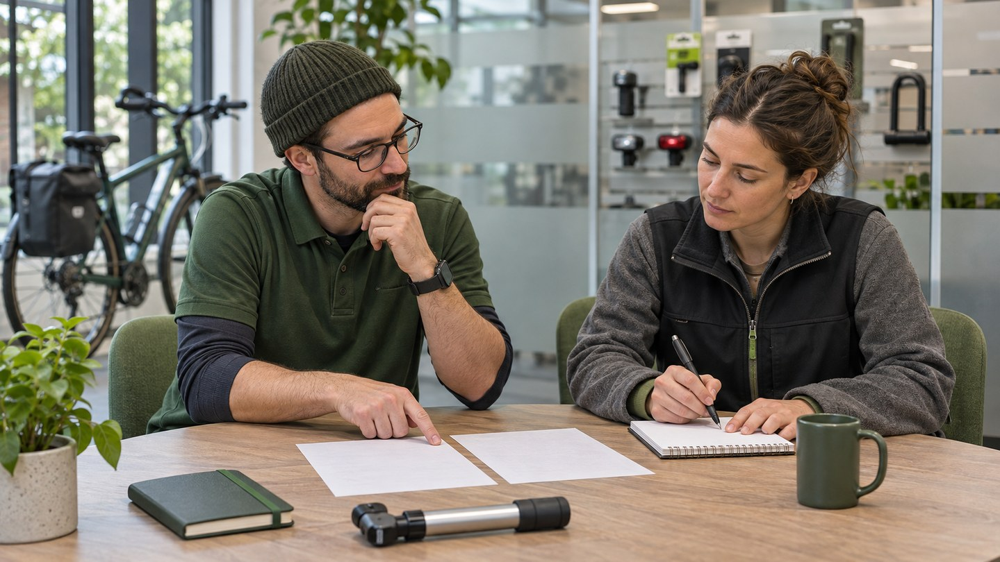

# M1 – Aktionsbericht von Global Bike

<figure>

<figcaption>Das Team vergleicht die Unterlagen zur Aktion.</figcaption>
</figure>

Die Läden waren in der Vergleichswoche und in der Aktionswoche jeweils fünf Tage geöffnet. Das Ziel gilt für jeden Laden: **Mindestens 20 % mehr Stück aus dem <a href="../ls-glossar.html?from=material%2Fm1.html%23begriffsstelle-1#gl-aktionssortiment" id="begriffsstelle-1">Aktionssortiment</a> verkaufen** als in der <a href="../ls-glossar.html?from=material%2Fm1.html%23begriffsstelle-2#gl-vergleichswoche" id="begriffsstelle-2">Vergleichswoche</a>. Beide Male waren alle Artikel aus der Liste lieferbar.

| Merkmal                                                                                                                                                         | 2-Rad Center Block, Aurich                                          | Bike Arena Oltmanns, Leer                                                  |
|-----------------------------------------------------------------------------------------------------------------------------------------------------------------|---------------------------------------------------------------------|----------------------------------------------------------------------------|
| <a href="../ls-glossar.html?from=material%2Fm1.html%23begriffsstelle-3#gl-kernsortiment" id="begriffsstelle-3">Kernsortiment</a>                                | L10 LED-Lichtset, S20 Bügelschloss, T30 Rahmentasche, P50 Minipumpe | L10 LED-Lichtset, S20 Bügelschloss, T30 Rahmentasche, P50 Minipumpe        |
| <a href="../ls-glossar.html?from=material%2Fm1.html%23begriffsstelle-4#gl-lokale-sortimentserg%C3%A4nzung" id="begriffsstelle-4">Lokale Sortimentsergänzung</a> | R40 Sattelüberzug                                                   | F60 Flaschenhalter und B80 Reflektorband                                   |
| <a href="../ls-glossar.html?from=material%2Fm1.html%23begriffsstelle-5#gl-platzierung" id="begriffsstelle-5">Platzierung</a>                                    | Zubehör an Warenträgern, Vorführung am Beratungsplatz               | Zwei Aktionsgondeln zur Selbstbedienung mit Produktkarten                  |
| Werbung                                                                                                                                                         | Newsletter am Montag mit Einladung zur Beratung                     | Eingangsschild ab Freitag mit Hinweis auf das Zubehör für die nächste Tour |

