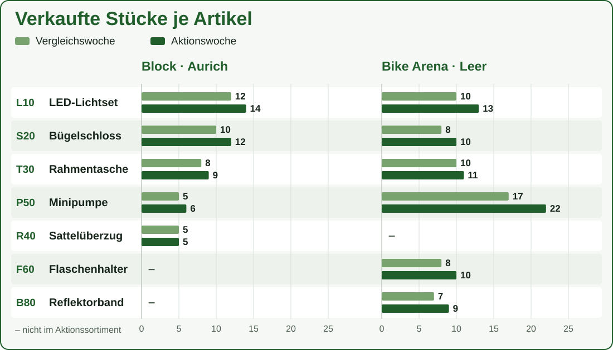

# M2 – Absatzmengen in Stück

<figure>

<figcaption>Jeder Balken zeigt die verkauften Stücke eines Artikels in einer Woche. Ein Strich bedeutet, dass der Laden den Artikel bei der Aktion nicht angeboten hat.</figcaption>
</figure>

Die Tabelle zeigt die <a href="../ls-glossar.html?from=material%2Fm2.html%23begriffsstelle-1#gl-absatzmenge" id="begriffsstelle-1">Absatzmenge</a> pro Artikel und Woche. Ein leeres Feld bedeutet: Der Artikel gehört in diesem Laden nicht zur Aktion.

| Artikel            | Block · Vergleichswoche | Block · Aktionswoche | Bike Arena · Vergleichswoche | Bike Arena · Aktionswoche |
|--------------------|------------------------:|---------------------:|-----------------------------:|--------------------------:|
| L10 LED-Lichtset   |                      12 |                   14 |                           10 |                        13 |
| S20 Bügelschloss   |                      10 |                   12 |                            8 |                        10 |
| T30 Rahmentasche   |                       8 |                    9 |                           10 |                        11 |
| P50 Minipumpe      |                       5 |                    6 |                           17 |                        22 |
| R40 Sattelüberzug  |                       5 |                    5 |                              |                           |
| F60 Flaschenhalter |                         |                      |                            8 |                        10 |
| B80 Reflektorband  |                         |                      |                            7 |                         9 |

